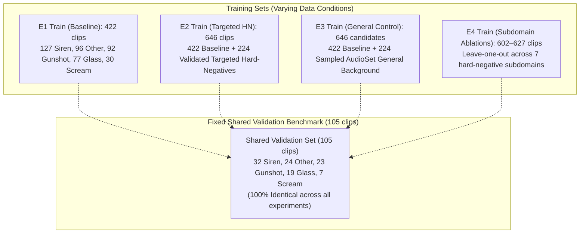

# Experimental Design Revision: Shared Validation Benchmark and E3 Candidate Audit

**Project:** `D:\ml\fydp\MyNet`  
**Date:** October 30, 2026  
**Pipeline Script:** [`src/prepare_experimental_manifests.py`](file:///d:/ml/fydp/MyNet/src/prepare_experimental_manifests.py)  
**Shared Validation Manifest:** [`data/processed/shared_val_split_manifest.csv`](file:///d:/ml/fydp/MyNet/data/processed/shared_val_split_manifest.csv)  
**Archive of Original Manifests (v1):** [`data/processed/archive_experimental_manifests_v1/`](file:///d:/ml/fydp/MyNet/data/processed/archive_experimental_manifests_v1/)  
**Ablation Config:** [`configs/e4_ablation_config.json`](file:///d:/ml/fydp/MyNet/configs/e4_ablation_config.json)  
**Test Suite:** [`tests/test_experimental_manifests.py`](file:///d:/ml/fydp/MyNet/tests/test_experimental_manifests.py)  
**Status:** Validated (88/88 Unit Tests Passing)

---

## 1. Executive Summary & Design Revision Rationale

To prepare rigorous experiments for the research question:

> **"Does model-error-guided hard-negative data selection improve emergency audio classification more effectively than simply increasing the amount of general background audio?"**

The experimental configuration has been refined from an **expanding validation set design** to a **fixed shared validation benchmark design**.

### Why the Initial Design Was Confounded
In the initial configuration, the 224 additional samples were partitioned 80% to train (+178) and 20% to validation (+46). This caused validation set sizes to diverge:
- E1 Validation: 105 samples
- E2 Validation: 151 samples (105 baseline + 46 targeted hard-negatives)
- E3 Validation: 151 candidate samples (105 baseline + 46 general candidates)

Evaluating model checkpoints and training loss against different validation sets introduces **evaluation set variance** as a confounding variable. A model trained on E2 would be evaluated on a harder validation set with 46 additional confusers, while E1 would be evaluated on an easier set. 

### The Corrected Scientific Design
1. **Identical Benchmark**: All models (E1, E2, E3, and all E4 ablations) are validated on the **exact same 105 baseline validation samples** during training.
2. **Expansion to Training Split Only**: All 224 targeted hard negatives in E2 (and all 224 general background candidates in E3) are placed strictly into the training split ($422 + 224 = 646$ training clips).
3. **No Split Contamination**: Zero targeted expansion or E3 samples are placed into validation.
4. **Direct Comparability**: Training loss trajectories, early stopping checkpoints, and validation metrics reflect true learning dynamics against an invariant benchmark.

---

## 2. E3 Candidate Quality and AudioSet Label Audit (Part 2)

A deep audit was conducted on the 224 AudioSet candidate segments sampled for E3.

### 2.1. Audit Summary Checklist
| Audit Criterion | Requirement | Result | Status |
| :--- | :--- | :---: | :---: |
| **Emergency Label Contamination** | 0 AudioSet emergency target MIDs/labels (`scream`, `shatter`, `glass`, `gunshot`, `siren`, `fireworks`, `explosion`, etc.) | 0 occurrences | **PASSED** |
| **Ambiguous Confuser Contamination** | 0 ambiguous confuser MIDs (shouting, wailing, crying, bangs, pops) | 0 occurrences | **PASSED** |
| **Baseline Train Overlap** | Zero common video IDs with baseline training set (527 clips) | 0 overlap | **PASSED** |
| **Evaluation Set Overlap** | Zero common video IDs with `eval_manifest.csv` (744 rows / 519 audio files) | 0 overlap | **PASSED** |
| **Pilot Set Overlap** | Zero common video IDs with pilot audio (15 clips) | 0 overlap | **PASSED** |
| **Targeted Expansion Overlap** | Zero common video IDs with targeted expansion candidates (672 rows / 400 audio files) | 0 overlap | **PASSED** |
| **Candidate ID Uniqueness** | Exactly 224 unique YouTube video IDs | 224 unique IDs | **PASSED** |
| **Subdomain Quota Distribution** | Balanced representation across 6 non-target categories | 37–38 per subdomain | **PASSED** |
| **Sampling Seed Reproducibility** | Deterministic selection using Seed `42` from `balanced_train_segments.csv` | 100% reproducible | **PASSED** |

### 2.2. Subdomain Quota Breakdown
The 224 candidates were sampled to achieve balanced coverage across six everyday acoustic subdomains:

| Subdomain | Target Quota | Selected Candidates | Primary Source AudioSet MID | Primary Matched Label |
| :--- | :---: | :---: | :--- | :--- |
| **`traffic`** | 38 | 38 | `/m/0btp2`, `/m/0k4j`, `/m/07yv9` | Vehicle, Car, Traffic noise |
| **`environmental`** | 38 | 38 | `/m/0838f`, `/m/06mb1`, `/m/03m9d0z` | Water, Rain, Wind |
| **`speech`** | 37 | 37 | `/m/09x0r`, `/m/01h8n0`, `/m/02qldy` | Speech, Conversation, Narration |
| **`music`** | 37 | 37 | `/m/04rlf`, `/m/042v_gx`, `/m/05r5c` | Music, Guitar, Piano |
| **`animals`** | 37 | 37 | `/m/0bt9lr`, `/m/05tny_`, `/m/015p6` | Dog, Bark, Bird, Cat |
| **`household`** | 37 | 37 | `/m/04brg2`, `/m/02dgv`, `/m/02jz0l` | Dishes, Door, Water tap, Cupboard |
| **Total E3 Candidates** | **224** | **224** | — | **188 unique multi-label MIDs** |

### 2.3. Label Distribution and Acoustic Content Disclaimer
> [!CAUTION]
> **AudioSet Weak Labeling Disclaimer:** In AudioSet, metadata labels are weak, video-level annotations often generated from user tags or automated classifiers. An AudioSet metadata label does **not** guarantee acoustic purity, isolation, or the absence of unannotated background artifacts.

To verify label quality, all multi-label co-occurrences across the 224 candidates were audited:
- **Speech (37 clips):** Dominant label is `Speech` (37), with co-occurring tags `Music` (10), `Animal` (4), `Outside, urban` (3), `Inside, small room` (3).
- **Music (37 clips):** Dominant label is `Music` (37), with co-occurring tags `Speech` (12), `Singing` (4), `Sad music` (3), `Boing` (2).
- **Animals (37 clips):** Dominant labels are `Domestic animals, pets` (23), `Animal` (21), `Dog` (15), `Bird` (11), `Speech` (15).
- **Household (37 clips):** Dominant labels are `Cupboard open or close` (10), `Water tap, faucet` (9), `Water` (8), `Dishes` (6), `Speech` (8).
- **Traffic (38 clips):** Dominant labels are `Vehicle` (36), `Car` (18), `Motor vehicle (road)` (6), `Outside, urban` (6), `Speech` (8).
- **Environmental (38 clips):** Dominant labels are `Water` (20), `Rain` (10), `Water tap` (9), `Raindrop` (7), `Thunderstorm` (7).

**Quality Conclusion:** All 224 candidates are completely free of emergency MIDs and confusers. However, once downloaded, human content verification or spectrogram inspection should be applied prior to training to ensure high recording quality, exactly as was done for the targeted expansion dataset.

---

## 3. Experiment Comparison Table (Part 3 & Part 4)

All experiments now share the exact same 105 validation samples:

| Experiment ID | Condition Description | Train Clips | Shared Val Clips | Total Clips | Other (Train) | Emergency (Train) | Audio Status on Disk |
| :--- | :--- | :---: | :---: | :---: | :---: | :---: | :--- |
| **E1** | Original AudioSet Baseline | 422 | 105 | 527 | 96 | 326 | 100% Downloaded & Verified |
| **E2** | Baseline + 224 Targeted Hard-Negatives | 646 | 105 | 751 | 320 | 326 | 100% Downloaded & Verified |
| **E3** | Baseline + 224 General Background Control | 646 | 105 | 751 | 320 | 326 | `PENDING_DOWNLOAD` (Candidates verified) |
| **E4-A1** | E2 minus `human_shouting` | 602 | 105 | 707 | 276 | 326 | 100% Downloaded & Verified |
| **E4-A2** | E2 minus `metal_impacts` | 606 | 105 | 711 | 280 | 326 | 100% Downloaded & Verified |
| **E4-A3** | E2 minus `door_slams` | 613 | 105 | 718 | 287 | 326 | 100% Downloaded & Verified |
| **E4-A4** | E2 minus `construction_tools` | 616 | 105 | 721 | 290 | 326 | 100% Downloaded & Verified |
| **E4-A5** | E2 minus `car_alarms_detectors` | 617 | 105 | 722 | 291 | 326 | 100% Downloaded & Verified |
| **E4-A6** | E2 minus `fireworks_firecrackers` | 618 | 105 | 723 | 292 | 326 | 100% Downloaded & Verified |
| **E4-A7** | E2 minus `whistles_high_pitch` | 627 | 105 | 732 | 301 | 326 | 100% Downloaded & Verified |

### Detailed Training Subdomain Counts for E4 Ablations
In all E4 ablations, the 422 baseline training samples are 100% preserved. The table below details the exact number of targeted hard-negative training samples remaining after category ablation:

| Hard-Negative Subdomain | Full E2 Train Additions | E4-A1 (minus shout) | E4-A2 (minus metal) | E4-A3 (minus doors) | E4-A4 (minus tools) | E4-A5 (minus alarms) | E4-A6 (minus fireworks) | E4-A7 (minus whistles) |
| :--- | :---: | :---: | :---: | :---: | :---: | :---: | :---: | :---: |
| `human_shouting` | 44 | **0** | 44 | 44 | 44 | 44 | 44 | 44 |
| `metal_impacts` | 40 | 40 | **0** | 40 | 40 | 40 | 40 | 40 |
| `door_slams` | 33 | 33 | 33 | **0** | 33 | 33 | 33 | 33 |
| `construction_tools` | 30 | 30 | 30 | 30 | **0** | 30 | 30 | 30 |
| `car_alarms_detectors` | 29 | 29 | 29 | 29 | 29 | **0** | 29 | 29 |
| `fireworks_firecrackers` | 28 | 28 | 28 | 28 | 28 | 28 | **0** | 28 |
| `whistles_high_pitch` | 19 | 19 | 19 | 19 | 19 | 19 | 19 | **0** |
| `other_vocal` (reclassified) | 1 | 1 | 1 | 1 | 1 | 1 | 1 | 1 |
| **Total HN Additions** | **224** | **180** | **184** | **191** | **194** | **195** | **196** | **205** |
| **Baseline Train Clips** | **422** | **422** | **422** | **422** | **422** | **422** | **422** | **422** |
| **Total Training Clips** | **646** | **602** | **606** | **613** | **616** | **617** | **618** | **627** |

---

## 4. Source-Level Data Leakage & Isolation Audit

Every generated manifest was verified through automated integrity checks:

| Isolation Check | Verification Target | Result | Status |
| :--- | :--- | :---: | :---: |
| **E1 Train vs Shared Val** | Zero video ID overlap between 422 train and 105 val | 0 common IDs | **PASSED** |
| **E2 Train vs Shared Val** | Zero video ID overlap between 646 train and 105 val | 0 common IDs | **PASSED** |
| **E3 Train vs Shared Val** | Zero video ID overlap between 646 train cands and 105 val | 0 common IDs | **PASSED** |
| **E4 Train vs Shared Val** | Zero video ID overlap across all 7 ablations | 0 common IDs | **PASSED** |
| **Shared Val vs Evaluation Set** | Zero overlap with `eval_manifest.csv` (744 rows / 519 audio files) | 0 common IDs | **PASSED** |
| **E1 Train vs Evaluation Set** | Zero overlap with evaluation set | 0 common IDs | **PASSED** |
| **E2 Train vs Evaluation Set** | Zero overlap with evaluation set | 0 common IDs | **PASSED** |
| **E3 Train vs Evaluation Set** | Zero overlap with evaluation set | 0 common IDs | **PASSED** |
| **E2 Additions vs Pilot Audio** | Zero overlap with `pilot_manifest.csv` (15 clips) | 0 common IDs | **PASSED** |
| **E3 Additions vs Pilot Audio** | Zero overlap with `pilot_manifest.csv` | 0 common IDs | **PASSED** |
| **NEEDS_SECOND_REVIEW Exclusion** | `ja-Qxq5NAoE` strictly excluded from all training and validation splits | 0 occurrences | **PASSED** |
| **Positive Expansion Exclusion** | 82 screams and 74 glass breaking recordings excluded from E2/E3 | 0 occurrences | **PASSED** |
| **Shared Val Identity** | 100% video ID and row identity across all 10 validation manifest files | Verified identical | **PASSED** |

---

## 5. Deliverables & Artifact Index

1. **Shared Validation Manifest:**
   - [`data/processed/shared_val_split_manifest.csv`](file:///d:/ml/fydp/MyNet/data/processed/shared_val_split_manifest.csv) (105 rows)
2. **Archived Previous Version (v1):**
   - [`data/processed/archive_experimental_manifests_v1/`](file:///d:/ml/fydp/MyNet/data/processed/archive_experimental_manifests_v1/)
   - [`configs/archive_e4_ablation_config_v1.json`](file:///d:/ml/fydp/MyNet/configs/archive_e4_ablation_config_v1.json)
3. **Updated E1 Manifests:**
   - Master: [`data/processed/e1_baseline_manifest.csv`](file:///d:/ml/fydp/MyNet/data/processed/e1_baseline_manifest.csv) (527 rows)
   - Train: [`data/processed/e1_train_split_manifest.csv`](file:///d:/ml/fydp/MyNet/data/processed/e1_train_split_manifest.csv) (422 rows)
   - Val: [`data/processed/e1_val_split_manifest.csv`](file:///d:/ml/fydp/MyNet/data/processed/e1_val_split_manifest.csv) (105 rows, identical to shared val)
4. **Updated E2 Manifests:**
   - Master: [`data/processed/e2_targeted_manifest.csv`](file:///d:/ml/fydp/MyNet/data/processed/e2_targeted_manifest.csv) (751 rows)
   - Train: [`data/processed/e2_train_split_manifest.csv`](file:///d:/ml/fydp/MyNet/data/processed/e2_train_split_manifest.csv) (646 rows)
   - Val: [`data/processed/e2_val_split_manifest.csv`](file:///d:/ml/fydp/MyNet/data/processed/e2_val_split_manifest.csv) (105 rows, identical to shared val)
5. **Updated E3 Candidate Manifests:**
   - Master: [`data/processed/e3_general_candidate_manifest.csv`](file:///d:/ml/fydp/MyNet/data/processed/e3_general_candidate_manifest.csv) (751 rows, status `PENDING_DOWNLOAD`)
   - Train: [`data/processed/e3_general_train_candidates.csv`](file:///d:/ml/fydp/MyNet/data/processed/e3_general_train_candidates.csv) (646 rows)
   - Val: [`data/processed/e3_general_val_candidates.csv`](file:///d:/ml/fydp/MyNet/data/processed/e3_general_val_candidates.csv) (105 rows, identical to shared val)
6. **Updated E4 Ablation Suite:**
   - Manifests Directory: [`data/processed/e4_ablations/`](file:///d:/ml/fydp/MyNet/data/processed/e4_ablations/) (14 manifests: 7 train [602–627 clips] and 7 val [105 clips])
   - Config: [`configs/e4_ablation_config.json`](file:///d:/ml/fydp/MyNet/configs/e4_ablation_config.json)
7. **Summary Metadata:**
   - [`data/processed/experimental_manifests_summary.json`](file:///d:/ml/fydp/MyNet/data/processed/experimental_manifests_summary.json)
8. **Test Suite:**
   - [`tests/test_experimental_manifests.py`](file:///d:/ml/fydp/MyNet/tests/test_experimental_manifests.py) (9 unit tests passing)
   - Full project test suite: **88 passed in 55.71s**.
