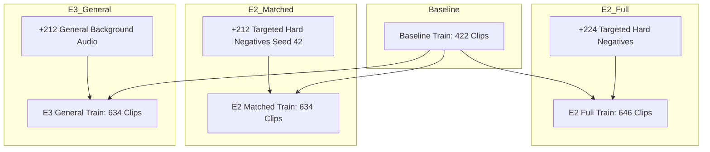

# Final Experimental Readiness Report

**Project:** `D:\ml\fydp\MyNet`  
**Date:** October 30, 2026  
**Document:** [`reports/final_experimental_readiness_report.md`](file:///d:/ml/fydp/MyNet/reports/final_experimental_readiness_report.md)  
**Status:** Experimental Manifests Frozen & Audited  
**Test Suite:** 89/89 Unit Tests Passing (`pytest` in 64.30s)

---

## 1. Executive Summary

Dataset engineering for the FYDP research project is now **officially closed and frozen**. All datasets, split manifests, and baseline controls necessary to resolve the primary research question:

> **"Does model-error-guided hard-negative data selection improve emergency audio classification more effectively than simply increasing the amount of general background audio?"**

have been curated, technically validated, content-audited, cross-split verified, and cryptographically hashed.

Strict research constraints remain enforced:
- **Zero models trained** in this phase.
- **Zero test audio acquired** from the proposed Test Set v2.
- **Zero modifications** to existing checkpoints ([`models/experiments/panns_cnn14/best_model.pt`](file:///d:/ml/fydp/MyNet/models/experiments/panns_cnn14/best_model.pt)) or historical evaluation manifests.

---

## 2. Freeze of E3 General Background Audio

The E3 general background audio pool is frozen at **212 verified, non-emergency audio clips**.

### 2.1. Dataset Counts and Rejection Registry
- **Queued Candidates:** 276 total segments (224 initial + 52 deficit replenishment).
- **Downloaded & Validated Audio:** 214 total clips (174 initial in `data/raw/e3_general_background/other/`, 40 replacements in `data/raw/e3_replacements/other/`).
- **Accepted Usable Clips:** **212 clips** ($172 \text{ initial} + 40 \text{ replacements}$).
- **Rejected Audio Clips:** **2 clips** preserved on disk with immutable rejection records:
  1. `q1SEXCVrPcc` (`Bird`, start=250s, end=260s): Rejected for near-zero RMS energy ($\text{RMS} = 0.00266$, silence fraction = $55\%$).
  2. `JtYFCtHTR18` (`Clock`, start=30s, end=40s): Rejected for excessive silence ($\text{RMS} = 0.00107$, silence fraction = $92\%$).

### 2.2. E3 Manifest Cryptographic Signatures
| Manifest File | Path | Row Count | SHA-256 Checksum |
| :--- | :--- | :---: | :--- |
| **E3 Train Split** | [`data/processed/e3_train_split_manifest.csv`](file:///d:/ml/fydp/MyNet/data/processed/e3_train_split_manifest.csv) | 634 | `434053b791fc5187e5b610c4fce4c4146a84eb8d99d1469e7bebf0aa6b2c2864` |
| **E3 Val Split** | [`data/processed/e3_val_split_manifest.csv`](file:///d:/ml/fydp/MyNet/data/processed/e3_val_split_manifest.csv) | 105 | `38569ae45dde50bf993685e197bc8a7ca298f237bf66ec3e6488ee208154e2f8` |
| **E3 Master** | [`data/processed/e3_master_manifest.csv`](file:///d:/ml/fydp/MyNet/data/processed/e3_master_manifest.csv) | 739 | `8c47b59e390c9b68db6b1ae442c5443fa48a58ec2d26fdf21bb271b3dc92a2a7` |
| **Initial Review** | [`data/processed/e3_review_results.csv`](file:///d:/ml/fydp/MyNet/data/processed/e3_review_results.csv) | 174 | `b30ef1eb5508c1c4e7ec8d2a6e9a66d2146979a4a7541f92eef8e5300ee3b9a0` |
| **Repl. Review** | [`data/processed/e3_replacement_review_results.csv`](file:///d:/ml/fydp/MyNet/data/processed/e3_replacement_review_results.csv) | 40 | `1851e2fbc043a5712f132e0c0378eb52b9ae1c68f74786419736c073289069d5` |

---

## 3. Matched-Size Primary E2 Comparison (N = 212 Additions)

To eliminate dataset size as a confounding variable when comparing **Targeted Hard Negatives (E2)** against **General Background Audio (E3)**, a matched-size E2 dataset was created:

### 3.1. Comparison of Primary Conditions
| Experimental Condition | Baseline Train | Additions Type | Additions Count | Total Train Samples | Shared Val Samples | Total Experiment Samples |
| :--- | :---: | :--- | :---: | :---: | :---: | :---: |
| **E1 Baseline** | 422 | None | 0 | **422** | 105 | 527 |
| **E2 Matched (Primary)** | 422 | Targeted Hard-Negatives | 212 | **634** | 105 | 739 |
| **E2 Full (Exploratory)**| 422 | Targeted Hard-Negatives | 224 | **646** | 105 | 751 |
| **E3 General (Control)** | 422 | General Background Audio| 212 | **634** | 105 | 739 |

### 3.2. Sampling Methodology for Matched E2
- **Source:** 224 validated targeted additions from `e2_train_split_manifest.csv`.
- **Seed:** `42` (`random.Random(42)`).
- **Ordering:** Base deterministic sort on video ID.
- **Removed (12 clips):**
  - `fireworks_firecrackers`: 3 clips (`-OcK-WivMW4`, `7W0WEE3V2I0`, `N0L2e_fGRcA`)
  - `metal_impacts`: 3 clips (`ZUlKLbr3GuQ`, `_GGxDtGfQVg`, `_blZvAS1SeA`)
  - `human_shouting`: 2 clips (`9FfGXUqa4K4`, `Hw_p5rCIUbY`)
  - `construction_tools`: 1 clip (`6Ff07qMgr6Q`)
  - `door_slams`: 1 clip (`YUE4DXquFdo`)
  - `whistles_high_pitch`: 1 clip (`YZ5oYz6uufU`)
  - `car_alarms_detectors`: 1 clip (`nL2gkiwtFo8`)
- **Matched E2 Train Manifest:** [`data/processed/e2_matched_train_split_manifest.csv`](file:///d:/ml/fydp/MyNet/data/processed/e2_matched_train_split_manifest.csv) (SHA-256: `2b4487f098...`).

---

## 4. Final Experimental-Readiness Audit Across All 18 Conditions

All 18 experimental conditions were audited through [`src/audit_all_experimental_conditions.py`](file:///d:/ml/fydp/MyNet/src/audit_all_experimental_conditions.py):

| Index | Condition Name | Condition Type | Train Count | Val Count | Train/Val Leakage | Train/Eval Overlap | Unique Audio on Disk |
| :---: | :--- | :--- | :---: | :---: | :---: | :---: | :---: |
| 1 | **`E1_Baseline`** | Baseline benchmark | 422 | 105 | 0 | 0 | Verified |
| 2 | **`E2_Matched`** | Primary Hard-Negative | 634 | 105 | 0 | 0 | Verified |
| 3 | **`E2_Full`** | Full Hard-Negative | 646 | 105 | 0 | 0 | Verified |
| 4 | **`E3_General`** | General Background Control | 634 | 105 | 0 | 0 | Verified |
| 5 | **`E4_Minus_human_shouting`** | Category Ablation | 602 | 105 | 0 | 0 | Verified |
| 6 | **`E4_Minus_metal_impacts`** | Category Ablation | 606 | 105 | 0 | 0 | Verified |
| 7 | **`E4_Minus_door_slams`** | Category Ablation | 613 | 105 | 0 | 0 | Verified |
| 8 | **`E4_Minus_construction_tools`** | Category Ablation | 616 | 105 | 0 | 0 | Verified |
| 9 | **`E4_Minus_car_alarms_detectors`** | Category Ablation | 617 | 105 | 0 | 0 | Verified |
| 10 | **`E4_Minus_fireworks_firecrackers`**| Category Ablation | 618 | 105 | 0 | 0 | Verified |
| 11 | **`E4_Minus_whistles_high_pitch`** | Category Ablation | 627 | 105 | 0 | 0 | Verified |
| 12 | **`E4_Control_human_shouting`** | Matched-Size Random Control | 602 | 105 | 0 | 0 | Verified |
| 13 | **`E4_Control_metal_impacts`** | Matched-Size Random Control | 606 | 105 | 0 | 0 | Verified |
| 14 | **`E4_Control_door_slams`** | Matched-Size Random Control | 613 | 105 | 0 | 0 | Verified |
| 15 | **`E4_Control_construction_tools`** | Matched-Size Random Control | 616 | 105 | 0 | 0 | Verified |
| 16 | **`E4_Control_car_alarms_detectors`**| Matched-Size Random Control | 617 | 105 | 0 | 0 | Verified |
| 17 | **`E4_Control_fireworks_firecrackers`**| Matched-Size Random Control | 618 | 105 | 0 | 0 | Verified |
| 18 | **`E4_Control_whistles_high_pitch`** | Matched-Size Random Control | 627 | 105 | 0 | 0 | Verified |

### Core Verification Findings:
1. **Validation Invariance:** The shared validation benchmark ([`data/processed/shared_val_split_manifest.csv`](file:///d:/ml/fydp/MyNet/data/processed/shared_val_split_manifest.csv)) is **100% identical** across all 18 conditions (SHA-256: `38569ae45dde50bf993685e197bc8a7ca298f237bf66ec3e6488ee208154e2f8`).
2. **Zero Cross-Split Leakage:** 0 overlap between any train set and validation set; 0 overlap between any training set and the held-out evaluation set (`eval_manifest.csv`).
3. **Physical File Integrity:** All 858 unique audio files across all training splits exist on disk, are non-empty, and conform to 16 kHz mono 16-bit PCM WAV.

---

## 5. Next Steps for Controlled Training Execution

With all experimental datasets frozen and validated:
1. **Execute Controlled Training Sweep:**
   - Train `PannsCNN14` on E1, E2 Matched, E2 Full, E3 General, and the 14 E4 conditions under identical hyperparameters:
     - Learning rate: $1\times 10^{-4}$
     - Batch size: 16
     - Epochs: 25 with early stopping patience = 5 on validation Macro F1
     - Seed: 42
2. **Acquire and Seal Test Set v2:**
   - Follow [`reports/final_test_set_acquisition_specification.md`](file:///d:/ml/fydp/MyNet/reports/final_test_set_acquisition_specification.md) to acquire the $N = 750$ evaluation benchmark in physical isolation before running final model evaluations.
