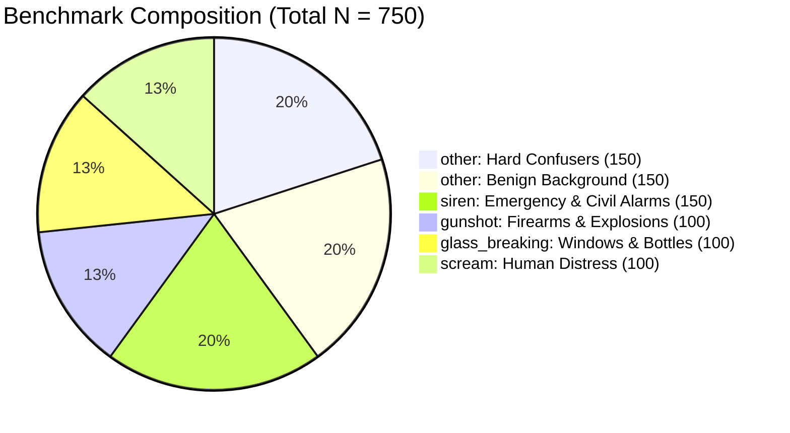
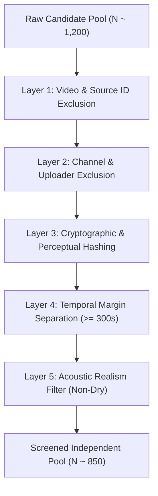

# Final Independent Evaluation Set (Test Set v2) Acquisition Specification

**Project:** `D:\ml\fydp\MyNet`  
**Date:** October 30, 2026  
**Document:** [`reports/final_test_set_acquisition_specification.md`](file:///d:/ml/fydp/MyNet/reports/final_test_set_acquisition_specification.md)  
**Status:** Pre-Acquisition Specification & Statistical Design  
**Constraint:** Pre-acquisition design only — NO files downloaded or acquired yet.

---

## 1. Executive Summary & Purpose

The purpose of this specification is to define the exact protocol for assembling, verifying, and cryptographically sealing an independent, pristine **Final Evaluation Benchmark ($N = 750$)**, designated **Test Set v2**.

### Why Test Set v2 Is Mandatory:
During earlier exploratory research, the existing 519-sample evaluation set ([`data/processed/eval_manifest.csv`](file:///d:/ml/fydp/MyNet/data/processed/eval_manifest.csv)) was directly probed to analyze baseline model error modes (identifying false alarms on shouting, metal impacts, door slams, car alarms, fireworks, and whistles). Because the targeted hard-negative collection (E2) was specifically designed to counteract those exact error modes, re-evaluating on the original 519 samples creates a significant **meta-overfitting risk** (optimistic evaluation bias). 

To satisfy top-tier academic peer review, the primary research claim:
> *"Model-error-guided hard-negative data selection improves emergency audio classification more effectively than general background scaling"*

must be demonstrated on a completely untouched benchmark that has **never been queried or used to inform data curation**.

---

## 2. Five-Class Benchmark Distribution & Justification

### 2.1. Class Allocation
| Class Name | Target Class ID | Target Sample Count ($N$) | Proportion (%) | Primary Acoustic Sub-Types |
| :--- | :---: | :---: | :---: | :--- |
| **`scream`** | 0 | 100 | 13.3% | Female, male, and juvenile distress screams; indoor reverberant, outdoor distant, noise-embedded screams. |
| **`glass_breaking`** | 1 | 100 | 13.3% | Window panes, automotive windshields, bottles, display cases; sudden shatter and cascading impacts. |
| **`gunshot`** | 2 | 100 | 13.3% | Handguns, rifles, shotguns, automatic bursts; close-mic, distant echo, reverberant urban alleys. |
| **`siren`** | 3 | 150 | 20.0% | Police cruisers, ambulances, fire engines, civil defense wails, electronic yelps, doppler pass-bys. |
| **`other` (Benign)** | 4 | 150 | 20.0% | Normal human speech, music, traffic flow, environmental weather (rain/wind), domestic household appliances. |
| **`other` (Confusers)** | 4 | 150 | 20.0% | Shouting/cheering, metal clatter, door slams, power tools, car horns/buzzers, fireworks, whistles. |
| **Total Benchmark** | — | **750** | **100.0%** | **450 Emergency Signals vs. 300 Negative Control Signals** |

### 2.2. Justification for the `other` Class Allocation ($N = 300$)
In operational emergency detection systems, background audio accounts for $>99.9\%$ of operational life. A balanced 1:1:1:1:1 benchmark severely underestimates operational false alarm rates. 

However, evaluating solely against benign audio (rain, speech, music) produces unrealistically low false alarm metrics that fail to expose model weaknesses. Therefore, the 300 `other` samples are divided into two distinct strata:
1. **Strata A: Benign Background ($N = 150$):** Measures the baseline False Alarm Rate under normal acoustic environments.
2. **Strata B: Targeted Acoustic Confusers ($N = 150$):** Measures the specific discrimination capability against known acoustic triggers (shouting, metal bangs, fireworks).

---

## 3. Independent Source Strategy & Preventing Domain Collapse

As demonstrated during our NIGENS investigation, sound-effects libraries fail because their dry, close-mic, un-reverberated acoustic profiles do not generalize to real-world in-the-wild audio.

### Candidate Source Pools:
1. **Pool A: AudioSet Evaluation Split (Held-Out Slices):**
   - Segments drawn exclusively from AudioSet evaluation segments that have **zero overlap** with the training or historical evaluation manifests.
   - Preserves authentic YouTube in-the-wild compression, variable acoustics, and natural ambient noise.
2. **Pool B: FSD50K (Freesound Dataset 50K):**
   - Ground-truth curated open-source clips under CC-BY licenses.
   - Sourced specifically for emergency sound categories with verified acoustic presence.
3. **Pool C: Real-World In-Situ Field Recordings:**
   - Uncut field recordings captured in public urban spaces and concrete corridors.

---

## 4. Multi-Layer Source Isolation & Leakage Prevention Protocol

To guarantee mathematical independence, every candidate segment must clear a strict five-layer isolation filter:

1. **Layer 1: Video ID & Source ID Exclusion:**
   - Absolute exclusion of all 2,167 historical project video IDs (E1 baseline train & val, Eval v1, Pilot, Targeted Expansion E2, E3 general, and E3 replacements).
2. **Layer 2: Uploader & Channel ID Exclusion:**
   - If an AudioSet or YouTube segment was uploaded by a channel that exists anywhere in E1, E2, or E3, the candidate is discarded to prevent channel-specific microphone/production artifacts from leaking.
3. **Layer 3: Cryptographic & Perceptual Hashing:**
   - MD5, SHA-256, and acoustic fingerprinting (chroma hash) to catch audio clips re-uploaded under different YouTube video IDs.
4. **Layer 4: Temporal Separation:**
   - If audio is drawn from a longer video, it must maintain a $\ge 300\text{s}$ buffer from any clip ever seen in the repository.
5. **Layer 5: Studio/Dryness Filter:**
   - Clips with zero reverberation and zero background noise (studio foley) are flagged and excluded to avoid the NIGENS domain mismatch.

---

## 5. Human Content-Review Protocol: Two-Pass Blind Consensus

To ensure gold-standard ground-truth annotations:

1. **Two-Pass Blind Review:**
   - Reviewer 1 and Reviewer 2 audit each 10-second candidate clip independently without seeing metadata labels or model predictions.
2. **Annotation Schema:**
   - **Target Event Audibility:** Clearly audible for $\ge 1.0\text{s}$.
   - **Acoustic Purity:** Zero contamination from unassigned emergency classes.
   - **Quality Check:** No severe clipping, bit-depth quantization distortion, or silence $> 50\%$.
3. **Inter-Annotator Agreement & Arbitration:**
   - Compute Cohen’s Kappa ($\kappa$).
   - Clips with agreement ($\kappa = 1.0$) are admitted.
   - Disagreements ($\kappa < 1.0$) are arbitrated by a third senior reviewer. If consensus is not reached, the clip is rejected.

---

## 6. Sample Sufficiency, Power Analysis & Confidence Intervals

### 6.1. Confidence Interval Expectations
Using the **Wilson score interval with continuity correction** for binomial proportions ($95\%\text{ CI}$, $\alpha = 0.05$):

| Evaluation Metric | Test Population ($N$) | Hypothesized Performance | 95% Wilson Score CI | Margin of Error ($\pm$) |
| :--- | :---: | :---: | :---: | :---: |
| **Overall Emergency Recall** | 450 emergency clips | $92.0\%$ | $[89.1\%, 94.2\%]$ | $\pm 2.5\%$ |
| **False Emergency Rate (Overall)** | 300 other clips | $4.0\%$ | $[2.3\%, 6.9\%]$ | $\pm 2.3\%$ |
| **FER on Hard Confusers** | 150 confuser clips | $6.7\%$ | $[3.7\%, 11.8\%]$ | $\pm 4.0\%$ |
| **FER on Benign Background** | 150 benign clips | $1.3\%$ | $[0.4\%, 4.7\%]$ | $\pm 2.1\%$ |
| **Per-Class Recall (`scream`)** | 100 scream clips | $90.0\%$ | $[82.6\%, 94.5\%]$ | $\pm 5.9\%$ |
| **Per-Class Recall (`glass`)** | 100 glass clips | $91.0\%$ | $[83.8\%, 95.2\%]$ | $\pm 5.7\%$ |

### 6.2. Statistical Comparison Plan (E2 vs. E3 vs. E1)
1. **Paired McNemar’s Test:**
   - Conducted on paired binary predictions ($\text{Emergency}$ vs $\text{Non-Emergency}$) between E2 (Matched) and E3 (General):
     $$\chi^2 = \frac{(|b - c| - 1)^2}{b + c}, \quad \text{where } b, c \text{ are discordant predictions.}$$
   - Significance threshold set at $p < 0.05$.
2. **Bootstrap Confidence Intervals for Metric Differences:**
   - 10,000 bootstrap iterations over Test Set v2 to establish $95\%$ empirical confidence intervals for $\Delta F_1 = F_{1,\text{E2}} - F_{1,\text{E3}}$ and $\Delta \text{FER} = \text{FER}_{\text{E3}} - \text{FER}_{\text{E2}}$.
   - If the $95\%\text{ CI}$ of $\Delta \text{FER}$ strictly excludes 0, the hypothesis is confirmed.

---

## 7. Critical Design Weaknesses & Mitigations

> [!WARNING]
> **Weakness 1: Rare-Class Sample Size Constrained by AudioSet Evaluation Pool**  
> **Detail:** Screaming and glass breaking are relatively scarce in AudioSet's held-out evaluation set. Queuing 160 scream candidates to yield 100 validated clips nears the ceiling of available uncorrupted segments.  
> **Mitigation:** Sourcing will blend AudioSet evaluation segments with FSD50K verified clips to ensure sample diversity without exhausting either source.

> [!WARNING]
> **Weakness 2: Over-Representation of Emergencies vs Open-World Deployment**  
> **Detail:** Even with 300 `other` samples, emergency sounds represent $60\%$ ($450/750$) of the test set, whereas in deployment they represent $<0.01\%$.  
> **Mitigation:** In addition to macro-averaged F1, the primary reported deployment metric will be **False Alarms per 24 Hours (FA/24h)** calculated by standardizing the observed False Emergency Rate against continuous audio stream assumptions.

> [!WARNING]
> **Weakness 3: FSD50K Foley / Sound-Effect Risk**  
> **Detail:** FSD50K contains Foley sound effects recorded in soundproof studios. Evaluating on studio sound effects risks replicating NIGENS domain collapse.  
> **Mitigation:** FSD50K clips must pass an automated SNR and reverberation pre-filter ($\text{SNR} \le 25\text{ dB}$, non-zero ambient floor) before human review.
