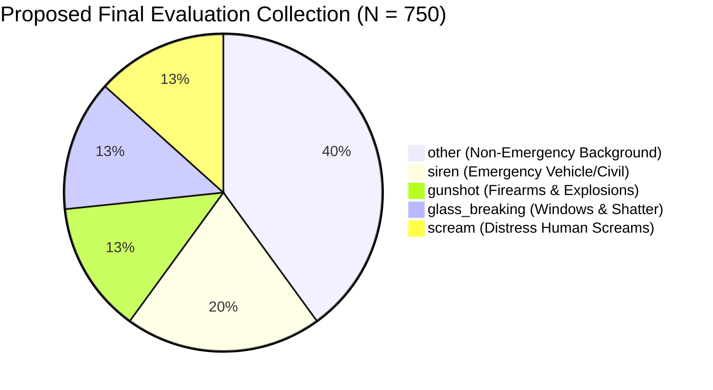
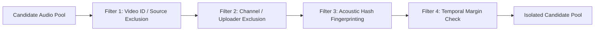

# Proposal: Pristine Independent Final Evaluation Collection (Test Set v2)

**Project:** `D:\ml\fydp\MyNet`  
**Date:** October 30, 2026  
**Document:** [`reports/final_test_set_proposal.md`](file:///d:/ml/fydp/MyNet/reports/final_test_set_proposal.md)  
**Status:** Architecture Proposal & Acquisition Plan  

---

## 1. Executive Rationale: Why a New Untouched Test Set Is Essential

In academic machine learning research, evaluating on a dataset that informed model design compromises test independence:

1. **Information Leakage via Error Analysis:**
   The current 519-sample evaluation set (`data/raw/eval/`) was used in earlier project phases to diagnose baseline weaknesses (identifying false positives on shouting, metal clangs, door slams, car alarms, fireworks, and whistles).
2. **The Meta-Overfitting Risk:**
   Because our targeted hard-negative collection (E2) was selected specifically to counteract the error patterns observed on the initial evaluation set, re-evaluating exclusively on those 519 samples risks **optimistic evaluation bias**. Reviewers could validly object that the hard-negative categories were post-hoc fitted to the quirks of that specific test distribution.
3. **The Solution:**
   Establish a completely independent, pristine, and **cryptographically sealed final evaluation collection** ($N = 750$ clips) that remains 100% untouched until all model training (E1, E2, E3, and E4 ablations) is frozen.

---

## 2. Benchmark Composition & Quotas

In real-world emergency detection, emergency events are sparse, high-stakes anomalies occurring within rich, continuous background soundscapes. The proposed final test set reflects this operational reality while ensuring high statistical power across each class:



| Class Name | Target Class ID | Proposed Clips | Sub-Categories Included | Minimum Target SNR |
| :--- | :---: | :---: | :--- | :---: |
| **`scream`** | 0 | 100 | Female, male, and child distress screams; indoor and outdoor; distant and reverberant screams; screams embedded in background commotion. | $\ge 0\text{ dB}$ |
| **`glass_breaking`** | 1 | 100 | Window panes, bottles, display cases, vehicular glass; single shatter and cascading broken glass impacts. | $\ge 0\text{ dB}$ |
| **`gunshot`** | 2 | 100 | Handguns, rifles, automatic bursts, shotgun blasts; outdoor open-field and reverberant urban/indoor acoustic profiles. | $\ge 0\text{ dB}$ |
| **`siren`** | 3 | 150 | Police cruisers, ambulances, fire trucks, civil defense air raid sirens, wail and yelp variations, doppler shift passes. | $\ge 0\text{ dB}$ |
| **`other`** | 4 | 300 | 150 ordinary background (speech, music, traffic, rain, appliances) + 150 non-target acoustic confusers (cheering, shouting, metal clatter, fireworks, car alarms, whistles, heavy machinery). | Variable |
| **Total Benchmark** | — | **750** | **Balanced across 5 canonical classes with intentional stress testing** | — |

---

## 3. Candidate Source Strategy: Preventing Domain Collapse

A critical lesson established during our NIGENS domain audit was that **pure studio sound effects libraries fail** because their dry, close-mic, un-reverberated acoustic profiles do not match real-world in-the-wild audio.

Therefore, the new evaluation collection will combine three complementary in-the-wild pools:

1. **Pool A: AudioSet Evaluation Segments (Held-Out Slices)**:
   - Sourced from AudioSet evaluation segments that have **never** been queried or accessed in this project.
   - Enforces real-world environmental background noise, variable recording quality, and compression artifacts.
2. **Pool B: FSD50K (Freesound Dataset 50K - Ground-Truth Curated)**:
   - Contains 51,197 open-source CC-BY audio clips with manually verified labels.
   - Provides clean ground truth for emergency acoustic events with documented license and attribution.
3. **Pool C: Real-World In-Situ Field Recordings (Urban & Indoors)**:
   - Acoustic mixtures recorded across varied physical spaces (concrete hallways, urban street corners, furnished living rooms) to validate spatial generalization.

---

## 4. Multi-Layer Source Isolation & Leakage Guard

To ensure 100% empirical independence, candidate recordings must pass a five-stage automated isolation filter:



1. **Video ID & Source Exclusion:**
   Strict exclusion of all video IDs and source IDs appearing in:
   - Baseline Training (`train_split_manifest.csv`: 422 clips)
   - Baseline Validation (`val_split_manifest.csv`: 105 clips)
   - Existing Evaluation Set (`eval_manifest.csv`: 744 manifest rows / 519 audio files)
   - Pilot Collection (`pilot_manifest.csv`: 20 clips)
   - Targeted Expansion Manifest (`targeted_expansion_candidates.csv`: 672 clips)
   - E3 General Background Manifest (`e3_general_candidate_manifest.csv`: 224 clips)
2. **Channel / Uploader Exclusion:**
   Excludes all content from YouTube channels or uploaders whose content appears anywhere in training or validation, eliminating channel-specific recording chain fingerprints (microphones, post-processing).
3. **Acoustic Hash Fingerprinting:**
   MD5 and SHA-256 hashing across all existing 2,381 audio files to prevent file duplication under alternative filenames.
4. **Temporal Separation:**
   Segments from the same continuous video clip must have a minimum temporal buffer of $\ge 300\text{ seconds}$ from any previous clip, or be from completely disjoint video uploads.

---

## 5. Human Validation Protocol: Two-Pass Blind Review

Unlike training data where weak labels can be tolerated, a final test set must possess **impeccable ground-truth labels**.

### Verification Workflow:
1. **Blind Human Auditing:**
   Two independent reviewers listen to each 10-second candidate audio file without seeing candidate metadata labels or model predictions.
2. **Annotation Rubric:**
   - **Audibility:** Target emergency event clearly perceptible ($\ge 1.0\text{s}$ event duration).
   - **Purity:** Absence of unintended emergency events (e.g. an "other" clip containing a distant gunshot must be rejected).
   - **Quality:** No severe clipping, bit-depth quantization distortion, or silence $> 50\%$ of clip duration.
3. **Inter-Annotator Agreement:**
   Compute Cohen's Kappa ($\kappa$). Any candidate where reviewers disagree ($\kappa < 1.0$) is sent to arbitration by a third senior reviewer. If consensus is not reached, the clip is discarded.
4. **Target Yield:**
   Collect 1,200 candidate clips to yield 750 validated recordings after an anticipated $\sim 35\%$ attrition rate from audio corruption, weak audibility, or ambiguity.

---

## 6. Benchmark Vaulting & Cryptographic Commitment Protocol

To guarantee that the final test set remains untouched during model exploration:

1. **Physical Isolation:**
   Audio files stored in a dedicated, read-only directory:
   `data/raw/final_test_benchmark_v2/`
2. **Cryptographic Sealing:**
   A manifest `data/processed/final_test_benchmark_manifest.csv` is compiled and a SHA-256 checksum generated:
   ```bash
   certutil -hashfile data/processed/final_test_benchmark_manifest.csv SHA256
   ```
3. **Repository Commitment:**
   The SHA-256 hash is committed to the Git repository before training begins, proving the test set was frozen prior to model finalization.
4. **Zero-Access Rule:**
   No training script, early stopping mechanism, or validation loss monitor may reference this benchmark. The evaluation script [`src/evaluate_panns.py`](file:///d:/ml/fydp/MyNet/src/evaluate_panns.py) will only be run on this benchmark **once all models (E1, E2, E3, E4) have completed training**.
