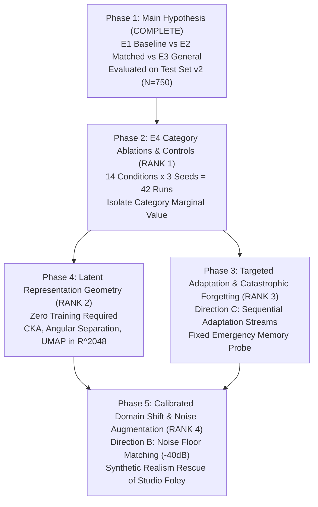
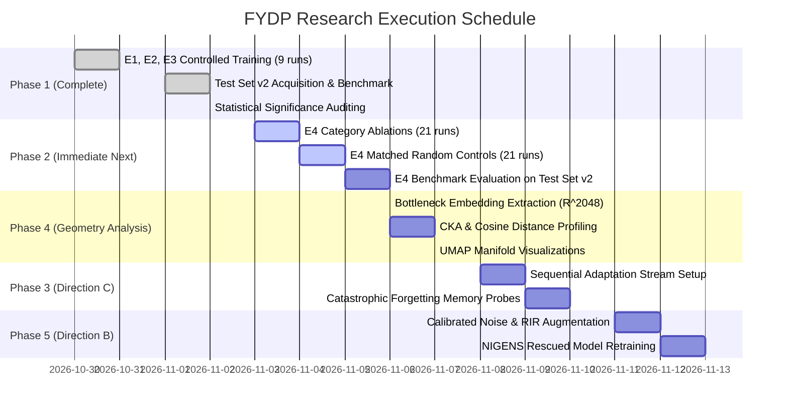

# FYDP Research Execution Roadmap: Prioritized Experimental Phases

**Project:** `D:\ml\fydp\MyNet`  
**Research Framing:** *Data-Centric Analysis of Hard-Negative Learning and Domain Shift in Emergency Audio Classification*  
**Date:** November 2, 2026  
**Document:** [`reports/fydp_research_execution_roadmap.md`](file:///d:/ml/fydp/MyNet/reports/fydp_research_execution_roadmap.md)  
**Status:** Frozen Execution Plan & Experimental Sequence  
**Prerequisites:** Phase 1 Completed & Verified; Test Set v2 Evaluated

---

## 1. Roadmap Architecture & Execution Philosophy

With Phase 1 controlled experiments and Test Set v2 benchmark evaluations completed and independently audited, the foundational hypothesis has been established:
> **Model-error-guided hard negatives significantly outperform general background audio in suppressing false emergency alarms ($p = 0.000316$, McNemar), reducing confuser false alarms by $21.78$ percentage points.**

The remaining research questions transition the project from proving *that* hard negatives work to uncovering *which* categories drive the effect, *how* the latent representations adapt, and *where* the boundaries of acoustic domain transfer lie.

To maintain strict scientific integrity and avoid confounding, subsequent experiments are organized into five sequentially ranked phases:

---

## 2. Prioritized Experimental Phases

### Phase 2 (Rank 1): E4 Category Ablations & Matched Random Controls

- **Scientific Rationale:** Having proven that the aggregate pool of 212 hard negatives outperforms general background audio, the immediate priority is determining **which specific acoustic confuser subcategories drive the benefit**. Does suppressing false scream alarms depend entirely on human shouting? Do door slams uniquely protect gunshot precision? Without category ablations, the hard-negative pool remains a black box.
- **Priority Rank:** **1 (Highest)**. Directly addresses RQ-1 and completes the core empirical narrative for publication.
- **Statistical Prerequisites:**
  - All 14 split manifests must be verified and frozen with 0 cross-split leakage (Completed in `data/processed/e4_ablations/`).
  - Shared validation set ($N = 105$) must be invariant across all runs (Completed, SHA-256 verified).
  - Multi-seed execution: 3 seeds (**42**, **123**, **2026**) required per condition to match Phase 1 rigor ($14 \times 3 = 42$ runs).
  - Evaluation executed exclusively against the frozen Test Set v2 benchmark ($N = 750$).
- **Experimental Conditions:**
  1. `E4_Minus_human_shouting` ($N = 602$ train) vs. `E4_Control_human_shouting` ($N = 602$ train)
  2. `E4_Minus_metal_impacts` ($N = 606$ train) vs. `E4_Control_metal_impacts` ($N = 606$ train)
  3. `E4_Minus_door_slams` ($N = 613$ train) vs. `E4_Control_door_slams` ($N = 613$ train)
  4. `E4_Minus_construction_tools` ($N = 616$ train) vs. `E4_Control_construction_tools` ($N = 616$ train)
  5. `E4_Minus_car_alarms_detectors` ($N = 617$ train) vs. `E4_Control_car_alarms_detectors` ($N = 617$ train)
  6. `E4_Minus_fireworks_firecrackers` ($N = 618$ train) vs. `E4_Control_fireworks_firecrackers` ($N = 618$ train)
  7. `E4_Minus_whistles_high_pitch` ($N = 627$ train) vs. `E4_Control_whistles_high_pitch` ($N = 627$ train)
- **Target Metrics & Acceptance Criteria:**
  - Delta false emergency rate ($\Delta \text{FER}$) on the specific ablated subdomain in Test Set v2.
  - Category importance confirmed if $\text{FER}_{\text{Ablation}} - \text{FER}_{\text{Matched Control}} > 0$ with $p < 0.05$ (paired Wilcoxon / McNemar).
- **Technical Dependencies:**
  - Frozen PANNs CNN14 architecture with standard hyperparameters ($lr = 10^{-3}$, batch size 16, weight decay $10^{-4}$).
  - `src/train.py` automated multi-run launcher script.
- **Risk Factors & Mitigation:**
  - *Risk:* 42 runs take significant compute time ($\sim 3-4$ hours total on GPU). *Mitigation:* Early stopping (patience 7) terminates unpromising runs around epoch 10-15.

---

### Phase 4 (Rank 2): Latent Representation Geometry & Manifold Restructuring

- **Scientific Rationale:** To explain *mechanistically* how hard-negative learning alters model behavior, we must examine the internal geometry of the penultimate feature layer ($\mathbb{R}^{2048}$). Does hard-negative fine-tuning deform the global representation manifold, or does it merely reorient the linear decision hyperplane?
- **Priority Rank:** **2 (High)**. Requires **zero model retraining** and leverages existing checkpoints, providing immense scientific insight with minimal computational risk.
- **Statistical Prerequisites:**
  - Utilizes existing frozen checkpoints: E1 Baseline, E2 Matched, and E3 General across seeds 42, 123, 2026.
  - Zero modifications to weights.
- **Experimental Procedure:**
  1. Pass all 750 Test Set v2 samples through each model and extract the 2048-dimensional bottleneck embeddings prior to the final linear layer.
  2. Compute **Centered Kernel Alignment (CKA)** across models to quantify global representation similarity.
  3. Compute pairwise **cosine distance matrices** between emergency classes and confuser sub-clusters.
  4. Perform **UMAP (Uniform Manifold Approximation and Projection)** to visualize the angular separation between screams vs. shouting, gunshots vs. fireworks/door slams, and sirens vs. whistles/car alarms.
- **Target Metrics & Acceptance Criteria:**
  - Inter-cluster cosine distance between emergency and confuser classes: Expected $\mathbf{D_{\cos}(\text{emergency}, \text{confuser})}_{\text{E2}} > \mathbf{D_{\cos}(\text{emergency}, \text{confuser})}_{\text{E3}}$.
  - UMAP visualization demonstrating clear margin expansion between confusers and true emergencies in E2 compared to E1 and E3.
- **Technical Dependencies:**
  - Script: `src/analyze_representation_geometry.py` (needs to be created).
  - Dependencies: `umap-learn`, `scikit-learn`, `scipy`.
- **Risk Factors & Mitigation:**
  - *Risk:* UMAP projections can introduce 2D embedding artifacts. *Mitigation:* Always report high-dimensional quantitative cosine distances alongside low-dimensional plots.

---

### Phase 3 (Rank 3): Direction C Sequential Targeted Adaptation & Catastrophic Forgetting

- **Scientific Rationale:** In deployed systems, new acoustic confusers appear sequentially over time (e.g., a newly installed ventilation fan or seasonal fireworks). If an emergency classifier is updated on newly encountered hard negatives, does it suffer from **catastrophic forgetting** of previously learned emergency signatures or benign sounds?
- **Priority Rank:** **3 (Medium)**. Completes Faculty Direction C and investigates continual learning dynamics.
- **Statistical Prerequisites:**
  - Established Phase 1 and Phase 2 baselines.
  - Creation of a fixed **Emergency Memory Probe Set** ($N = 100$: 25 scream, 25 glass, 25 gunshot, 25 siren) sampled from shared validation and training splits to track recall retention at every adaptation step.
- **Experimental Procedure:**
  1. Start from E1 Baseline model checkpoint.
  2. Stream hard-negative confuser categories sequentially in 7 adaptation steps (shouting $\rightarrow$ metal $\rightarrow$ door slams $\rightarrow$ tools $\rightarrow$ alarms $\rightarrow$ fireworks $\rightarrow$ whistles).
  3. At each step, update the transfer head for 3 epochs with small learning rate ($10^{-4}$).
  4. Measure performance on: (a) newly adapted confuser, (b) previously adapted confusers, (c) fixed Emergency Memory Probe, (d) benign background audio.
  5. Compare vanilla gradient descent against replay buffer (retaining 10% past samples) and Elastic Weight Consolidation (EWC).
- **Target Metrics & Acceptance Criteria:**
  - Backward Transfer (BWT) and Forgetting Ratio ($F$).
  - Catastrophic forgetting confirmed if Emergency Probe Recall drops by $>5\%$ following adaptation on confusers.
- **Technical Dependencies:**
  - Continual adaptation script with checkpointing at each adaptation step.
- **Risk Factors & Mitigation:**
  - *Risk:* Overfitting to tiny confuser batches. *Mitigation:* Regularize with weight decay ($10^{-3}$) and freeze backbone completely.

---

### Phase 4 (Rank 4): Direction B Calibrated Domain Shift & Synthetic Noise Augmentation

- **Scientific Rationale:** EXP-006 and EXP-007 demonstrated that pristine studio audio from NIGENS degrades in-the-wild classification by $+58.5\%$ due to an ambient noise floor mismatch ($-55\text{ dB}$ vs $-40\text{ dB}$) and excessive silence. Can this domain gap be bridged through **calibrated synthetic acoustic augmentation**?
- **Priority Rank:** **4 (Exploratory / Remediation)**. Completes Faculty Direction B by providing a constructive solution to the diagnostic established in EXP-007.
- **Statistical Prerequisites:**
  - Established DSP profiles from [`models/experiments/model_comparison/acoustic_features_extracted.csv`](file:///d:/ml/fydp/MyNet/models/experiments/model_comparison/acoustic_features_extracted.csv).
  - NIGENS raw audio files in `data/raw/nigens/`.
- **Experimental Procedure:**
  1. Apply **Acoustic Noise Floor Matching**: Inject pink/ambient noise into NIGENS clips to raise their noise floor from $-55\text{ dB}$ to $-40\text{ dB}$ SNR, matching the empirical AudioSet distribution.
  2. Apply **Synthetic Room Impulse Response (RIR)** convolution to simulate typical indoor/outdoor reverberation.
  3. Remove silence padding: Truncate leading/trailing silence frames where RMS energy $< -45\text{ dB}$.
  4. Retrain PANNs CNN14 on Calibrated AudioSet + Augmented NIGENS.
  5. Evaluate on Eval Set v1 ($N = 519$) and Test Set v2 ($N = 750$).
- **Target Metrics & Acceptance Criteria:**
  - Elimination of the 17 false glass alarms caused by NIGENS in EXP-006.
  - Overall accuracy recovery on Eval Set v1: Target $\ge 84.78\%$ (matching or exceeding baseline).
- **Technical Dependencies:**
  - Audio transformation pipeline using `torchaudio.transforms` or `scipy.signal`.
- **Risk Factors & Mitigation:**
  - *Risk:* Synthetic noise might sound unnatural to deep convolutional kernels. *Mitigation:* Use real recorded background noise from AudioSet benign clips instead of pure synthetic Gaussian noise.

---

## 3. Dependency and Execution Gantt Structure

---

## 4. Phase Verification Checkpoints & Quality Gates

To prevent any deviation from research standards, each phase must pass a mandatory **Quality Gate** before subsequent experiments can begin:

1. **Gate 1 (Pre-Training Integrity):** Manifest SHA-256 matches frozen registry; 0 train/validation overlap; 0 train/Test-Set-v2 overlap.
2. **Gate 2 (Training Equivalence):** Identical architecture, initialization checkpoint, learning rate ($10^{-3}$), optimizer parameters, batch size (16), and early stopping patience (7).
3. **Gate 3 (Evaluation Isolation):** Zero threshold tuning or hyperparameter searching against Test Set v2; inference executed using frozen model checkpoints.
4. **Gate 4 (Statistical Rigor):** Every metric difference must report 95% confidence intervals (Wilson score for binomial, bootstrap percentile for continuous) and exact paired significance tests (McNemar or Wilcoxon).
