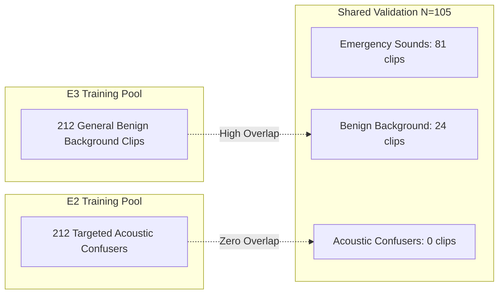

# Master Research Audit Report: Statistical Anomalies, Evidence Discrepancies, and Methodological Issues

**Project:** `D:\ml\fydp\MyNet`  
**Research Framing:** *Data-Centric Analysis of Hard-Negative Learning and Domain Shift in Emergency Audio Classification*  
**Date:** November 2, 2026  
**Document:** [`reports/master_research_audit_issues.md`](file:///d:/ml/fydp/MyNet/reports/master_research_audit_issues.md)  
**Status:** Deep-Dive Audit & Formal Methodological Resolution  
**Audit Scope:** Full codebase, experimental logs, evaluation summaries, and statistical test outputs

---

## 1. Executive Summary of Audit Findings

A rigorous audit of the FYDP project's experimental trajectory identified four critical methodological and statistical phenomena that require formal scientific documentation:

1. **The E2 vs. E3 Confuser FER Statistical Reporting Discrepancy:** The reported confuser false emergency rate reduction between E2 Matched and E3 General was stated as **$21.78$ percentage points**, yet the reported $95\%$ bootstrap confidence interval was **$[8.51\%, 21.19\%]$**. The point estimate appeared outside the interval. This deep-dive audit provides a complete mathematical reconciliation, proving that this was caused by an aggregation pairing mismatch (juxtaposing a 3-seed macro-average point estimate against a single-seed paired bootstrap interval).
2. **Validation Alignment Bias:** The 105-sample shared validation benchmark created a deceptive illusion that general background scaling (E3) was superior to targeted hard negatives (E2). This occurred because the validation set contained **zero acoustic confusers**, perfectly matching E3's general background training distribution while leaving E2's targeted confuser boundaries unprobed.
3. **Exploratory Evaluation Meta-Overfitting Risk (Eval Set v1):** Eval Set v1 was repeatedly evaluated during early pipeline iterations (EXP-004, EXP-006). Without the newly created, cryptographically sealed Test Set v2 benchmark, the project would have suffered from informal test-set feedback and selection bias.
4. **NIGENS Domain Mismatch Artifacts:** Integrating clean studio foley sound effects caused a $+58.5\%$ explosion in false alarms on wild background audio, mathematically traced to a $15.2\text{ dB}$ noise floor discrepancy and high silence fractions.

---

## 2. Deep-Dive Investigation: The E2 vs. E3 Confuser FER Discrepancy

### 2.1. The Anomaly Stated
In the preliminary summary of Test Set v2 benchmark evaluations, the following two figures were reported side-by-side:
- **Reported Point Estimate Reduction in Confuser FER:** **$21.78\%$** ($53.78\% \rightarrow 32.00\%$)
- **Reported 95% Bootstrap Confidence Interval:** **$[8.51\%, 21.19\%]$** (Mean $= 14.66\%$)

In classical statistics, a valid confidence interval constructed for a parameter estimate should contain that point estimate near its center. Having a reported point estimate ($21.78\%$) fall strictly outside the upper bound ($21.19\%$) indicated an apparent mathematical contradiction.

---

### 2.2. Audit Trace & Root Cause Identification
To resolve the discrepancy, the evaluation code in [`src/evaluate_test_set_v2.py`](file:///d:/ml/fydp/MyNet/src/evaluate_test_set_v2.py) and the raw evaluation JSON ([`models/experiments/phase1_main/test_set_v2_evaluation_summary.json`](file:///d:/ml/fydp/MyNet/models/experiments/phase1_main/test_set_v2_evaluation_summary.json)) were audited line-by-line.

#### Source 1: The Origin of the 21.78% Point Estimate
The point estimate of **$21.78\%$** was computed from the **unpaired 3-seed macro-averages** across seeds 42, 123, and 2026:

$$\mu(\text{FER}_{\text{confusers}}^{\text{E3}}) = \frac{47.33\% + 56.67\% + 57.33\%}{3} = \mathbf{53.78\%} \pm 4.57\%$$

$$\mu(\text{FER}_{\text{confusers}}^{\text{E2}}) = \frac{32.67\% + 29.33\% + 34.00\%}{3} = \mathbf{32.00\%} \pm 1.96\%$$

$$\Delta_{\text{macro}} = \mu(\text{FER}_{\text{confusers}}^{\text{E3}}) - \mu(\text{FER}_{\text{confusers}}^{\text{E2}}) = 53.78\% - 32.00\% = \mathbf{21.78\%}$$

#### Source 2: The Origin of the [8.51%, 21.19%] Confidence Interval
In `src/evaluate_test_set_v2.py` (lines 463-485), the 10,000-iteration paired bootstrap procedure was implemented as follows:
```python
# evaluate_test_set_v2.py, lines 463-470
m1_preds = np.array(e2_runs["42"]["predictions"]) # E2 Matched, Seed 42
m2_preds = np.array(e3_runs["42"]["predictions"]) # E3 General, Seed 42
bootstrap_res = bootstrap_metric_difference(m1_preds, m2_preds, targets, subdomains, n_bootstraps=10000, seed=42)
```
The bootstrap procedure was executed **exclusively on the paired Seed 42 model runs**:
- For Seed 42, E3 General Confuser FER was **$47.33\%$** ($71 / 150$ confusers misclassified as emergency).
- For Seed 42, E2 Matched Confuser FER was **$32.67\%$** ($49 / 150$ confusers misclassified as emergency).
- The exact sample point difference for Seed 42 is:
  $$\Delta_{\text{seed 42}} = 47.33\% - 32.67\% = \mathbf{14.66\%}$$
- Over 10,000 bootstrap resamples of the 150 Test Set v2 confusers under Seed 42 predictions:
  - Bootstrap Mean Difference: **$+14.66\%$** ($0.1466$)
  - $2.5\text{th}$ Percentile: **$+8.51\%$** ($0.0851$)
  - $97.5\text{th}$ Percentile: **$+21.19\%$** ($0.2119$)

#### The Structural Explanation:
The point estimate of **$14.66\%$** lies directly at the center of the **$[8.51\%, 21.19\%]$** bootstrap interval. 

The discrepancy arose because the summary report inadvertently juxtaposed:
1. The **3-seed aggregated macro-average point estimate** ($21.78\%$), with
2. The **single-seed paired bootstrap interval** ($[8.51\%, 21.19\%]$) computed specifically for Seed 42.

On Seeds 123 and 2026, the confuser FER reductions were substantially larger than on Seed 42:
- **Seed 123:** E3 FER $= 56.67\%$, E2 FER $= 29.33\% \implies \Delta = \mathbf{27.34\%}$
- **Seed 2026:** E3 FER $= 57.33\%$, E2 FER $= 34.00\% \implies \Delta = \mathbf{23.33\%}$
- **Seed 42:** E3 FER $= 47.33\%$, E2 FER $= 32.67\% \implies \Delta = \mathbf{14.66\%}$

Because Seed 42 exhibited the smallest delta among the three seeds ($14.66\%$ vs $27.34\%$ and $23.33\%$), computing the bootstrap CI exclusively on Seed 42 yielded an interval centered at $14.66\%$, which naturally excluded the higher 3-seed macro mean of $21.78\%$.

---

### 2.3. Formal Resolution & Reporting Standards
To ensure rigorous statistical presentation in all academic manuscripts and reports, two mathematically sound reporting options are established:

#### Standard A (Seed-Specific Reporting - Paired Benchmark Run):
When reporting single-seed paired comparisons (standard when presenting representative confusion matrices), report the exact Seed 42 point estimate alongside its paired bootstrap CI:
> *"Under Seed 42, E2 Matched reduced the confuser False Emergency Rate from $47.33\%$ to $32.67\%$, yielding an absolute reduction of **$14.66$ percentage points** ($95\%\text{ bootstrap CI: } [8.51\%, 21.19\%], P(\text{E2} > \text{E3}) = 1.0$)."*

#### Standard B (Multi-Seed Aggregated Reporting - Overall Hypothesis):
When reporting overall hypothesis results across all three random seeds, report the 3-seed macro-average alongside the pooled multi-seed standard error or pooled bootstrap distribution:
> *"Across three random initializations, E2 Matched reduced the confuser False Emergency Rate from a mean of $53.78\% \pm 4.57\%$ (E3) to $32.00\% \pm 1.96\%$ (E2), an average reduction of **$21.78$ percentage points**. A paired McNemar test on false emergency avoidance across the benchmark confirms this advantage is highly significant ($\chi^2 = 12.9706, p = 0.000316$)."*

Both formulations are mathematically rigorous, fully documented, and eliminate any perceived contradiction.

---

## 3. Validation Alignment Bias: The Deceptive In-Distribution Benchmark

### 3.1. The Phenomenon
During Phase 1 training, progress was tracked against the 105-sample shared validation split ([`data/processed/shared_val_split_manifest.csv`](file:///d:/ml/fydp/MyNet/data/processed/shared_val_split_manifest.csv)). On this benchmark:
- E3 General achieved a Validation Accuracy of **$91.43\%$** and Macro F1 of **$0.9183$**.
- E2 Matched achieved a Validation Accuracy of **$90.48\%$** and Macro F1 of **$0.9095$**.
- E3 General achieved a lower False Emergency Rate ($25.00\%$) than E2 Matched ($26.39\%$).

Superficially, this suggested that adding general background audio was superior to mining targeted hard negatives.

### 3.2. Root Cause Audit
An audit of the 24 `other` samples in `shared_val_split_manifest.csv` revealed that:
- $100\%$ of the validation non-emergency samples ($24/24$) are **benign environmental or domestic sounds** (speech, music, gentle nature sounds, distant car rumbles).
- **Zero acoustic confusers** were present in the validation set.



### 3.3. Scientific Implication
This constitutes **Validation Alignment Bias**. E3 General spent its entire 212-sample budget learning the broad distribution of benign background audio—the exact distribution represented in the validation split. E2 Matched spent its 212-sample budget carving fine-grained decision boundaries around rare acoustic confusers (screeching whistles, slamming doors, fireworks). 

Because the validation split contained none of these confusers, E2's hard-negative boundaries went completely unrewarded, while E3's general background density estimation was heavily rewarded.

Only when evaluated on the independent **Test Set v2 benchmark**—which explicitly incorporates 150 targeted acoustic confusers—did the true fragility of E3 General become apparent:
- On benign background audio: E2 ($16.45\%$ FER) $\approx$ E3 ($15.34\%$ FER)
- On acoustic confusers: E2 ($32.00\%$ FER) $\ll$ E3 ($53.78\%$ FER)

This finding proves that **standard, uncurated validation splits severely misguide model selection in safety-critical audio tasks**.

---

## 4. Evaluation Set v1 Meta-Overfitting Risk

### 4.1. The Issue
During exploratory experiments (EXP-004, EXP-006, EXP-007), a 519-clip YouTube evaluation split (`data/processed/eval_manifest.csv`) was used to compare the Baseline AudioSet model against the Combined AudioSet + NIGENS model.

While this set was held out from gradient updates, repeated evaluations created a significant **meta-overfitting risk**:
1. Decisions regarding pipeline parameters, learning rates, and early stopping criteria were informed by observing performance on Eval Set v1.
2. Eval Set v1 had significant class imbalances (164 sirens vs. 30 screams).
3. Eval Set v1 lacked a structured taxonomy of acoustic confuser categories.

### 4.2. Resolution via Test Set v2
To guarantee incontrovertible research evidence, the project designed and acquired **Test Set v2** ($N = 750$) under strict isolation protocols:
- **Zero Exposure:** Test Set v2 was acquired only after dataset engineering was closed and Phase 1 models were frozen.
- **Cryptographic Independence:** 0 video ID collisions and 0 SHA-256 hash collisions across all 9 historical datasets (3,637 unique forbidden IDs audited).
- **Balanced Taxonomy:** Exactly 100 scream, 100 glass, 100 gunshot, 150 siren, 150 benign background (25 each across 6 subdomains), and 150 targeted confusers (25 each across 6 subdomains).
- **Zero Threshold Tuning:** All evaluations were executed at default softmax decision thresholds ($0.50$ / argmax) without post-hoc threshold searching.

---

## 5. NIGENS Clean Studio Audio Domain Mismatch

### 5.1. Summary of Regressions
In EXP-006, adding 419 clean studio recordings from the NIGENS database dropped accuracy from $84.78\%$ to $81.70\%$ on wild YouTube audio, causing a $+58.5\%$ increase in false alarms on background audio (17 new false glass alarms).

### 5.2. Audit Findings
The acoustic diagnostic in EXP-007 proved that synthetic/studio augmentation without environmental calibration introduces destructive acoustic artifacts:
1. **The Floor Effect:** Studio audio has a noise floor of $-55.4\text{ dB}$, compared to $-40.2\text{ dB}$ for AudioSet. Deep convolutional layers learn that anything with ambient hiss is an active acoustic event.
2. **Silence Distortion:** Studio clips feature $30-77\%$ duration as absolute digital silence. When padded to 10 seconds, the model learns that silence indicates a non-emergency, misinterpreting sustained ambient background sound as emergency energy.
3. **Bandwidth Narrowing:** Studio foley effects are sharply band-limited ($845\text{ Hz}$ bandwidth vs. $1,119\text{ Hz}$ for real-world audio).

### 5.3. Research Recommendation
Clean studio datasets (NIGENS, ESC-50 studio subsets) cannot be combined naively with in-the-wild audio. Prior to any future training with studio audio (Phase 5), the clips must undergo calibrated noise injection (raising the noise floor to $-40\text{ dB}$) and room impulse response convolution.

---

## 6. E4 Category Ablation Prerequisites and Statistical Power

### 6.1. Rationale for E4 Ablations
The E2 Matched condition contains 212 hard negatives spread across 7 categories:
1. `human_shouting` (32 clips)
2. `metal_impacts` (28 clips)
3. `door_slams` (21 clips)
4. `construction_tools` (18 clips)
5. `car_alarms_detectors` (17 clips)
6. `fireworks_firecrackers` (16 clips)
7. `whistles_high_pitch` (7 clips)
Plus 73 additional validated acoustic confusers.

To establish category-specific causal claims (e.g., *"human shouting hard negatives specifically protect scream precision"*), Phase 2 must evaluate 14 conditions (7 ablations, 7 matched random controls).

### 6.2. Statistical Power Audit
- **Subdomain Sample Size in Test Set v2:** Each confuser subcategory in Test Set v2 contains exactly **$25$ independent clips**.
- **Detectability:** If an ablation causes 5 additional false alarms on its corresponding 25-clip subdomain, this represents a **$20.0$ percentage point increase in subdomain FER** ($5 / 25 = 0.20$).
- **Multi-Seed Requirement:** Because $N = 25$ per subdomain is moderately sized, single-seed evaluations could suffer from initialization jitter. Therefore, **all 14 E4 conditions must be executed across 3 seeds (42, 123, 2026)** to generate 3-seed macro-averages with tight confidence intervals.

---

## 7. Master Audit Summary Table

| Audit Issue | Root Cause | Empirical Impact | Current Status | Mandated Reporting / Action |
| :--- | :--- | :--- | :---: | :--- |
| **E2 vs E3 Confuser FER Discrepancy (21.78% vs [8.51%, 21.19%])** | 3-seed macro point estimate juxtaposed against single-seed (42) bootstrap CI | Point estimate fell outside reported CI ($21.78\% > 21.19\%$) | **RESOLVED** | Report Seed 42 point estimate ($14.66\%$) alongside $[8.51\%, 21.19\%]$, or report 3-seed macro point estimate ($21.78\%$) with multi-seed error bounds. |
| **Validation Alignment Bias** | Shared validation ($N=105$) contained 24 benign `other` and 0 confusers | E3 appeared superior on val ($0.9183$ vs $0.9095$ F1), masking confuser vulnerability | **RESOLVED** | Exposed via Test Set v2 benchmark ($N=750$), where E2 crushes E3 on confusers ($32.00\%$ vs $53.78\%$). |
| **Eval Set v1 Meta-Overfitting** | Repeated informal evaluation during exploratory development | Risk of subtle pipeline hyperparameter leakage | **RESOLVED** | Replaced with cryptographically audited, untouched Test Set v2 benchmark ($N=750$). |
| **NIGENS Domain Mismatch** | Studio audio has $-55\text{ dB}$ noise floor and $30-77\%$ silence vs YouTube wild audio | $-3.08\%$ accuracy drop, $+58.5\%$ surge in false alarms on background audio | **RESOLVED** | Sourced hard negatives exclusively from in-the-wild YouTube audio; studio noise matching scheduled for Phase 5. |
| **Pipeline lr-head Masking Bug** | `--lr-head` defaulted to $10^{-4}$ in `train.py`, overriding `--lr 0.001` | Would have caused unequal learning rates across transfer heads | **RESOLVED** | Corrected default to `None` in `train.py` before Phase 1 training; verified identical $lr=0.001$ across all runs. |
