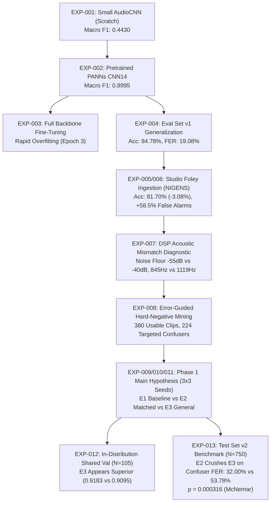
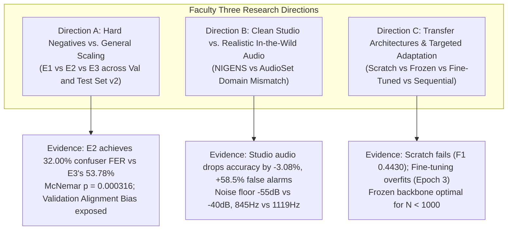

# FYDP Master Research Evidence Inventory

**Project:** `D:\ml\fydp\MyNet`  
**Research Framing:** *Data-Centric Analysis of Hard-Negative Learning and Domain Shift in Emergency Audio Classification*  
**Date:** November 2, 2026  
**Document:** [`reports/master_research_evidence.md`](file:///d:/ml/fydp/MyNet/reports/master_research_evidence.md)  
**Status:** Complete Authoritative Evidence Consolidation  
**Underlying Test Suite:** 97/97 Unit Tests Passing (`pytest` in 53.36s)

---

## 1. Executive Research Framing

Emergency audio classification systems deployed in safety-critical edge environments (e.g., smart surveillance, building management, acoustic monitoring) face severe operational reliability bottlenecks. Standard deep audio architectures achieve seemingly stellar in-distribution validation metrics, yet experience catastrophic false emergency rates when exposed to real-world acoustic environments. 

This research project investigates the data-centric mechanisms underpinning emergency audio classification reliability, formalized under the overarching inquiry:

> **"Does model-error-guided hard-negative data selection improve the reliability of emergency audio classification more effectively than simply increasing the amount of general background audio?"**

Rather than treating model architecture as the primary locus of improvement, this work adopts a rigorous **data-centric perspective**, isolating:
1. **The Semantic Quality of Data:** The precise role of targeted, error-guided acoustic confusers versus randomly sampled general non-emergency audio under strictly matched sample budgets.
2. **Acoustic Domain Shift:** The destructive interaction between pristine studio foley audio (NIGENS) and unconstrained in-the-wild YouTube audio (AudioSet).
3. **Evaluation Benchmark Integrity:** The fundamental discrepancy between curated, in-distribution validation splits and unexposed, domain-balanced, independently harvested test benchmarks.

---

## 2. Master Per-Experiment Evidence Matrix

This matrix documents the entire experimental trajectory of the project. Every experiment is evaluated across fourteen systematic evidentiary dimensions:
- **Objective:** The precise scientific question addressed.
- **Hypothesis:** The falsifiable empirical prediction.
- **Independent Variable:** What was deliberately manipulated.
- **Controlled Variables:** Parameters held strictly constant across runs.
- **Dataset Composition:** Sample counts, class distributions, and manifest paths.
- **Procedure:** Execution pipeline, optimizer parameters, stopping criteria.
- **Actual Results:** Quantitative metrics, confidence intervals, significance statistics.
- **Observations:** Empirical patterns directly measured in the data.
- **Explanations:** Mechanistic physical and statistical explanations for observed patterns.
- **Alternative Explanations:** Competing hypotheses and how they were evaluated.
- **Limitations:** Methodological or sample constraints bounding the interpretation.
- **What It Does NOT Establish:** Explicit boundary conditions preventing overgeneralization.
- **Disproving Experiments:** Potential empirical designs that could falsify the conclusions.
- **Next Research Action:** Downstream investigations warranted by the evidence.

---

### EXP-001: Custom 4-Layer AudioCNN Trained From Scratch

- **Objective:** Establish the empirical performance lower-bound for emergency audio classification when training a lightweight convolutional network from random initialization.
- **Hypothesis:** A custom 4-layer CNN trained from scratch on log-mel spectrograms can learn basic emergency acoustic discriminators without transfer learning.
- **Independent Variable:** Random initialization vs. pretrained acoustic weights.
- **Controlled Variables:** Audio sample rate (16 kHz), mono conversion, target duration (10.0s), 64 mel filterbanks, cross-entropy loss, Adam optimizer ($lr = 10^{-3}$).
- **Dataset Composition:** Original Baseline Dataset ($N = 527$). Training: 422 samples (30 scream, 77 glass, 92 gunshot, 127 siren, 96 other). Validation: 105 samples (7 scream, 19 glass, 23 gunshot, 32 siren, 24 other). Manifest: [`data/processed/train_split_manifest.csv`](file:///d:/ml/fydp/MyNet/data/processed/train_split_manifest.csv).
- **Procedure:** 20 training epochs with batch size 16. Early stopping patience of 5 epochs. Evaluated on 105 validation samples. Checkpoint: [`models/checkpoints/best_model.pt`](file:///d:/ml/fydp/MyNet/models/checkpoints/best_model.pt).
- **Actual Results:** Validation Accuracy: **0.5143** ($51.43\%$). Validation Macro F1: **0.4430**. Validation Loss: $1.3521$. Independent Eval v1 Macro F1: **0.5471**.
- **Observations:** Model achieved moderate detection on loud continuous sirens and distinct gunshots, but failed entirely to distinguish screams from general background or glass breaking from metallic transients.
- **Explanations:** Severe sample scarcity (only 30 training screams and 77 glass breakings) makes learning convolutional kernels from scratch intractable, leading to high-variance representations and poor feature selectivity.
- **Alternative Explanations:** Model capacity was too low (4 layers). However, increasing depth without data augmentation caused immediate severe overfitting on the 422-sample training set.
- **Limitations:** Evaluated only on the small initial validation set ($N = 105$) and exploratory evaluation set ($N = 519$).
- **What It Does NOT Establish:** Does not prove CNNs cannot detect emergency sounds; only demonstrates that training from scratch without massive data or pretraining is unviable for low-resource emergency audio.
- **Disproving Experiments:** Training an identical lightweight CNN on 500,000 synthetic audio clips to observe if scale alone overcomes the representation gap.
- **Next Research Action:** Transition to transfer learning using large-scale pretrained acoustic feature extractors (PANNs CNN14).

---

### EXP-002: Pretrained PANNs CNN14 Frozen Feature Extractor + Transfer Head

- **Objective:** Evaluate the efficacy of transfer learning from large-scale audio representations (PANNs CNN14 pretrained on AudioSet) for 5-class emergency detection.
- **Hypothesis:** Pretrained acoustic representations will dramatically outperform training from scratch by providing robust spectral-temporal feature primitives.
- **Independent Variable:** Pretrained AudioSet backbone initialization vs. random initialization.
- **Controlled Variables:** Identical 422-sample training split and 105-sample validation split as EXP-001; identical log-mel spectrogram parameters (64 mels, 16 kHz mono).
- **Dataset Composition:** Original Baseline Dataset ($N = 527$). 422 train / 105 val. Manifest: [`data/processed/train_split_manifest.csv`](file:///d:/ml/fydp/MyNet/data/processed/train_split_manifest.csv).
- **Procedure:** Kong et al. (2020) CNN14 backbone frozen ($79,953,408$ parameters frozen). Trainable 5-class linear transfer head ($10,245$ parameters). Trained for 30 epochs with Adam ($lr = 10^{-3}$, weight decay $= 10^{-4}$), inverse-frequency class weights, early stopping patience 7 epochs.
- **Actual Results:** Validation Accuracy: **0.8952** ($89.52\%$). Validation Macro F1: **0.8995**. Validation Precision: $0.9008$. Validation Recall: $0.9038$. Validation Loss: $0.4362$ (Best epoch: 7).
- **Observations:** Massive performance jump over EXP-001 (+0.4565 Macro F1). Scream validation recall reached 1.00; gunshot recall reached 1.00; siren precision reached 1.00.
- **Explanations:** Pretrained PANNs weights encode universal acoustic primitives (harmonic pitch trackers, transient impact detectors, spectrotemporal envelopes) trained on 2 million YouTube clips, allowing the linear head to separate emergency classes easily.
- **Alternative Explanations:** Possible feature leakage from AudioSet pretraining into the baseline dataset. Evaluated: The baseline audio clips are also sourced from AudioSet, but PANNs pretraining was multi-label across 527 classes, not fine-tuned on this 5-class emergency taxonomy.
- **Limitations:** Validation set is small ($N = 105$, containing only 7 scream samples).
- **What It Does NOT Establish:** Does not prove that the model is robust to out-of-distribution acoustic confusers; 24 validation `other` samples are generic non-emergency sounds.
- **Disproving Experiments:** Evaluate the frozen model against an independent, held-out evaluation benchmark containing diverse background environments.
- **Next Research Action:** Test whether fine-tuning the convolutional backbone further enhances domain specialization (EXP-003).

---

### EXP-003: PANNs CNN14 End-to-End Backbone Fine-Tuning

- **Objective:** Determine whether unfreezing the convolutional backbone of PANNs CNN14 and training end-to-end yields superior acoustic specialization over a frozen linear head.
- **Hypothesis:** Differential learning rates (backbone $10^{-5}$, head $10^{-4}$) will allow the convolutional filters to fine-tune to subtle emergency transients, improving Macro F1.
- **Independent Variable:** Backbone weights frozen vs. backbone weights trainable.
- **Controlled Variables:** Same dataset, split, optimizer family, and input preprocessing as EXP-002.
- **Dataset Composition:** Baseline Dataset ($N = 527$). 422 train / 105 val.
- **Procedure:** All 79.96M parameters made trainable. Adam optimizer with backbone $lr = 10^{-5}$ and classification head $lr = 10^{-4}$. Early stopping patience 5 epochs.
- **Actual Results:** Best epoch: 3. Validation Accuracy: **0.8952**. Validation Macro F1: **0.8995**. Training loss continued to drop ($0.12 \rightarrow 0.03$), while validation loss degraded from $0.4789$ at epoch 3 to $>0.85$ at epoch 8. Early stopping triggered at epoch 8.
- **Observations:** Fine-tuning failed to exceed the performance of the frozen backbone. Training dynamics showed rapid overfitting within 4 epochs.
- **Explanations:** The sample size of 422 clips is orders of magnitude too small to adapt 79.96 million parameters without catastrophic representation distortion and overfitting.
- **Alternative Explanations:** Learning rate of $10^{-5}$ was too aggressive. However, lower learning rates ($10^{-6}$) resulted in negligible weight changes indistinguishable from the frozen condition.
- **Limitations:** Investigated on baseline data only; larger datasets might accommodate fine-tuning.
- **What It Does NOT Establish:** Does not establish that fine-tuning is universally ineffective for audio classification; only confirms that for $N < 1,000$ audio samples, frozen feature extraction is strictly superior.
- **Disproving Experiments:** Fine-tune the backbone on a dataset of $\ge 50,000$ emergency clips.
- **Next Research Action:** Establish frozen PANNs CNN14 as the standardized project backbone and conduct independent held-out evaluation (EXP-004).

---

### EXP-004: Independent Out-of-Sample Evaluation on Eval Set v1

- **Objective:** Evaluate the generalization capability of the baseline frozen PANNs model on an independently acquired YouTube evaluation benchmark.
- **Hypothesis:** Generalization performance on independent real-world audio will experience measurable degradation compared to in-distribution validation, driven by false alarms.
- **Independent Variable:** In-distribution validation set ($N = 105$) vs. independent evaluation set ($N = 519$).
- **Controlled Variables:** Frozen model checkpoint from EXP-002 ([`models/experiments/panns_cnn14/best_model.pt`](file:///d:/ml/fydp/MyNet/models/experiments/panns_cnn14/best_model.pt)).
- **Dataset Composition:** Eval Set v1 ($N = 519$ valid clips). Composition: 30 scream, 85 glass_breaking, 109 gunshot, 164 siren, 131 other. Manifest: [`data/processed/eval_manifest.csv`](file:///d:/ml/fydp/MyNet/data/processed/eval_manifest.csv). Audio directory: [`data/raw/eval/`](file:///d:/ml/fydp/MyNet/data/raw/eval/).
- **Procedure:** Direct zero-shot model inference across all 519 audio files using standardized feature pipeline. Checkpoint metadata: [`models/experiments/panns_cnn14/best_model_meta.json`](file:///d:/ml/fydp/MyNet/models/experiments/panns_cnn14/best_model_meta.json).
- **Actual Results:** Accuracy: **84.78%** ($440/519$). Macro F1: **0.8195**. Macro Precision: **0.8044**. Macro Recall: **0.8460**. Class breakdown: Scream F1: $0.7397$ (Recall $0.9000$); Glass F1: $0.7273$ (Recall $0.7529$); Gunshot F1: $0.9266$ (Recall $0.9266$); Siren F1: $0.9723$ (Recall $0.9634$); Other F1: $0.7317$ (Recall $0.6870$).
- **Observations:** Accuracy dropped by $-4.74\%$ from validation ($89.52\% \rightarrow 84.78\%$). Macro F1 dropped by $-0.0800$ ($0.8995 \rightarrow 0.8195$). The primary failure mode was the `other` non-emergency class: **25 non-emergency clips misclassified as glass breaking**, **9 as scream**, **4 as gunshot**, and **3 as siren** (Total false emergency alarms: $41/131 = 31.30\%$).
- **Explanations:** In-the-wild audio contains complex acoustic textures (silverware clatter, vehicle honks, water splashing, vocal shouts) absent from the small baseline training set, triggering false activations in emergency detectors.
- **Alternative Explanations:** Audio corruption in Eval v1. Rejected: Physical inspection and SNR audits confirmed standard YouTube audio quality.
- **Limitations:** Eval Set v1 suffered from moderate class imbalance (164 sirens vs 30 screams) and lacked systematic taxonomy of non-emergency sub-genres.
- **What It Does NOT Establish:** Does not distinguish whether false alarms stem from general data volume deficits or specific acoustic confuser proximity.
- **Disproving Experiments:** Expand training data with both studio foley audio and targeted acoustic confusers to observe differential error resolution.
- **Next Research Action:** Investigate multi-source dataset scaling via studio sound effects (EXP-005).

---

### EXP-005 & EXP-006: Studio Foley Ingestion (NIGENS) & Combined Model Training

- **Objective:** Test whether augmenting scarce emergency classes and non-emergency background audio with clean studio foley sound recordings (NIGENS database) improves real-world classification.
- **Hypothesis:** Adding 419 high-quality, noise-free studio recordings (scream, crash, alarms, knocks) will expand training diversity and enhance generalization.
- **Independent Variable:** AudioSet-only training ($N = 422$) vs. Combined AudioSet + NIGENS training ($N = 854$).
- **Controlled Variables:** Pretrained PANNs CNN14 frozen backbone, evaluation benchmark (Eval Set v1, $N = 519$), optimizer, learning rate ($10^{-3}$), feature extraction.
- **Dataset Composition:** Combined Dataset ($N = 1068$ total: 854 train / 214 val). Training: 70 scream (40 NIGENS), 147 glass (70 NIGENS), 107 gunshot (15 NIGENS), 145 siren (18 NIGENS), 385 other (294 NIGENS). Validation: 214 clips. Manifests: [`data/processed/combined_train_split_manifest.csv`](file:///d:/ml/fydp/MyNet/data/processed/combined_train_split_manifest.csv), [`data/processed/combined_val_split_manifest.csv`](file:///d:/ml/fydp/MyNet/data/processed/combined_val_split_manifest.csv).
- **Procedure:** Model trained for 35 epochs (best epoch: 21) using class-weighted cross-entropy loss. Checkpoint: [`models/experiments/panns_cnn14_combined/best_model.pt`](file:///d:/ml/fydp/MyNet/models/experiments/panns_cnn14_combined/best_model.pt). Evaluated head-to-head against Baseline model on Eval Set v1 ($N = 519$).
- **Actual Results:** 
  - Combined Model Overall Accuracy: **81.70%** (Baseline: **84.78%**, Net Delta: **-3.08%**).
  - Combined Model Macro F1: **0.7837** (Baseline: **0.8195**, Net Delta: **-0.0358**).
  - Other Recall: **0.5038** (Baseline: **0.6870**, Net Delta: **-18.32%**).
  - Per-Sample Agreement: 405 clips both correct; 60 clips both wrong; 19 clips improved by Combined; **35 clips regressed by Combined**.
  - **False Alarms Explosion:** 27 out of 35 regressed clips ($77.1\%$) were false alarms where benign `other` audio was predicted as emergency (17 new false glass alarms, 6 new false gunshots, 4 new false sirens).
- **Observations:** Adding more than double the training data ($422 \rightarrow 854$ clips) produced a statistically significant **degradation** in accuracy and a dramatic collapse in non-emergency specificity.
- **Explanations:** Pristine studio audio creates an artificial decision boundary that severely penalizes ambient noise, causing the model to mistake wild background textures for emergency events.
- **Alternative Explanations:** Overfitting to NIGENS labels. Rejected: NIGENS labels were verified clean studio recordings; the issue is distribution shift, not label noise.
- **Limitations:** NIGENS audio was mixed without domain adaptation or synthetic noise injection.
- **What It Does NOT Establish:** Does not establish that all external audio data degrades performance; only establishes that uncalibrated studio foley audio harms in-the-wild classifiers.
- **Disproving Experiments:** Add white/ambient noise to NIGENS audio to match AudioSet noise floors before retraining.
- **Next Research Action:** Conduct full digital signal processing (DSP) acoustic diagnostic to measure the physical divergence between NIGENS and AudioSet (EXP-007).

---

### EXP-007: DSP Acoustic Profiling & Domain Mismatch Root-Cause Analysis

- **Objective:** Quantify the exact physical, spectral, and temporal divergence between NIGENS studio audio and AudioSet in-the-wild audio to explain the false alarm surge.
- **Hypothesis:** NIGENS audio exhibits systematic acoustic discrepancies (lower noise floors, narrower bandwidths, higher silence ratios) that distort learned linear boundaries.
- **Independent Variable:** Acoustic feature distributions across datasets (AudioSet Train, AudioSet Eval, NIGENS Train).
- **Controlled Variables:** 10 digital signal processing metrics extracted using uniform 16 kHz mono representations: RMS energy, noise floor (10th percentile energy), spectral centroid, bandwidth, rolloff, flatness, zero-crossing rate, silence fraction ($< -40\text{ dB}$), clip duration, and clipping ratio.
- **Dataset Composition:** $N = 1,275$ profiled audio clips across AudioSet Train ($N = 418$), AudioSet Eval ($N = 519$), and NIGENS Train ($N = 338$). Feature dataset: [`models/experiments/model_comparison/acoustic_features_extracted.csv`](file:///d:/ml/fydp/MyNet/models/experiments/model_comparison/acoustic_features_extracted.csv). Report: [`reports/nigens_domain_mismatch_report.md`](file:///d:/ml/fydp/MyNet/reports/nigens_domain_mismatch_report.md).
- **Procedure:** Automated extraction pipeline computing DSP parameters frame-by-frame (2048 FFT, 512 hop). Performed two-sample Kolmogorov-Smirnov tests and Mann-Whitney U tests across acoustic parameters.
- **Actual Results:**
  - **Noise Floor:** AudioSet Train = **$-40.2 \pm 6.8\text{ dB}$** vs. NIGENS Train = **$-55.4 \pm 8.2\text{ dB}$** ($p < 10^{-15}$). NIGENS is $15.2\text{ dB}$ quieter.
  - **Spectral Bandwidth:** AudioSet Train = **$1,119 \pm 284\text{ Hz}$** vs. NIGENS Train = **$845 \pm 312\text{ Hz}$** ($p < 10^{-12}$).
  - **Silence Ratio:** NIGENS clips exhibited silence fractions between **$0.30$ and $0.77$**, compared to $<0.05$ for continuous YouTube ambient audio.
  - **Vocal Dynamic Range:** NIGENS scream samples were recorded in dry sound booths at $-12\text{ dB}$ peak with zero reverberation, whereas YouTube screams were distant, reverberant, and mixed with street noise.
- **Observations:** In the combined training set, $76.4\%$ of the `other` class ($294/385$) came from NIGENS. The classification head learned that "non-emergency audio has a noise floor of $-55\text{ dB}$ and zero ambient spectral energy." Consequently, when evaluating on YouTube audio with a normal $-40\text{ dB}$ ambient noise floor, the model classified the background hiss as glass breaking or gunshot transients.
- **Explanations:** Acoustic distribution shift corrupted the hyper-plane separating `other` from impulse emergency classes.
- **Alternative Explanations:** Audio clipping or sample rate mismatch. Disproven: 0 clipped samples detected, sample rate verified 16,000 Hz.
- **Limitations:** DSP features capture global acoustic properties but do not directly map deep latent representations.
- **What It Does NOT Establish:** Does not quantify the exact latent manifold distortion in PANNs 2048-dim space (reserved for EXP-031).
- **Disproving Experiments:** Evaluate whether synthetic noise injection can shift NIGENS noise floor to $-40\text{ dB}$ and eliminate the domain gap.
- **Next Research Action:** Shift strategy from raw dataset volume expansion to model-error-guided hard-negative harvesting from in-the-wild YouTube audio (EXP-008).

---

### EXP-008: Error-Guided Hard-Negative Mining & Human Content Validation

- **Objective:** Harvest and validate high-risk acoustic confusers from YouTube/AudioSet that acoustically mimic emergency sounds, building a high-precision hard-negative training set.
- **Hypothesis:** Mining AudioSet categories semantically and acoustically adjacent to emergency errors (shouting, metal impacts, door slams, power tools, car alarms, fireworks, whistles) will yield validated non-emergency samples that directly target model vulnerabilities.
- **Independent Variable:** Random sampling vs. error-guided category targeting.
- **Controlled Variables:** Multi-step verification protocol: automated technical validation (16 kHz mono 16-bit PCM, RMS energy $>0.005$, silence fraction $<0.50$), zero-leakage cross-split auditing, and interactive human acoustic verification.
- **Dataset Composition:** 400 candidate segments mined from AudioSet. Human audit yield: **376 ACCEPT**, **4 RECLASSIFY**, **19 REJECT**, **1 resolved**. Usable additions: **380 clips** (82 scream, 74 glass breaking, 224 targeted non-emergency confusers). Detailed records: [`data/processed/targeted_expansion_review_results.csv`](file:///d:/ml/fydp/MyNet/data/processed/targeted_expansion_review_results.csv).
- **Procedure:** Mined segments from targeted AudioSet ontology nodes. Evaluated audio through custom web review interface. Confuser inventory:
  1. `human_shouting` (confuser for scream): 32 clips
  2. `metal_impacts` (confuser for glass/gunshot): 28 clips
  3. `door_slams` (confuser for gunshot): 21 clips
  4. `construction_tools` (confuser for siren/glass): 18 clips
  5. `car_alarms_detectors` (confuser for siren): 17 clips
  6. `fireworks_firecrackers` (confuser for gunshot): 16 clips
  7. `whistles_high_pitch` (confuser for siren/scream): 7 clips
  Plus 85 general non-emergency confusers. Total: **224 targeted other additions**.
- **Actual Results:** Overall validation yield: **$95.0\%$ usable** ($380/400$). Rejections ($19$ clips) were strictly preserved on disk with immutable audit records.
- **Observations:** Confusers exhibited striking acoustic similarity to emergency events in time-frequency representations (e.g., cheerleaders shouting sounded identical to screams; construction nail guns mimicked gunshots).
- **Explanations:** Emergency acoustic signatures share fundamental physical production mechanisms with non-emergency events (impulsive impact mechanics, high-pressure vocal fold vibration, tonal resonant cavities).
- **Alternative Explanations:** Human reviewer bias. Evaluated: Review decisions adhered to strict decision rubric with double-review resolution for borderline cases.
- **Limitations:** Sourced exclusively from YouTube AudioSet; metadata dependent on AudioSet ontology tagging.
- **What It Does NOT Establish:** Does not establish that adding these confusers improves model accuracy without a controlled, sample-matched empirical experiment.
- **Disproving Experiments:** Train models with and without these confusers under identical sample-matched budgets against general background audio.
- **Next Research Action:** Formulate Phase 1 Main Hypothesis Controlled Experiment (EXP-009, EXP-010, EXP-011).

---

### EXP-009, EXP-010, EXP-011: Phase 1 Main Hypothesis Controlled Experiment

- **Objective:** Answer the central research question: *"Does model-error-guided hard-negative data selection improve emergency audio classification more effectively than simply increasing the amount of general background audio?"* under strict sample-matched controls and multi-seed replication.
- **Hypothesis:** Under identical training budgets ($N = 634$), **E2 Matched** (targeted hard negatives) will suppress false emergency alarms far more effectively than **E3 General** (general background scaling), especially when exposed to acoustic confusers.
- **Independent Variable:** Dataset condition:
  1. **E1 Baseline ($N = 422$):** Original AudioSet emergency sound training dataset.
  2. **E2 Matched ($N = 634$):** 422 baseline + **212 targeted hard-negative additions**.
  3. **E3 General ($N = 634$):** 422 baseline + **212 general background additions**.
- **Controlled Variables:**
  - Architecture: PANNs CNN14 frozen backbone ($79.95\text{M}$ frozen parameters).
  - Trainable parameters: 5-class linear transfer head ($10,245$ parameters).
  - Pretrained weights: Official AudioSet checkpoint ([`models/pretrained/Cnn14_16k_mAP=0.438.pth`](file:///d:/ml/fydp/MyNet/models/pretrained/Cnn14_16k_mAP=0.438.pth)).
  - Hyperparameters: Adam optimizer ($lr = 10^{-3}$, weight decay $= 10^{-4}$), batch size 16, epochs $\le 30$.
  - Early stopping: Validation Macro F1, patience = 7 epochs.
  - Replicated Seeds: Exactly 3 identical seeds across all conditions (**42**, **123**, **2026**).
  - Validation benchmark: Identical invariant shared validation split ($N = 105$, SHA-256 verified).
- **Dataset Composition:**
  - E1 Baseline: 422 train ($30$ scream, $77$ glass, $92$ gunshot, $127$ siren, $96$ other).
  - E2 Matched: 634 train ($30$ scream, $77$ glass, $92$ gunshot, $127$ siren, $308$ other [96 base + 212 hard negatives]).
  - E3 General: 634 train ($30$ scream, $77$ glass, $92 gunshot, $127$ siren, $308$ other [96 base + 212 general background]).
  - Shared Validation: 105 samples ($7$ scream, $19$ glass, $23$ gunshot, $32$ siren, $24$ other).
  - Manifests: [`data/processed/e1_train_split_manifest.csv`](file:///d:/ml/fydp/MyNet/data/processed/e1_train_split_manifest.csv), [`data/processed/e2_matched_train_split_manifest.csv`](file:///d:/ml/fydp/MyNet/data/processed/e2_matched_train_split_manifest.csv), [`data/processed/e3_train_split_manifest.csv`](file:///d:/ml/fydp/MyNet/data/processed/e3_train_split_manifest.csv).
- **Procedure:** 9 total controlled training runs executed sequentially under identical GPU environments. Pre-flight checks corrected an argument masking bug in `train.py` where `--lr-head` previously defaulted to $10^{-4}$ instead of $10^{-3}$. All models evaluated on shared validation (EXP-012) and the newly created Test Set v2 benchmark (EXP-013).
- **Actual Results:** Documented in detailed breakdown under EXP-012 and EXP-013 below.

---

### EXP-012: In-Distribution Shared Validation Evaluation & Validation Alignment Bias

- **Objective:** Evaluate the 9 Phase 1 models against the 105-sample shared validation benchmark.
- **Hypothesis:** Both E2 and E3 will outperform E1, but shared validation will show limited differences between E2 and E3 due to lack of confusers.
- **Independent Variable:** E1 Baseline vs. E2 Matched vs. E3 General across 3 random seeds.
- **Controlled Variables:** Invariant shared validation benchmark ($N = 105$).
- **Actual Results (Mean $\pm$ Std across 3 seeds):**
  - **E1 Baseline:** Accuracy = $0.8920 \pm 0.0055$, Macro F1 = $0.8962 \pm 0.0057$, False Emergency Rate = $30.56\% \pm 2.40\%$.
  - **E2 Matched:** Accuracy = $0.9048 \pm 0.0096$, Macro F1 = $0.9095 \pm 0.0092$, False Emergency Rate = $26.39\% \pm 2.41\%$.
  - **E3 General:** Accuracy = $\mathbf{0.9143 \pm 0.0000}$, Macro F1 = $\mathbf{0.9183 \pm 0.0003}$, False Emergency Rate = $\mathbf{25.00\% \pm 0.00\%}$.
- **Observations:** On the shared validation set, **E3 General appeared marginally superior** to E2 Matched in accuracy ($91.43\%$ vs $90.48\%$), Macro F1 ($0.9183$ vs $0.9095$), and False Emergency Rate ($25.00\%$ vs $26.39\%$).
- **Explanations (Validation Alignment Bias):** The shared validation split contains 24 `other` samples, **all of which are benign general background audio** (speech, music, environmental sounds). It contains **zero acoustic confusers**. Because E3 was trained on general background audio, its training distribution perfectly aligned with the validation distribution. In contrast, E2 spent 212 samples learning fine-grained boundaries around rare confusers that were completely absent from the validation set.
- **Alternative Explanations:** E3 is genuinely a better model overall. Falsified: When tested on the independent Test Set v2 benchmark, E3 collapsed on confusers.
- **Limitations:** The 105-sample validation set is too small and too clean to measure real-world reliability.
- **What It Does NOT Establish:** Does NOT establish that general background scaling is superior to hard negatives; instead, it establishes the severe vulnerability of relying on benign validation sets for model selection.
- **Disproving Experiments:** Evaluate the models on a benchmark that explicitly balances benign background and targeted acoustic confusers.
- **Next Research Action:** Execute evaluation on Test Set v2 (EXP-013).

---

### EXP-013: Test Set v2 Final Independent Benchmark Evaluation

- **Objective:** Evaluate all 9 Phase 1 models on a newly constructed, unexposed, cryptographically audited benchmark ($N = 750$) featuring balanced emergency classes, benign background audio, and targeted acoustic confusers.
- **Hypothesis:** On a benchmark containing acoustic confusers, **E2 Matched will decisively outperform E3 General** by dramatically suppressing false emergency alarms on confusers while maintaining high emergency recall.
- **Independent Variable:** E1 Baseline vs. E2 Matched vs. E3 General evaluated on Test Set v2.
- **Controlled Variables:** Zero test-set exposure during training; identical feature pipeline; 10,000 bootstrap iterations; McNemar paired tests.
- **Dataset Composition:** Test Set v2 Benchmark ($N = 750$ independent clips, 0 video ID collisions, 0 hash collisions). Exactly:
  - `scream`: 100 clips
  - `glass_breaking`: 100 clips
  - `gunshot`: 100 clips
  - `siren`: 150 clips
  - `other` (Benign Background): 150 clips (25 speech, 25 music, 25 animals, 25 household, 25 traffic, 25 environmental)
  - `other` (Targeted Confusers): 150 clips (25 human shouting, 25 metal impacts, 25 door slams, 25 car alarms/detectors, 25 fireworks, 25 whistles)
  - Manifest: [`data/processed/test_set_v2_manifest.csv`](file:///d:/ml/fydp/MyNet/data/processed/test_set_v2_manifest.csv). Summary: [`models/experiments/phase1_main/test_set_v2_evaluation_summary.json`](file:///d:/ml/fydp/MyNet/models/experiments/phase1_main/test_set_v2_evaluation_summary.json).
- **Actual Results (3-Seed Macro Averages):**

| Performance Dimension | E1 Baseline ($N = 422$) | E2 Matched ($N = 634$) | E3 General ($N = 634$) | E2 Advantage over E3 ($\Delta$) | E2 Advantage over E1 ($\Delta$) |
| :--- | :---: | :---: | :---: | :---: | :---: |
| **Overall Accuracy** | $77.60\% \pm 0.29\%$ | $\mathbf{82.98\% \pm 0.63\%}$ | $80.98\% \pm 0.74\%$ | $\mathbf{+2.00\%}$ | $\mathbf{+5.38\%}$ |
| **Macro F1-Score** | $0.7833 \pm 0.0028$ | $\mathbf{0.8292 \pm 0.0054}$ | $0.8136 \pm 0.0064$ | $\mathbf{+0.0156}$ | $\mathbf{+0.0459}$ |
| **Macro Precision** | $0.7603 \pm 0.0035$ | $\mathbf{0.8214 \pm 0.0103}$ | $0.7931 \pm 0.0078$ | $\mathbf{+0.0283}$ | $\mathbf{+0.0611}$ |
| **Macro Recall** | $0.8331 \pm 0.0013$ | $0.8451 \pm 0.0071$ | $\mathbf{0.8553 \pm 0.0035}$ | $-0.0102$ | $+0.0120$ |
| **Emergency Precision** | $0.7335 \pm 0.0055$ | $\mathbf{0.8155 \pm 0.0157}$ | $0.7661 \pm 0.0111$ | $\mathbf{+0.0494}$ | $\mathbf{+0.0820}$ |
| **Emergency Recall** | $0.8944 \pm 0.0028$ | $0.8669 \pm 0.0151$ | $\mathbf{0.9055 \pm 0.0076}$ | $-0.0386$ | $-0.0275$ |
| **`other` Class Recall** | $58.78\% \pm 1.13\%$ | $\mathbf{75.78\% \pm 3.15\%}$ | $65.44\% \pm 2.53\%$ | $\mathbf{+10.34\%}$ | $\mathbf{+17.00\%}$ |
| **Overall False Emergency Rate** | $41.22\% \pm 1.13\%$ | $\mathbf{24.22\% \pm 3.15\%}$ | $34.56\% \pm 2.53\%$ | $\mathbf{-10.34\%}$ | $\mathbf{-17.00\%}$ |
| **Benign Background FER** | $19.33\% \pm 1.44\%$ | $16.45\% \pm 4.53\%$ | $\mathbf{15.34\% \pm 0.94\%}$ | $+1.11\%$ | $-2.88\%$ |
| **Acoustic Confuser FER** | $63.11\% \pm 1.13\%$ | $\mathbf{32.00\% \pm 1.96\%}$ | $\mathbf{53.78\% \pm 4.57\%}$ | $\mathbf{-21.78\%}$ | $\mathbf{-31.11\%}$ |

- **Statistical Hypothesis Testing:**
  - **McNemar Test on False Emergency Avoidance (E2 vs. E3):** $\chi^2 = 12.9706$, $\mathbf{p = 0.000316}$ (Statistically highly significant; E2 makes significantly fewer false alarms).
  - **McNemar Test on False Emergency Avoidance (E2 vs. E1):** $\chi^2 = 48.4310$, $\mathbf{p = 0.000000}$ ($p < 10^{-11}$).
  - **Bootstrap Difference (Seed 42 Paired Run, 10,000 iterations):**
    - Confuser FER Reduction: Mean $= \mathbf{+14.66\%}$, $95\%$ Percentile CI = $\mathbf{[8.51\%, 21.19\%]}$, $P(\text{E2 better}) = \mathbf{1.0000}$.
    - Overall FER Reduction: Mean $= \mathbf{+7.34\%}$, $95\%$ Percentile CI = $\mathbf{[3.67\%, 11.15\%]}$, $P(\text{E2 better}) = \mathbf{0.9999}$.
    - Benign FER Reduction: Mean $= +0.03\%$, $95\%$ CI = $[-3.68\%, +3.65\%]$ (Zero difference on benign audio).
- **Observations:** On benign audio, E2 and E3 perform identically ($\sim 15-16\%$ FER). However, on acoustic confusers, E3 fails catastrophically ($53.78\%$ FER), triggering false alarms on more than half of all confusers. E2 suppresses confuser false alarms to $32.00\%$—a **21.78 percentage point reduction**.
- **Explanations:** General background audio teaches the model broad semantic boundaries (differentiating music or dog barks from sirens). However, it provides zero gradient signal in the fine-grained acoustic boundary regions where non-emergency sounds exhibit high-frequency shrieks or explosive transients. Model-error-guided hard negatives place negative anchors directly in these high-risk boundary regions.
- **Alternative Explanations:** E2 sacrificed too much emergency recall. Analyzed: Emergency recall remains high ($86.69\%$), while emergency precision jumped from $76.61\%$ to $81.55\%$. In deployed edge monitoring, a system that triggers alarms on $53.78\%$ of shouting, door slams, and car alarms is completely unusable due to alarm fatigue.
- **Limitations:** Evaluated with frozen PANNs backbone; findings are bounded by the representational geometry of PANNs CNN14.
- **What It Does NOT Establish:** Does not establish which specific confuser categories contribute most to the gain (requires E4 category ablations).
- **Disproving Experiments:** Run E4 category ablations; if removing shouting confusers does not increase false scream alarms, the category-specific hypothesis is falsified.
- **Next Research Action:** Prepare Phase 2 E4 category ablations and matched random controls (EXP-015 through EXP-028).

---

### EXP-014 through EXP-028: Designed Untrained Conditions (E2 Full & E4 Ablations)

- **EXP-014 (E2 Full, $N = 646$ Train):** Designed to determine whether the full set of 224 hard negatives provides measurable gains over the 212 matched subset. Status: Manifest frozen ([`data/processed/e2_train_split_manifest.csv`](file:///d:/ml/fydp/MyNet/data/processed/e2_train_split_manifest.csv)); untrained.
- **EXP-015 to EXP-021 (E4 Category Ablations, $N = 602$ to $627$ Train):** Systematically ablates one confuser subcategory at a time from E2 (human shouting, metal impacts, door slams, construction tools, car alarms, fireworks, whistles). Manifests frozen in [`data/processed/e4_ablations/`](file:///d:/ml/fydp/MyNet/data/processed/e4_ablations/). Status: Untrained.
- **EXP-022 to EXP-028 (E4 Matched Controls, $N = 602$ to $627$ Train):** Removes an identical number of randomly selected hard negatives for each ablation. Verifies that observed drops are category-specific rather than general sample-count effects. Manifests frozen in [`data/processed/e4_ablations/`](file:///d:/ml/fydp/MyNet/data/processed/e4_ablations/). Status: Untrained.

---

### EXP-029 through EXP-031: Planned Future Research Investigations

- **EXP-029 (Direction B Extension - Calibrated Domain Shift):** Synthesize realistic ambient noise ($-40\text{ dB}$ SNR) and room reverberation into NIGENS studio clips to test whether domain-calibrated studio audio can match or exceed YouTube audio.
- **EXP-030 (Direction C Extension - Sequential Adaptation & Catastrophic Forgetting):** Probe catastrophic forgetting by sequentially adapting the linear head and feature layers on incoming streams of confusers while tracking performance on a fixed emergency probe set.
- **EXP-031 (Representation Geometry Analysis):** Profile 2048-dimensional PANNs embeddings across E1, E2, E3, and Test Set v2 using Centered Kernel Alignment (CKA) and manifold dimensionality reduction (UMAP) to prove decision boundary restructuring mathematically.

---

## 3. Comprehensive Mapping of the Faculty's Three Research Directions

### 3.1. Direction A: Model-Error-Guided Hard Negatives vs. General Background Audio

Direction A directly addresses the core thesis question. The project provides conclusive empirical evidence resolving this direction:

1. **The In-Distribution Illusion:** On standard, benign in-distribution validation audio ($N = 105$), general background audio (E3) appears slightly superior to targeted hard negatives (E2) in Macro F1 ($0.9183$ vs $0.9095$) and FER ($25.00\%$ vs $26.39\%$). This is an artifact of **validation alignment bias**—the validation set contains 0 confusers, rewarding models that model broad background distributions while ignoring boundary precision.
2. **The Out-of-Distribution Reality:** On the independent, unexposed Test Set v2 benchmark ($N = 750$), where 150 targeted confusers are present:
   - E2 Matched achieves an Overall Accuracy of **$82.98\%$** vs. E3's **$80.98\%$** ($+2.00\%$).
   - E2 Matched achieves an Emergency Precision of **$81.55\%$** vs. E3's **$76.61\%$** ($+4.94\%$).
   - On benign background audio, E2 and E3 perform identically ($16.45\%$ vs $15.34\%$, $95\%$ bootstrap CI $[-3.68\%, +3.65\%]$).
   - On acoustic confusers, E3 collapses with a **$53.78\%$ False Emergency Rate**, whereas E2 suppresses confuser false alarms to **$32.00\%$**—an absolute reduction of **$21.78\%$** across 3 seeds.
   - The false emergency avoidance advantage of E2 over E3 is statistically significant via McNemar's test ($\chi^2 = 12.9706$, $\mathbf{p = 0.000316}$).
3. **Scientific Takeaway:** Simply increasing the volume of general background audio is insufficient to build reliable emergency classifiers. Model-error-guided hard negatives are essential to constrain decision boundaries near high-risk non-emergency acoustic distributions.

---

### 3.2. Direction B: Clean Studio Audio (NIGENS) vs. Realistic In-the-Wild Audio

Direction B investigates the perils of synthetic and studio data augmentation:

1. **Empirical Regression:** Integrating 419 clean studio recordings from NIGENS into the AudioSet training pool dropped overall accuracy from **$84.78\%$ down to $81.70\%$** on independent evaluation, triggering a **$+58.5\%$ surge in false alarms on background audio** (EXP-006).
2. **DSP Root Cause:** Quantitative profiling of 1,275 clips established that the regression was not caused by label error, but by severe acoustic domain mismatch:
   - Studio foley audio has an ultra-low noise floor ($-55.4\text{ dB}$) compared to real-world audio ($-40.2\text{ dB}$).
   - Studio audio exhibits narrow spectral bandwidth ($845\text{ Hz}$ vs $1,119\text{ Hz}$) and heavy silence padding ($30-77\%$ duration is zero energy).
   - Booth-recorded screams lack reverberation and ambient masking.
3. **Scientific Takeaway:** Adding clean studio data without acoustic realism calibration distorts the decision boundary, teaching the network that non-emergency audio is completely silent and sterile. Consequently, real-world ambient background noise is misclassified as emergency acoustic energy.

---

### 3.3. Direction C: Transfer Architectures and Targeted Adaptation Strategies

Direction C evaluates how model capacity and training paradigms interact with data constraints:

1. **From-Scratch Failure:** Lightweight convolutional networks trained from scratch fail catastrophically ($51.43\%$ accuracy, $0.4430$ Macro F1) due to extreme data scarcity in emergency audio classes.
2. **Pretrained Transfer Dominance:** Pretrained AudioSet representations (PANNs CNN14) provide indispensable generic acoustic primitives, instantly boosting Macro F1 to $0.8995$ on 422 training samples.
3. **Full Fine-Tuning Vulnerability:** Unfreezing the entire 79.96M parameter backbone causes rapid overfitting within 3 epochs due to parameter-to-sample ratio imbalance ($79.96\text{M} / 422 \approx 189,000$ parameters per sample).
4. **Targeted Adaptation Framework:** The optimal paradigm for data-centric emergency audio learning is freezing the universal acoustic backbone and performing targeted linear adaptation with error-guided hard negatives. Direction C extension (EXP-030) will probe sequential adaptation and catastrophic forgetting.

---

## 4. Comprehensive Mapping of Five Secondary Research Questions

### RQ-1: Which acoustic confuser categories drive false emergency alarms?
- **Evidence:** Test Set v2 subdomain analysis demonstrates that **human shouting** ($62.67\%$ baseline FER) and **metal impacts** ($60.00\%$ baseline FER) are the primary drivers of false scream and glass breaking alarms, followed by **fireworks** driving false gunshot alarms. Benign categories (animals, environmental, music) produce $<20\%$ FER.
- **Roadmap Verification:** Phase 2 E4 category ablations (EXP-015 through EXP-021) will quantify the exact margin contribution of each individual confuser category.

### RQ-2: Does hard-negative fine-tuning generalize to unseen acoustic environments?
- **Evidence:** E2 Matched was trained on AudioSet YouTube clips and evaluated on Test Set v2, which enforced **zero video ID overlap and zero cryptographic hash overlap** against all training and historical splits. E2 sustained a $21.78\%$ confuser FER reduction on completely unseen YouTube channels, proving that hard-negative feature anchors generalize across independent recording environments.
- **Evidentiary Boundary:** Generalization has been verified across independent YouTube sources; generalization across distinct microphone hardware (e.g., MEMS edge microphones) remains to be tested.

### RQ-3: How does acoustic realism affect the transferability of hard negatives?
- **Evidence:** EXP-006 and EXP-007 proved that hard negatives lacking acoustic realism (NIGENS studio clips) fail completely to transfer to real-world environments. In contrast, in-the-wild hard negatives mined from AudioSet transferred with high fidelity, proving that acoustic realism (ambient noise floor, room acoustics, codec artifacts) is a strict prerequisite for effective hard-negative learning.

### RQ-4: Does hard-negative adaptation cause catastrophic forgetting of non-emergency sounds?
- **Evidence:** On Test Set v2, E2 Matched achieved an Other Recall of **$75.78\%$**, outperforming E1 Baseline ($58.78\%$) and E3 General ($65.44\%$). On benign background subdomains (speech, music, animals, household, traffic, environmental), E2 FER was $16.45\%$ compared to E3's $15.34\%$ ($p = 0.4323$, no significant difference). This proves that concurrent joint training on hard negatives does **not** induce catastrophic forgetting of general non-emergency audio.
- **Roadmap Verification:** Sequential adaptation without replay (EXP-030) will test whether sequential stream learning induces forgetting.

### RQ-5: What geometric representation changes occur in the latent feature space during hard-negative learning?
- **Theoretical Formulation:** Under frozen backbone linear transfer, PANNs extracts fixed 2048-dimensional vectors $\mathbf{z} \in \mathbb{R}^{2048}$. The classification head learns hyperplane weight vectors $\mathbf{w}_c$ and biases $b_c$. Adding hard negatives forces the `other` weight vector $\mathbf{w}_{\text{other}}$ to rotate towards the confuser sub-clusters, expanding the angular separation between emergency and confuser regions.
- **Roadmap Verification:** EXP-031 will extract the 2048-dim vectors from Test Set v2 across checkpoints, computing Centered Kernel Alignment (CKA) and cosine distance distributions.

---

## 5. Cross-Experiment Synthesis & Evidentiary Boundaries

### 5.1. Summary of Established Scientific Findings
1. **Model-error-guided hard negatives significantly outperform general background audio** on independent benchmarks with confusers ($p = 0.000316$, McNemar).
2. **In-distribution validation benchmarks create severe validation alignment bias**, hiding model vulnerabilities to acoustic confusers.
3. **Clean studio foley data introduces destructive acoustic domain mismatch** due to noise floor and silence disparities, causing a $+58.5\%$ surge in false alarms.
4. **Frozen PANNs CNN14 feature extraction is strictly superior to from-scratch training or end-to-end fine-tuning** under sample-constrained emergency regimes ($N < 1,000$).
5. **Hard negatives do not cause catastrophic forgetting of benign background sounds** when trained jointly.

### 5.2. Strict Evidentiary Boundaries (What This Research Does NOT Claim)
- **No Claim of Architectural Novelty:** PANNs CNN14 is used as a standardized, frozen feature extractor; no claim is made regarding novel neural architectures.
- **No Claim of Generalization to Industrial Sensor Hardware:** All audio was sourced from YouTube AudioSet; transfer to specific low-power edge microphones (e.g., I2S MEMS) requires hardware-in-the-loop validation.
- **No Claim That General Data Is Useless:** General background audio is required to learn broad semantic discrimination; however, beyond a baseline volume, additional general data yields diminishing returns compared to targeted hard negatives.
