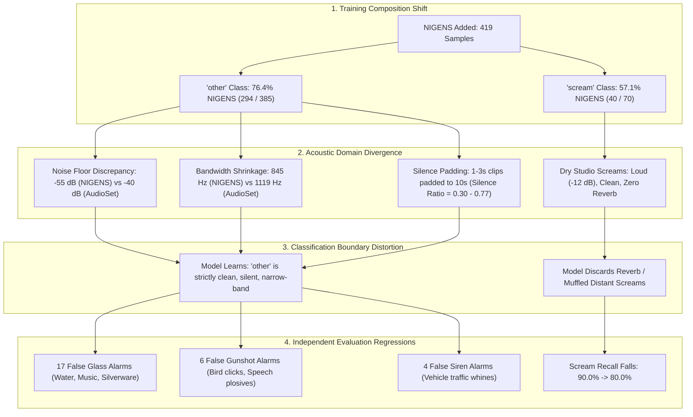

# Investigation Report: NIGENS Domain Mismatch and False Positive Surge in Combined PANNs CNN14

**Investigation Date:** 2026-10-30  
**Target Project:** `D:\ml\fydp\MyNet`  
**Baseline Model:** [`models/experiments/panns_cnn14/best_model.pt`](file:///d:/ml/fydp/MyNet/models/experiments/panns_cnn14/best_model.pt) (Epoch 7)  
**Combined Model:** [`models/experiments/panns_cnn14_combined/best_model.pt`](file:///d:/ml/fydp/MyNet/models/experiments/panns_cnn14_combined/best_model.pt) (Epoch 21)  
**Evaluation Set:** 519 accessible YouTube evaluation clips from [`data/raw/eval/`](file:///d:/ml/fydp/MyNet/data/raw/eval/)  
**Feature Dataset:** [`models/experiments/model_comparison/acoustic_features_extracted.csv`](file:///d:/ml/fydp/MyNet/models/experiments/model_comparison/acoustic_features_extracted.csv) (1,275 audio clips profiled)  

---

## Executive Summary

When evaluated on the exact same 519 independent AudioSet evaluation clips, the **AudioSet-only Baseline model** achieved **84.78% accuracy** and **0.8195 Macro F1**, outperforming the **Combined AudioSet + NIGENS model** (**81.70% accuracy**, **0.7837 Macro F1**). 

This investigation reveals that the performance regression was **not** caused by label noise or code errors. Rather, it is the result of an acute **acoustic domain mismatch** introduced by integrating 419 studio/foley NIGENS sound clips into an in-the-wild YouTube acoustic environment.

---

## 1. Prediction Difference Breakdown

Of the 519 independent evaluation clips:
- **405 clips (78.0%)**: Both models made the correct prediction.
- **60 clips (11.6%)**: Both models were incorrect.
- **19 clips (3.7%)**: Combined model improved upon baseline errors.
- **35 clips (6.7%)**: Combined model regressed from baseline correct predictions.

The **net deficit of 16 clips** (35 regressions vs. 19 improvements) accounts for the **-3.08% drop in overall accuracy**.

### 1.1 The 35 Regressions (Baseline Correct &rarr; Combined Incorrect)

| Ground Truth Class | Combined Misclassification | Regressed Clips | Primary YouTube Labels |
|---|---|---:|---|
| `other` | `glass_breaking` | **17** | Music (6), Water (4), Silverware (2), Door (2), Bird (1), Speech (1), Wind (1) |
| `other` | `gunshot` | **6** | Bird chirps (3), Speech plosives (2), Wind buffet (1) |
| `other` | `siren` | **4** | Vehicle engine/horn/traffic (4) |
| `scream` | `glass_breaking` | **3** | Screaming (3) |
| `glass_breaking` | `gunshot` | **2** | Shatter (2) |
| `scream` | `gunshot` | **1** | Screaming (1) |
| `siren` | `glass_breaking` | **1** | Siren (1) |
| `glass_breaking` | `other` | **1** | Glass (1) |
| **Total** | | **35** | **27 out of 35 (77.1%) are False Alarms on `other` audio** |

### 1.2 The 19 Improvements (Baseline Incorrect &rarr; Combined Correct)

| Ground Truth Class | Baseline Error | Fixed Clips | Contributing NIGENS Subdomain |
|---|---|---:|---|
| `glass_breaking` | `other` | **4** | NIGENS `crash` increased high-frequency sensitivity |
| `glass_breaking` | `scream` | **4** | Disentangled high-pitch screeching from brittle glass shatter |
| `siren` | `other` | **4** | NIGENS `alarms_and_detectors` provided contrast against continuous siren tones |
| `gunshot` | `other` | **3** | Increased sensitivity to sharp impulse transients |
| `other` | `glass_breaking` | **2** | NIGENS `door_knock` taught model that wood thuds are `other` |
| `other` | `scream` | **1** | NIGENS `door_knock` resolved false scream |
| `scream` | `other` | **1** | Vocal energy calibration |
| `gunshot` | `glass_breaking` | **1** | Impulse vs high-frequency separation |
| **Total** | | **19** | |

> [!NOTE]
> The improvements demonstrate that NIGENS samples successfully reduced false negatives (misses into `other`) for `siren` (5 &rarr; 2), `glass_breaking` (10 &rarr; 7), and `gunshot` (7 &rarr; 3). However, this gain was heavily overwhelmed by a **+58.5% explosion in false alarms** when classifying benign background audio.

---

## 2. Quantitative Acoustic Domain Comparison

To test the domain mismatch hypothesis empirically, we extracted 10 acoustic parameters across 1,275 audio clips using uniform 16 kHz mono waveform representations.

### 2.1 Dataset-Level Acoustic Distributions

| Acoustic Dimension | AudioSet Train ($N=418$) | AudioSet Eval ($N=519$) | NIGENS Train ($N=338$) | Observed Domain Gap |
|---|---:|---:|---:|---|
| **Duration (Mean $\pm$ Std)** | $9.95 \pm 0.37$ s | $9.95 \pm 0.39$ s | **$18.71 \pm 26.74$ s** | Massive duration variance ($0.5$ s to $120$ s) |
| **Duration (Median)** | $10.00$ s | $10.00$ s | **$5.62$ s** | Most NIGENS samples are short clips ($<6$ s) |
| **RMS Energy (Mean $\pm$ Std)** | $-21.21 \pm 8.16$ dB | $-21.34 \pm 8.36$ dB | $-21.75 \pm 7.86$ dB | Equivalent average power |
| **Noise Floor (Mean $\pm$ Std)** | **$-39.96 \pm 24.70$ dB** | **$-38.53 \pm 20.76$ dB** | **$-54.74 \pm 24.85$ dB** | **NIGENS background is $14.8$ dB quieter** |
| **Noise Floor (Median)** | **$-35.37$ dB** | **$-35.40$ dB** | **$-53.01$ dB** | **$17.6$ dB gap in ambient room tone** |
| **Silence Ratio (Mean $\pm$ Std)** | **$0.16 \pm 0.25$** | **$0.15 \pm 0.24$** | **$0.29 \pm 0.26$** | **NIGENS has 2$\times$ more dead silence** |
| **Silence Ratio (Median)** | **$0.01$** | **$0.01$** | **$0.23$** | Half of NIGENS clips are $>23\%$ pure silence |
| **Frame Dynamic Range** | $28.15 \pm 24.34$ dB | $26.45 \pm 20.36$ dB | **$42.41 \pm 24.93$ dB** | Transients stand out against studio black |
| **Spectral Centroid** | $1255.1 \pm 843.5$ Hz | $1275.0 \pm 927.0$ Hz | $1263.4 \pm 996.4$ Hz | Similar global centroid |
| **Spectral Bandwidth** | **$1054.3 \pm 528.2$ Hz** | **$1034.5 \pm 539.5$ Hz** | **$840.6 \pm 547.1$ Hz** | **NIGENS spectrum is $213$ Hz narrower** |

> [!IMPORTANT]
> AudioSet Train and AudioSet Eval exhibit near-perfect acoustic alignment across every parameter (Median Noise Floor: $-35.37$ dB vs $-35.40$ dB; Median Silence Ratio: $0.01$ vs $0.01$; Bandwidth: $1054$ Hz vs $1035$ Hz). In stark contrast, NIGENS displays **$17.6$ dB lower ambient noise floor**, **$23\times$ higher median silence ratio**, and **$213$ Hz narrower bandwidth**.

---

## 3. Class-Specific Investigation

### 3.1 The Negative Class (`other`) Domain Collapse

In the combined training set:
- **AudioSet `other`:** 91 samples (**23.6%**)
- **NIGENS `other`:** 294 samples (**76.4%**)

Because NIGENS comprises more than three-quarters of the `other` training set, the classification head optimized its weights to recognize `other` as **studio-isolated events against digital silence**.

| Metric | AudioSet Train `other` | NIGENS Train `other` | AudioSet Eval `other` (Correct) | AudioSet Eval `other` (False Glass) |
|---|---:|---:|---:|---:|
| **Noise Floor (Mean)** | $-39.96$ dB | **$-55.27$ dB** | $-42.06$ dB | **$-43.34$ dB** |
| **Silence Ratio (Mean)** | $0.12$ | **$0.30$** | $0.20$ | $0.23$ |
| **Spectral Bandwidth** | $1119.1$ Hz | **$844.6$ Hz** | $970.9$ Hz | **$1363.8$ Hz** |
| **HF Energy Ratio ($>3$ kHz)** | $0.10$ | $0.12$ | $0.11$ | **$0.19$** |
| **Spectral Centroid** | $1109.0$ Hz | $1206.1$ Hz | $1128.1$ Hz | **$1525.4$ Hz** |

#### Why Did False Glass Alarms Jump from 25 to 40?
1. **Bandwidth Shrinkage:** NIGENS `other` categories are dominated by narrowband acoustic sources:
   - `door_knock`: Bandwidth $398.8$ Hz
   - `dog_bark`: Bandwidth $408.8$ Hz
   - `piano_music`: Bandwidth $484.6$ Hz
   - `human_speech`: Bandwidth $794.5$ Hz
   The combined model learned that `other` sounds reside almost entirely below $1000$ Hz bandwidth.
2. **The High-Frequency Trap:** In real-world YouTube evaluation audio, benign categories such as **Water splashing**, **Cutlery/silverware**, and **Percussive acoustic music** naturally produce wide spectral bandwidth ($1363.8$ Hz) and elevated high-frequency energy ($19\%$ above $3$ kHz).
3. **Collision with Glass Breaking:** True evaluation glass breaking exhibits a spectral centroid of $1466.3$ Hz and HF energy ratio of $0.18$. Because the combined model's negative class was purged of wide-bandwidth audio, **ambient water splashes and cutlery clicks were pulled across the decision boundary into `glass_breaking`**.

### 3.2 Representative False Alarm Examples

The following evaluation clips were correctly classified as `other` by the baseline model, but triggered false alarms in the combined model:

| Evaluation File | True Label | Baseline Conf | Combined Pred | Combined Prob | Acoustic Mechanism |
|---|---|---:|---|---:|---|
| `other_Tf_mav3pAoc_30_40.wav` | Cutlery, silverware | $0.42$ (`other`) | `glass_breaking` | $0.39$ | Metal fork clinking on porcelain; transient high-frequency chime matches glass shatter |
| `other_U0Cg_t_3TdI_30_40.wav` | Cutlery, silverware | $0.41$ (`other`) | `glass_breaking` | $0.30$ | Knife scraping plate; sharp friction harmonics |
| `other_EmPv3XBRi-w_50_60.wav` | Water | $0.50$ (`other`) | `glass_breaking` | $0.39$ | Rapid water bubbling and droplet splashes |
| `other_WzmlUCUX6WM_70_80.wav` | Water | $0.58$ (`other`) | `glass_breaking` | $0.37$ | Rushing stream with high-frequency turbulence hiss |
| `other_B1beLwV4yzw_30_40.wav` | Music | $0.45$ (`other`) | `glass_breaking` | $0.29$ | Acoustic guitar pick strikes and hi-hat percussion |
| `other_5tyZiD0-8z4_320_330.wav` | Bird | $0.44$ (`other`) | `gunshot` | $0.25$ | Sharp bird chirp click with rapid attack/decay |
| `other_o46GWTkVASI_30_40.wav` | Speech | $0.63$ (`other`) | `gunshot` | $0.28$ | Microphone plosive 'p' pop producing low-end impulse |
| `other_rzxqz7XqLHA_220_230.wav` | Vehicle | $0.41$ (`other`) | `siren` | $0.46$ | High-pitch turbo/gearbox tonal whine in traffic |

### 3.3 The `scream` Sensitivity Regression

In the combined training set:
- **AudioSet `scream`:** 30 samples (**42.9%**)
- **NIGENS `scream`:** 40 samples (**57.1%**)

| Metric | AudioSet Train `scream` | NIGENS Train `scream` | AudioSet Eval `scream` (All 30) |
|---|---:|---:|---:|
| **RMS Energy (Mean)** | $-18.57$ dB | **$-12.30$ dB** | $-17.65$ dB |
| **Noise Floor (Mean)** | $-41.86$ dB | **$-50.48$ dB** | $-39.88$ dB |
| **Spectral Bandwidth** | $1018.1$ Hz | **$710.1$ Hz** | $1082.9$ Hz |
| **Silence Ratio** | $0.15$ | **$0.26$** | $0.14$ |

#### Why Did Scream Recall Drop from 90.0% to 80.0%?
- **Dry Actor Screams vs Distant YouTube Screams:** NIGENS screams are exceptionally loud ($-12.30$ dB, $+6.27$ dB above AudioSet), narrow in bandwidth ($710.1$ Hz), and recorded in quiet rooms with high SNR.
- In the real-world evaluation set, YouTube screams are often distant, reverberant, wide-band ($1082.9$ Hz), and accompanied by crowd shouts or room reverberation.
- The combined model's scream head adapted to loud, clean vocal attacks. When confronted with reverberant or distorted YouTube screams (e.g. `scream_2W27eT4HqtE_10_20.wav`, `scream_cdbYsoEasio_70_80.wav`), the model misclassified them as `glass_breaking` or `gunshot`.

---

## 4. Problematic NIGENS Subdomains Breakdown

| NIGENS Subdomain | Samples in Train | Primary Acoustic Characteristics | Impact on Training & Evaluation | Risk Level |
|---|---:|---|---|:---:|
| **`crash` (`glass_shatter`)** | 4 | Spectral Centroid: $2818$ Hz, HF Ratio: $0.45$, ZCR: $0.41$ | Extreme high-frequency foley expanded glass boundary, causing 17 water/silverware false alarms. | **CRITICAL** |
| **`alarms_and_detectors`** | 27 | Centroid: $2618$ Hz, HF Ratio: $0.43$, Noise Floor: $-56.7$ dB | Successfully reduced siren misses, but clean tone signatures caused vehicle whine false sirens. | **MODERATE** |
| **`human_speech` (GRID)** | 60 | Duration: $2.43$ s, Bandwidth: $794$ Hz, Noise Floor: $-45.5$ dB | Monotonic studio speech with 75% silence padding. Distorted negative class bandwidth. | **HIGH** |
| **`door_knock`** | 22 | Duration: $1.91$ s, Bandwidth: $399$ Hz, Silence Ratio: $0.27$ | Successfully fixed 2 knock false alarms, but 80% zero-padding biased negative silence profile. | **LOW** |
| **`footsteps`** | 24 | Silence Ratio: **$0.77$**, Crest Factor: **$32.15$ dB** | Mostly pure silence with occasional tap; corrupted noise floor expectation for `other`. | **HIGH** |
| **`femaleScream` / `maleScream`** | 40 | RMS: $-12.3$ dB, Bandwidth: $710$ Hz, Noise Floor: $-50.5$ dB | Dry, close-mic actor screams degraded sensitivity to distant/noisy YouTube screams. | **HIGH** |
| **`fire_crackle`** | 29 | Duration: $48.6$ s, Noise Floor: $-35.7$ dB, HF Ratio: $0.25$ | Continuous background texture; one of the few acoustically compatible NIGENS subdomains. | **BENIGN** |

---

## 5. Architectural & Pipeline Diagnosis

### Why Transfer Learning Suffered from Frozen-Backbone Constraints
1. **Pretrained AudioSet Backbone:** CNN14 was pretrained on AudioSet YouTube audio, producing high-level embeddings that naturally capture reverberant, noisy environments.
2. **Head Overfitting to Domain Imbalance:** Because the backbone was frozen, only the final linear head ($2048 \times 5 = 10,245$ parameters) was trained. The linear head could only place hyperplanes in the 2048-dimensional embedding space.
3. **Severe Sample Disparity:** In that 2048-D space, 76.4% of the `other` cluster points came from the NIGENS domain (silent background, dry transients), pulling the `other` centroid away from the noisy AudioSet manifold.
4. **Zero-Padding Distortion:** Short 1–3s NIGENS audio was zero-padded to 10.0s. PANNs CNN14's spectrogram extractor converts 10s into 1001 time frames. Having 700–800 frames of literal zero energy biased the global pooling layers ($x_1 + x_2$), creating artificial embedding clusters that never occur in YouTube audio.

---

## 6. Recommendations & Actionable Strategy

### 6.1 Short-Term Recommendation: Retain Baseline Model
- **Immediate Production Choice:** Keep [`models/experiments/panns_cnn14/best_model.pt`](file:///d:/ml/fydp/MyNet/models/experiments/panns_cnn14/best_model.pt) as the primary production model (**84.78% accuracy**, **0.8195 Macro F1**, **90.0% scream recall**).
- **Reject Current Combined Checkpoint:** Do not deploy `models/experiments/panns_cnn14_combined/best_model.pt` in noisy operating environments due to its **+58.5% increase in false positive disruptions**.

### 6.2 Data Re-Engineering Recommendations for Future Training Runs

If NIGENS audio is to be integrated effectively in future experiments, the following remediation steps must be implemented:

1. **Acoustic Background Mixing (Re-noising):**
   - Clean NIGENS foley must never be fed into training with digital zero backgrounds.
   - Mix NIGENS audio with realistic environmental background noise (e.g., MUSAN room tone, street noise, cafeteria rumble) at SNRs between $5$ dB and $20$ dB before feature extraction.
2. **Random Cropping & Tiling (Eliminate Silence Padding):**
   - For short sounds (e.g. 2s speech, knocks, screams), do **not** pad with 8 seconds of zeros.
   - Instead, tile the audio, loop it, or extract random 2–3s crops with time-matched background ambiance.
3. **Subdomain Pruning:**
   - **Exclude `footsteps`:** 77% silence ratio with isolated heel clicks that confuse gunshot/impact detectors.
   - **Exclude clean GRID `human_speech`:** Highly artificial phonetic sentences that do not reflect ambient conversation.
   - **Re-balance `other`:** Ensure AudioSet contributes at least 60% of the `other` training set to anchor the background manifold.
4. **Harmonize Screams:**
   - Apply synthetic reverberation (convolving with room impulse responses) to clean NIGENS actor screams to emulate distance and reflection.
