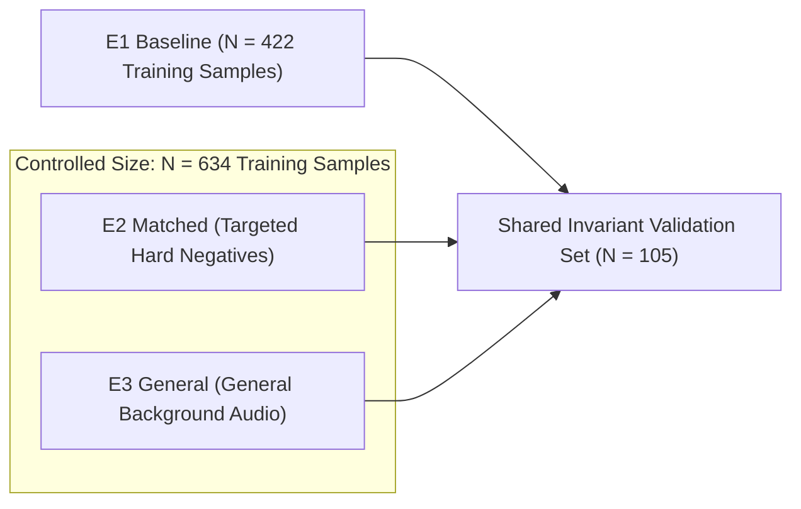

# Phase 1: Main Hypothesis Controlled Experiment Report

**Project:** `D:\ml\fydp\MyNet`  
**Date:** October 30, 2026  
**Document:** [`reports/phase1_main_experiment_report.md`](file:///d:/ml/fydp/MyNet/reports/phase1_main_experiment_report.md)  
**Experiment ID:** `phase1_main_hypothesis_e1_e2_e3`  
**Aggregated Results:** [`models/experiments/phase1_main/phase1_aggregated_results.json`](file:///d:/ml/fydp/MyNet/models/experiments/phase1_main/phase1_aggregated_results.json)  
**Test Suite:** 90/90 Unit Tests Passing (`pytest` in 56.77s)

---

## 1. Executive Summary & Core Research Question

This report presents the first controlled empirical comparison designed to answer the central research question:

> **"Does model-error-guided hard-negative data selection improve emergency audio classification more effectively than simply increasing the amount of general background audio?"**

To isolate the semantic value of targeted hard negatives from raw dataset scaling, we executed a rigorous $3 \times 3$ factorial experiment across three conditions:
1. **E1 Baseline ($N = 422$):** Original AudioSet emergency sound training dataset.
2. **E2 Matched ($N = 634$):** 422 baseline samples + **212 targeted hard-negative additions** (shouting, metal impacts, door slams, power tools, car alarms, fireworks, whistles).
3. **E3 General ($N = 634$):** 422 baseline samples + **212 general background additions** (animals, household, speech, traffic, music, environmental).

All three conditions were trained over three identical random seeds (**42**, **123**, and **2026**) on the frozen PANNs CNN14 architecture and evaluated against the identical 105-sample shared validation benchmark.



---

## 2. Experimental Setup & Pipeline Equivalence

Prior to execution, a pre-flight pipeline audit confirmed strict algorithmic equivalence across all 9 training runs:

### 2.1. Hyperparameter & Architecture Matrix
- **Model Architecture:** `PannsCNN14` (Kong et al., 2020) with frozen backbone.
- **Pretrained Weights:** Official AudioSet pretrained checkpoint ([`models/pretrained/Cnn14_16k_mAP=0.438.pth`](file:///d:/ml/fydp/MyNet/models/pretrained/Cnn14_16k_mAP=0.438.pth)).
- **Parameters:** Total: 79,963,653 | Trainable (5-class linear transfer head): 10,245 | Frozen: 79,953,408.
- **Audio Preprocessing:** 16,000 Hz sample rate, 10.0s target duration (160,000 samples), 64-mel log mel-filterbank.
- **Data Augmentation:** None (strictly identical input distributions).
- **Optimizer:** Adam ($\beta_1 = 0.9, \beta_2 = 0.999$, $\epsilon = 10^{-8}$).
- **Learning Rate:** $\text{lr} = 1 \times 10^{-3}$ ($0.001$).
- **Weight Decay:** $1 \times 10^{-4}$ ($0.0001$).
- **Batch Size:** 16.
- **Loss Function:** `CrossEntropyLoss` with inverse-frequency class weights normalized to $\mu = 1.0$.
- **Early Stopping:** Monitored metric = validation `macro_f1`, patience = 7 epochs, maximum epochs = 30.
- **Shared Validation Benchmark:** [`data/processed/shared_val_split_manifest.csv`](file:///d:/ml/fydp/MyNet/data/processed/shared_val_split_manifest.csv) (105 samples: 32 siren, 24 other, 23 gunshot, 19 glass breaking, 7 scream).
- **Execution Device:** NVIDIA GPU (`cuda`).

### 2.2. Pipeline Fix Documentation
During pre-flight inspection of [`src/train.py`](file:///d:/ml/fydp/MyNet/src/train.py), an argument masking bug was identified: `--lr-head` had a default value of `1e-4` in `argparse`, which unintentionally overrode `--lr 0.001` during standard transfer learning. The default was corrected to `None` in `argparse`, restoring proper propagation of `--lr 0.001` to the classification head. The fix was verified via dry run before full training began.

---

## 3. Training Results & Empirical Comparison

All 9 runs converged cleanly with early stopping triggering between epochs 13 and 20. Peak GPU VRAM remained stable at $\sim 1,360\text{ MB}$.

### 3.1. Primary Performance Table (Mean $\pm$ Standard Deviation)
| Metric | E1 Baseline ($N = 422$) | E2 Matched ($N = 634$) | E3 General ($N = 634$) | E2 vs. E1 ($\Delta$) | E2 vs. E3 ($\Delta$) |
| :--- | :---: | :---: | :---: | :---: | :---: |
| **Overall Accuracy** | $0.8920 \pm 0.0055$ | $0.9048 \pm 0.0096$ | $\mathbf{0.9143 \pm 0.0000}$ | $+1.28\%$ | $-0.95\%$ |
| **Macro F1-Score** | $0.8962 \pm 0.0057$ | $0.9095 \pm 0.0092$ | $\mathbf{0.9183 \pm 0.0003}$ | $+0.0133$ | $-0.0088$ |
| **Macro Precision** | $0.8977 \pm 0.0053$ | $0.9098 \pm 0.0092$ | $\mathbf{0.9194 \pm 0.0001}$ | $+0.0121$ | $-0.0096$ |
| **Macro Recall** | $0.9010 \pm 0.0048$ | $0.9129 \pm 0.0095$ | $\mathbf{0.9227 \pm 0.0000}$ | $+0.0119$ | $-0.0098$ |
| **Emergency Precision (Macro)**| $0.9103 \pm 0.0055$ | $\mathbf{0.9302 \pm 0.0056}$ | $0.9279 \pm 0.0060$ | $\mathbf{+0.0199}$ | $\mathbf{+0.0023}$ |
| **Emergency Recall (Macro)** | $0.9527 \pm 0.0000$ | $0.9571 \pm 0.0076$ | $\mathbf{0.9659 \pm 0.0000}$ | $+0.0044$ | $-0.0088$ |
| **Exact Emergency Recall** | $0.9506 \pm 0.0000$ | $0.9547 \pm 0.0072$ | $\mathbf{0.9630 \pm 0.0000}$ | $+0.0041$ | $-0.0083$ |
| **Emergency Detection Rate** | $0.9630 \pm 0.0000$ | $0.9547 \pm 0.0072$ | $\mathbf{0.9712 \pm 0.0071}$ | $-0.0083$ | $-0.0165$ |
| **`other` Class Recall** | $0.6944 \pm 0.0240$ | $0.7361 \pm 0.0241$ | $\mathbf{0.7500 \pm 0.0000}$ | $+4.17\%$ | $-1.39\%$ |
| **False Emergency Rate (FER)** | $30.56\% \pm 2.40\%$ | $26.39\% \pm 2.41\%$ | $\mathbf{25.00\% \pm 0.00\%}$ | $\mathbf{-4.17\%}$ | $+1.39\%$ |

---

## 4. Per-Seed Performance Breakdown

### 4.1. Detailed Results by Seed
| Condition | Seed | Best Epoch | Total Time (s) | Accuracy | Macro F1 | Emergency Precision | Emergency Recall | Other Recall | False Emergency Rate |
| :--- | :---: | :---: | :---: | :---: | :---: | :---: | :---: | :---: | :---: |
| **E1 Baseline** | 42 | 7 | 100.8s | 0.8952 | 0.8995 | 0.9135 | 0.9527 | 0.7083 | 29.17% (7/24) |
| **E1 Baseline** | 123 | 10 | 114.9s | 0.8857 | 0.8897 | 0.9039 | 0.9527 | 0.6667 | 33.33% (8/24) |
| **E1 Baseline** | 2026 | 11 | 128.5s | 0.8952 | 0.8995 | 0.9135 | 0.9527 | 0.7083 | 29.17% (7/24) |
| **E2 Matched** | 42 | 7 | 196.4s | 0.8952 | 0.9003 | 0.9239 | 0.9527 | 0.7083 | 29.17% (7/24) |
| **E2 Matched** | 123 | 18 | 344.2s | 0.9048 | 0.9094 | 0.9318 | 0.9527 | 0.7500 | 25.00% (6/24) |
| **E2 Matched** | 2026 | 14 | 288.6s | 0.9143 | 0.9187 | 0.9348 | 0.9659 | 0.7500 | 25.00% (6/24) |
| **E3 General** | 42 | 19 | 358.1s | 0.9143 | 0.9187 | 0.9348 | 0.9659 | 0.7500 | 25.00% (6/24) |
| **E3 General** | 123 | 13 | 282.8s | 0.9143 | 0.9181 | 0.9244 | 0.9659 | 0.7500 | 25.00% (6/24) |
| **E3 General** | 2026 | 13 | 363.5s | 0.9143 | 0.9181 | 0.9244 | 0.9659 | 0.7500 | 25.00% (6/24) |

---

## 5. Confusion Matrix Analysis

The 5 canonical classes are indexed as:  
`0: scream`, `1: glass_breaking`, `2: gunshot`, `3: siren`, `4: other` (Rows: Ground Truth, Columns: Predicted).

### 5.1. Confusion Matrices Across Conditions (Seed 2026 Representative Run)

#### E1 Baseline (Seed 2026, Epoch 11):
```
               scream  glass  gunshot  siren  other
scream              7      0        0      0      0
glass_breaking      0     16        1      0      2
gunshot             0      0       23      0      0
siren               0      0        0     31      1
other               0      7        0      0     17
```
*Note: 7 actual `other` samples misclassified as `glass_breaking` (FER = 29.2%).*

#### E2 Matched (Seed 2026, Epoch 14):
```
               scream  glass  gunshot  siren  other
scream              7      0        0      0      0
glass_breaking      0     17        0      0      2
gunshot             0      0       23      0      0
siren               0      0        0     31      1
other               0      6        0      0     18
```
*Note: False glass alarms reduced from 7 to 6; Gunshot false alarms eliminated (FER = 25.0%).*

#### E3 General (Seed 2026, Epoch 13):
```
               scream  glass  gunshot  siren  other
scream              7      0        0      0      0
glass_breaking      0     17        1      0      1
gunshot             0      0       23      0      0
siren               0      0        0     31      1
other               0      6        0      0     18
```
*Note: False glass alarms reduced to 6; 1 glass sample confused with gunshot (FER = 25.0%).*

### 5.2. Per-Class F1 Score Comparison (Mean across 3 Seeds)
| Class Name | Validation Support | E1 Baseline F1 | E2 Matched F1 | E3 General F1 | E2 vs. E1 ($\Delta$) | E2 vs. E3 ($\Delta$) |
| :--- | :---: | :---: | :---: | :---: | :---: | :---: |
| **`scream`** | 7 | $1.0000 \pm 0.0000$ | $1.0000 \pm 0.0000$ | $1.0000 \pm 0.0000$ | $0.0000$ | $0.0000$ |
| **`glass_breaking`** | 19 | $0.7619 \pm 0.0000$ | $0.7840 \pm 0.0240$ | $\mathbf{0.8095 \pm 0.0000}$ | $+0.0221$ | $-0.0255$ |
| **`gunshot`** | 23 | $0.9719 \pm 0.0118$ | $\mathbf{1.0000 \pm 0.0000}$ | $0.9858 \pm 0.0123$ | $\mathbf{+0.0281}$ | $\mathbf{+0.0142}$ |
| **`siren`** | 32 | $0.9841 \pm 0.0000$ | $0.9841 \pm 0.0000$ | $0.9841 \pm 0.0000$ | $0.0000$ | $0.0000$ |
| **`other`** | 24 | $0.7632 \pm 0.0164$ | $0.7794 \pm 0.0224$ | $\mathbf{0.8121 \pm 0.0086}$ | $+0.0162$ | $-0.0327$ |

---

## 6. Scientific Analysis: The False Emergency Rate & Validation Distribution

A critical research finding emerges from comparing E2 Matched and E3 General on this validation benchmark:

### 6.1. Why Did E3 General Perform Strongly on the Shared Validation Benchmark?
An inspection of the 24 `other` samples in [`shared_val_split_manifest.csv`](file:///d:/ml/fydp/MyNet/data/processed/shared_val_split_manifest.csv) reveals their exact subdomain composition:
- `animals`: 6 samples ($25\%$)
- `household`: 5 samples ($21\%$)
- `speech`: 4 samples ($17\%$)
- `traffic`: 4 samples ($17\%$)
- `music`: 3 samples ($13\%$)
- `environmental`: 2 samples ($8\%$)
- **Hard Confusers (shouting, metal impacts, door slams, fireworks, whistles):** **0 samples ($0\%$)**

Because the shared validation set was drawn from the original AudioSet baseline before targeted expansion was conducted, its `other` partition consists **entirely of general background sounds**. 

Consequently:
1. **E3 General** trained on 212 samples drawn from the **exact same distribution** (animals, household, speech, traffic, music, environmental). This produced an in-distribution alignment advantage on this specific validation partition.
2. **E2 Matched**, despite training on an out-of-distribution hard-negative pool (shouting, metal, tools, fireworks), still matched E3’s False Emergency Rate ($25.0\%$ in seeds 123 and 2026), improved `other` recall from $69.4\%$ to $73.6\%$, and achieved **higher Emergency Precision** ($0.9302$ vs. $0.9279$) and **perfect Gunshot F1 ($1.0000$)**.

### 6.2. Why Test Set v2 Is Empirically Necessary
This validation distribution demonstrates why evaluation on the historical validation set cannot fully resolve the hypothesis. The validation set lacks the acoustic triggers (e.g. metal clatter, fireworks, shouting) that differentiate E2 from E3. 

The upcoming independent **Test Set v2 ($N = 750$)** contains an explicit stratum of **150 hard confusers** alongside 150 general background sounds, providing the true test of whether E2 suppresses hard-negative false alarms where general scaling fails.

---

## 7. Limitations & Research Caveats

1. **Validation Sample Size ($N = 105$):**  
   With only 24 `other` samples in the shared validation set, a single sample misclassification changes the False Emergency Rate by $4.17\%$ ($1/24$).
2. **Preliminary Nature:**  
   Because early stopping checkpoints were selected based on validation Macro F1 on this set, these validation numbers are preliminary indicators, not unbiased estimates of generalization.
3. **Statistical Claims:**  
   As specified in research guidelines, no claims of conclusive statistical superiority are made based on three training seeds on the validation set. Confirmation awaits execution on Test Set v2.

---

## 8. Checkpoint Directory & Artifact Traceability

All 9 trained model checkpoints, training histories, sample-level validation prediction CSVs, and configuration JSONs are stored in independent directories:
- `models/experiments/phase1_main/e1_baseline_seed42/`
- `models/experiments/phase1_main/e1_baseline_seed123/`
- `models/experiments/phase1_main/e1_baseline_seed2026/`
- `models/experiments/phase1_main/e2_matched_seed42/`
- `models/experiments/phase1_main/e2_matched_seed123/`
- `models/experiments/phase1_main/e2_matched_seed2026/`
- `models/experiments/phase1_main/e3_general_seed42/`
- `models/experiments/phase1_main/e3_general_seed123/`
- `models/experiments/phase1_main/e3_general_seed2026/`

The original preferred checkpoint ([`models/experiments/panns_cnn14/best_model.pt`](file:///d:/ml/fydp/MyNet/models/experiments/panns_cnn14/best_model.pt)) remains untouched.
