# Final Implementation-Readiness Audit and Execution Contract: Phase 2 E4 Experiments

**Project:** `D:\ml\fydp\MyNet`  
**Research Framing:** *Data-Centric Analysis of Hard-Negative Learning and Domain Shift in Emergency Audio Classification*  
**Date:** November 2, 2026  
**Document:** [`reports/phase2_e4_final_execution_contract.md`](file:///d:/ml/fydp/MyNet/reports/phase2_e4_final_execution_contract.md)  
**Status:** Implementation-Readiness Audit Complete & Execution Contract Frozen  
**Preceding Documents:**
- [`reports/phase2_e4_pretraining_audit.md`](file:///d:/ml/fydp/MyNet/reports/phase2_e4_pretraining_audit.md)
- [`reports/phase2_e4_statistical_design_correction.md`](file:///d:/ml/fydp/MyNet/reports/phase2_e4_statistical_design_correction.md)
- [`reports/master_research_evidence.md`](file:///d:/ml/fydp/MyNet/reports/master_research_evidence.md)  
**Underlying Test Suite:** 97/97 Unit Tests Passing (`pytest` in 53.36s)

---

## 1. Executive Summary & Audit Verdict

### Final Implementation Verdict: **READY AFTER SPECIFIED CORRECTIONS**

The Phase 2 E4 experimental suite is fundamentally sound, but requires **two minimal code implementations** before training is launched:
1. **Manifest and Audio Readiness (PASSED):** All 15 training split manifests (1 unablated parent `E2 Full` + 7 Category Ablations + 7 Matched-Size Random Controls) and 15 validation manifests exist on disk, are cryptographically verified, exhibit **0 video ID collisions** with validation or Test Set v2, and all **10,068 referenced audio files exist**.
2. **PyTorch Training Engine Readiness (PASSED):** `src/train.py` (`run_training_experiment`) is verified to enforce strict hyperparameter equivalence with Phase 1 (PANNs CNN14 frozen backbone, Adam $lr = 0.001$, weight decay $10^{-4}$, batch size 16, patience 7, max 30 epochs).
3. **Execution Runner Gap (SPECIFIED CORRECTION REQUIRED):** The dedicated multi-condition, multi-seed runner script for Phase 2 (`scripts/run_phase2_experiments.py`) does not yet exist and must be created to iterate over the 15 conditions across seeds 42, 123, and 2026 ($45$ runs) into `models/experiments/phase2_e4/<condition>_seed<seed>/`.
4. **Statistical Evaluation Pipeline Gap (SPECIFIED CORRECTION REQUIRED):** The existing evaluation script (`src/evaluate_test_set_v2.py`) was written exclusively for Phase 1. It uses asymptotic $\chi^2$ McNemar (which fails on small discordant counts) and naive row-level bootstrapping (which violates recording independence). A dedicated Phase 2 evaluation pipeline (`src/evaluate_phase2_e4.py`) must be implemented to enforce exact binomial McNemar, cluster-aware recording-level bootstrapping, separate estimand reporting, and Holm-Bonferroni correction.
5. **Statistical Edge-Case Unit Tests (SPECIFIED CORRECTION REQUIRED):** Dedicated unit tests in `tests/test_phase2_e4_statistics.py` must verify the exact binomial behavior on edge cases ($5:0, 6:0, 9:0, 7:2, 2:7$) prior to evaluation execution.

Once these minimal Python files are in place, the experiment is **100% READY TO EXECUTE**.

---

## 2. Inventory of All 15 Experimental Conditions

```mermaid
graph TD
    Parent["Condition 0: E2 Full (N = 646 Train)<br/>422 Baseline + 224 Targeted Hard Negatives"]
    
    subgraph Category_Ablations [7 Leave-One-Out Category Ablations]
        Parent -->|Minus 44 Shouting| A1["E4-A1: Minus Shouting (602)"]
        Parent -->|Minus 40 Metal| A2["E4-A2: Minus Metal (606)"]
        Parent -->|Minus 33 Doors| A3["E4-A3: Minus Doors (613)"]
        Parent -->|Minus 30 Tools| A4["E4-A4: Minus Tools (616)"]
        Parent -->|Minus 29 Alarms| A5["E4-A5: Minus Alarms (617)"]
        Parent -->|Minus 28 Fireworks| A6["E4-A6: Minus Fireworks (618)"]
        Parent -->|Minus 19 Whistles| A7["E4-A7: Minus Whistles (627)"]
    end
    
    subgraph Matched_Controls [7 Matched-Size Random Controls]
        Parent -->|Minus 44 Random| C1["E4-C1: Matched Control Shouting (602)"]
        Parent -->|Minus 40 Random| C2["E4-C2: Matched Control Metal (606)"]
        Parent -->|Minus 33 Random| C3["E4-C3: Matched Control Doors (613)"]
        Parent -->|Minus 30 Random| C4["E4-C4: Matched Control Tools (616)"]
        Parent -->|Minus 29 Random| C5["E4-C5: Matched Control Alarms (617)"]
        Parent -->|Minus 28 Random| C6["E4-C6: Matched Control Fireworks (618)"]
        Parent -->|Minus 19 Random| C7["E4-C7: Matched Control Whistles (627)"]
    end
```



The experiment comprises **15 conditions** executed across **3 random seeds** (**42**, **123**, **2026**), yielding exactly **45 training runs**:

| Index | Condition Key | Manifest Path | Train Size | Excluded Count | Target Subdomain Excluded | Remaining Target Count | Role in Experimental Design |
| :---: | :--- | :--- | :---: | :---: | :---: | :---: | :--- |
| **0** | `e2_full` | `data/processed/e2_train_split_manifest.csv` | **646** | 0 | None (All 224 additions present) | All | **Unablated Parent Reference Ceiling** |
| **1** | `e4_minus_human_shouting` | `data/processed/e4_ablations/e4_minus_human_shouting_train.csv` | **602** | 44 | `human_shouting` | **0** | Category Ablation |
| **2** | `e4_matched_control_human_shouting` | `data/processed/e4_ablations/e4_matched_control_human_shouting_train.csv` | **602** | 44 | Random Hard Negatives | 36 | Matched-Size Random Control |
| **3** | `e4_minus_metal_impacts` | `data/processed/e4_ablations/e4_minus_metal_impacts_train.csv` | **606** | 40 | `metal_impacts` | **0** | Category Ablation |
| **4** | `e4_matched_control_metal_impacts` | `data/processed/e4_ablations/e4_matched_control_metal_impacts_train.csv` | **606** | 40 | Random Hard Negatives | 29 | Matched-Size Random Control |
| **5** | `e4_minus_door_slams` | `data/processed/e4_ablations/e4_minus_door_slams_train.csv` | **613** | 33 | `door_slams` | **0** | Category Ablation |
| **6** | `e4_matched_control_door_slams` | `data/processed/e4_ablations/e4_matched_control_door_slams_train.csv` | **613** | 33 | Random Hard Negatives | 30 | Matched-Size Random Control |
| **7** | `e4_minus_construction_tools` | `data/processed/e4_ablations/e4_minus_construction_tools_train.csv` | **616** | 30 | `construction_tools` | **0** | Category Ablation |
| **8** | `e4_matched_control_construction_tools` | `data/processed/e4_ablations/e4_matched_control_construction_tools_train.csv` | **616** | 30 | Random Hard Negatives | 27 | Matched-Size Random Control |
| **9** | `e4_minus_car_alarms_detectors` | `data/processed/e4_ablations/e4_minus_car_alarms_detectors_train.csv` | **617** | 29 | `car_alarms_detectors` | **0** | Category Ablation |
| **10** | `e4_matched_control_car_alarms_detectors` | `data/processed/e4_ablations/e4_matched_control_car_alarms_detectors_train.csv` | **617** | 29 | Random Hard Negatives | 25 | Matched-Size Random Control |
| **11** | `e4_minus_fireworks_firecrackers` | `data/processed/e4_ablations/e4_minus_fireworks_firecrackers_train.csv` | **618** | 28 | `fireworks_firecrackers` | **0** | Category Ablation |
| **12** | `e4_matched_control_fireworks_firecrackers` | `data/processed/e4_ablations/e4_matched_control_fireworks_firecrackers_train.csv` | **618** | 28 | Random Hard Negatives | 24 | Matched-Size Random Control |
| **13** | `e4_minus_whistles_high_pitch` | `data/processed/e4_ablations/e4_minus_whistles_high_pitch_train.csv` | **627** | 19 | `whistles_high_pitch` | **0** | Category Ablation |
| **14** | `e4_matched_control_whistles_high_pitch` | `data/processed/e4_ablations/e4_matched_control_whistles_high_pitch_train.csv` | **627** | 19 | Random Hard Negatives | 18 | Matched-Size Random Control |

---

## 3. Experimental Comparison Structure

### 3.1. Rejection of the "Full Factorial" Misnomer
This experiment is **not** a full factorial design. Across 7 binary factors (presence or absence of each category), a full factorial design would require $2^7 = 128$ experimental conditions. 

Describing this experiment as full factorial is scientifically inaccurate. The formal methodology is a **Leave-One-Out (LOO) Category Ablation Suite with Matched-Size Random Controls and an Unablated Reference Ceiling**.

### 3.2. Primary Comparison (Pure Semantic Effect)
$$\Delta \text{FER}_k^{\text{primary}} = \text{FER}_k(\text{Ablation}_k) - \text{FER}_k(\text{Matched Control}_k)$$
- **Contrast:** `e4_minus_<category>` vs. `e4_matched_control_<category>`.
- **Methodological Merit:** Both conditions have the **exact same training sample size** (e.g., $602$ vs. $602$). Both models experienced identical sample drops from `E2 Full`.
- **Scientific Isolation:** This contrast isolates the **pure semantic importance** of the category, completely unconfounded by sample-size effects.

### 3.3. Secondary Comparison (Total Ablation Margin)
$$\Delta \text{FER}_k^{\text{secondary}} = \text{FER}_k(\text{Ablation}_k) - \text{FER}_k(\text{E2 Full})$$
- **Contrast:** `e4_minus_<category>` vs. `E2 Full`.
- **Methodological Caveat:** In this comparison, the ablation model has *both* the targeted category removed *and* fewer training samples ($646 \rightarrow 602..627$).
- **Scientific Interpretation:** This measures the total real-world margin loss from removing the category, but researchers must document that this difference conflates the category semantic loss with sample-size reduction.

---

## 4. Corrected Statistical Analysis Specifications

### 4.1. Cluster-Aware (Recording-Level) Bootstrap Verification
To eliminate the pseudo-replication error identified in the statistical audit:
1. **Resampling Unit:** The physical audio recording ID (`filename` or `video_id`). In Test Set v2, each confuser subdomain contains exactly $N = 25$ unique recordings.
2. **Within-Cluster Integrity:** Each drawn recording retains its predictions across all three seeds ($s \in \{42, 123, 2026\}$).
3. **Cluster Resampling:** In each bootstrap iteration, draw $N = 25$ recordings **with replacement**.
4. **Consistency:** The metric difference is calculated strictly within each bootstrap iteration.
5. **Reproducibility:** Seed = `42`, Iterations = `10,000`.

### 4.2. Explicit Estimand Definitions
The evaluation pipeline must compute and report two distinct estimands:

#### Estimand 1: Three-Seed Average Model Effect ($\theta_1$)
$$\theta_1 = \mathbb{E}_{\text{recordings}} \left[ \frac{1}{3} \sum_{s \in \{42, 123, 2026\}} \left( \mathbb{I}(\hat{y}_{i, s}^{\text{Abl}} \in \text{Emerg}) - \mathbb{I}(\hat{y}_{i, s}^{\text{Ctl}} \in \text{Emerg}) \right) \right]$$
- **Estimand Meaning:** The expected difference in error rate if an end user deploys a single randomly initialized and trained model.
- **Reporting:** Point estimate $= \bar{\Delta}_{\text{macro}}$, Confidence Interval $= [q_{0.025}, q_{0.975}]$ from cluster bootstrap.

#### Estimand 2: Probability-Ensemble Effect ($\theta_2$)
$$\theta_2 = \mathbb{E}_{\text{recordings}} \left[ \mathbb{I}\left( \arg\max_c \bar{p}_{i, c}^{\text{Abl}} \in \text{Emerg} \right) - \mathbb{I}\left( \arg\max_c \bar{p}_{i, c}^{\text{Ctl}} \in \text{Emerg} \right) \right]$$
where $\bar{\mathbf{p}}_i = \frac{1}{3} \sum_s \mathbf{p}_{i, s}$ is the average softmax probability vector across the 3 seeds.
- **Estimand Meaning:** The expected difference in error rate if an end user deploys the full 3-seed ensemble.
- **Reporting:** Point estimate $= \Delta_{\text{ens}}$, Confidence Interval $= [q_{0.025}^{\text{ens}}, q_{0.975}^{\text{ens}}]$ from cluster bootstrap.
- **Strict Rule:** $\theta_1$ and $\theta_2$ must be reported in separate table columns. They must never be blended into a single estimate.

---

### 4.3. Exact McNemar Binomial Test Verification & Edge Cases
All paired tests on the 25 recordings must use the **exact two-sided binomial test** via `scipy.stats.binomtest(b, b + c, 0.5, alternative='two-sided')`. 

The test preserves direction:
- $b > c \implies$ Ablation made more false alarms (Ablation hurts specificity).
- $c > b \implies$ Control made more false alarms.

#### Verified Edge Cases Table:

| Discordant Pair $(b : c)$ | Total Discordant ($n$) | Net Error Shift ($b - c$) | Asymptotic $\chi^2$ $p$-value | Exact Binomial $p$-value | Significant at Unadjusted $\alpha = 0.05$? | Significant under Holm-Bonferroni Rank 1 ($\alpha_1 = 0.00714$)? | Exact Interpretation |
| :---: | :---: | :---: | :---: | :---: | :---: | :---: | :--- |
| **$5 : 0$** | 5 | +5 | $0.073638$ | **$0.062500$** | NO ($p > 0.05$) | NO | Insufficient evidence; underpowered |
| **$6 : 0$** | 6 | +6 | $0.041227$ | **$0.031250$** | **YES** ($p < 0.05$) | NO ($p > 0.00714$) | Significant unadjusted, fails FWER |
| **$9 : 0$** | 9 | +9 | $0.007661$ | **$0.003906$** | **YES** ($p < 0.05$) | **YES** ($\mathbf{p < 0.00714}$) | **Survives Holm-Bonferroni Step 1** |
| **$7 : 2$** | 9 | +5 | $0.182422$ | **$0.179688$** | NO ($p > 0.05$) | NO | Insignificant ($5$ net discordant pairs) |
| **$2 : 7$** | 9 | -5 | $0.182422$ | **$0.179688$** | NO ($p > 0.05$) | NO | Insignificant (opposite direction) |

*Notice that for $b = 9, c = 0$, the asymptotic continuity-corrected $\chi^2$ test yields $p = 0.007661$ (which would erroneously fail Holm-Bonferroni), whereas the exact binomial test yields $p = \mathbf{0.003906}$ (which correctly passes). Using exact binomial testing is therefore mandatory.*

---

### 4.4. Multiple Comparisons Correction (Holm-Bonferroni)
Testing 7 categories simultaneously inflates the family-wise error rate ($\alpha_{\text{family}} \approx 30.17\%$). The Holm-Bonferroni step-down procedure is applied to the 7 category ensemble $p$-values:
1. Sort $p$-values: $p_{(1)} \le p_{(2)} \le \dots \le p_{(7)}$.
2. Step-down thresholds:
   - Rank 1: $\alpha_{(1)} = 0.05 / 7 = \mathbf{0.007143}$
   - Rank 2: $\alpha_{(2)} = 0.05 / 6 = \mathbf{0.008333}$
   - Rank 3: $\alpha_{(3)} = 0.05 / 5 = \mathbf{0.010000}$
   - Rank 4: $\alpha_{(4)} = 0.05 / 4 = \mathbf{0.012500}$
   - Rank 5: $\alpha_{(5)} = 0.05 / 3 = \mathbf{0.016667}$
   - Rank 6: $\alpha_{(6)} = 0.05 / 2 = \mathbf{0.025000}$
   - Rank 7: $\alpha_{(7)} = 0.05 / 1 = \mathbf{0.050000}$
3. A category hypothesis is rejected if $p_{(i)} \le \alpha_{(i)}$ for all steps up to $i$.

---

## 5. Execution Equivalence & Pipeline Audit

An audit of the training environment confirmed 100% equivalence with Phase 1 standards:

1. **Pretrained Weights:** Official AudioSet pretrained checkpoint (`models/pretrained/Cnn14_16k_mAP=0.438.pth`).
2. **Audio Preprocessing:** 16 kHz sample rate, mono conversion, 10.0s target duration (160,000 samples), 64 mel filterbanks, standard log-mel spectrogram computation.
3. **Data Augmentation:** None (strictly identical input distributions).
4. **Optimizer:** Adam ($\beta_1 = 0.9, \beta_2 = 0.999$, $\epsilon = 10^{-8}$, weight decay $= 10^{-4}$, initial learning rate $lr = 0.001$).
5. **Batch Size:** 16.
6. **Validation Manifest:** [`data/processed/shared_val_split_manifest.csv`](file:///d:/ml/fydp/MyNet/data/processed/shared_val_split_manifest.csv) ($N = 105$, SHA-256: `38569ae45dde50bfc4971544a3df87beb01f9a292a88c5c8a8a37c7c2d24a6bf`).
7. **Early Stopping:** Monitored metric = validation `macro_f1`, patience = 7 epochs, maximum epochs = 30. Best checkpoint saved as `best_model.pt`.
8. **Independent Checkpoint Directory:** All checkpoints and histories will be written to `models/experiments/phase2_e4/<condition>_seed<seed>/`. Zero Phase 1 files will be overwritten.

---

## 6. Implementation Defect Log and Proposed Minimal Corrections

To elevate the project from **READY AFTER SPECIFIED CORRECTIONS** to **READY TO EXECUTE**, the following three minimal implementations are required:

### Defect 1: Missing Phase 2 Multi-Condition Training Runner
- **Issue:** No automated runner script currently exists to launch the 45 Phase 2 training runs.
- **Proposed Correction:** Create [`scripts/run_phase2_experiments.py`](file:///d:/ml/fydp/MyNet/scripts/run_phase2_experiments.py), structured identically to `run_phase1_experiments.py`, mapping all 15 conditions across seeds 42, 123, and 2026 into `models/experiments/phase2_e4/`.

### Defect 2: Outdated Statistical Functions in Benchmark Evaluation Pipeline
- **Issue:** `src/evaluate_test_set_v2.py` only implements continuity-corrected $\chi^2$ McNemar and naive row-level bootstrap for Phase 1. It lacks cluster-aware bootstrap, ensemble probability testing, and Holm-Bonferroni correction.
- **Proposed Correction:** Implement [`src/evaluate_phase2_e4.py`](file:///d:/ml/fydp/MyNet/src/evaluate_phase2_e4.py), providing:
  1. `exact_mcnemar_test(b, c)` using `scipy.stats.binomtest`.
  2. `cluster_aware_bootstrap(recordings, y_true, preds_ablation, preds_control)` resampling clusters of size 3.
  3. `compute_probability_ensemble(probs_seed42, probs_seed123, probs_seed2026)`.
  4. `holm_bonferroni_correction(category_p_values, alpha=0.05)`.
  5. Dedicated per-category reporting for both Estimand 1 and Estimand 2.

### Defect 3: Missing Edge-Case Statistical Unit Tests
- **Issue:** No unit tests currently verify exact binomial McNemar on the mandated edge cases ($5:0, 6:0, 9:0, 7:2, 2:7$).
- **Proposed Correction:** Create [`tests/test_phase2_e4_statistics.py`](file:///d:/ml/fydp/MyNet/tests/test_phase2_e4_statistics.py) containing automated pytest assertions for all edge cases and cluster bootstrap reproducibility.

---

## 7. Execution Commands Protocol

Once the minimal corrections above are approved and created, the exact execution commands to conduct the complete Phase 2 E4 research cycle are:

### Step 1: Execute Statistical Unit Tests
```bash
pytest -v tests/test_phase2_e4_statistics.py
```
*Acceptance:* All edge-case assertions (5:0, 6:0, 9:0, 7:2, 2:7) pass.

### Step 2: Execute Phase 2 Training Suite (45 Runs)
```bash
python scripts/run_phase2_experiments.py
```
*Runtime:* $\sim 2.5 - 3.5$ hours on GPU. All 45 models saved to `models/experiments/phase2_e4/<condition>_seed<seed>/`.

### Step 3: Execute Benchmark Evaluation & Statistical Analysis
```bash
python src/evaluate_phase2_e4.py
```
*Output:* Full results saved to `models/experiments/phase2_e4/phase2_e4_evaluation_summary.json` and human-readable report `reports/phase2_e4_evaluation_report.md`.

---

## 8. Epistemic Demarcation & Interpretation Boundaries

1. **Exploratory Status on Test Set v2:** Test Set v2 was unblinded in Phase 1. Phase 2 findings on Test Set v2 represent **exploratory category-level attribution**, not a blind confirmatory benchmark test.
2. **Statistical Power Limitation:** With $N = 25$ recordings per category, exact tests cannot confirm subtle margin shifts ($< 24\%$). Lack of significance ($p > 0.05$) must not be reported as "proof of no effect."
3. **Validation Blindness:** The shared validation set contains 0 confusers. Early-stopping checkpoints represent models optimized for general emergency discrimination, holding the validation criterion constant across all conditions.
4. **Hardware Domain Shift:** All audio is derived from YouTube AudioSet; findings do not claim generalization to embedded edge microphone hardware without field testing.
