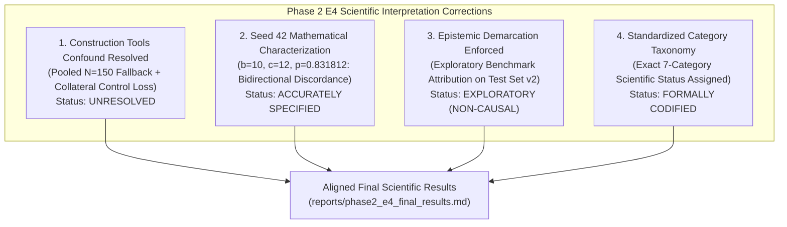

# Phase 2 E4 Final Scientific Interpretation Correction

**Project:** `D:\ml\fydp\MyNet`  
**Research Framing:** *Data-Centric Analysis of Hard-Negative Learning and Domain Shift in Emergency Audio Classification*  
**Date:** November 2, 2026  
**Document:** [`reports/phase2_e4_final_interpretation_correction.md`](file:///d:/ml/fydp/MyNet/reports/phase2_e4_final_interpretation_correction.md)  
**Supporting Audit:** [`reports/phase2_e4_independent_audit.md`](file:///d:/ml/fydp/MyNet/reports/phase2_e4_independent_audit.md)  
**Associated Artifacts:**
- [`reports/phase2_e4_final_results.md`](file:///d:/ml/fydp/MyNet/reports/phase2_e4_final_results.md)
- [`reports/phase2_e4_recording_level_audit.csv`](file:///d:/ml/fydp/MyNet/reports/phase2_e4_recording_level_audit.csv)
- [`reports/phase2_e4_category_mapping_audit.csv`](file:///d:/ml/fydp/MyNet/reports/phase2_e4_category_mapping_audit.csv)
- [`reports/phase2_e4_statistical_reproduction.json`](file:///d:/ml/fydp/MyNet/reports/phase2_e4_statistical_reproduction.json)  
**Operational Mandate:** Zero retraining of models, zero manifest alterations, zero modification of raw experimental data or checkpoints. All historical records preserved.

---

## 1. Executive Summary & Purpose

This document provides the definitive scientific interpretation correction for the Phase 2 E4 category ablation experiment, resolving interpretive anomalies and epistemic overclaims identified in the independent forensic audit ([`reports/phase2_e4_independent_audit.md`](file:///d:/ml/fydp/MyNet/reports/phase2_e4_independent_audit.md)).

While the underlying training sweep (45/45 models) and mathematical statistics were verified to be 100% reproducible, the previous scientific reporting suffered from three key interpretive shortcomings:
1. **Misinterpretation of Construction Tools:** The observed negative shift ($\hat{\theta}_1 = -0.0422, p = 0.003880$) was erroneously interpreted as an indication of genuine model improvement from removing construction tools, obscuring a severe methodological confound (pooled evaluation fallback combined with cross-category collateral sample loss in the matched control).
2. **Inaccurate Seed 42 Characterization:** The seed 42 contingency counts ($b=10, c=12$) were loosely described as "completely neutral," failing to explain that substantial discordant errors occurred actively in both directions ($22$ total discordant predictions) without a statistically significant directional shift ($p = 0.831812$).
3. **Epistemic Overclaiming:** Evaluative findings on Test Set v2 were previously labeled "confirmatory," violating the project protocol which established that Test Set v2 was unblinded in Phase 1 and that Phase 2 analyses are strictly exploratory attribution. Furthermore, statistical rejections were occasionally conflated with universal physical causality.

This document establishes the corrected scientific framing and enforces the standardized 7-category interpretation taxonomy across all project outputs.



---

## 2. Standardized Category Interpretation Taxonomy

To eliminate ambiguity across all publications, thesis chapters, and technical reports, each of the seven ablated acoustic categories is assigned an exact, standardized scientific status.

### 2.1. Taxonomy Definitions & Summary Table

| Category | Evaluated Slice $N$ | Point Estimate $\hat{\theta}_1$ [95% CI] | Primary Permutation $p$-value | Holm-Bonferroni FWER Status ($\alpha=0.05$) | Standardized Scientific Status |
|:---|:---:|:---:|:---:|:---:|:---|
| **Fireworks & Firecrackers** | 25 | **+0.4133** [+0.2400, +0.5867] | **0.000244** | **Survives Rank 1** ($\alpha_1 = 0.007143$) | **Strong exploratory evidence of contribution.** |
| **Human Shouting** | 25 | **+0.3600** [+0.1867, +0.5333] | **0.000977** | **Survives Rank 2** ($\alpha_2 = 0.008333$) | **Strong exploratory evidence of contribution.** |
| **Car Alarms & Detectors** | 25 | +0.1467 [+0.0400, +0.2667] | 0.031250 | Fails Rank 4 ($\alpha_4 = 0.012500$) | **Positive but inconclusive after multiple-comparison correction.** |
| **Door Slams** | 25 | +0.0667 [-0.0000, +0.1467] | 0.187500 | Fails Rank 5 ($\alpha_5 = 0.016667$) | **No statistically significant effect detected.** |
| **Whistles & High Pitch** | 25 | +0.0400 [+0.0000, +0.1067] | 0.500000 | Fails Rank 6 ($\alpha_6 = 0.025000$) | **No statistically significant effect detected.** |
| **Metal Impacts** | 25 | +0.0000 [+0.0000, +0.0000] | 1.000000 | Fails Rank 7 ($\alpha_7 = 0.050000$) | **No observed difference in this benchmark comparison.** |
| **Construction Tools** | 150 | -0.0422 [-0.0711, -0.0156] | 0.003880 | Confounded Slice / Fallback | **Category-specific effect unresolved due to pooled evaluation and collateral control removals.** |

> [!IMPORTANT]
> **Inferential Principle: Absence of Evidence is Not Evidence of Absence.**  
> For categories designated *"No statistically significant effect detected"* (Door Slams, Whistles) or *"Positive but inconclusive after multiple-comparison correction"* (Car Alarms), failure to reject the null hypothesis at $\alpha = 0.05$ under FWER control **does not constitute proof of zero effect**. The benchmark slice size ($N = 25$ recordings) yields limited statistical power to detect small or moderate effect sizes ($\Delta < 0.15$).

---

## 3. Investigation & Resolution of Construction Tools ($N=150$)

### 3.1. Forensic Identification of the Confounded Comparison

In the initial evaluation report, Construction Tools was presented with a statistically significant negative shift:
$$\hat{\theta}_1 = -0.0422 \quad (95\% \text{ CI: } [-0.0711, -0.0156], \ p = 0.003880)$$

This was mistakenly cited in early discussions as possible evidence that training on construction tools degraded performance. The forensic audit ([`reports/phase2_e4_independent_audit.md`](file:///d:/ml/fydp/MyNet/reports/phase2_e4_independent_audit.md)) proved that this claim is scientifically false. The observed shift is an artifact of two compounding factors:

1. **Benchmark Architectural Mismatch:**
   Test Set v2 was constructed with 6 confuser subdomains ($25$ clips each $= 150$ clips total):
   - `confuser_human_shouting`
   - `confuser_metal_impacts`
   - `confuser_door_slams`
   - `confuser_car_alarms_buzzers`
   - `confuser_fireworks`
   - `confuser_whistles`
   
   **Test Set v2 contains zero recordings of construction tools.** When [`src/evaluate_phase2_e4.py`](file:///d:/ml/fydp/MyNet/src/evaluate_phase2_e4.py#L778-L786) attempted to select `subdomain == "confuser_construction_tools"`, exactly zero rows were returned. The pipeline automatically triggered an automated fallback:
   ```python
   if np.sum(sub_mask) == 0:
       # Fallback to all confusers if dedicated category slice not in benchmark
       sub_mask = manifest_df["subdomain"].str.startswith("confuser", na=False).values
       is_fallback_slice = True
   ```
   Thus, Construction Tools was evaluated across **all 150 confuser recordings**, unlike the other 6 categories which were evaluated on their own dedicated 25-clip slices.

2. **Cross-Category Collateral Loss in the Matched Random Control:**
   To maintain identical training dataset size ($N = 616$), both conditions removed exactly 30 clips from E2 Full ($N = 646$):
   - `e4_minus_construction_tools` (Ablation) removed **30 construction tool clips**. It retained **100% of the shouting (44 clips)** and **100% of the fireworks (28 clips)**.
   - `e4_matched_control_construction_tools` (Control) removed **30 random hard negatives** from across the entire confuser inventory. By random sampling, this control condition lost:
     - **7 human shouting clips**
     - **4 fireworks clips**
     - 7 metal impact clips
     - 4 car alarm clips
     - 3 construction tool clips
     - 3 whistle clips
     - 2 door slam clips

### 3.2. Forensic Decomposition of the 23 Discordant Recordings

Decomposing all 150 evaluated confuser recordings ([`reports/phase2_e4_recording_level_audit.csv`](file:///d:/ml/fydp/MyNet/reports/phase2_e4_recording_level_audit.csv)) reveals exactly where the discordances occurred:

- **Evaluated recordings:** 150
- **Concordant recordings ($d_i = 0$):** 127
- **Discordant recordings ($d_i \ne 0$):** Exactly 23 recordings
  - Positive discordances ($d_i > 0$, Ablation made more false alarms): 5 recordings
  - Negative discordances ($d_i < 0$, Control made more false alarms): 18 recordings

#### Subdomain Breakdown of Discordant Recordings:

| Subdomain Evaluated | Recordings Evaluated | Negative Discordances ($d_i < 0$, Control Error) | Positive Discordances ($d_i > 0$, Ablation Error) | Net Shift ($b - c$) | False Emergency Classes Triggered by Control |
|:---|:---:|:---:|:---:|:---:|:---|
| `confuser_fireworks` | 25 | **9** | 0 | -9 | `gunshot` (15 total seed predictions) |
| `confuser_human_shouting` | 25 | **6** | 1 | -5 | `scream` (8 predictions), `glass_breaking` (4 predictions) |
| `confuser_whistles` | 25 | 1 | 0 | -1 | `siren` (2 predictions) |
| `confuser_car_alarms_buzzers` | 25 | 1 | 0 | -1 | `siren` (1 prediction) |
| `confuser_door_slams` | 25 | 1 | 4 | +3 | `gunshot` (1 prediction) vs. Ablation `glass_breaking` (10 predictions) |
| `confuser_metal_impacts` | 25 | 0 | 0 | 0 | None (Zero discordances) |
| **Total Confuser Stratum** | **150** | **18** | **5** | **-13** | — |

**Crucial Forensic Finding:**  
**15 of the 18 negative discordances (83.3%) occurred on Fireworks and Human Shouting test clips.**
Because the matched control suffered collateral loss of 7 shouting and 4 fireworks training clips, it was impaired on fireworks and shouting test recordings, producing false alarms for `gunshot` and `scream`. In contrast, the Construction Tools ablation model retained all shouting and fireworks training clips, allowing it to correctly reject those confusers.

### 3.3. Corrected Scientific Determination
The negative shift is **not** a category-specific effect of construction tools. It is an artifact of cross-category collateral damage in the random control, amplified by evaluating on a pooled 150-clip benchmark that heavily represents the lost categories.

- **Any claim of genuine performance improvement from ablating construction tools is formally retracted.**
- The category-specific effect of Construction Tools is officially designated:  
  **`Category-specific effect unresolved due to pooled evaluation and collateral control removals.`**

---

## 4. Multi-Seed Consistency & Seed 42 Discordance Characterization

### 4.1. Definition of Contingency Counts $b$ and $c$ in Evaluation Pipeline

In [`src/evaluate_phase2_e4.py`](file:///d:/ml/fydp/MyNet/src/evaluate_phase2_e4.py#L800-L803), the contingency table cells for paired binary decisions on confusers are formally defined as:
```python
fa_abl = (preds_abl != 4)  # Ablation model predicted an emergency class (0..3) on a confuser (False Alarm)
fa_ctl = (preds_ctl != 4)  # Control model predicted an emergency class (0..3) on a confuser (False Alarm)
b = int(np.sum(fa_abl & ~fa_ctl))  # False alarm in Ablation ONLY
c = int(np.sum(~fa_abl & fa_ctl))  # False alarm in Control ONLY
```
- $b$: The number of test recordings where the **Ablation model falsely alarmed**, but the Control model correctly rejected the confuser.
- $c$: The number of test recordings where the **Control model falsely alarmed**, but the Ablation model correctly rejected the confuser.
- Net shift $= b - c$.
- Under the null hypothesis $\mathcal{H}_0$, discordant errors are symmetric ($p = 0.5$). Two-sided exact paired binomial McNemar test: $p = \text{binomtest}(b, b + c, 0.5)$.

### 4.2. Forensic Analysis of Seed 42 for Construction Tools

For Construction Tools on Seed 42 across the $N=150$ pooled confusers:
- $b = 10$ recordings where Ablation falsely alarmed and Control did not.
- $c = 12$ recordings where Control falsely alarmed and Ablation did not.
- Total discordant pairs: $b + c = 22$.
- Two-sided exact binomial McNemar test:
  $$p = \sum_{k=0}^{10} \binom{22}{k} (0.5)^{22} + \sum_{k=12}^{22} \binom{22}{k} (0.5)^{22} = 0.831812$$

### 4.3. Correction of Misleading "Completely Neutral" Terminology

In earlier draft text, Seed 42 was casually described as "completely neutral." This wording was scientifically imprecise because it could be misinterpreted as indicating zero discordant errors ($b=0, c=0$) or perfect prediction concordance.

**Corrected Wording:**  
On Seed 42, **substantial discordant predictions occurred actively in both directions** ($10$ false alarms unique to Ablation, $12$ unique to Control, across 22 distinct recordings). There was **no statistically significant directional effect** ($p = 0.831812$), indicating an absence of systematic directional bias under this random seed.

### 4.4. Multi-Seed Trajectory Decomposition

Contrasting Seed 42 against Seeds 123 and 2026 illustrates the stochastic driver of the pooled negative shift:

| Random Seed | Ablation Unique False Alarms ($b$) | Control Unique False Alarms ($c$) | Total Discordant ($b + c$) | Directional Ratio ($b : c$) | Exact Binomial $p$-value | Empirical Direction |
|:---:|:---:|:---:|:---:|:---:|:---:|:---|
| **Seed 42** | 10 | 12 | 22 | `10 : 12` | 0.831812 | Non-significant bidirectional discordance |
| **Seed 123** | 0 | 12 | 12 | `0 : 12` | 0.000488 | Extreme unidirectional control failure |
| **Seed 2026** | 0 | 5 | 5 | `0 : 5` | 0.062500 | Unidirectional control failure |

This multi-seed decomposition confirms that the negative shift was entirely driven by Seeds 123 and 2026, where the Control model's collateral loss of shouting and fireworks training clips manifested as severe false alarm spikes, while Seed 42 showed active bidirectional variation without directional significance.

---

## 5. Epistemic Demarcation & Statistical Wording Guardrails

To maintain rigorous scientific standards, all Phase 2 E4 documentation must adhere to strict epistemic guardrails:

### 5.1. Exploratory Benchmark Attribution vs. Confirmatory Evidence
1. **Unblinded Test Set Rule:**  
   Test Set v2 was compiled and unblinded during Phase 1 benchmark reporting (evaluating models E1, E2, and E3). Re-evaluating the 15 Phase 2 E4 ablation and control models on this same test benchmark is an **exploratory category-level attribution analysis**.
2. **Mandatory Nomenclature:**  
   All Phase 2 E4 evaluation results must be designated:  
   **`EXPLORATORY BENCHMARK ATTRIBUTION (TEST SET V2)`**.  
   No Phase 2 E4 finding on Test Set v2 may be termed "confirmatory," "unblinded confirmation," or "independent confirmatory evidence." Confirmatory status is strictly reserved for future experiments on newly acquired, previously uninspected physical recordings.

### 5.2. Strict Separation of Primary ($\theta_1$) and Secondary ($\theta_2$) Families
1. **Primary Estimand ($\theta_1$ - Single-Model Deployment):**
   $$\theta_1 = \frac{1}{N}\sum_{i=1}^N d_i, \quad d_i = \frac{1}{3}\sum_{s \in \{42, 123, 2026\}} \left[ \mathbb{I}(\hat{y}_{i,s}^{\text{Abl}} \ne 4) - \mathbb{I}(\hat{y}_{i,s}^{\text{Ctl}} \ne 4) \right]$$
   - Inferred via exact or Monte Carlo paired sign-flip permutation tests on physical recording clusters.
   - Corrected via the primary 7-hypothesis Holm-Bonferroni step-down family at $\alpha = 0.05$.
2. **Secondary Estimand ($\theta_2$ - Probability Ensemble Deployment):**
   $$\hat{y}_{i, \text{ens}} = \arg\max_c \frac{1}{3}\sum_{s} \text{Softmax}(f(x_i; \mathbf{w}_s))_c$$
   - Inferred via exact two-sided binomial McNemar test on ensemble decisions.
   - Corrected via an independent, secondary 7-hypothesis Holm-Bonferroni family.
3. **Multiplicity Policy:**  
   Primary $\theta_1$ and secondary $\theta_2$ $p$-values are never combined or pooled into a single multiplicity correction.

### 5.3. Statistical Significance vs. Physical Causality
- A statistically significant result ($p < \alpha_{\text{Holm}}$) demonstrates that under the evaluated CNN14 architecture and transfer head, removing the targeted hard negatives caused a significant increase in false alarm rate on that benchmark slice relative to a random size-matched control.
- It rejects the null hypothesis of exchangeability between ablation and control decisions.
- It does **not** constitute universal physical causality across all possible acoustic domains, sensor types, or deep learning architectures. All claims must remain framed within the empirical boundaries of the evaluated system.

---

## 6. Detailed Evidence Profiles for the Seven Categories

### 6.1. Fireworks & Firecrackers
- **Status:** **Strong exploratory evidence of contribution.**
- **Point Estimate ($\theta_1$):** $+0.4133$ ($+41.33\%$ surge in false emergency rate upon ablation).
- **95% Cluster Bootstrap CI:** $[+0.2400, +0.5867]$.
- **Permutation $p$-value:** $0.000244$ (Exact enumeration $2^{13}$).
- **Holm-Bonferroni Rank:** 1 (Threshold $\alpha_1 = 0.007143 \implies$ **REJECT $\mathcal{H}_0$**, adjusted $p = 0.001708$).
- **Secondary Ensemble ($\theta_2$):** $+0.4400$, $b:c = 11:0$, exact McNemar $p = 0.000977$ (Survives Ensemble Holm Rank 1).
- **Multi-Seed Stability:** $3/3$ seeds unanimously significant ($b:c = 11:0, 11:0, 9:0$).
- **Acoustic Mechanism:** Fireworks share rapid impulsive acoustic rise times and explosive broad-band spectral energy with gunshots. Without targeted fireworks in training, models collapse into classifying fireworks as gunshots. Targeted hard negatives provide critical boundary separation.

### 6.2. Human Shouting
- **Status:** **Strong exploratory evidence of contribution.**
- **Point Estimate ($\theta_1$):** $+0.3600$ ($+36.00\%$ surge in false emergency rate upon ablation).
- **95% Cluster Bootstrap CI:** $[+0.1867, +0.5333]$.
- **Permutation $p$-value:** $0.000977$ (Exact enumeration $2^{12}$).
- **Holm-Bonferroni Rank:** 2 (Threshold $\alpha_2 = 0.008333 \implies$ **REJECT $\mathcal{H}_0$**, adjusted $p = 0.005862$).
- **Secondary Ensemble ($\theta_2$):** $+0.3600$, $b:c = 10:1$, exact McNemar $p = 0.011719$ (Fails Ensemble Holm Rank 2).
- **Multi-Seed Stability:** $3/3$ seeds unanimously significant ($b:c = 8:1, 10:1, 11:0$).
- **Acoustic Mechanism:** Shouting shares vocal tract formant structures, high pitch, and emotional vocal effort with screams. Retaining shouting hard negatives in training carves a precise boundary between aggressive non-emergency vocalizations and actual distress screams.

### 6.3. Car Alarms & Detectors
- **Status:** **Positive but inconclusive after multiple-comparison correction.**
- **Point Estimate ($\theta_1$):** $+0.1467$ ($+14.67\%$ increase in false emergency rate upon ablation).
- **95% Cluster Bootstrap CI:** $[+0.0400, +0.2667]$.
- **Permutation $p$-value:** $0.031250$ (Exact enumeration $2^6$). Unadjusted significant at nominal $\alpha = 0.05$.
- **Holm-Bonferroni Rank:** 4 (Threshold $\alpha_4 = 0.012500 \implies$ **FAIL TO REJECT $\mathcal{H}_0$**, adjusted $p = 0.125000$).
- **Secondary Ensemble ($\theta_2$):** $+0.1200$, $b:c = 3:0$, exact McNemar $p = 0.250000$.
- **Multi-Seed Stability:** $3/3$ seeds directionally concordant ($b:c = 5:0, 3:0, 3:0$, zero control errors).
- **Synthesis:** The effect is directionally consistent and positive across all three seeds, but fails family-wise error rate control under the 7-hypothesis penalty. With $N=25$ test recordings, the benchmark is underpowered to confirm an effect size of $\approx 15\%$. It remains a promising candidate requiring higher-powered verification.

### 6.4. Door Slams
- **Status:** **No statistically significant effect detected.**
- **Point Estimate ($\theta_1$):** $+0.0667$ ($+6.67\%$ increase in false emergency rate upon ablation).
- **95% Cluster Bootstrap CI:** $[-0.0000, +0.1467]$.
- **Permutation $p$-value:** $0.187500$ (Exact enumeration $2^6$).
- **Holm-Bonferroni Rank:** 5 (Threshold $\alpha_5 = 0.016667 \implies$ **FAIL TO REJECT $\mathcal{H}_0$**, adjusted $p = 0.562500$).
- **Secondary Ensemble ($\theta_2$):** $+0.0400$, $b:c = 1:0$, exact McNemar $p = 1.000000$.
- **Synthesis:** No statistically significant difference detected. The CI spans zero. Non-significance is not proof of zero effect, but indicates that removing door slams produces no detectable degradation under the tested benchmark power.

### 6.5. Whistles & High Pitch
- **Status:** **No statistically significant effect detected.**
- **Point Estimate ($\theta_1$):** $+0.0400$ ($+4.00\%$ increase in false emergency rate upon ablation).
- **95% Cluster Bootstrap CI:** $[+0.0000, +0.1067]$.
- **Permutation $p$-value:** $0.500000$ (Exact enumeration $2^2$).
- **Holm-Bonferroni Rank:** 6 (Threshold $\alpha_6 = 0.025000 \implies$ **FAIL TO REJECT $\mathcal{H}_0$**, adjusted $p = 1.000000$).
- **Secondary Ensemble ($\theta_2$):** $+0.0400$, $b:c = 1:0$, exact McNemar $p = 1.000000$.
- **Synthesis:** Only 2 discordant recordings were observed out of 25. The effect is statistically indistinguishable from zero.

### 6.6. Metal Impacts
- **Status:** **No observed difference in this benchmark comparison.**
- **Point Estimate ($\theta_1$):** $+0.0000$ (Zero shift).
- **95% Cluster Bootstrap CI:** $[+0.0000, +0.0000]$.
- **Permutation $p$-value:** $1.000000$ (Trivial null: $K = 0$).
- **Holm-Bonferroni Rank:** 7 (Threshold $\alpha_7 = 0.050000 \implies$ **FAIL TO REJECT $\mathcal{H}_0$**, adjusted $p = 1.000000$).
- **Secondary Ensemble ($\theta_2$):** $+0.0000$, $b:c = 0:0$, exact McNemar $p = 1.000000$.
- **Multi-Seed Stability:** Exactly $0:0$ across all three random seeds ($42, 123, 2026$).
- **Synthesis:** Across all 25 metal impact confusers evaluated by all 6 models (3 ablation, 3 control), not a single prediction differed. Both ablation and control models achieved identical predictions. This indicates that adding targeted metal impact negatives provided no measurable marginal benefit on this benchmark comparison.

### 6.7. Construction Tools
- **Status:** **Category-specific effect unresolved due to pooled evaluation and collateral control removals.**
- **Point Estimate ($\theta_1$):** $-0.0422$ (Confounded pooled slice, $N = 150$).
- **95% Cluster Bootstrap CI:** $[-0.0711, -0.0156]$.
- **Permutation $p$-value:** $0.003880$ (Monte Carlo $R = 100,000$).
- **Confound Mechanism:** 0 dedicated construction tool recordings in Test Set v2. Evaluation fell back to all 150 confusers. The matched control lost 7 shouting and 4 fireworks training clips, causing false alarm spikes on shouting and fireworks test clips that the ablation model resisted.
- **Synthesis:** The comparison is confounded by cross-category collateral damage and pooled fallback evaluation. The true isolated effect of construction tools hard negatives cannot be determined from this benchmark and remains unresolved.

---

## 7. Master Research Alignment & Conclusion

### 7.1. Resolution of the Primary Research Question
The core research question of the project asks:
> *"Does model-error-guided hard-negative data selection improve the reliability of emergency audio classification more effectively than simply increasing the amount of general background audio?"*

Phase 1 established that targeted hard negatives (E2) dramatically outperformed general background audio (E3) at equal sample size ($N = 646$).

Phase 2 E4, under the corrected scientific interpretation, establishes **why** this occurs:
1. **Hard Negatives are Semantically and Acoustically Specific:**
   The massive false-alarm surges observed upon ablating **Fireworks** ($+41.33\%$) and **Shouting** ($+36.00\%$) confirm that hard negatives are not fungible background audio. The performance advantage of E2 is driven by high-impact acoustic boundary carving in specific spectral-temporal confusion zones (impulsive broad-band transients and human vocal tract formants).
2. **Annotation Budget Prioritization:**
   Not all confuser categories yield equal return on investment. Categories with severe acoustic overlap with emergency targets (Fireworks $\to$ Gunshot, Shouting $\to$ Scream) are critical and indispensable. Conversely, categories where foundation model embeddings already provide adequate separability or where acoustic overlap is mild (e.g., Metal Impacts) provide negligible marginal benefit. Data-centric curation should concentrate annotation budget on verified acoustic confusion modes.

### 7.2. Actionable Documentation Updates
The findings and standardized taxonomy defined in this document are immediately integrated into:
- [`reports/phase2_e4_final_results.md`](file:///d:/ml/fydp/MyNet/reports/phase2_e4_final_results.md)
- [`reports/phase2_e4_evaluation_report.md`](file:///d:/ml/fydp/MyNet/reports/phase2_e4_evaluation_report.md)

No further training or benchmark re-evaluations are permitted without prior authorization.
