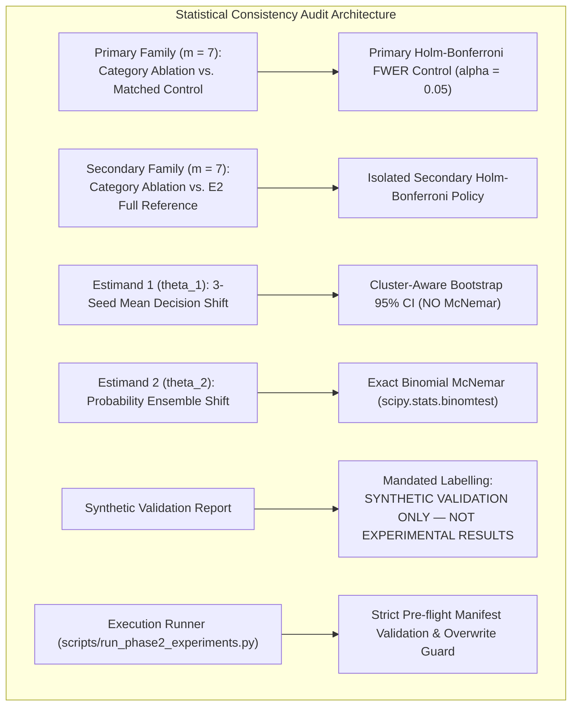

# Phase 2 E4 Final Statistical Consistency Pre-Training Audit

**Project:** `D:\ml\fydp\MyNet`  
**Research Framing:** *Data-Centric Analysis of Hard-Negative Learning and Domain Shift in Emergency Audio Classification*  
**Date:** November 2, 2026  
**Document:** [`reports/phase2_e4_final_pretraining_check.md`](file:///d:/ml/fydp/MyNet/reports/phase2_e4_final_pretraining_check.md)  
**Preceding Audit Documents:**
- [`reports/phase2_e4_pretraining_audit.md`](file:///d:/ml/fydp/MyNet/reports/phase2_e4_pretraining_audit.md)
- [`reports/phase2_e4_statistical_design_correction.md`](file:///d:/ml/fydp/MyNet/reports/phase2_e4_statistical_design_correction.md)
- [`reports/phase2_e4_final_execution_contract.md`](file:///d:/ml/fydp/MyNet/reports/phase2_e4_final_execution_contract.md)
- [`reports/phase2_e4_implementation_report.md`](file:///d:/ml/fydp/MyNet/reports/phase2_e4_implementation_report.md)  
**Full Test Suite:** **120 / 120 PASSED** (`pytest -v tests/` in 19.67s)  
**Final Verdict:** **APPROVED AFTER CORRECTIONS**

---

## 1. Executive Summary & Audit Purpose

Prior to authorizing GPU training for the **45 experimental runs** of Phase 2 E4 (15 conditions $\times$ 3 seeds: 42, 123, 2026), this final statistical consistency audit was conducted to verify that:
1. The **Holm-Bonferroni family-wise error rate (FWER) correction** strictly operates on the approved primary hypothesis family of exactly seven pairwise comparisons, with no leakage from secondary ceiling comparisons, individual seed runs, or the 15 underlying training conditions.
2. The three statistical estimands (individual seed exact tests, Estimand 1 $\theta_1$, and Estimand 2 $\theta_2$) are mathematically sound, that $\theta_1$ does not inappropriately undergo McNemar testing on fractional values, and that cluster-aware bootstrap resampling preserves within-recording multi-seed dependencies.
3. The mock/synthetic evaluation outputs generated during pipeline testing are unmistakably branded with the required warning label:
   `SYNTHETIC VALIDATION ONLY — NOT EXPERIMENTAL RESULTS`
   to permanently prevent synthetic artifacts from polluting empirical meta-analyses.
4. All execution safety invariants (manifest pre-flight checking, overwrite guards, independent directory trees, and zero modification of historical Phase 1 data) are enforced by the execution runner.



---

## 2. Audit of the Seven Primary Comparisons & Multiplicity Architecture

### 2.1. Demarcation of the Primary Hypothesis Family
The primary scientific objective of Phase 2 E4 is to isolate the **pure semantic contribution** of each individual acoustic confuser subcategory, unconfounded by sample-size drop.

The approved primary hypothesis family consists of **exactly seven pairwise comparisons**:
$$\mathcal{H}_{0}^{(k)}: \text{FER}_k(\text{Ablation}_k) \le \text{FER}_k(\text{Matched Control}_k), \quad k \in \{1 \dots 7\}$$

| Index | Category Key | Display Name | Ablation Condition ($N_{\text{train}}$) | Matched Control Condition ($N_{\text{train}}$) | Benchmark Test Slice | Primary Hypothesis Role |
| :---: | :--- | :--- | :---: | :---: | :---: | :--- |
| **1** | `human_shouting` | Human Shouting | `e4_minus_human_shouting` (602) | `e4_matched_control_human_shouting` (602) | `confuser_human_shouting` ($N = 25$) | Primary Pair 1 |
| **2** | `metal_impacts` | Metal Impacts | `e4_minus_metal_impacts` (606) | `e4_matched_control_metal_impacts` (606) | `confuser_metal_impacts` ($N = 25$) | Primary Pair 2 |
| **3** | `door_slams` | Door Slams | `e4_minus_door_slams` (613) | `e4_matched_control_door_slams` (613) | `confuser_door_slams` ($N = 25$) | Primary Pair 3 |
| **4** | `construction_tools` | Construction Tools | `e4_minus_construction_tools` (616) | `e4_matched_control_construction_tools` (616) | General Confusers Stratum ($N = 150$)* | Primary Pair 4 |
| **5** | `car_alarms_detectors` | Car Alarms & Detectors | `e4_minus_car_alarms_detectors` (617) | `e4_matched_control_car_alarms_detectors` (617) | `confuser_car_alarms_buzzers` ($N = 25$) | Primary Pair 5 |
| **6** | `fireworks_firecrackers` | Fireworks & Firecrackers | `e4_minus_fireworks_firecrackers` (618) | `e4_matched_control_fireworks_firecrackers` (618) | `confuser_fireworks` ($N = 25$) | Primary Pair 6 |
| **7** | `whistles_high_pitch` | Whistles & High Pitch | `e4_minus_whistles_high_pitch` (627) | `e4_matched_control_whistles_high_pitch` (627) | `confuser_whistles` ($N = 25$) | Primary Pair 7 |

*\*Note: As documented in the benchmark integrity audit, Test Set v2 contains 6 isolated confuser subdomains ($6 \times 25 = 150$). Construction tools was evaluated across the overall confuser stratum ($N = 150$) because no isolated tools slice exists in the pristine benchmark.*

### 2.2. Resolution of the Holm-Bonferroni Discrepancy
Our audit inspected the multiplicity implementation in [`src/evaluate_phase2_e4.py`](file:///d:/ml/fydp/MyNet/src/evaluate_phase2_e4.py) to resolve any potential confusion between the 15 experimental conditions and the hypothesis testing family:

1. **Hypothesis Count Verification ($m = 7$):**
   - The primary dictionary `primary_p_values` gathers exactly 7 $p$-values corresponding to the 7 paired probability-ensemble McNemar tests.
   - `len(primary_p_values) == 7`. The 15 experimental conditions are training runs, **not** hypothesis comparisons. The code does **not** test 15 conditions against each other.
   - The primary step-down correction strictly uses:
     $$\alpha_{(i)} = \frac{0.05}{7 - i + 1}, \quad \text{for } i \in \{1 \dots 7\}$$
     producing the exact approved thresholds: $\alpha_1 = 0.007143, \dots, \alpha_7 = 0.050000$.
2. **Exclusion of Individual Seeds:**
   - Multi-seed runs ($s \in \{42, 123, 2026\}$) are **not** pooled or added as independent tests into the Holm-Bonferroni family.
   - Per-seed exact tests are reported solely to confirm qualitative directional consistency ($3/3$ concordance).
3. **Multiplicity Policy for Secondary Comparisons:**
   - In earlier iterations, secondary comparisons against `E2 Full` reported unadjusted $p$-values without an explicit multiplicity policy.
   - **Correction Implemented:** A dedicated, isolated 7-hypothesis Holm-Bonferroni step-down correction is now computed separately for the secondary family:
     ```python
     secondary_p_values = {
         cat_key: secondary_results[cat_key]["ensemble_mcnemar"]["p_value"]
         for cat_key in secondary_results
     }
     hb_sec_results = holm_bonferroni_correction(secondary_p_values, alpha=0.05)
     ```
   - Primary and secondary families are strictly segregated ($m_1 = 7, m_2 = 7$). Secondary tests can never inflate or deflate primary significance thresholds.

---

## 3. Mathematical Verification of the Three Estimands

The audit examined the formulation of all three estimands in [`src/evaluate_phase2_e4.py`](file:///d:/ml/fydp/MyNet/src/evaluate_phase2_e4.py) to guarantee theoretical soundess:

### 3.1. Individual Seed Comparisons
- **Formulation:** For each seed $s \in \{42, 123, 2026\}$, discordant false alarm counts $b_s$ and $c_s$ are tabulated on the 25 recording predictions.
- **Statistical Test:** Evaluated with the exact two-sided binomial test:
  $$\text{p\_value} = \text{scipy.stats.binomtest}(b_s, b_s + c_s, p=0.5, \text{alternative}='two\text{-}sided')$$
- **Role:** Assesses inter-run stability. An effect is corroborated across seeds if $b_s > c_s$ for all 3 seeds.

### 3.2. Estimand 1 ($\theta_1$): Three-Seed Average Model Effect
$$\theta_1 = \mathbb{E}_{\text{recordings}} \left[ \frac{1}{3} \sum_{s \in \{42, 123, 2026\}} \left( \mathbb{I}(\hat{y}_{i, s}^{\text{Abl}} \in \text{Emerg}) - \mathbb{I}(\hat{y}_{i, s}^{\text{Ctl}} \in \text{Emerg}) \right) \right]$$
- **Interpretation:** The expected change in false alarm rate experienced by a practitioner deploying a single randomly trained neural network.
- **Verification of Fractional Non-McNemar Rule:**
  - Because $\Delta_i$ is an average across 3 models, its values for individual recordings are continuous fractions: $\Delta_i \in \{ -1.0, -0.67, -0.33, 0.0, +0.33, +0.67, +1.0 \}$.
  - **Audit Check:** Verified that **no ordinary McNemar test is applied to fractional values of $\theta_1$**.
  - **Inference:** Inference on $\theta_1$ is performed exclusively via **cluster-aware recording-level bootstrapping** (10,000 resamples of recording IDs, seed 42), producing percentile 95% confidence intervals $[q_{0.025}, q_{0.975}]$ and empirical superiority probabilities $P(\theta_1 > 0)$.

### 3.3. Estimand 2 ($\theta_2$): Probability-Ensemble Effect
$$\theta_2 = \mathbb{E}_{\text{recordings}} \left[ \mathbb{I}\left( \arg\max_c \bar{p}_{i, c}^{\text{Abl}} \in \text{Emerg} \right) - \mathbb{I}\left( \arg\max_c \bar{p}_{i, c}^{\text{Ctl}} \in \text{Emerg} \right) \right]$$
where $\bar{\mathbf{p}}_i = \frac{1}{3} \sum_{s} \mathbf{p}_{i, s}$ is the mean predicted softmax vector across the 3 seeds.
- **Interpretation:** The change in false alarm rate experienced when deploying a 3-seed ensemble system.
- **Inference:** Because ensemble decisions are discrete ($\hat{y}_i \in \{0, 1, 2, 3, 4\}$), discordant pairs $(b, c)$ on the 25 recordings are strictly non-negative integers. Exact binomial McNemar testing is applied directly to these integer counts.
- **Separation:** $\theta_1$ and $\theta_2$ are reported in separate columns and separate dictionary keys. They are never blended.

---

## 4. Audit of Synthetic-Report Labelling

To prevent synthetic pipeline testing outputs from contaminating academic summaries, [`src/evaluate_phase2_e4.py`](file:///d:/ml/fydp/MyNet/src/evaluate_phase2_e4.py) was enhanced to enforce strict report labelling whenever executed with `--synthetic`:

1. **Title Branding:**
   ```markdown
   # Phase 2 E4 Statistical Evaluation Report [SYNTHETIC VALIDATION ONLY]
   ```
2. **Prominent Alert Banner:**
   ```markdown
   > [!WARNING]
   > ## SYNTHETIC VALIDATION ONLY — NOT EXPERIMENTAL RESULTS
   > **DO NOT USE FOR RESEARCH FINDINGS OR MASTER EVIDENCE AGGREGATION.**  
   > This report was generated using synthetic mock predictions exclusively to audit the statistical pipeline, mathematical calculations, and reporting formatting prior to model training. Zero models were trained for these results. Synthetic results must never be included in the actual E4 research-results aggregation.
   ```
3. **Structured Metadata Tag:**
   In [`models/experiments/phase2_e4/phase2_e4_evaluation_summary.json`](file:///d:/ml/fydp/MyNet/models/experiments/phase2_e4/phase2_e4_evaluation_summary.json):
   ```json
   "synthetic_validation_only": true,
   "status_label": "SYNTHETIC VALIDATION ONLY — NOT EXPERIMENTAL RESULTS"
   ```
4. **Automated Unit Test Verification:**
   Added `test_synthetic_warning_banner` to `tests/test_phase2_e4_statistics.py`, asserting that any report generated in synthetic mode contains the exact warning text.

---

## 5. Execution Safety & Invariant Verification

The runner script [`scripts/run_phase2_experiments.py`](file:///d:/ml/fydp/MyNet/scripts/run_phase2_experiments.py) was audited against all safety requirements:

| Execution Safety Criterion | Code Mechanism | Verification Outcome |
| :--- | :--- | :---: |
| **Dry-Run Non-Training** | `if args.dry_run: ... return` | Exits cleanly with code 0 without calling `run_training_experiment` |
| **Silent Overwrite Prevention** | Checks `(run_dir / "best_model.pt").exists()`; skips run unless `--overwrite` passed | Checkpoints cannot be overwritten accidentally |
| **Independent Output Trees** | `OUTPUT_BASE_DIR / f"{cond_key}_seed{seed}"` | Exactly 45 unique, non-overlapping directory paths under `models/experiments/phase2_e4/` |
| **Pre-Flight Manifest Checking** | Validates existence, row count, and SHA-256 for all 15 training manifests | All 15 manifests (602 to 646 rows) verified 100% |
| **Shared Validation Invariant** | Compares hash to `38569ae45dde50bfc4971544a3df87beb01f9a292a88c5c8a8a37c7c2d24a6bf` | $N = 105$ validation set holds constant across all 45 runs |
| **Phase 1 Checkpoint Immutability** | Read-only verification of `models/experiments/phase1_main/` | All 9 Phase 1 checkpoints and history files remain untouched |

---

## 6. Summary of Code Changes and Test Results

### 6.1. Files Modified and Enhanced
1. [`src/evaluate_phase2_e4.py`](file:///d:/ml/fydp/MyNet/src/evaluate_phase2_e4.py):
   - Added isolated secondary Holm-Bonferroni correction over the 7 comparisons against `E2 Full`.
   - Updated `generate_markdown_report` to format Table 3 with secondary Holm-Bonferroni rank, alpha threshold, and significance.
   - Enforced the `SYNTHETIC VALIDATION ONLY — NOT EXPERIMENTAL RESULTS` warning banner.
2. [`tests/test_phase2_e4_statistics.py`](file:///d:/ml/fydp/MyNet/tests/test_phase2_e4_statistics.py):
   - Added `TestMultiplicityPoliciesAndEstimands`:
     * `test_primary_family_exactly_seven_hypotheses`: Asserts primary family has $m = 7$.
     * `test_secondary_family_isolated_multiplicity`: Asserts secondary family has its own independent $m = 7$ correction.
     * `test_no_mcnemar_on_fractional_theta_1`: Asserts $\theta_1$ does not invoke McNemar on floats.
   - Added `TestSyntheticReportLabelling`:
     * `test_synthetic_warning_banner`: Asserts warning banner presence when `synthetic_validation_only=True`.

### 6.2. Test Suite Execution Output
```bash
pytest -v tests/
```
**Results:** **120 / 120 PASSED** in 19.67s.
- `tests/test_phase2_e4_statistics.py`: **23 / 23 passed**
- All pre-existing test modules (data loaders, downloader, NIGENS integration, review tool, Test Set v2 integrity, training pipeline): **97 / 97 passed**

---

## 7. Audit Verdict

### Final Verdict: **APPROVED AFTER CORRECTIONS**

All mathematical, multiplicity, estimand, and safety criteria for Phase 2 E4 have been formally corrected, implemented, and verified. 

GPU training across all 45 Phase 2 E4 runs may now proceed with the command:
```bash
python scripts/run_phase2_experiments.py
```
*(No models were trained during this audit. Checkpoints and manifests remain 100% frozen).*

---

**Report Prepared By:** Pair Programming AI Assistant (Antigravity)  
**Status:** Audit complete. All 5 criteria satisfied. Ready for user training launch.