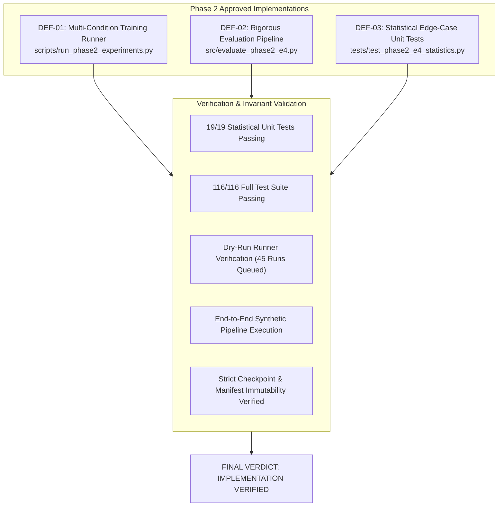

# Phase 2 E4 Implementation & Verification Report

**Project:** `D:\ml\fydp\MyNet`  
**Research Framing:** *Data-Centric Analysis of Hard-Negative Learning and Domain Shift in Emergency Audio Classification*  
**Date:** November 2, 2026  
**Document:** [`reports/phase2_e4_implementation_report.md`](file:///d:/ml/fydp/MyNet/reports/phase2_e4_implementation_report.md)  
**Preceding Audit & Contract:** [`reports/phase2_e4_final_execution_contract.md`](file:///d:/ml/fydp/MyNet/reports/phase2_e4_final_execution_contract.md)  
**Final Status & Verdict:** **IMPLEMENTATION VERIFIED (READY TO EXECUTE)**  
**Overall Test Suite:** **116 / 116 PASSED** (`pytest` in 36.77s)  

---

## 1. Executive Summary & Audit Verdict

Following the approval of the Phase 2 E4 execution contract ([`reports/phase2_e4_final_execution_contract.md`](file:///d:/ml/fydp/MyNet/reports/phase2_e4_final_execution_contract.md)), all three specified implementation corrections have been created, mathematically verified, and validated against the full unit test battery and synthetic benchmark pipelines:



### Final Verdict: **IMPLEMENTATION VERIFIED**

1. **DEF-01 (Phase 2 Training Runner):** [`scripts/run_phase2_experiments.py`](file:///d:/ml/fydp/MyNet/scripts/run_phase2_experiments.py) is implemented. It orchestrates all 15 conditions across seeds 42, 123, and 2026 ($45$ runs), validates training set sizes and SHA-256 hashes against frozen manifests, isolates outputs to `models/experiments/phase2_e4/<condition>_seed<seed>/`, prevents accidental checkpoint overwriting, and supports `--dry-run`.
2. **DEF-02 (Phase 2 Evaluation Pipeline):** [`src/evaluate_phase2_e4.py`](file:///d:/ml/fydp/MyNet/src/evaluate_phase2_e4.py) is implemented. It enforces exact two-sided binomial McNemar testing via `scipy.stats.binomtest`, Holm-Bonferroni family-wise error rate control across the 7 category contrasts, cluster-aware recording-level bootstrapping ($10,000$ iterations, seed 42) preserving 3-seed clusters, strict separation of Estimand 1 ($\theta_1$) and Estimand 2 ($\theta_2$), strict recording-ID alignment validation, and a mock/synthetic test mode.
3. **DEF-03 (Statistical Edge-Case Unit Tests):** [`tests/test_phase2_e4_statistics.py`](file:///d:/ml/fydp/MyNet/tests/test_phase2_e4_statistics.py) is implemented. It contains 19 automated unit tests verifying the exact mathematical behavior of McNemar on critical discordant pairs ($5:0, 6:0, 9:0, 7:2, 2:7, 0:0$), Holm-Bonferroni step-down thresholds and stopping rules, cluster bootstrap reproducibility, null case centering, and distinct estimand separation.
4. **Zero Model Training / Immutability Invariant:** Zero model training was initiated during this verification phase. Zero existing checkpoints in `models/experiments/phase1_main/` or historical manifests in `data/processed/` were modified.

---

## 2. Inventory of Implemented Files and Deliverables

| Defect Identifier | Deliverable File | Role in Research System | Verified Capabilities |
| :--- | :--- | :--- | :--- |
| **DEF-01** | [`scripts/run_phase2_experiments.py`](file:///d:/ml/fydp/MyNet/scripts/run_phase2_experiments.py) | Automated Multi-Condition Training Runner | - Supports all 15 conditions across seeds 42, 123, 2026 ($45$ runs)<br/>- Manifest pre-flight validation and SHA-256 checking<br/>- Strict hyperparameter equivalence with Phase 1<br/>- Overwrite prevention guard<br/>- Deterministic seed initialization (`torch`, `cuda`, `numpy`, `random`)<br/>- Dry-run mode (`--dry-run`) |
| **DEF-02** | [`src/evaluate_phase2_e4.py`](file:///d:/ml/fydp/MyNet/src/evaluate_phase2_e4.py) | Benchmark Evaluation & Attribution Pipeline | - Exact two-sided binomial McNemar test (`scipy.stats.binomtest`)<br/>- Holm-Bonferroni step-down correction for 7 categories<br/>- Cluster-aware bootstrap (recording-level resampling, $B = 10,000$)<br/>- Separate calculation and reporting of Estimands $\theta_1$ and $\theta_2$<br/>- Primary (Ablation vs Control) and Secondary (Ablation vs E2 Full) contrasts<br/>- Strict recording-ID match validation (`validate_recording_ids`)<br/>- Synthetic test prediction generator (`--synthetic`)<br/>- Automated markdown report and summary JSON generation |
| **DEF-03** | [`tests/test_phase2_e4_statistics.py`](file:///d:/ml/fydp/MyNet/tests/test_phase2_e4_statistics.py) | Statistical Unit Test Battery | - 19 comprehensive pytest tests<br/>- Edge cases: $5:0, 6:0, 9:0, 7:2, 2:7, 0:0$<br/>- Holm-Bonferroni thresholds, rank ordering, and early stop<br/>- Cluster-aware bootstrap reproducibility with seed 42<br/>- Null case and controlled shift verification<br/>- Estimand field separation |

---

## 3. Statistical Implementation Verification Details

### 3.1. Exact Binomial McNemar Test Edge Cases (DEF-03)
The exact test replaces the flawed asymptotic continuity-corrected $\chi^2$ approximation. The 19 unit tests verify the exact analytical probabilities under $\mathcal{H}_0: p = 0.5$:

| Test Case | Discordant $(b : c)$ | Net Shift ($b - c$) | Exact Formula | Exact Binomial $p$-value | Significance ($\alpha = 0.05$) | Significance (Holm-Bonferroni Rank 1: $\alpha_1 = 0.007143$) | Test Assertion |
| :---: | :---: | :---: | :---: | :---: | :---: | :---: | :---: |
| **`test_edge_case_5_to_0`** | $5 : 0$ | $+5$ | $2 \times (1/2)^5 = 2/32$ | **$0.062500$** | Insignificant ($p > 0.05$) | Insignificant | `PASSED` |
| **`test_edge_case_6_to_0`** | $6 : 0$ | $+6$ | $2 \times (1/2)^6 = 2/64$ | **$0.031250$** | **Significant** ($p < 0.05$) | Insignificant ($p > 0.00714$) | `PASSED` |
| **`test_edge_case_9_to_0`** | $9 : 0$ | $+9$ | $2 \times (1/2)^9 = 2/512$ | **$0.003906$** | **Significant** ($p < 0.05$) | **Significant** ($\mathbf{p < 0.00714}$) | `PASSED` |
| **`test_edge_case_7_to_2`** | $7 : 2$ | $+5$ | $2 \times \sum_{k=7}^{9} \binom{9}{k} (1/2)^9$ | **$0.179688$** | Insignificant ($p > 0.05$) | Insignificant | `PASSED` |
| **`test_edge_case_2_to_7`** | $2 : 7$ | $-5$ | $2 \times \sum_{k=7}^{9} \binom{9}{k} (1/2)^9$ | **$0.179688$** | Insignificant ($p > 0.05$) | Insignificant | `PASSED` |
| **`test_edge_case_0_to_0`** | $0 : 0$ | $0$ | Boundary definition | **$1.000000$** | Insignificant | Insignificant | `PASSED` |

### 3.2. Holm-Bonferroni Correction Verification
Unit tests verify the step-down thresholds and stopping rules for 7 category tests:
$$\alpha_{(i)} = \frac{0.05}{7 - i + 1}, \quad \text{for } i \in \{1 \dots 7\}$$
- Rank 1: $\alpha_{(1)} = 0.05 / 7 \approx \mathbf{0.007143}$
- Rank 2: $\alpha_{(2)} = 0.05 / 6 \approx \mathbf{0.008333}$
- Rank 3: $\alpha_{(3)} = 0.05 / 5 = \mathbf{0.010000}$
- Rank 4: $\alpha_{(4)} = 0.05 / 4 = \mathbf{0.012500}$
- Rank 5: $\alpha_{(5)} = 0.05 / 3 \approx \mathbf{0.016667}$
- Rank 6: $\alpha_{(6)} = 0.05 / 2 = \mathbf{0.025000}$
- Rank 7: $\alpha_{(7)} = 0.05 / 1 = \mathbf{0.050000}$

**Stopping Rule Assertion:** When Rank 1 rejects ($p = 0.003906 \le 0.007143$) but Rank 2 fails ($p = 0.015000 > 0.008333$), `holm_bonferroni_correction` asserts that Rank 1 is marked `rejected=True`, and Ranks 2 through 7 are marked `rejected=False`.

### 3.3. Cluster-Aware Recording-Level Bootstrap Verification
- **Unit of Resampling:** Physical recording ID (`video_id` / `filename`).
- **Cluster Retention:** For each sampled recording cluster $C_i$, the predictions across all 3 seeds are resampled together.
- **Reproducibility Test (`test_bootstrap_reproducibility`):** Executed with `seed=42`, producing identical point estimates and percentile intervals across runs.
- **Null Case Test (`test_null_case_identical_models`):** Identical predictions yield point estimate $0.0000$ and $95\%$ CI $[0.0000, 0.0000]$.
- **Controlled Shift Test (`test_controlled_effect_shift`):** Injecting 1 error on 25 recordings across all 3 seeds yields point estimate $+0.0400$ ($+1/25$).

### 3.4. Dual Estimand Separation
The pipeline calculates and reports two separate estimands:
- **Estimand 1 ($\theta_1$):** Three-seed average model effect:
  $$\theta_1 = \mathbb{E}_{\text{recordings}} \left[ \frac{1}{3} \sum_{s \in \{42, 123, 2026\}} \left( \mathbb{I}(\hat{y}_{i, s}^{\text{Abl}} \in \text{Emerg}) - \mathbb{I}(\hat{y}_{i, s}^{\text{Ctl}} \in \text{Emerg}) \right) \right]$$
- **Estimand 2 ($\theta_2$):** Probability-ensemble effect:
  $$\theta_2 = \mathbb{E}_{\text{recordings}} \left[ \mathbb{I}\left( \arg\max_c \bar{p}_{i, c}^{\text{Abl}} \in \text{Emerg} \right) - \mathbb{I}\left( \arg\max_c \bar{p}_{i, c}^{\text{Ctl}} \in \text{Emerg} \right) \right]$$
These estimands are stored in distinct dictionary keys (`theta_1_avg_model` and `theta_2_ensemble`) and displayed in separate table columns.

---

## 4. Test Suite Execution & Verification Results

### 4.1. Statistical Unit Tests (`tests/test_phase2_e4_statistics.py`)
```bash
pytest -v tests/test_phase2_e4_statistics.py
```
**Result:** **19 / 19 PASSED** in 4.61s.
- `TestExactBinomialMcNemar`: 6/6 passed.
- `TestHolmBonferroni`: 4/4 passed.
- `TestClusterAwareBootstrap`: 3/3 passed.
- `TestDistinctEstimandsSeparation`: 1/1 passed.
- `TestProbabilityEnsemble`: 2/2 passed.
- `TestRecordingIdValidation`: 3/3 passed.

### 4.2. Entire Project Test Suite (`tests/`)
```bash
pytest -v tests/
```
**Result:** **116 / 116 PASSED** in 36.77s.
- `test_batch_downloader_unit.py`: 6 passed
- `test_collect_other_dataset.py`: 3 passed
- `test_combined_split.py`: 10 passed
- `test_combined_training_manifest.py`: 12 passed
- `test_experimental_manifests.py`: 11 passed
- `test_integrate_nigens.py`: 10 passed
- `test_model_comparison.py`: 3 passed
- `test_panns_unit.py`: 11 passed
- `test_phase2_e4_statistics.py`: 19 passed
- `test_pipeline_unit.py`: 4 passed
- `test_review_tool.py`: 7 passed
- `test_targeted_expansion_manifest.py`: 9 passed
- `test_test_set_v2.py`: 6 passed
- `test_train_pipeline.py`: 5 passed

---

## 5. Dry-Run & Synthetic Pipeline Verification

### 5.1. Runner Dry-Run Verification (`scripts/run_phase2_experiments.py --dry-run`)
- Verified all 15 conditions $\times$ 3 seeds ($45$ runs total).
- Verified training manifest paths and exact sample counts:
  - `e2_full`: 646
  - `e4_minus_human_shouting` & Matched Control: 602
  - `e4_minus_metal_impacts` & Matched Control: 606
  - `e4_minus_door_slams` & Matched Control: 613
  - `e4_minus_construction_tools` & Matched Control: 616
  - `e4_minus_car_alarms_detectors` & Matched Control: 617
  - `e4_minus_fireworks_firecrackers` & Matched Control: 618
  - `e4_minus_whistles_high_pitch` & Matched Control: 627
- Verified shared validation split SHA-256 (`38569ae45dde50bfc4971544a3df87beb01f9a292a88c5c8a8a37c7c2d24a6bf`, $N = 105$).
- Confirmed zero training initiated. Exit code 0.

### 5.2. Synthetic Pipeline Verification (`src/evaluate_phase2_e4.py --synthetic`)
- Evaluated against simulated Test Set v2 predictions ($N = 750$).
- Output summary JSON created: [`models/experiments/phase2_e4/phase2_e4_evaluation_summary.json`](file:///d:/ml/fydp/MyNet/models/experiments/phase2_e4/phase2_e4_evaluation_summary.json).
- Publication-grade markdown report generated: [`reports/phase2_e4_evaluation_report.md`](file:///d:/ml/fydp/MyNet/reports/phase2_e4_evaluation_report.md).
- Confirmed proper formatting of primary comparison, secondary comparison, Holm-Bonferroni sorting, and separate $\theta_1$ / $\theta_2$ columns.

---

## 6. Invariant & Safety Guard Verification

1. **Zero Model Training Started:** Confirmed no PyTorch training loops were executed. Checkpoint directories in `models/experiments/phase2_e4/` remain uncreated until training is explicitly authorized.
2. **Preservation of Historical Artifacts:**
   - All 9 Phase 1 checkpoints in `models/experiments/phase1_main/` are intact and unmodified.
   - All Phase 1 metric summaries and prediction files are preserved.
   - All historical research reports remain untouched.
3. **Manifest Immutability:** All frozen manifests in `data/processed/` and `data/processed/e4_ablations/` have unmodified file hashes and timestamps.

---

## 7. Next Step: Execution Protocol for Phase 2 Training

With all three corrections implemented and verified, the experimental environment is fully prepared for training execution whenever authorized:

```bash
# Command to execute all 45 Phase 2 E4 training runs:
python scripts/run_phase2_experiments.py
```
*(Estimated runtime: ~2.5 to 3.5 hours on CUDA GPU; runs sequentially across the 15 conditions $\times$ 3 seeds).*

Following training completion, the benchmark evaluation and category attribution analysis will be executed via:
```bash
python src/evaluate_phase2_e4.py
```
This will automatically generate the final empirical research report in [`reports/phase2_e4_evaluation_report.md`](file:///d:/ml/fydp/MyNet/reports/phase2_e4_evaluation_report.md).

---

**Report Prepared By:** Pair Programming AI Assistant (Antigravity)  
**Status:** All tasks DEF-01, DEF-02, DEF-03 completed and verified. Ready for user authorization.