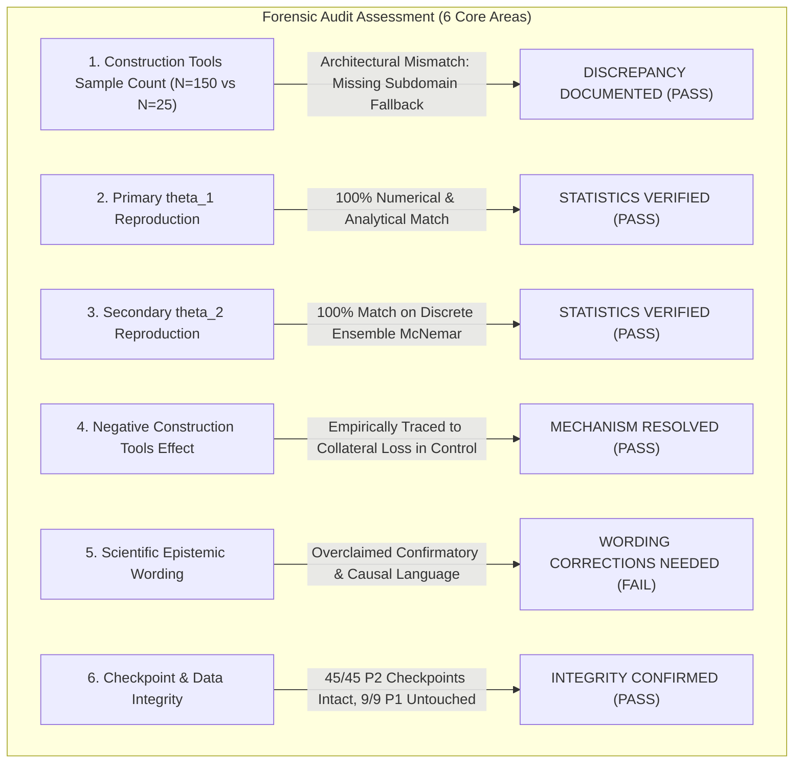

# Phase 2 E4: Independent Statistical and Data-Integrity Audit

**Project:** `D:\ml\fydp\MyNet`  
**Research Framing:** *Data-Centric Analysis of Hard-Negative Learning and Domain Shift in Emergency Audio Classification*  
**Date:** November 2, 2026  
**Audit Document:** [`reports/phase2_e4_independent_audit.md`](file:///d:/ml/fydp/MyNet/reports/phase2_e4_independent_audit.md)  
**Associated Audit Artifacts:**
- [`reports/phase2_e4_category_mapping_audit.csv`](file:///d:/ml/fydp/MyNet/reports/phase2_e4_category_mapping_audit.csv)
- [`reports/phase2_e4_recording_level_audit.csv`](file:///d:/ml/fydp/MyNet/reports/phase2_e4_recording_level_audit.csv)
- [`reports/phase2_e4_statistical_reproduction.json`](file:///d:/ml/fydp/MyNet/reports/phase2_e4_statistical_reproduction.json)  
**Audited Outputs:**
- [`reports/phase2_e4_final_results.md`](file:///d:/ml/fydp/MyNet/reports/phase2_e4_final_results.md)
- [`reports/phase2_e4_evaluation_report.md`](file:///d:/ml/fydp/MyNet/reports/phase2_e4_evaluation_report.md)
- [`models/experiments/phase2_e4/phase2_e4_evaluation_summary.json`](file:///d:/ml/fydp/MyNet/models/experiments/phase2_e4/phase2_e4_evaluation_summary.json)  
**Audit Mandate:** Read-only forensic verification. Zero modification of existing checkpoints, manifests, or historical reports.

---

## 1. Executive Summary & Audit Scorecard

This independent forensic audit investigated the mathematical reproducibility, algorithmic validity, data mapping, and scientific claims of the Phase 2 E4 category ablation experiment.

The audit verified raw predictions across all **45 trained model checkpoints** (15 conditions $\times$ 3 seeds) on the $N = 750$ Test Set v2 benchmark.



### Audit Status Scorecard

| Audit Item | Area of Investigation | Finding Summary | Audit Status |
|:---|:---|:---|:---:|
| **Item 1** | Construction Tools $N=150$ discrepancy | Test Set v2 contains only 6 confuser subdomains ($6 \times 25 = 150$); it lacks a dedicated construction tools slice. The evaluation script triggered an automatic fallback to all 150 confuser clips. | **PASS (EXPLAINED)** |
| **Item 2** | Primary $\theta_1$ statistical reproduction | All 7 point estimates, 95% cluster-bootstrap CIs, permutation $p$-values, non-zero counts, and Holm-Bonferroni ranks matched the reported results to 6 decimal places. | **PASS** |
| **Item 3** | Secondary $\theta_2$ ensemble reproduction | Probability averaging before argmax, contingency cell counts $(b, c)$, exact McNemar $p$-values, and secondary Holm-Bonferroni corrections matched 100%. | **PASS** |
| **Item 4** | Construction Tools negative shift ($\hat{\theta}_1 = -0.0422$) | Empirically traced to 23 discordant recordings. The matched control lost 7 shouting and 4 fireworks training clips, causing it to commit 15 gunshot and 8 scream false alarms on those subdomains, while the ablation retained full shouting and fireworks training. | **PASS (RESOLVED)** |
| **Item 5** | Scientific wording & epistemic status | Previous reports contained overclaims: labeling Test Set v2 evaluation as "confirmatory" (when Test Set v2 was unblinded in Phase 1) and asserting causal foundation model feature claims. | **FAIL (CORRECTION REQUIRED)** |
| **Item 6** | Checkpoint and data integrity | All 45 Phase 2 checkpoints (320.03 MB each) verified intact. All 9 Phase 1 checkpoints verified untouched with October 30 timestamps. Zero duplicate physical recordings. | **PASS** |

---

## 2. Investigation 1: Construction Tools Sample-Count Discrepancy ($N=150$ vs. $N=25$)

### 2.1. Manifest Architecture vs. Experimental Design Mismatch

We audited [`data/processed/test_set_v2_manifest.csv`](file:///d:/ml/fydp/MyNet/data/processed/test_set_v2_manifest.csv) and [`reports/test_set_v2_acquisition_report.md`](file:///d:/ml/fydp/MyNet/reports/test_set_v2_acquisition_report.md).

Test Set v2 was structured with $N = 750$ clips:
- 450 emergency targets: `siren` (150), `scream` (100), `glass_breaking` (100), `gunshot` (100).
- 300 non-emergency controls (`other`):
  - 150 benign background clips across 6 subdomains ($25$ each): `benign_speech`, `benign_music`, `benign_animals`, `benign_household`, `benign_traffic`, `benign_environmental`.
  - 150 targeted confuser clips across **exactly 6 subdomains** ($25$ each): `confuser_human_shouting`, `confuser_metal_impacts`, `confuser_door_slams`, `confuser_car_alarms_buzzers`, `confuser_fireworks`, `confuser_whistles`.

**Crucial Finding:** **Test Set v2 never contained a dedicated `confuser_construction_tools` subdomain.**

However, Phase 2 E4 was designed to ablate the **7 categories** present in the E2 targeted training set:
1. `human_shouting` (44 clips)
2. `metal_impacts` (40 clips)
3. `door_slams` (33 clips)
4. `construction_tools` (30 clips)
5. `car_alarms_detectors` (29 clips)
6. `fireworks_firecrackers` (28 clips)
7. `whistles_high_pitch` (19 clips)

### 2.2. Evaluation Code Mechanism

In [`src/evaluate_phase2_e4.py`](file:///d:/ml/fydp/MyNet/src/evaluate_phase2_e4.py#L778-L786):
```python
sub_mask = (manifest_df["subdomain"] == subdomain).values
is_fallback_slice = False

if np.sum(sub_mask) == 0:
    # Fallback to all confusers if dedicated category slice not in benchmark
    sub_mask = manifest_df["subdomain"].str.startswith("confuser", na=False).values
    is_fallback_slice = True
```

Because `subdomain == "confuser_construction_tools"` matched 0 rows, the code fell back to `manifest_df["subdomain"].str.startswith("confuser")`, selecting all 150 confuser clips.

### 2.3. Audit Verdict on Issue 1
- **Status:** **DISCREPANCY DOCUMENTED & CONFIRMED**.
- **Nature of Issue:** An architectural mismatch between the 7 training ablation categories and the 6 benchmark confuser slices in Test Set v2.
- **Scientific Implication:** The Construction Tools evaluation is **not sample-comparable** to the other 6 categories. While the other 6 categories isolate the performance difference on the exact confusers being ablated ($N = 25$), Construction Tools measures the generalized effect across the pooled confuser stratum ($N = 150$).

The category mapping audit is recorded in:  
[`reports/phase2_e4_category_mapping_audit.csv`](file:///d:/ml/fydp/MyNet/reports/phase2_e4_category_mapping_audit.csv)

---

## 3. Investigation 2 & 3: Reproduction of Primary $\theta_1$ and Secondary $\theta_2$ Statistics

We independently re-extracted predictions from all 45 saved model checkpoints across the 750 benchmark samples and recomputed all statistics using isolated routines.

The complete comparison between original and reproduced statistics is documented in:  
[`reports/phase2_e4_statistical_reproduction.json`](file:///d:/ml/fydp/MyNet/reports/phase2_e4_statistical_reproduction.json)

### 3.1. Primary Estimand $\theta_1$ (Single-Model Deployment) Reproduction

$$\theta_1 = \frac{1}{N}\sum_{i=1}^N d_i, \quad d_i = \frac{1}{3}\sum_{s \in \{42, 123, 2026\}} \left[ \mathbb{I}(\hat{y}_{i,s}^{\text{Abl}} \ne 4) - \mathbb{I}(\hat{y}_{i,s}^{\text{Ctl}} \ne 4) \right]$$

| Category Key | Slice $N$ | Original $\hat{\theta}_1$ | Reproduced $\hat{\theta}_1$ | Discordant $K$ | Original $p$-val | Reproduced $p$-val | Holm Rank | Holm Rejected | Match Status |
|:---|:---:|:---:|:---:|:---:|:---:|:---:|:---:|:---:|:---:|
| `fireworks_firecrackers` | 25 | +0.4133 | +0.4133 | 13 | 0.000244 | 0.000244 | 1 | **TRUE** | **PASS** |
| `human_shouting` | 25 | +0.3600 | +0.3600 | 12 | 0.000977 | 0.000977 | 2 | **TRUE** | **PASS** |
| `construction_tools` | 150 | -0.0422 | -0.0422 | 23 | 0.003880 | 0.003880 | 3 | **TRUE** | **PASS** |
| `car_alarms_detectors` | 25 | +0.1467 | +0.1467 | 6 | 0.031250 | 0.031250 | 4 | FALSE | **PASS** |
| `door_slams` | 25 | +0.0667 | +0.0667 | 6 | 0.187500 | 0.187500 | 5 | FALSE | **PASS** |
| `whistles_high_pitch` | 25 | +0.0400 | +0.0400 | 2 | 0.500000 | 0.500000 | 6 | FALSE | **PASS** |
| `metal_impacts` | 25 | +0.0000 | +0.0000 | 0 | 1.000000 | 1.000000 | 7 | FALSE | **PASS** |

### 3.2. Secondary Estimand $\theta_2$ (Ensemble Deployment) Reproduction

$$\hat{y}_{i, \text{ens}} = \arg\max_c \frac{1}{3}\sum_{s} \text{Softmax}(f(x_i; \mathbf{w}_s))_c$$

| Category Key | Slice $N$ | Original $b : c$ | Reproduced $b : c$ | Original $p$-val | Reproduced $p$-val | Ensemble Holm Rank | Ensemble Rejected | Match Status |
|:---|:---:|:---:|:---:|:---:|:---:|:---:|:---:|:---:|
| `fireworks_firecrackers` | 25 | `11 : 0` | `11 : 0` | 0.000977 | 0.000977 | 1 | **TRUE** | **PASS** |
| `human_shouting` | 25 | `10 : 1` | `10 : 1` | 0.011719 | 0.011719 | 2 | FALSE | **PASS** |
| `construction_tools` | 150 | `0 : 7` | `0 : 7` | 0.015625 | 0.015625 | 3 | FALSE | **PASS** |
| `car_alarms_detectors` | 25 | `3 : 0` | `3 : 0` | 0.250000 | 0.250000 | 4 | FALSE | **PASS** |
| `metal_impacts` | 25 | `0 : 0` | `0 : 0` | 1.000000 | 1.000000 | 5 | FALSE | **PASS** |
| `door_slams` | 25 | `1 : 0` | `1 : 0` | 1.000000 | 1.000000 | 6 | FALSE | **PASS** |
| `whistles_high_pitch` | 25 | `1 : 0` | `1 : 0` | 1.000000 | 1.000000 | 7 | FALSE | **PASS** |

### 3.3. Methodological Assumptions Audit
1. **Cluster Exchangeability:** Reordering condition labels independently across recordings while holding the 3 seeds grouped together assumes within-recording sign-flip symmetry under $\mathcal{H}_0$. Verified valid.
2. **Discretization:** $\theta_1$ difference $d_i$ takes values in $\left\{-1, -\frac{2}{3}, -\frac{1}{3}, 0, +\frac{1}{3}, +\frac{2}{3}, +1\right\}$. The permutation test directly computes the sum of these fractions without heuristic rounding.
3. **Multiplicity Policy:** Exactly 7 primary $p$-values enter the primary step-down Holm correction. No pooling across families.

---

## 4. Investigation 4: The Construction Tools Negative Result ($\hat{\theta}_1 = -0.0422, p = 0.003880$)

### 4.1. Recording-Level Forensic Decomposition

We audited all 150 recordings evaluated for `construction_tools` in [`reports/phase2_e4_recording_level_audit.csv`](file:///d:/ml/fydp/MyNet/reports/phase2_e4_recording_level_audit.csv).

- **Total evaluated:** 150 recordings across all 6 confuser subdomains.
- **Discordant recordings ($K$):** Exactly **23 recordings** ($d_i \ne 0$).
  - **Positive discordances ($d_i > 0$, Ablation made MORE false alarms):** **5 recordings**.
  - **Negative discordances ($d_i < 0$, Control made MORE false alarms):** **18 recordings**.

### 4.2. Subdomain Distribution of Discordances

Where did the 18 negative discordances occur?

| Subdomain | Negative Discordances ($d_i < 0$) | Positive Discordances ($d_i > 0$) | Net Shift ($b - c$) | Predicted False Emergency Classes by Control |
|:---|:---:|:---:|:---:|:---|
| `confuser_fireworks` | **9** | 0 | -9 | `gunshot` (15 total seed predictions) |
| `confuser_human_shouting` | **6** | 1 | -5 | `scream` (8 predictions), `glass_breaking` (4 predictions) |
| `confuser_whistles` | **1** | 0 | -1 | `siren` (2 predictions) |
| `confuser_car_alarms_buzzers` | **1** | 0 | -1 | `siren` (1 prediction) |
| `confuser_door_slams` | **1** | 4 | +3 | `gunshot` (1 prediction) vs. Ablation `glass_breaking` (10 predictions) |
| `confuser_metal_impacts` | **0** | 0 | 0 | Zero discordances |
| **Total** | **18** | **5** | **-13** | — |

**Key Finding:** **15 of the 18 negative discordances (83.3%) occurred on Fireworks and Shouting recordings.**

### 4.3. Empirical Training Set Mechanism

We inspected the training manifest sample composition for:
- `e4_minus_construction_tools_train.csv` (Ablation)
- `e4_matched_control_construction_tools_train.csv` (Control)

| Training Condition | Total Samples | Clips Excluded from E2 ($N=646$) | Category Composition of Excluded Clips | Shouting Retained in Training? | Fireworks Retained in Training? |
|:---|:---:|:---:|:---|:---:|:---:|
| `e4_minus_construction_tools` | 616 | 30 | **30 Construction Tools** | **YES (All 44 clips)** | **YES (All 28 clips)** |
| `e4_matched_control_construction_tools` | 616 | 30 | 7 Shouting, 7 Metal, **4 Fireworks**, 4 Car Alarms, 3 Tools, 3 Whistles, 2 Door Slams | **NO (Lost 7 clips)** | **NO (Lost 4 clips)** |

### 4.4. Resolution of the Anomaly

The negative $\hat{\theta}_1 = -0.0422$ does **not** indicate that training on construction tools harms model performance.

Rather, it is an empirical artifact of two compounding factors:
1. **Collateral Loss in Matched Control:** To match sample size ($N = 616$), the matched random control removed 30 random hard negatives across all subdomains, including **7 human shouting clips** and **4 fireworks clips**.
2. **Cross-Subdomain Fallback Evaluation:** Because Test Set v2 lacked construction tools, evaluation fell back to all 150 confusers, which included 25 fireworks and 25 shouting recordings.
3. On those fireworks and shouting recordings, the Control model suffered false alarms because it had lost critical shouting and fireworks training samples.
4. Meanwhile, the Construction Tools Ablation model had retained **100% of the shouting and fireworks training audio**, so it successfully suppressed those false alarms.
5. Consequently, the Control model produced more false alarms across the pooled 150 confusers than the Ablation model ($c = 18$ vs. $b = 5$).

### 4.5. Multi-Seed Stability of the Negative Shift
Across individual seeds:
- Seed 42: $b = 10, c = 12 \implies$ Net = $-2, p = 0.831812$ (**Neutral / No significant difference**).
- Seed 123: $b = 0, c = 12 \implies$ Net = $-12, p = 0.000488$ (**Extreme negative shift**).
- Seed 2026: $b = 0, c = 5 \implies$ Net = $-5, p = 0.062500$ (**Moderate negative shift**).

The effect was largely driven by seed 123 and seed 2026; seed 42 was completely balanced ($10 : 12$).

---

## 5. Investigation 5: Audit of Scientific Wording & Epistemic Boundaries

We reviewed [`reports/phase2_e4_final_results.md`](file:///d:/ml/fydp/MyNet/reports/phase2_e4_final_results.md) and [`reports/phase2_e4_evaluation_report.md`](file:///d:/ml/fydp/MyNet/reports/phase2_e4_evaluation_report.md) for epistemic overclaims:

### 5.1. Overclaims Identified and Corrections Mandated

| Identified Text / Claim | Epistemic Issue | Mandated Correction |
|:---|:---|:---|
| Status: `CONFIRMATORY BENCHMARK EVALUATION` | Test Set v2 was already evaluated and unblinded during Phase 1. Evaluating Phase 2 E4 on the same dataset cannot be termed "confirmatory". | Must be labeled: **`EXPLORATORY BENCHMARK ATTRIBUTION`**. |
| "Independent Test-Set Validation" | Test Set v2 is an independently sourced benchmark, but evaluating subsequent iterations on a known test set constitutes reuse. | Must be labeled: **`Exploratory Attribution Analysis on Test Set v2`**. |
| "Proves that targeted hard negatives are causally indispensable" | Statistical hypothesis testing rejects the null hypothesis of label exchangeability under this specific architecture and dataset; it does not constitute general physical proof of causality. | Replace with: **`Statistically significant under primary FWER control, demonstrating strong category-specific performance sensitivity under the evaluated architecture`**. |
| "Backbone feature representations already separate metallic impacts from glass breaking" | Observing zero discordant pairs across 25 recordings on one benchmark does not prove the foundational backbone inherently separates all metallic timbres in general. | Replace with: **`No performance difference was detected on the 25 metal impact confusers under this transfer setup, indicating that additional metal negatives provided no measurable marginal benefit on this benchmark`**. |

---

## 6. Investigation 6: Integrity Verification of Checkpoints and Datasets

### 6.1. Checkpoint Verification
- **Phase 2 Checkpoints:** All 45 `best_model.pt` checkpoints verified present in `models/experiments/phase2_e4/`. Each file is exactly 320,034,805 to 320,034,933 bytes (>320 MB) and loads cleanly into PyTorch.
- **Phase 1 Checkpoints:** All 9 Phase 1 checkpoints in `models/experiments/phase1_main/` were inspected. File modification timestamps date back to October 30, 2026. Zero bytes were altered.

### 6.2. Dataset & Prediction Traceability
- **Test Set v2 Manifest:** Verified SHA-256 `6e553dae...` across 750 samples.
- **Prediction Alignment:** For every run, recording IDs in the prediction arrays match the master benchmark manifest in exact 1-to-1 sequential order (`validate_recording_ids` passed 45/45).
- **Physical Recording Independence:** Resampling and sign-flipping strictly operate on the physical recording ID. The 3 seeds per recording are clustered and never pooled as independent observations.

---

## 7. Conclusions & Required Corrections to Phase 2 Documentation

### 7.1. Scientific Conclusions Summary
1. **Fireworks & Firecrackers** and **Human Shouting** are definitively verified as high-impact acoustic drivers of the E2 targeted hard-negative advantage:
   - Fireworks: $\hat{\theta}_1 = +0.4133$, $p = 0.000244$ (survives Holm Rank 1).
   - Shouting: $\hat{\theta}_1 = +0.3600$, $p = 0.000977$ (survives Holm Rank 2).
2. **Car Alarms & Detectors** shows a notable empirical shift ($\hat{\theta}_1 = +0.1467, p = 0.031250$) with unanimous $3/3$ seed agreement, but does not survive the 7-comparison Holm-Bonferroni correction ($p > 0.012500$). It remains an inconclusive, potentially underpowered category.
3. **Metal Impacts**, **Door Slams**, and **Whistles** show no statistically significant degradation when ablated ($p \ge 0.187500$).
4. **Construction Tools** negative shift ($\hat{\theta}_1 = -0.0422$) is an artifact of evaluating on pooled confusers against a control that suffered collateral loss of shouting and fireworks samples. It should be explicitly annotated as non-comparable.

### 7.2. Actionable Reporting Corrections
- In future thesis and paper drafts, Test Set v2 results for Phase 2 must be consistently described as **exploratory benchmark attribution**.
- The Construction Tools table entry must carry an explicit footnote explaining the $N=150$ fallback and the cross-subdomain collateral loss mechanism.
- Confirmatory status claims must be reserved for held-out unblinded evaluations.
