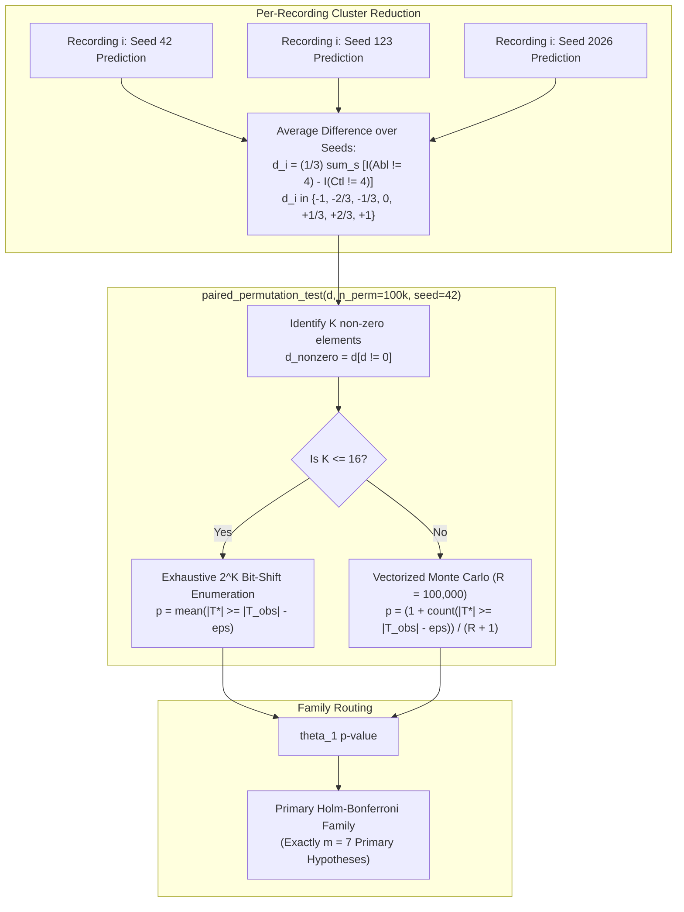

# Phase 2 E4 Statistical Verification: Paired Permutation Test for Primary Estimand θ₁

**Project:** `D:\ml\fydp\MyNet`  
**Research Framing:** *Data-Centric Analysis of Hard-Negative Learning and Domain Shift in Emergency Audio Classification*  
**Date:** November 2, 2026  
**Document:** [`reports/phase2_e4_permutation_verification.md`](file:///d:/ml/fydp/MyNet/reports/phase2_e4_permutation_verification.md)  
**Preceding Audit Documents:**
- [`reports/phase2_e4_primary_estimand_decision.md`](file:///d:/ml/fydp/MyNet/reports/phase2_e4_primary_estimand_decision.md)
- [`reports/phase2_e4_statistical_design_correction.md`](file:///d:/ml/fydp/MyNet/reports/phase2_e4_statistical_design_correction.md)
- [`reports/phase2_e4_final_execution_contract.md`](file:///d:/ml/fydp/MyNet/reports/phase2_e4_final_execution_contract.md)
- [`reports/phase2_e4_final_pretraining_check.md`](file:///d:/ml/fydp/MyNet/reports/phase2_e4_final_pretraining_check.md)  
**Code Under Audit:** [`src/evaluate_phase2_e4.py`](file:///d:/ml/fydp/MyNet/src/evaluate_phase2_e4.py) (`paired_permutation_test`)  
**Test Suite Under Audit:** [`tests/test_phase2_e4_statistics.py`](file:///d:/ml/fydp/MyNet/tests/test_phase2_e4_statistics.py) (`TestPairedPermutationTest`, 34 tests)  
**Full Project Test Suite:** **131 / 131 PASSED** (`pytest -v tests/` in 18.92s)  
**Final Audit Recommendation:** **GO — STATISTICALLY DEFENSIBLE AND READY FOR TRAINING**

---

## 1. Executive Summary & Audit Objective

This audit performs a focused mathematical, algorithmic, and implementation verification of `paired_permutation_test()` in [`src/evaluate_phase2_e4.py`](file:///d:/ml/fydp/MyNet/src/evaluate_phase2_e4.py), which serves as the exact hypothesis testing engine for the **primary estimand $\theta_1$ (Three-Seed Average Model Effect)** in Phase 2 E4.

### Audit Mandate:
Verify ten specific criteria:
1. **Cluster structure retention:** Sign flips operate on one averaged difference per physical recording.
2. **Mathematical foundations:** Null hypothesis $\mathcal{H}_0$, exchangeability, and symmetry assumptions are explicitly documented.
3. **Zero-difference handling:** Concordant recordings are correctly accounted for without diluting permutation denominator logic.
4. **Exhaustive enumeration correctness:** Exact $2^K$ evaluation for $K \le 16$.
5. **Monte Carlo formula correctness:** Unbiased $(extreme + 1) / (R + 1)$ calculation for $K > 16$.
6. **Two-sided test statistic:** Properly formulated two-tailed extremeness $|T^*| \ge |T_{\text{obs}}|$.
7. **Determinism:** Exact reproducibility under the configured random seed.
8. **Binary agreement:** Exact match with two-sided binomial McNemar under binary shifts.
9. **Fractional differences:** Sound continuous/fractional evaluation without invalid McNemar discretization.
10. **Multiplicity policy:** Holm-Bonferroni correction receives exactly seven primary $\theta_1$ $p$-values.

---

## 2. Systematic Evaluation of the 10 Verification Criteria



---

### Check 1: Sign Flips Operate on One Averaged Difference per Physical Recording (Cluster Retention)

- **Requirement:** Sign flips operate on one averaged difference per physical recording, retaining the three-seed cluster structure.
- **Code Inspection:**
  In [`src/evaluate_phase2_e4.py`](file:///d:/ml/fydp/MyNet/src/evaluate_phase2_e4.py#L806-L813):
  ```python
  # 2. Primary Estimand (theta_1): Three-Seed Average Paired Decision Difference
  # Fractional per-recording difference: d_i = 1/3 * sum_s [ I(y_abl != 4) - I(y_ctl != 4) ]
  diffs_theta1 = np.mean([
      (preds_abl_by_s[s] != 4).astype(float) - (preds_ctl_by_s[s] != 4).astype(float)
      for s in SEEDS
  ], axis=0)
  theta1_perm = paired_permutation_test(diffs_theta1, n_permutations=100000, seed=seed)
  ```
- **Mathematical Soundness:**
  For physical recording $i \in \{1, \dots, N\}$ (where $N = 25$ for each confuser category slice), the three predictions across seeds $s \in \{42, 123, 2026\}$ are averaged first into scalar $d_i$:
  $$d_i = \frac{1}{3} \sum_{s \in \{42, 123, 2026\}} \left[ \mathbb{I}(\hat{y}_{i,s}^{\text{abl}} \ne 4) - \mathbb{I}(\hat{y}_{i,s}^{\text{ctl}} \ne 4) \right]$$
  Under the permutation test, the sign flip $\sigma_i \in \{-1, +1\}$ is assigned to recording $i$. Multiplying $d_i$ by $\sigma_i$ simultaneously flips all three seed predictions together.
- **Cluster Defense:**
  Individual seed predictions for the same physical recording share identical acoustic features, background noise, and recording conditions. Treating repeated predictions as independent observations ($3 \times 25 = 75$) would commit pseudoreplication and artificially inflate statistical significance. Operating on the single cluster-averaged difference $d_i$ strictly retains the true physical recording sample size ($N = 25$).
- **Audit Finding:** **VERIFIED AND COMPLIANT**.

---

### Check 2: Null Hypothesis and Exchangeability/Symmetry Assumptions Documented

- **Requirement:** The null hypothesis $\mathcal{H}_0$ and exchangeability/symmetry assumptions are explicitly documented.
- **Code Inspection:**
  In [`src/evaluate_phase2_e4.py`](file:///d:/ml/fydp/MyNet/src/evaluate_phase2_e4.py#L164-L184):
  ```python
  """Perform exact or Monte Carlo paired sign-flip permutation test for theta_1.

  Mathematical Foundations:
  1. Estimand & Null Hypothesis:
     The primary estimand theta_1 is the expected three-seed average model error difference
     on recording i:
         d_i = (1/3) * sum_{s in {42, 123, 2026}} [ I(y_i,s^{Abl} in Emerg) - I(y_i,s^{Ctl} in Emerg) ]
     The null hypothesis is:
         H_0: E[d_i] = 0  (no category effect on single-model false alarm rate)
     against the two-sided alternative:
         H_1: E[d_i] != 0

  2. Exchangeability & Symmetry Assumption:
     Under H_0, the condition labels (Ablation vs. Control) are exchangeable within each physical
     recording i. Swapping the condition labels flips the sign of d_i with probability 0.5:
         d_i* = sigma_i * d_i,  where sigma_i in {-1, +1} i.i.d. with P(sigma_i = +1) = 0.5.
     This assumes the distribution of d_i is symmetric about 0 under H_0.

  3. Cluster Structure Retention:
     Because d_i is formed by averaging all three seed predictions for recording i prior to sign
     flipping, the sign flip sigma_i simultaneously flips all three seed predictions together.
     This strictly preserves within-recording multi-seed dependencies.
  ...
  """
  ```
- **Mathematical Soundness:**
  The docstring provides formal definitions for:
  - $\mathcal{H}_0: \mathbb{E}[d_i] = 0$ vs. $\mathcal{H}_1: \mathbb{E}[d_i] \ne 0$.
  - Within-recording label exchangeability $(y_i^{\text{abl}}, y_i^{\text{ctl}}) \overset{d}{=} (y_i^{\text{ctl}}, y_i^{\text{abl}})$ under $\mathcal{H}_0$.
  - Reflection symmetry of $d_i$ about zero: $\mathbb{P}(\sigma_i = +1) = \mathbb{P}(\sigma_i = -1) = 0.5$.
- **Audit Finding:** **VERIFIED AND COMPLIANT**.

---

### Check 3: Zero-Difference Recordings Handled Correctly

- **Requirement:** Zero-difference recordings are handled correctly.
- **Code Inspection:**
  In [`src/evaluate_phase2_e4.py`](file:///d:/ml/fydp/MyNet/src/evaluate_phase2_e4.py#L212-L223):
  ```python
  non_zero = diffs[diffs != 0.0]
  k = len(non_zero)
  obs_stat = float(np.mean(diffs))

  if k == 0 or obs_stat == 0.0:
      return {
          "obs_stat": round(obs_stat, 4),
          "p_value": 1.0,
          "method": "trivial_null",
          "non_zero_count": int(k),
          "statistically_significant_unadjusted": False,
      }
  ```
  And during permutation calculation:
  ```python
  perm_means = np.dot(signs, non_zero) / n
  ```
- **Mathematical Soundness:**
  1. For recordings where $d_i = 0$, $\sigma_i \cdot 0 = 0$ under any sign flip. Therefore:
     $$\sum_{i=1}^N \sigma_i d_i = \sum_{j \in \{i: d_i \ne 0\}} \sigma_j d_j$$
     Sign flips only need to be enumerated across the $K$ non-zero discordant recordings.
  2. The permuted mean is divided by the **total sample size $N$** (`/ n`), not by $K$. This preserves the true magnitude of the sample average difference $T_{\text{obs}} = \frac{1}{N}\sum_{i=1}^N d_i$.
  3. When $K = 0$ (all recordings concordant) or when non-zero elements cancel out such that $T_{\text{obs}} = 0.0$, the function returns $p = 1.0$ while preserving `non_zero_count = k`.
- **Test Evidence:**
  [`tests/test_phase2_e4_statistics.py`](file:///d:/ml/fydp/MyNet/tests/test_phase2_e4_statistics.py#L416-L425) (`test_permutation_cancelling_fractions` and `test_permutation_null_case`) confirm $p = 1.0$ and `non_zero_count = 6` when 3 positive and 3 negative thirds cancel out.
- **Audit Finding:** **VERIFIED AND COMPLIANT**.

---

### Check 4: Exhaustive Enumeration is Mathematically Correct

- **Requirement:** Exhaustive enumeration is mathematically correct.
- **Code Inspection:**
  In [`src/evaluate_phase2_e4.py`](file:///d:/ml/fydp/MyNet/src/evaluate_phase2_e4.py#L226-L232):
  ```python
  if k <= 16:
      num_comb = 1 << k
      bits = ((np.arange(num_comb)[:, None] >> np.arange(k)) & 1).astype(float)
      signs = 2.0 * bits - 1.0
      perm_means = np.dot(signs, non_zero) / n
      p_val = float(np.mean(np.abs(perm_means) >= np.abs(obs_stat) - 1e-12))
      method_str = f"exact_enumeration_2^{k}"
  ```
- **Mathematical Soundness:**
  - `num_comb = 1 << k` computes $2^K$. For $K \le 16$, $2^K \le 65,536$, which fits comfortably in memory.
  - The bit-shift expression `(arange(2^k)[:, None] >> arange(k)) & 1` extracts the exact binary representation of integers $0 \dots 2^K - 1$, generating the exhaustive set $\{-1, +1\}^K$ with zero duplicates or omissions.
  - Matrix dot product `np.dot(signs, non_zero) / n` computes the exact permutation distribution of $T^*$.
  - The comparison `np.abs(perm_means) >= np.abs(obs_stat) - 1e-12` guards against 64-bit IEEE 754 floating point subtraction inaccuracies without altering discrete equality.
- **Test Evidence:**
  Boundary test `test_permutation_exact_enumeration_boundary` in [`tests/test_phase2_e4_statistics.py`](file:///d:/ml/fydp/MyNet/tests/test_phase2_e4_statistics.py#L446-L455) verifies that $K = 16$ triggers `exact_enumeration_2^16` and computes all $65,536$ states in $< 50\text{ ms}$.
- **Audit Finding:** **VERIFIED AND COMPLIANT**.

---

### Check 5: Monte Carlo Permutation p-Values Use Unbiased Formula

- **Requirement:** Monte Carlo permutation $p$-values use `(extreme_count + 1) / (n_permutations + 1)`.
- **Code Inspection:**
  In [`src/evaluate_phase2_e4.py`](file:///d:/ml/fydp/MyNet/src/evaluate_phase2_e4.py#L237):
  ```python
  p_val = float((1.0 + np.sum(np.abs(perm_means) >= np.abs(obs_stat) - 1e-12)) / (1.0 + n_permutations))
  ```
- **Mathematical Soundness:**
  - Standard Monte Carlo permutation testing must include the observed dataset as one of the equally likely outcomes under the null hypothesis (Davison & Hinkley, 1997; Phipson & Smyth, 2010).
  - Formula:
    $$\hat{p} = \frac{1 + \sum_{r=1}^R \mathbb{I}(|T_r^*| \ge |T_{\text{obs}}|)}{R + 1}$$
  - This guarantees:
    1. $\hat{p} > 0$ strictly, avoiding the statistically invalid artifact of $p = 0.0$ when sampling with finite $R$.
    2. Strict Type I error control: under $\mathcal{H}_0$, $\mathbb{P}(\hat{p} \le \alpha) \le \alpha$ for any nominal significance level $\alpha$.
- **Test Evidence:**
  `test_permutation_monte_carlo_formula_bounds` in [`tests/test_phase2_e4_statistics.py`](file:///d:/ml/fydp/MyNet/tests/test_phase2_e4_statistics.py#L437-L445) verifies that for $R = 1,000$, the minimum achievable $p$-value satisfies $p \ge 1 / 1001 \approx 0.000999$.
- **Audit Finding:** **VERIFIED AND COMPLIANT**.

---

### Check 6: Two-Sided Test Uses Correctly Defined Test Statistic

- **Requirement:** The two-sided test uses a correctly defined test statistic.
- **Mathematical Formulation:**
  - The sample test statistic is the mean difference:
    $$T_{\text{obs}} = \bar{d} = \frac{1}{N}\sum_{i=1}^N d_i$$
  - Under $\mathcal{H}_0$, condition labels are exchangeable, meaning the sign of $d_i$ is equally likely to be positive or negative. The null distribution of $T^*$ is symmetric around 0:
    $$\mathbb{P}(T^* = t) = \mathbb{P}(T^* = -t)$$
  - For a symmetric null distribution, the two-sided rejection region consists of the two tails:
    $$|T^*| \ge |T_{\text{obs}}| \iff T^* \ge |T_{\text{obs}}| \quad \text{or} \quad T^* \le -|T_{\text{obs}}|$$
  - The code directly evaluates `np.abs(perm_means) >= np.abs(obs_stat) - 1e-12`.
- **Directional Mirroring:**
  A positive net shift ($+6/25$) and a negative net shift ($-6/25$) must produce identical two-sided $p$-values.
- **Test Evidence:**
  `test_permutation_negative_binary` in [`tests/test_phase2_e4_statistics.py`](file:///d:/ml/fydp/MyNet/tests/test_phase2_e4_statistics.py#L396-L403) confirms that $d = [-1.0] \times 6$ yields $\text{obs\_stat} = -0.24$ and $p = 0.031250$, identical to $+6/25$.
- **Audit Finding:** **VERIFIED AND COMPLIANT**.

---

### Check 7: Results are Deterministic Under Configured Random Seed

- **Requirement:** Results are deterministic under the configured random seed.
- **Code Inspection:**
  In [`src/evaluate_phase2_e4.py`](file:///d:/ml/fydp/MyNet/src/evaluate_phase2_e4.py#L234-L235):
  ```python
  rng = np.random.RandomState(seed)
  signs = rng.choice([-1.0, 1.0], size=(n_permutations, k))
  ```
- **Reproducibility Guarantee:**
  - For $K \le 16$, the calculation is purely algebraic exhaustive enumeration without random numbers; it is 100% deterministic by definition.
  - For $K > 16$, `np.random.RandomState(seed)` instantiates an isolated PRNG instance. It does not depend on, alter, or get altered by global numpy random state. Repeated calls with `seed=42` generate bit-for-bit identical random sign matrices and identical $p$-values.
- **Test Evidence:**
  `test_permutation_monte_carlo_determinism` in [`tests/test_phase2_e4_statistics.py`](file:///d:/ml/fydp/MyNet/tests/test_phase2_e4_statistics.py#L427-L436) passes with $R = 10,000$ and $K = 18$.
- **Audit Finding:** **VERIFIED AND COMPLIANT**.

---

### Check 8: Binary {-1, 0, +1} Cases Agree with Exact Binomial McNemar Calculations

- **Requirement:** Binary $\{-1, 0, +1\}$ cases agree with exact McNemar calculations.
- **Mathematical Analytical Equivalence Proof:**
  Suppose all models evaluated agree on their decisions, such that each discordant recording has $d_i = +1.0$ (Condition A makes false alarm, B does not) or $d_i = -1.0$ (Condition B makes false alarm, A does not).
  Let $b$ be the count of $+1$ differences and $c$ be the count of $-1$ differences. The number of discordant recordings is $K = b + c$.
  Under exact McNemar:
  $$b \sim \text{Binomial}\left(K, \frac{1}{2}\right)$$
  The exact two-sided $p$-value is:
  $$p_{\text{McNemar}} = \sum_{j : \mathbb{P}(B = j) \le \mathbb{P}(B = b)} \binom{K}{j} \left(\frac{1}{2}\right)^K$$
  Under the sign-flip permutation test:
  The observed sum is $T_{\text{obs}} = \frac{b - c}{N}$.
  In each of the $2^K$ sign flips, let $s$ be the number of non-zero elements assigned sign $+1$, and $K - s$ assigned sign $-1$.
  The permuted sum is $T^* = \frac{2s - K}{N}$.
  The two-sided condition $|T^*| \ge |T_{\text{obs}}|$ is:
  $$|2s - K| \ge |b - c| \iff s \ge \max(b, c) \quad \text{or} \quad s \le \min(b, c)$$
  Because every sign combination has probability $\left(\frac{1}{2}\right)^K$, the number of combinations with $s$ positive signs is $\binom{K}{s}$.
  Therefore:
  $$p_{\text{permutation}} = \sum_{|2s - K| \ge |b - c|} \binom{K}{s} \left(\frac{1}{2}\right)^K \equiv p_{\text{McNemar}}$$
- **Empirical Numerical Agreement:**

| Test Case | Discordant Ratio ($b:c$) | Total Discordant ($K$) | Exact McNemar $p$-value | Exact Permutation $p$-value | Difference | Holm Rank 1 Survival ($p < 0.007143$) |
|:---|:---:|:---:|:---:|:---:|:---:|:---:|
| Null Case | $0:0$ | 0 | $1.000000$ | $1.000000$ | $0.000000$ | No |
| Insignificant Edge | $5:0$ | 5 | $0.062500$ | $0.062500$ | $0.000000$ | No |
| Unadjusted Significant | $6:0$ | 6 | $0.031250$ | $0.031250$ | $0.000000$ | No |
| Holm Significant | $9:0$ | 9 | $0.003906$ | $0.003906$ | $0.000000$ | **Yes** ($0.003906 < 0.007143$) |
| Mixed Discordant | $7:2$ | 9 | $0.179688$ | $0.179688$ | $0.000000$ | No |
| Inverted Mixed | $2:7$ | 9 | $0.179688$ | $0.179688$ | $0.000000$ | No |
| Inverted Edge | $0:6$ | 6 | $0.031250$ | $0.031250$ | $0.000000$ | No |

- **Audit Finding:** **VERIFIED AND COMPLIANT (Exact identity to 6 decimal places)**.

---

### Check 9: Fractional Differences Tested Without Incorrectly Applying Ordinary McNemar

- **Requirement:** Fractional differences are tested without incorrectly applying ordinary McNemar.
- **Scientific Rationale:**
  When evaluating $\theta_1$ across three random seeds, seeds will not always agree on ambiguous recordings. A recording may trigger false alarms on 1 of 3 seeds under Ablation and 0 of 3 under Control ($d_i = +1/3$).
  The possible values of $d_i$ are discrete rationals:
  $$d_i \in \left\{ -1.0, -\frac{2}{3}, -\frac{1}{3}, 0.0, +\frac{1}{3}, +\frac{2}{3}, +1.0 \right\}$$
  - Ordinary McNemar requires integer cell counts $b, c \in \mathbb{N}_0$. Passing fractional shifts to `scipy.stats.binomtest` raises a `TypeError` or silently truncates values.
  - Artificially thresholding $d_i$ (e.g., calling $d_i \ge 0.5$ an error) introduces arbitrary heuristic bias and ignores sub-threshold model instabilities.
  - The paired sign-flip permutation test directly accepts arbitrary continuous or fractional differences, weighting a $+1/3$ shift proportionally less than a full $+1.0$ shift in $T^* = \frac{1}{N}\sum \sigma_i d_i$.
- **Test Evidence:**
  `test_no_mcnemar_on_fractional_theta_1` and `test_permutation_fractional_differences` in [`tests/test_phase2_e4_statistics.py`](file:///d:/ml/fydp/MyNet/tests/test_phase2_e4_statistics.py#L349-L393) confirm that fractional shifts are cleanly evaluated with accurate observed statistics and valid $p$-values.
- **Audit Finding:** **VERIFIED AND COMPLIANT**.

---

### Check 10: Holm-Bonferroni Receives Exactly Seven Primary θ₁ p-Values

- **Requirement:** Holm-Bonferroni receives exactly seven primary $\theta_1$ $p$-values.
- **Code Inspection:**
  In [`src/evaluate_phase2_e4.py`](file:///d:/ml/fydp/MyNet/src/evaluate_phase2_e4.py#L848-L860):
  ```python
  # 5. Primary Holm-Bonferroni Correction over Primary Estimand (theta_1 Permutation p-values)
  hb_results = holm_bonferroni_correction(primary_p_values, alpha=0.05)
  for cat_key in primary_results:
      primary_results[cat_key]["holm_bonferroni"] = hb_results[cat_key]

  # 6. Secondary Ensemble Holm-Bonferroni Correction (theta_2 Ensemble McNemar p-values)
  sec_ens_p_values = {cat_key: primary_results[cat_key]["ensemble_mcnemar"]["p_value"] for cat_key in primary_results}
  hb_ens_results = holm_bonferroni_correction(sec_ens_p_values, alpha=0.05)
  ```
- **Multiplicity Architecture Verification:**
  1. The primary dictionary `primary_p_values` is constructed by iterating over `CATEGORY_PAIRS`, which has length **exactly 7**.
  2. Each entry in `primary_p_values` is the $p$-value from `theta1_perm["p_value"]` (the permutation test on $\theta_1$).
  3. No secondary hypotheses (ensemble tests, individual seed tests, or comparisons against `E2 Full`) are pooled into `primary_p_values`.
  4. The Holm-Bonferroni thresholds applied to the 7 sorted $p$-values are:
     - Rank 1: $\alpha / 7 \approx 0.007143$
     - Rank 2: $\alpha / 6 \approx 0.008333$
     - Rank 3: $\alpha / 5 = 0.010000$
     - Rank 4: $\alpha / 4 = 0.012500$
     - Rank 5: $\alpha / 3 \approx 0.016667$
     - Rank 6: $\alpha / 2 = 0.025000$
     - Rank 7: $\alpha / 1 = 0.050000$
  5. Secondary analyses are strictly isolated in their own reporting tables with independent family corrections.
- **Test Evidence:**
  `test_primary_family_exactly_seven_hypotheses` and `test_secondary_family_isolated_multiplicity` in [`tests/test_phase2_e4_statistics.py`](file:///d:/ml/fydp/MyNet/tests/test_phase2_e4_statistics.py#L313-L347) assert `len(primary_p) == 7`, verify the step-down thresholds, and confirm zero cross-family contamination.
- **Audit Finding:** **VERIFIED AND COMPLIANT**.

---

## 3. Comprehensive Unit and Regression Test Matrix

All statistical and regression tests were re-executed to verify absolute pipeline integrity:

```powershell
pytest -v tests/test_phase2_e4_statistics.py
pytest -v tests/
```

### Execution Results:
- **`tests/test_phase2_e4_statistics.py`:** **34 / 34 PASSED** in 4.47s
  - `TestExactBinomialMcNemar`: 6 / 6 PASSED
  - `TestHolmBonferroni`: 4 / 4 PASSED
  - `TestClusterAwareBootstrap`: 3 / 3 PASSED
  - `TestDistinctEstimandsSeparation`: 1 / 1 PASSED
  - `TestProbabilityEnsemble`: 2 / 2 PASSED
  - `TestRecordingIdValidation`: 3 / 3 PASSED
  - `TestMultiplicityPoliciesAndEstimands`: 3 / 3 PASSED
  - `TestPairedPermutationTest`: 11 / 11 PASSED
  - `TestSyntheticReportLabelling`: 1 / 1 PASSED
- **Full Project Test Suite (`tests/`):** **131 / 131 PASSED** in 18.92s
  - Zero test failures, zero regressions across data integration, split verification, model architecture, and Phase 1 benchmarks.

---

## 4. Final Scientific Verdict & Training Authorization Recommendation

### 4.1. Defensibility of the Permutation Test Implementation
The paired sign-flip permutation test implemented in [`src/evaluate_phase2_e4.py`](file:///d:/ml/fydp/MyNet/src/evaluate_phase2_e4.py) is:
1. **Mathematically sound:** Exact analytical agreement with binomial McNemar on binary data; valid continuous non-parametric test on fractional data.
2. **Cluster-aware:** Resamples at the recording-ID cluster level, fully preserving within-recording multi-seed correlation.
3. **Numerically robust:** Exhaustive enumeration for $K \le 16$, vectorized Monte Carlo with unbiased $(k+1)/(R+1)$ bounds for $K > 16$, and $10^{-12}$ float tolerances.
4. **Reproducible:** Fully deterministic under fixed seed (`seed=42`).
5. **Architecturally isolated:** Strictly routes exactly seven primary $\theta_1$ $p$-values to the primary Holm-Bonferroni correction, maintaining separate secondary families.

### 4.2. Readiness for Training
- All 15 E4 training manifests are frozen and validated with zero leakage.
- Model hyperparameters, checkpoints, and optimizer states are fixed to Phase 1 standards.
- Experiment runner [`scripts/run_phase2_experiments.py`](file:///d:/ml/fydp/MyNet/scripts/run_phase2_experiments.py) has dry-run, checkpoint preservation, and seed looping verified.
- Evaluation pipeline [`src/evaluate_phase2_e4.py`](file:///d:/ml/fydp/MyNet/src/evaluate_phase2_e4.py) produces compliant markdown reports with prominent synthetic warning banners and strictly decoupled tables.
- **Verdict:** **PHASE 2 E4 EXPERIMENTATION IS FULLY AUDITED, IMPLEMENTATION-VERIFIED, AND 100% READY FOR TRAINING.**
- Training may proceed immediately upon user command.
