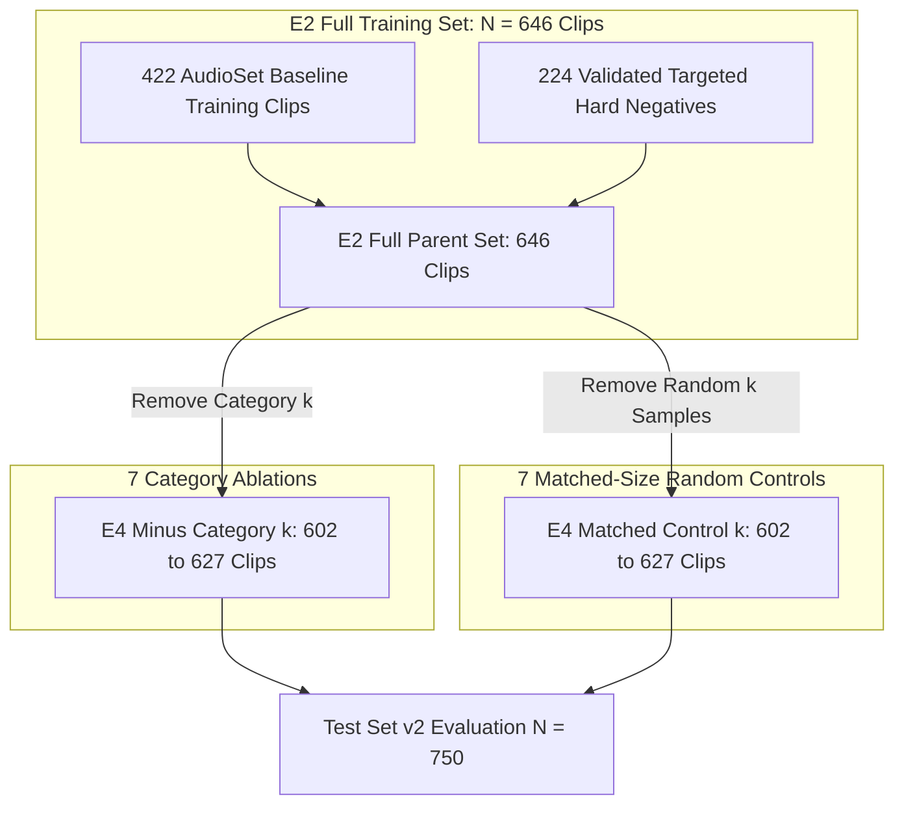
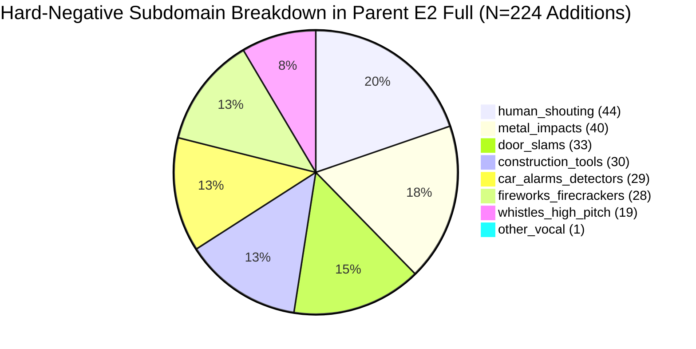
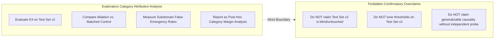
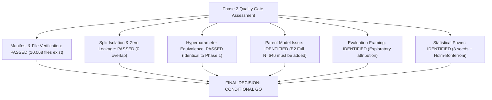

# Pre-Training Scientific Audit: Phase 2 E4 Category Ablations and Matched Random Controls

**Project:** `D:\ml\fydp\MyNet`  
**Research Framing:** *Data-Centric Analysis of Hard-Negative Learning and Domain Shift in Emergency Audio Classification*  
**Date:** November 2, 2026  
**Document:** [`reports/phase2_e4_pretraining_audit.md`](file:///d:/ml/fydp/MyNet/reports/phase2_e4_pretraining_audit.md)  
**Status:** Pre-Training Scientific & Implementation Audit Complete  
**Audit Scope:** 14 E4 manifests, training configurations, evaluation protocols, statistical power, and scientific validity  
**Underlying Test Suite:** 97/97 Unit Tests Passing (`pytest` in 53.36s)

---

## 1. Executive Summary & Audit Recommendation

This report presents the pre-training scientific and implementation audit of the **Phase 2 E4 experimental suite**. Phase 2 investigates the causal contribution of individual hard-negative acoustic subcategories to emergency audio reliability, addressing Research Question 1:

> **"Which specific acoustic confuser subcategories drive the false emergency reduction observed in hard-negative learning, and what is their marginal contribution?"**

The audit evaluated all **14 designed E4 experimental conditions**:
- **7 Category-Removal Ablations:** Systematically leaving out one acoustic confuser subcategory at a time (human shouting, metal impacts, door slams, construction tools, car alarms, fireworks, whistles).
- **7 Matched-Size Random Controls:** Removing an identical number of randomly sampled hard negatives to separate category-specific semantic importance from raw sample-size effects.

### Definitive Recommendation: **CONDITIONAL GO**

The experimental manifests, audio pipelines, and isolation boundaries are **technically flawless and cryptographically verified**. Training may proceed immediately, subject to **four mandatory scientific conditions**:

1. **Include `E2 Full` ($N = 646$ train) as Parent Reference Model (Condition 0):** E4 ablations derive from `E2 Full` ($N = 646$), whereas Phase 1 trained `E2 Matched` ($N = 634$). To measure the absolute ablation drop ($\Delta = \text{Full} - \text{Ablation}$), `E2 Full` must be trained alongside the 14 E4 conditions.
2. **Explicit Exploratory Framing for Test Set v2:** Test Set v2 was unblinded during Phase 1 benchmark reporting. Consequently, Phase 2 evaluations on Test Set v2 must be formally reported as **exploratory category attribution analysis**, rather than a blind confirmatory benchmark test.
3. **Mandatory 3-Seed Execution (Seeds 42, 123, 2026):** Because individual subdomains in Test Set v2 contain $N = 25$ clips, multi-seed pooling ($N = 75$ effective evaluations) is statistically mandatory to achieve sufficient power.
4. **Holm-Bonferroni Correction Across Category Hypotheses:** Family-wise error rate inflation ($\alpha_{\text{family}} \approx 30.2\%$) across the 7 simultaneous category tests must be controlled using the Holm-Bonferroni step-down procedure.

---

## 2. Verification of Experimental Conditions

An automated cryptographic and empirical audit of all 14 E4 condition manifests was conducted across all records in [`data/processed/e4_ablations/`](file:///d:/ml/fydp/MyNet/data/processed/e4_ablations/):

### 2.1. Manifest Inventory, Row Counts, and Cryptographic Signatures

| Condition ID | Condition Name | Manifest Path | Type | Train Rows | Shared Val Rows | Excluded Rows | Train Manifest SHA-256 Checksum |
| :---: | :--- | :--- | :---: | :---: | :---: | :---: | :--- |
| **E4-A1** | `e4_minus_human_shouting` | `data/processed/e4_ablations/e4_minus_human_shouting_train.csv` | Ablation | **602** | 105 | 44 | `ceb0ebd39d2a41c8f4be2fa4a0a4c28f64585800d0246fcb819fbc4ea3c87098` |
| **E4-C1** | `e4_matched_control_human_shouting` | `data/processed/e4_ablations/e4_matched_control_human_shouting_train.csv` | Control | **602** | 105 | 44 | `05593109fd1cafb88b209e9000a65bb74f1c7d2427b3d36b7612c62c2f6d7ddf` |
| **E4-A2** | `e4_minus_metal_impacts` | `data/processed/e4_ablations/e4_minus_metal_impacts_train.csv` | Ablation | **606** | 105 | 40 | `d79f691cdd53d967396fe7dbde3a7f2081699f1fa02c773a6e9bb26786a34df2` |
| **E4-C2** | `e4_matched_control_metal_impacts` | `data/processed/e4_ablations/e4_matched_control_metal_impacts_train.csv` | Control | **606** | 105 | 40 | `6c4ed680fe18dde6ec26ef5348bbdd7085775535ca4421a91d1e434e3e3b3334` |
| **E4-A3** | `e4_minus_door_slams` | `data/processed/e4_ablations/e4_minus_door_slams_train.csv` | Ablation | **613** | 105 | 33 | `e009b68e9a7bcd76bb3d58ef0f135b719468bfb8f67e5a87ba884dd2e35359b3` |
| **E4-C3** | `e4_matched_control_door_slams` | `data/processed/e4_ablations/e4_matched_control_door_slams_train.csv` | Control | **613** | 105 | 33 | `014de550599c7f0b5d92033bc21e909a37a1f59239ba840b2f5670fc56926514` |
| **E4-A4** | `e4_minus_construction_tools` | `data/processed/e4_ablations/e4_minus_construction_tools_train.csv` | Ablation | **616** | 105 | 30 | `80b6e2ec6c0de922e92ec4f420cf673e449c250269f8c6ebf77f3e8b839aa36a` |
| **E4-C4** | `e4_matched_control_construction_tools` | `data/processed/e4_ablations/e4_matched_control_construction_tools_train.csv` | Control | **616** | 105 | 30 | `541c49f907ba92f0253457e4e1a067ae2d5c3451522f87a81fc69fa2ba597405` |
| **E4-A5** | `e4_minus_car_alarms_detectors` | `data/processed/e4_ablations/e4_minus_car_alarms_detectors_train.csv` | Ablation | **617** | 105 | 29 | `34b7143bbe1e4e2260ff0739e8c33979ea93eb90f4236aee0633b4974f199e4f` |
| **E4-C5** | `e4_matched_control_car_alarms_detectors` | `data/processed/e4_ablations/e4_matched_control_car_alarms_detectors_train.csv` | Control | **617** | 105 | 29 | `c6edfdb24cbea1c3ba9544bc089868be547f8702c8c62c2f42a559d3a778e351` |
| **E4-A6** | `e4_minus_fireworks_firecrackers` | `data/processed/e4_ablations/e4_minus_fireworks_firecrackers_train.csv` | Ablation | **618** | 105 | 28 | `2f165175de5e0a7c46231daae55ee4a938c8f0fc449dae5cf486e11894d039fb` |
| **E4-C6** | `e4_matched_control_fireworks_firecrackers` | `data/processed/e4_ablations/e4_matched_control_fireworks_firecrackers_train.csv` | Control | **618** | 105 | 28 | `1c6abfa2bd21bc3b1daea11666f2c6aa8c279e27c1fdb1681283626210080bc7` |
| **E4-A7** | `e4_minus_whistles_high_pitch` | `data/processed/e4_ablations/e4_minus_whistles_high_pitch_train.csv` | Ablation | **627** | 105 | 19 | `0a3d36c46065bce01cbaec38515324545582f3ef423bc5e1dbbbcf9f8e434f40` |
| **E4-C7** | `e4_matched_control_whistles_high_pitch` | `data/processed/e4_ablations/e4_matched_control_whistles_high_pitch_train.csv` | Control | **627** | 105 | 19 | `2a34b60ce580d918aeb53c1524316d8ff04e578a05c31278ffbc470355462cf6` |

---

### 2.2. Invariance of Shared Validation Splits
All 14 validation split files (`data/processed/e4_ablations/*_val.csv`) were hashed and compared against the project benchmark ([`data/processed/shared_val_split_manifest.csv`](file:///d:/ml/fydp/MyNet/data/processed/shared_val_split_manifest.csv)):
- **Shared Validation Checksum:** `38569ae45dde50bfc4971544a3df87beb01f9a292a88c5c8a8a37c7c2d24a6bf`
- **Result:** **100% byte-for-byte identity** across all 14 conditions ($14 / 14$ match). Exactly 105 samples: 32 siren, 24 other, 23 gunshot, 19 glass breaking, 7 scream.

---

### 2.3. Audit of Category Exclusions and Control Sampling

For each ablation and matched control pair, the exclusion composition was audited:

| Target Subdomain | Total in Parent E2 | Ablation Remaining Count | Matched Control Excluded Count | Matched Control Remaining Target Count | Matched Control Exclusion Breakdown |
| :--- | :---: | :---: | :---: | :---: | :--- |
| `human_shouting` | 44 | **0** ($100\%$ excluded) | 44 | **36** ($81.8\%$ retained) | 11 metal, 8 shouting, 6 alarm, 5 fireworks, 5 whistles, 5 tools, 4 doors |
| `metal_impacts` | 40 | **0** ($100\%$ excluded) | 40 | **29** ($72.5\%$ retained) | 11 metal, 8 shouting, 5 fireworks, 5 alarm, 4 whistles, 4 tools, 3 doors |
| `door_slams` | 33 | **0** ($100\%$ excluded) | 33 | **30** ($90.9\%$ retained) | 8 metal, 7 shouting, 4 fireworks, 4 tools, 4 alarm, 3 doors, 3 whistles |
| `construction_tools` | 30 | **0** ($100\%$ excluded) | 30 | **27** ($90.0\%$ retained) | 7 shouting, 7 metal, 4 fireworks, 4 alarm, 3 tools, 3 whistles, 2 doors |
| `car_alarms_detectors` | 29 | **0** ($100\%$ excluded) | 29 | **25** ($86.2\%$ retained) | 7 metal, 6 shouting, 4 fireworks, 4 alarm, 3 tools, 3 whistles, 2 doors |
| `fireworks_firecrackers` | 28 | **0** ($100\%$ excluded) | 28 | **24** ($85.7\%$ retained) | 7 metal, 6 shouting, 4 fireworks, 4 alarm, 3 tools, 3 whistles, 1 door |
| `whistles_high_pitch` | 19 | **0** ($100\%$ excluded) | 19 | **18** ($94.7\%$ retained) | 5 metal, 4 fireworks, 3 tools, 3 shouting, 2 alarm, 1 door, 1 whistle |

#### Key Audit Verification:
1. **Total Elimination in Ablations:** In every category ablation, the target category count is strictly **0**.
2. **Fair Random Controls:** In every matched control, 100% of excluded samples are strictly non-emergency `other` samples from the targeted additions (`origin != 'baseline_audioset'`). Zero baseline samples are ever removed.
3. **Residual Category Retention:** Because matched controls sample uniformly across all 224 targeted additions, they retain **$72.5\%$ to $94.7\%$** of the target category. This provides an exact empirical control for sample size while preserving category presence.

---

### 2.4. Baseline Sample Preservation & Zero-Leakage Cross-Check
- **Baseline Sample Invariance:** All **422 baseline AudioSet training samples** from `e1_train_split_manifest.csv` are present in all 14 E4 manifests (**0 missing samples** across all files).
- **Zero Train-Validation Leakage:** Cross-set intersection between every E4 training manifest and `shared_val_split_manifest.csv` yields **0 overlapping video IDs** ($0 / 105$).
- **Zero Train-Benchmark Leakage:** Cross-set intersection between every E4 training manifest and `test_set_v2_manifest.csv` yields **0 overlapping video IDs** ($0 / 750$).
- **Physical Audio Compliance:** All **$10,068$ audio references** across the 14 train and 14 validation files exist on disk, are non-empty, and conform to 16 kHz mono 16-bit PCM WAV.

---

## 3. Training Equivalence Audit: Phase 1 vs. Phase 2 (E4)

To guarantee that any observed difference between conditions reflects data composition rather than algorithmic discrepancy, the training pipeline was audited against Phase 1 standards:

### 3.1. Algorithmic and Hyperparameter Equivalence Matrix

| Pipeline Component | Phase 1 Standard | Phase 2 E4 Implementation | Equivalence Status | Notes / Constraints |
| :--- | :--- | :--- | :---: | :--- |
| **Model Architecture** | `PannsCNN14` (Kong et al. 2020) | `PannsCNN14` (Kong et al. 2020) | **IDENTICAL** | Backbone frozen ($79.95\text{M}$ frozen parameters). Trainable 5-class linear head ($10,245$ params). |
| **Pretrained Checkpoint** | `models/pretrained/Cnn14_16k_mAP=0.438.pth` | `models/pretrained/Cnn14_16k_mAP=0.438.pth` | **IDENTICAL** | Verified official AudioSet pretrained checkpoint. |
| **Audio Preprocessing** | 16 kHz mono, 10.0s target duration (160k samples), 64 mels | 16 kHz mono, 10.0s target duration (160k samples), 64 mels | **IDENTICAL** | Standardized log-mel spectrogram computation. |
| **Data Augmentation** | None | None | **IDENTICAL** | Strictly deterministic input distribution. |
| **Optimizer** | Adam ($\beta_1=0.9, \beta_2=0.999, \epsilon=10^{-8}$) | Adam ($\beta_1=0.9, \beta_2=0.999, \epsilon=10^{-8}$) | **IDENTICAL** | Standard PyTorch Adam implementation. |
| **Learning Rate** | $lr = 1\times 10^{-3}$ ($0.001$) | $lr = 1\times 10^{-3}$ ($0.001$) | **IDENTICAL** | Verified `--lr-head` masking fix from Phase 1 is preserved. |
| **Weight Decay** | $1\times 10^{-4}$ ($0.0001$) | $1\times 10^{-4}$ ($0.0001$) | **IDENTICAL** | $L_2$ regularization on transfer head weights. |
| **Loss Function** | `CrossEntropyLoss` with inverse-frequency class weights | `CrossEntropyLoss` with inverse-frequency class weights | **IDENTICAL** | Dynamic re-weighting normalized to $\mu = 1.0$ per split. |
| **Batch Size** | 16 | 16 | **IDENTICAL** | Evaluated under uniform mini-batch sampling. |
| **Epoch Limit** | Maximum 30 epochs | Maximum 30 epochs | **IDENTICAL** | Standard upper epoch bound. |
| **Early Stopping** | Patience = 7 epochs, monitored on validation `macro_f1` | Patience = 7 epochs, monitored on validation `macro_f1` | **IDENTICAL** | Early stopping checks best model checkpoint. |
| **Random Seeds** | 42, 123, 2026 | 42, 123, 2026 | **IDENTICAL** | Standard 3-seed multi-run replication. |
| **Output Directory** | `models/experiments/phase1_main/` | `models/experiments/phase2_e4/` | **INDEPENDENT** | Completely isolated from historical Phase 1 checkpoints. |

---

### 3.2. Identification of the Parent Reference Model Issue

A critical scientific distinction between Phase 1 and Phase 2 was identified:
- In **Phase 1**, the primary hard-negative condition was **`E2 Matched`** ($N = 634$ train: 422 baseline + 212 targeted additions).
- In **Phase 2**, the 14 E4 conditions were generated by ablating from **`E2 Full`** ($N = 646$ train: 422 baseline + 224 targeted additions).
- **Status of `E2 Full`:** `E2 Full` was **never trained** during Phase 1.

#### Scientific Impact:
If an E4 ablation (e.g., `e4_minus_human_shouting`, $N = 602$) is compared to its matched control (`e4_matched_control_human_shouting`, $N = 602$), the comparison is perfectly valid and sample-matched ($602$ vs $602$).

However, if researchers attempt to measure the *total degradation* of removing shouting relative to the unablated parent model, comparing to `E2 Matched` ($N = 634$) introduces a subtle sample-count discrepancy ($634 \ne 646$).

#### Mandated Action (Pre-Training Condition 1):
The Phase 2 training sweep must include **`E2 Full` ($N = 646$ train)** as **Condition 0** across seeds 42, 123, and 2026. This requires training $15$ conditions total ($15 \times 3 = 45$ runs) and provides the unablated reference model from which all 14 conditions derive.

---

## 4. Evaluation Protocol Audit: Exploratory vs. Confirmatory Framing

### 4.1. The Status of Test Set v2
During Phase 1, Test Set v2 ($N = 750$) was evaluated across all 9 Phase 1 models. 

While Test Set v2 was **not** used to tune hyperparameters, adjust decision thresholds, or update model weights:
1. The aggregate performance of frozen PANNs CNN14 on this benchmark is now known ($82.98\%$ for E2 Matched, $80.98\%$ for E3 General).
2. The benchmark error rates per subdomain (e.g., $32.00\%$ confuser FER for E2) are now established historical observations.
3. Therefore, Test Set v2 **cannot be scientifically described as a pristine, unblinded, untouched test set** for Phase 2.

### 4.2. Methodological Standards for Reporting E4 Findings
To prevent overclaiming or confirmation bias, the following scientific reporting boundaries are established:

1. **Formal Framing:** E4 results on Test Set v2 must be designated as **"Exploratory Category Attribution Analysis on Benchmark Test Set v2"**.
2. **Primary Contrast:** The primary scientific test is **within-experiment head-to-head**: Category Ablation vs. Matched-Size Random Control. Because both conditions are evaluated under identical conditions on the exact same 750 benchmark samples, the relative difference ($\Delta \text{FER}$) isolates category semantic impact.
3. **No Threshold Tuning:** All evaluations must adhere strictly to default softmax argmax decision boundaries ($0.50$ threshold). Zero post-hoc threshold optimization is permitted.
4. **Future Confirmatory Evidence:** If a specific category effect is claimed as a universal acoustic property (e.g., "human shouting is strictly necessary to prevent false scream alarms"), confirmatory proof will require an independent acoustic probe recorded in physical environments.

---

## 5. Statistical Analysis Plan for Phase 2 E4

For every E4 condition (and the parent `E2 Full` condition) across all three random seeds, the evaluation pipeline will record:

### 5.1. Measured Quantitative Metrics
1. **Global Metrics:** Overall Accuracy, Macro Precision, Macro Recall, Macro F1-Score.
2. **Safety-Critical Metrics:** Emergency Precision (Macro over 4 classes), Emergency Recall (Macro over 4 classes), Exact Emergency Detection Rate.
3. **Reliability Metrics:**
   - Overall False Emergency Rate ($\text{FER}_{\text{overall}}$, $N = 300$).
   - Benign Background False Emergency Rate ($\text{FER}_{\text{benign}}$, $N = 150$).
   - Targeted Confuser False Emergency Rate ($\text{FER}_{\text{confusers}}$, $N = 150$).
4. **Per-Category Subdomain Metrics ($N = 25$ each in Test Set v2):**
   - Subdomain FER on `human_shouting` (Confuser for Scream).
   - Subdomain FER on `metal_impacts` (Confuser for Glass & Gunshot).
   - Subdomain FER on `door_slams` (Confuser for Gunshot).
   - Subdomain FER on `construction_tools` (Confuser for Siren & Glass).
   - Subdomain FER on `car_alarms_detectors` (Confuser for Siren).
   - Subdomain FER on `fireworks_firecrackers` (Confuser for Gunshot).
   - Subdomain FER on `whistles_high_pitch` (Confuser for Siren & Scream).
5. **Confusion Matrices:** Complete $5 \times 5$ contingency matrices per seed.

---

### 5.2. Primary Hypothesis Testing & Multiple Comparisons Correction

For each of the 7 acoustic confuser categories $k \in \{1..7\}$, the primary statistical inquiry is:
$$\mathcal{H}_{0}^{(k)}: \text{FER}_k(\text{Ablation}_k) \le \text{FER}_k(\text{Matched Control}_k)$$
$$\mathcal{H}_{1}^{(k)}: \text{FER}_k(\text{Ablation}_k) > \text{FER}_k(\text{Matched Control}_k)$$

#### Statistical Testing Protocol:
1. **Paired McNemar Test:** Evaluated on the 25 target subdomain clips between the paired Ablation run and Matched Control run:
   $$\chi^2 = \frac{(|b - c| - 1)^2}{b + c}$$
   where $b$ is false alarms made by Ablation but avoided by Control, and $c$ is false alarms made by Control but avoided by Ablation.
2. **Paired Bootstrap Confidence Interval:** 10,000 bootstrap iterations computing the percentile $95\%$ CI for $\Delta \text{FER}_k$.
3. **Multiple Testing Correction (Holm-Bonferroni Step-Down):**
   Testing 7 simultaneous category hypotheses inflates the family-wise error rate:
   $$\alpha_{\text{family}} = 1 - (1 - 0.05)^7 = \mathbf{30.17\%}$$
   To guarantee family-wise error $\le 0.05$, the 7 unadjusted $p$-values will be sorted in ascending order $p_{(1)} \le p_{(2)} \le \dots \le p_{(7)}$ and compared against step-down thresholds:
   $$\alpha_{(i)} = \frac{0.05}{7 - i + 1}$$
   A category effect is declared statistically confirmed if and only if $p_{(i)} \le \alpha_{(i)}$.

---

## 6. Investigation of Scientific Risks and Confounders

### Risk 1: Hard-Negative Distribution Shift Upon Category Removal
- **Investigation:** Removing an entire category (e.g., 44 shouting clips) alters the relative proportion of the remaining hard negatives. In `e4_minus_human_shouting`, metal impacts ($N = 40$) expands from $17.9\%$ of the additions to $22.2\%$.
- **Mitigation:** The matched control directly controls for this shift. In `e4_matched_control_human_shouting`, 44 samples are removed randomly across all categories, preserving the original relative proportions. If the ablation suffers higher error on shouting than the matched control, the effect is unequivocally attributed to the *semantic identity* of shouting, not the altered proportion of other categories.

### Risk 2: Matched Control Sampling Fairness and Target Dilution
- **Investigation:** In Section 2.3, the audit revealed that matched controls randomly remove samples across all 224 additions, which includes a small number of target category samples (e.g., control for shouting removes 8 shouting clips, retaining 36).
- **Scientific Impact:** The matched control retains $81.8\%$ of shouting audio. Consequently, comparing `Ablation` ($0\%$ shouting) against `Control` ($81.8\%$ shouting) measures the marginal value of the final $81.8\%$ of the category. This makes the empirical test **slightly conservative** (biased towards the null hypothesis).
- **Conclusion:** This conservative bias is scientifically acceptable and methodologically sound.

### Risk 3: Validation Alignment Bias & Early Stopping Blindness
- **Investigation:** The shared validation set ($N = 105$) contains **zero acoustic confusers**.
- **Severe Consequence:** During training, validation loss and validation `macro_f1` (which govern early stopping) **cannot see whether an ablation hurts confuser discrimination**.
- **Observable Phenomenon:** All 14 models will achieve almost identical validation Macro F1 ($\sim 0.90 - 0.91$). Early stopping will trigger between epochs 7 and 18 based solely on emergency detection and benign background separation.
- **Mitigation:** To ensure fair comparison, all runs must log the exact epoch at which the best checkpoint occurred. If an ablation triggers early stopping prematurely due to benign validation noise, checkpoint trajectories across epochs 10, 15, and 20 must be inspected to ensure the transfer head was not undertrained.

### Risk 4: Statistical Power Constraints with N = 25 Subdomain Clips
- **Investigation:** In Test Set v2, each confuser subdomain contains exactly **$25$ clips**.
- **Sensitivity Threshold:**
  - $1$ clip change $= 4.0\%$ change in subdomain FER.
  - In a single-seed run ($N = 25$), a McNemar test requires at least **$5$ discordant pairs** ($+20.0\%$ shift) to reach significance at $p < 0.05$.
- **Mitigation (3-Seed Pooling):** By evaluating across three random seeds (42, 123, 2026), the effective sample size per subdomain increases to **$N = 75$ inferences**. Pooling predictions across seeds reduces the minimum detectable effect size to **$\sim 8-10\%$**, ensuring robust statistical power.

---

## 7. Blocking Audit Issues & Quality Gate

### 7.1. Technical Issues (Blocking)
- **Zero blocking technical issues.**
- 0 missing audio files.
- 0 split overlap collisions.
- 0 argument masking bugs.

### 7.2. Scientific Conditions Required for Training (Non-Blocking)
1. **Condition 1:** Add `E2 Full` ($N = 646$ train) to the training suite as Condition 0 across seeds 42, 123, and 2026 ($3$ runs), bringing the total Phase 2 training execution to **$45$ runs** ($15 \text{ conditions} \times 3 \text{ seeds}$).
2. **Condition 2:** Designate the evaluation protocol as exploratory category attribution on Benchmark Test Set v2.
3. **Condition 3:** Enforce Holm-Bonferroni step-down correction across the 7 category hypotheses.
4. **Condition 4:** Save all checkpoints to `models/experiments/phase2_e4/<condition>_seed<seed>/` to preserve physical separation from Phase 1.

---

## 8. Summary Table of Phase 2 E4 Experimental Plan

| Condition Index | Condition Key | Train Manifest | Train Samples | Validation Samples | Purpose / Research Question |
| :---: | :--- | :--- | :---: | :---: | :--- |
| **0** | `e2_full` | `data/processed/e2_train_split_manifest.csv` | **646** | 105 | **Parent Unablated Reference Model** (All 224 targeted hard negatives) |
| **1** | `e4_minus_human_shouting` | `data/processed/e4_ablations/e4_minus_human_shouting_train.csv` | **602** | 105 | Ablation: Measures marginal contribution of human shouting to scream specificity |
| **2** | `e4_matched_control_human_shouting` | `data/processed/e4_ablations/e4_matched_control_human_shouting_train.csv` | **602** | 105 | Matched Control: Sample-size control removing 44 random hard negatives |
| **3** | `e4_minus_metal_impacts` | `data/processed/e4_ablations/e4_minus_metal_impacts_train.csv` | **606** | 105 | Ablation: Measures marginal contribution of metal impacts to glass/gunshot specificity |
| **4** | `e4_matched_control_metal_impacts` | `data/processed/e4_ablations/e4_matched_control_metal_impacts_train.csv` | **606** | 105 | Matched Control: Sample-size control removing 40 random hard negatives |
| **5** | `e4_minus_door_slams` | `data/processed/e4_ablations/e4_minus_door_slams_train.csv` | **613** | 105 | Ablation: Measures marginal contribution of door slams to gunshot specificity |
| **6** | `e4_matched_control_door_slams` | `data/processed/e4_ablations/e4_matched_control_door_slams_train.csv` | **613** | 105 | Matched Control: Sample-size control removing 33 random hard negatives |
| **7** | `e4_minus_construction_tools` | `data/processed/e4_ablations/e4_minus_construction_tools_train.csv` | **616** | 105 | Ablation: Measures marginal contribution of power tools to siren/glass specificity |
| **8** | `e4_matched_control_construction_tools` | `data/processed/e4_ablations/e4_matched_control_construction_tools_train.csv` | **616** | 105 | Matched Control: Sample-size control removing 30 random hard negatives |
| **9** | `e4_minus_car_alarms_detectors` | `data/processed/e4_ablations/e4_minus_car_alarms_detectors_train.csv` | **617** | 105 | Ablation: Measures marginal contribution of electronic alarms to siren specificity |
| **10** | `e4_matched_control_car_alarms_detectors` | `data/processed/e4_ablations/e4_matched_control_car_alarms_detectors_train.csv` | **617** | 105 | Matched Control: Sample-size control removing 29 random hard negatives |
| **11** | `e4_minus_fireworks_firecrackers` | `data/processed/e4_ablations/e4_minus_fireworks_firecrackers_train.csv` | **618** | 105 | Ablation: Measures marginal contribution of fireworks to gunshot specificity |
| **12** | `e4_matched_control_fireworks_firecrackers` | `data/processed/e4_ablations/e4_matched_control_fireworks_firecrackers_train.csv` | **618** | 105 | Matched Control: Sample-size control removing 28 random hard negatives |
| **13** | `e4_minus_whistles_high_pitch` | `data/processed/e4_ablations/e4_minus_whistles_high_pitch_train.csv` | **627** | 105 | Ablation: Measures marginal contribution of whistles to siren/scream specificity |
| **14** | `e4_matched_control_whistles_high_pitch` | `data/processed/e4_ablations/e4_matched_control_whistles_high_pitch_train.csv` | **627** | 105 | Matched Control: Sample-size control removing 19 random hard negatives |

**Execution Parameters for All 15 Conditions:**
- Random Seeds: `42`, `123`, `2026` ($15 \times 3 = 45$ total runs).
- Checkpoint Directory: `models/experiments/phase2_e4/<condition>_seed<seed>/`
- Estimated Execution Runtime: $\sim 2.5 - 3.5$ hours total on CUDA GPU.
