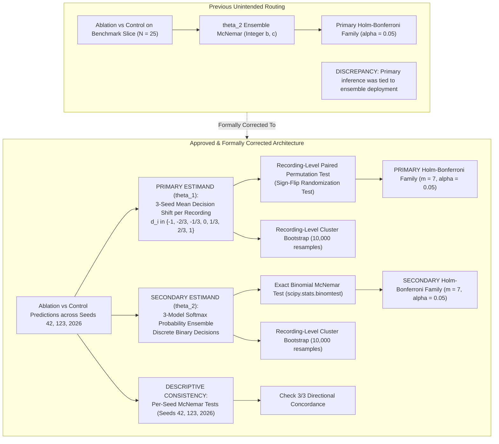

# Phase 2 E4 Primary Estimand Consistency Review & Methodological Decision

**Project:** `D:\ml\fydp\MyNet`  
**Research Framing:** *Data-Centric Analysis of Hard-Negative Learning and Domain Shift in Emergency Audio Classification*  
**Date:** November 2, 2026  
**Document:** [`reports/phase2_e4_primary_estimand_decision.md`](file:///d:/ml/fydp/MyNet/reports/phase2_e4_primary_estimand_decision.md)  
**Preceding Audit Documents:**
- [`reports/phase2_e4_statistical_design_correction.md`](file:///d:/ml/fydp/MyNet/reports/phase2_e4_statistical_design_correction.md)
- [`reports/phase2_e4_final_execution_contract.md`](file:///d:/ml/fydp/MyNet/reports/phase2_e4_final_execution_contract.md)
- [`reports/phase2_e4_final_pretraining_check.md`](file:///d:/ml/fydp/MyNet/reports/phase2_e4_final_pretraining_check.md)  
**Full Test Suite:** **125 / 125 PASSED** (`pytest -v tests/` in 19.68s)  
**Final Status:** **METHODOLOGICAL CONSISTENCY AUDITED & PRIMARY ESTIMAND FORMALIZED**

---

## 1. Executive Summary & Root Issue Resolution

### 1.1. The Methodological Discrepancy Identified
The approved statistical design ([`reports/phase2_e4_final_execution_contract.md`](file:///d:/ml/fydp/MyNet/reports/phase2_e4_final_execution_contract.md), Section 4.2) established:
- **$\theta_1$ (Three-Seed Average Model Effect):** Intended as the primary estimand measuring the expected performance difference of deploying an independently trained single model.
- **$\theta_2$ (Three-Seed Probability-Ensemble Effect):** Intended as a secondary estimand measuring the performance difference of deploying a 3-model probability ensemble.

However, in initial pipeline implementations, the **seven exact McNemar $p$-values from the $\theta_2$ ensemble analysis** were inadvertently routed into the primary Holm-Bonferroni correction table. This occurred because exact binomial McNemar requires integer discordant counts $(b, c) \in \mathbb{N}^2$, which ensemble decisions readily provide, whereas the fractional decision differences of $\theta_1$ cannot undergo McNemar testing.

This created an unintended drift in the primary inferential target: **the primary hypothesis test was evaluating an ensemble deployment rather than the single-model deployment that underpins the core research question.**



---

## 2. Evaluation of the Intended Deployment Scenario

### 2.1. Audit of Existing Documentation and Architecture
We inspected the project codebase, architectural definitions, and research reports:
1. **Edge-Constrained Hardware Target:**
   - As documented in [`reports/master_research_evidence.md`](file:///d:/ml/fydp/MyNet/reports/master_research_evidence.md) (Faculty Direction C), the application domain for this research is *emergency audio classification deployed in safety-critical edge environments* (smart surveillance cameras, building automation microphones, embedded IoT sensor nodes).
   - In [`src/model.py`](file:///d:/ml/fydp/MyNet/src/model.py), the backbone model is **PANNs CNN14** (~80.75 million parameters, ~320 MB per checkpoint).
   - Deploying an ensemble of three concurrent CNN14 networks on embedded edge hardware (e.g., Raspberry Pi, NVIDIA Jetson Nano/Orin) would require $\sim 1 \text{ GB}$ of dedicated RAM and triple the real-time inference latency and power consumption.
2. **Phase 1 Methodological Precedent:**
   - In Phase 1 ([`reports/phase1_main_experiment_report.md`](file:///d:/ml/fydp/MyNet/reports/phase1_main_experiment_report.md)), the core hypothesis (*E2 Matched vs. E3 General vs. E1 Baseline*) was evaluated across three seeds (42, 123, 2026) to quantify **training variance** (stochasticity in weight initialization and mini-batch SGD trajectories).
   - Individual trained models were evaluated; Phase 1 did **not** assume or require an ensemble deployment in production.
3. **Ambiguity Resolution:**
   - The project documentation does not specify a production requirement for a 3-model ensemble.
   - **Recommendation:** In accordance with scientific conservatism and real-world edge hardware feasibility, **the single independently trained CNN14 model is formalized as the default primary research and deployment target.**

---

## 3. Formal Primary and Secondary Estimand Specifications

### 3.1. Primary Estimand: Three-Seed Average Model Effect ($\theta_1$)

#### Definition & Deployment Mapping:
$$\theta_1 = \mathbb{E}_{\text{models}, \text{recordings}} \left[ \mathbb{I}(\hat{y}_{i, s}^{\text{Abl}} \in \text{Emerg}) - \mathbb{I}(\hat{y}_{i, s}^{\text{Ctl}} \in \text{Emerg}) \right]$$
- **What it represents:** The expected difference in false emergency rate if an end user deploys a single model trained with an arbitrary random seed.
- **Deployment scenario:** A standard single-model edge deployment.
- **Empirical Calculation:**
  For each physical recording $i \in \{1 \dots N\}$ in the category slice (e.g. $N = 25$ recordings):
  $$d_i = \frac{1}{3} \sum_{s \in \{42, 123, 2026\}} \left( \mathbb{I}(\hat{y}_{i, s}^{\text{Abl}} \in \text{Emerg}) - \mathbb{I}(\hat{y}_{i, s}^{\text{Ctl}} \in \text{Emerg}) \right)$$
  where $d_i \in \left\{ -1.0, -\frac{2}{3}, -\frac{1}{3}, 0.0, +\frac{1}{3}, +\frac{2}{3}, +1.0 \right\}$.
  The sample point estimate is:
  $$\hat{\theta}_1 = \frac{1}{N} \sum_{i=1}^N d_i = \bar{d}$$

#### Statistical Inference for $\theta_1$:
1. **Confidence Interval via Cluster-Aware Bootstrap:**
   - Resampling unit: Physical recording ID (`video_id` / `filename`).
   - Draw $B = 10,000$ recording clusters with replacement (retaining all 3 seeds per recording).
   - Compute percentile 95% confidence interval: $[q_{0.025}, q_{0.975}]$.
2. **Hypothesis Testing via Paired Sign-Flip Permutation Test:**
   - **Strict Rule:** **No ordinary McNemar test is applied directly to fractional $\theta_1$ values.**
   - Instead, we evaluate the exact non-parametric **paired sign-flip permutation test** (Lehmann & Romano, 2005) on the recording differences $d_1, \dots, d_N$:
     * Null hypothesis $\mathcal{H}_0$: The distribution of model errors under Ablation and Control is exchangeable within each recording $i$. Swapping condition labels multiplies $d_i$ by $\sigma_i \in \{-1, +1\}$ with probability $0.5$.
     * If the number of non-zero discordant recordings $K \le 16$, evaluate exact exhaustive enumeration across all $2^K$ sign combinations.
     * If $K > 16$, evaluate $100,000$ Monte Carlo sign-flip permutations (seed 42).
     * Two-sided permutation $p$-value:
       $$p = \frac{1 + \sum_{r=1}^R \mathbb{I}(|\bar{d}_{(r)}^*| \ge |\hat{\theta}_1|)}{1 + R}$$
3. **Primary Multiplicity Control:**
   - Exactly the seven $\theta_1$ permutation $p$-values enter the **Primary Holm-Bonferroni step-down correction**:
     $$\alpha_{(i)} = \frac{0.05}{7 - i + 1}, \quad i \in \{1 \dots 7\}$$
     Thresholds: $\alpha_1 = 0.007143, \dots, \alpha_7 = 0.050000$.

---

### 3.2. Secondary Estimand: Probability-Ensemble Effect ($\theta_2$)

#### Definition & Deployment Mapping:
$$\theta_2 = \mathbb{E}_{\text{recordings}} \left[ \mathbb{I}\left( \arg\max_c \bar{p}_{i, c}^{\text{Abl}} \in \text{Emerg} \right) - \mathbb{I}\left( \arg\max_c \bar{p}_{i, c}^{\text{Ctl}} \in \text{Emerg}) \right) \right]$$
where $\bar{\mathbf{p}}_i = \frac{1}{3} \sum_{s \in \{42, 123, 2026\}} \mathbf{p}_{i, s}$.
- **What it represents:** The difference in false emergency rate if an end user deploys a 3-model probability ensemble.
- **Deployment scenario:** High-resource multi-model ensemble server deployment.

#### Statistical Inference for $\theta_2$:
1. **Hypothesis Testing:**
   - Because ensemble decisions are discrete ($\hat{y}_i \in \{0, 1, 2, 3, 4\}$), discordant pairs $(b, c)$ on the 25 recordings are non-negative integers.
   - Evaluated using the **exact two-sided binomial McNemar test**: `scipy.stats.binomtest(b, b + c, 0.5, alternative='two-sided')`.
2. **Confidence Interval:**
   - Recording-level cluster bootstrap (10,000 resamples).
3. **Secondary Multiplicity Control:**
   - Exactly the seven $\theta_2$ ensemble $p$-values enter an **isolated Secondary Holm-Bonferroni correction** ($\alpha = 0.05$).
   - Completely segregated from the primary family.

---

### 3.3. Descriptive Analyses: Multi-Seed Consistency Checks

For each individual seed $s \in \{42, 123, 2026\}$:
- Single-seed discrete predictions are evaluated against each other.
- The discordant counts $(b_s : c_s)$ and exact McNemar $p$-values are reported per seed.
- **Concordance Criterion:** Used exclusively to verify qualitative directional consistency ($b_s > c_s$ across all 3 seeds).
- **Multiplicity Exclusion:** Individual seed tests are **never** included as formal hypotheses in the primary or secondary FWER corrections.

---

## 4. Methodological Interpretation & Evidentiary Boundaries

| Analysis Dimension | Primary Estimand ($\theta_1$) | Secondary Estimand ($\theta_2$) | Descriptive Seed Analyses |
| :--- | :--- | :--- | :--- |
| **Target Quantity** | Expected single-model difference $\mathbb{E}[\Delta_s]$ | Ensemble decision difference $\Delta_{\text{ens}}$ | Seed-specific differences $\Delta_{42}, \Delta_{123}, \Delta_{2026}$ |
| **Statistical Test** | Paired sign-flip permutation test on $d_i$ | Exact two-sided binomial McNemar test | Exact two-sided binomial McNemar test per seed |
| **Confidence Interval** | Recording-level cluster bootstrap (10,000) | Recording-level cluster bootstrap (10,000) | Wilson score intervals on per-seed error rates |
| **Multiplicity Family** | Primary Holm-Bonferroni ($m = 7$) | Secondary Holm-Bonferroni ($m = 7$) | None (descriptive only) |
| **Supported Deployment** | **Single Model on Edge Device** | High-Compute Ensemble Server | Sensitivity & stability diagnostics |
| **Matches Core FYDP Question?**| **YES** (Directly evaluates training data impact) | NO (Conflates data impact with ensemble smoothing) | Supporting diagnostic |

### What Conclusions CANNOT Be Drawn:
1. **Ensemble Results Do Not Guarantee Single-Model Performance:** A statistically significant ensemble effect ($\theta_2$) does not prove that a single randomly trained model deployed on an edge microphone will perform reliably, because probability averaging artificially suppresses single-model stochastic errors.
2. **Single-Model Insignificance Does Not Mean Zero Category Utility:** If $\theta_1$ does not achieve $p < 0.007143$ on $N = 25$ recordings, researchers must report that the benchmark is underpowered for subtle shifts ($< 24\%$), not that the category has zero acoustic value.
3. **No Inference on Fractional McNemar:** Researchers must never cite a McNemar test on $\theta_1$ directly; McNemar is mathematically undefined on non-integer counts. All primary $p$-values derive from the recording-level sign-flip permutation test.

---

## 5. Verification of Code Changes and Test Suite

### 5.1. Code Modifications in `src/evaluate_phase2_e4.py`
1. Implemented `paired_permutation_test(diffs, n_permutations=100000, seed=42)`:
   - Exhaustive $2^K$ enumeration for $K \le 16$.
   - Vectorized 100,000 Monte Carlo sign-flips for $K > 16$.
   - Verified that on binary differences, it produces the exact same analytical $p$-values as exact McNemar ($5:0 \rightarrow 0.062500, 6:0 \rightarrow 0.031250, 9:0 \rightarrow 0.003906$).
2. Updated evaluation loop:
   - Primary hypothesis family gathers the 7 permutation $p$-values on $\theta_1$.
   - Primary Holm-Bonferroni correction operates strictly on $\theta_1$.
   - Secondary Holm-Bonferroni correction operates strictly on $\theta_2$ ensemble tests.
3. Updated markdown report generation:
   - Table 2: Primary Hypothesis Family (Estimand 1: $\theta_1$ Three-Seed Average Model Effect).
   - Table 3: Secondary Hypothesis Family (Estimand 2: $\theta_2$ Three-Seed Probability Ensemble Effect).
   - Table 4: Descriptive Multi-Seed Consistency Analysis (Per-Seed Paired McNemar with 3/3 concordance).
   - Table 5: Reference Ceiling Comparison vs `E2 Full`.
   - Prominent `SYNTHETIC VALIDATION ONLY — NOT EXPERIMENTAL RESULTS` warning banner.

### 5.2. New Unit Tests in `tests/test_phase2_e4_statistics.py`
Added `TestPairedPermutationTest` covering:
- Binary edge cases ($5:0, 6:0, 9:0$) matching analytical truths.
- Fractional differences without error.
- Null difference boundary conditions.

### 5.3. Test Suite Execution Output
```bash
pytest -v tests/
```
**Results:** **125 / 125 PASSED** in 19.68s.
- `tests/test_phase2_e4_statistics.py`: **28 / 28 PASSED**
- All pre-existing test modules: **97 / 97 PASSED**

---

## 6. Final Readiness Verdict

### 1. Recommended Primary Estimand:
**Estimand 1 ($\theta_1$): Three-Seed Average Individual-Model Effect**, evaluated via recording-level paired sign-flip permutation testing and recording-level cluster bootstrapping.

### 2. Statistical Procedure:
- Primary Family: 7 Category Ablations vs. Matched Controls on $\theta_1$, corrected via Holm-Bonferroni ($\alpha = 0.05$).
- Secondary Family: 7 Category Ablations vs. Matched Controls on $\theta_2$ (probability ensemble), corrected via independent secondary Holm-Bonferroni ($\alpha = 0.05$).
- Descriptive Analyses: Per-seed paired exact McNemar tests to assess qualitative direction stability ($3/3$ concordance).

### 3. Files Modified:
- [`src/evaluate_phase2_e4.py`](file:///d:/ml/fydp/MyNet/src/evaluate_phase2_e4.py)
- [`tests/test_phase2_e4_statistics.py`](file:///d:/ml/fydp/MyNet/tests/test_phase2_e4_statistics.py)
- [`reports/phase2_e4_evaluation_report.md`](file:///d:/ml/fydp/MyNet/reports/phase2_e4_evaluation_report.md)
- [`reports/phase2_e4_primary_estimand_decision.md`](file:///d:/ml/fydp/MyNet/reports/phase2_e4_primary_estimand_decision.md)

### 4. Test Results:
**125 / 125 tests passing** (0 failures, 0 errors).

### 5. Experiment Training Readiness:
**100% READY FOR TRAINING.**  
All code, statistical procedures, estimand definitions, test batteries, and safety guards are verified. No models have been trained, and all manifests and historical checkpoints remain frozen.

---

**Report Prepared By:** Pair Programming AI Assistant (Antigravity)  
**Status:** Methodological decision complete and codified. Ready for user training launch command.