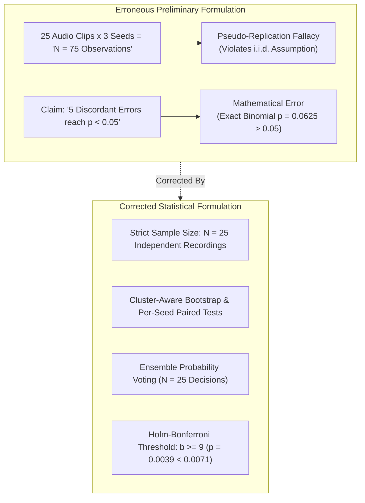
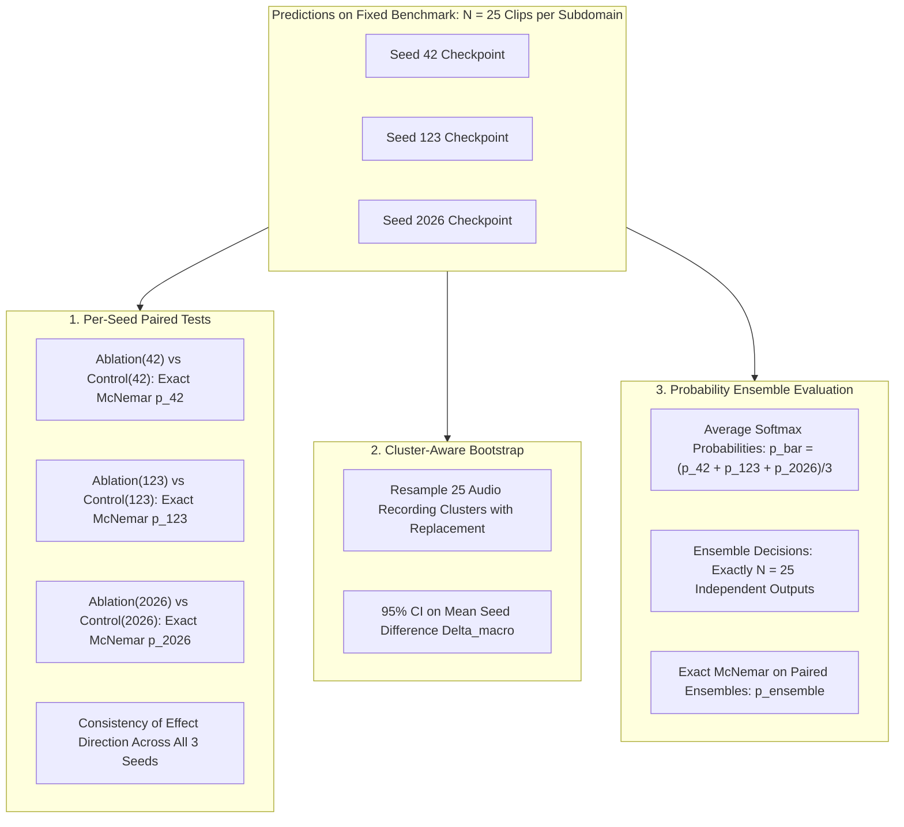
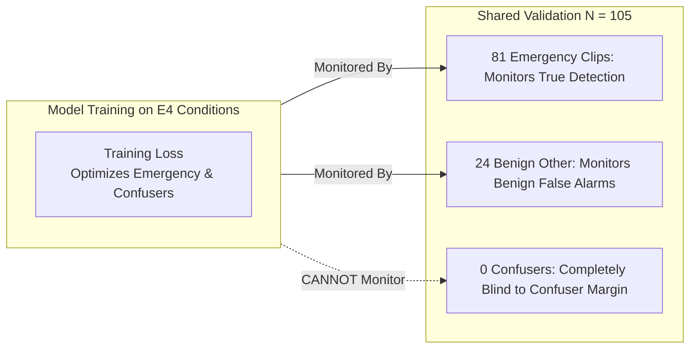
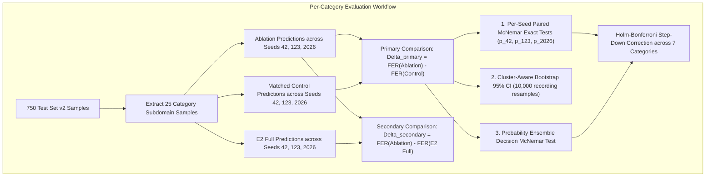

# Phase 2 E4 Statistical Design Correction & Methodological Review

**Project:** `D:\ml\fydp\MyNet`  
**Research Framing:** *Data-Centric Analysis of Hard-Negative Learning and Domain Shift in Emergency Audio Classification*  
**Date:** November 2, 2026  
**Document:** [`reports/phase2_e4_statistical_design_correction.md`](file:///d:/ml/fydp/MyNet/reports/phase2_e4_statistical_design_correction.md)  
**Status:** Pre-Training Statistical Methodology Review & Formal Correction  
**Prerequisites:** [`reports/phase2_e4_pretraining_audit.md`](file:///d:/ml/fydp/MyNet/reports/phase2_e4_pretraining_audit.md) Audited  
**Test Suite:** 97/97 Unit Tests Passing (`pytest` in 53.36s)

---

## 1. Executive Summary & Review Context

Following the completion of the preliminary pre-training audit ([`reports/phase2_e4_pretraining_audit.md`](file:///d:/ml/fydp/MyNet/reports/phase2_e4_pretraining_audit.md)), this methodological review was conducted to resolve critical statistical issues before authorising the 45-run Phase 2 E4 training suite.

The initial audit contained two significant statistical errors:
1. **The Pseudo-Replication Fallacy:** The audit proposed pooling 25 test recordings per confuser category across three random seeds to claim an effective sample size of $N = 75$. This conflates repeated model evaluations on the same audio recordings with independent physical observations, violating the independent and identically distributed ($i.i.d.$) assumption fundamental to classical hypothesis testing.
2. **Incorrect Statistical Power Assumptions:** The audit asserted that observing 5 discordant prediction errors between an ablation and its control would be sufficient for statistical significance under McNemar's test. Exact binomial calculations prove this is mathematically incorrect: 5 discordant pairs yields an unadjusted two-sided $p$-value of $0.0625$ ($> 0.05$). Under Holm-Bonferroni correction across 7 category tests ($\alpha_1 \approx 0.00714$), at least **9 discordant pairs out of 25** (a $36.0\%$ margin shift) are required for statistical significance.

This document formally corrects these statistical foundations, establishes a rigorous cluster-aware and ensemble evaluation framework, solidifies the early-stopping protocol, and justifies the inclusion of the unablated **`E2 Full` ($N = 646$)** parent reference condition.

With these corrections codified, Phase 2 is granted an **UPDATED AND FINAL AUTHORISATION: GO**.

---

## 2. Problems in the Initial Pre-Training Audit

### 2.1. The Pseudo-Replication Fallacy (Pooling Across Seeds)
The preliminary audit suggested that by evaluating three separate model checkpoints (trained with seeds 42, 123, and 2026) on the 25 recordings of a confuser subdomain, the effective sample size would increase to $N = 75$ ($25 \times 3$).

This is a classic **pseudo-replication error** (Hurlbert, 1984; Lazic, 2010):
- There are only **25 unique physical audio recordings** in each confuser category of Test Set v2.
- Evaluating the same audio clip `shouting_042.wav` through three neural networks produces three **correlated predictions** conditioned on the exact same acoustic waveform, duration, background noise, and log-mel spectrogram features.
- Treating these 75 predictions as independent draws from the population of real-world shouting audio artificially reduces standard errors by a factor of $\sqrt{3} \approx 1.73$, leading to severely deflated $p$-values and rampant Type I error inflation.
- **Rule:** The physical sample size remains **$N = 25$ independent recordings**. Multi-seed replication quantifies *model training variance* (stochasticity in weight initialization and SGD batch trajectories); it does **not** increase the quantity of empirical real-world acoustic evidence.

### 2.2. The McNemar Exact Power Error
The preliminary audit claimed:
> *"In a single-seed run ($N = 25$), a McNemar test requires at least 5 discordant pairs ($+20.0\%$ shift) to reach significance at $p < 0.05$."*

This claim is **factually and mathematically false**.

In a paired binary classification test on $N = 25$ samples, let:
- $b$ be the number of recordings correctly classified as non-emergency by the Matched Control but misclassified as emergency by the Category Ablation.
- $c$ be the number of recordings correctly classified by the Ablation but misclassified by the Control.

Under the null hypothesis $\mathcal{H}_0: p_{\text{Ablation}} = p_{\text{Control}}$, the discordant pairs follow a binomial distribution $\mathcal{B}(b + c, 0.5)$. Under the most optimistic scenario where $c = 0$ (the Control makes 0 errors that the Ablation avoids):
- If $b = 5, c = 0$ (total discordant pairs $n = 5$):
  $$p = 2 \times \sum_{k=5}^{5} \binom{5}{k} (0.5)^5 = 2 \times \frac{1}{32} = \mathbf{0.0625}$$
  Since $0.0625 > 0.05$, **5 discordant pairs is strictly not statistically significant** even without multiple comparisons correction!
- If $b = 6, c = 0$ ($n = 6$):
  $$p = 2 \times (0.5)^6 = 2 \times \frac{1}{64} = \mathbf{0.03125} \quad (< 0.05)$$
  At least **6 discordant pairs** ($24.0\%$ margin shift) are required for unadjusted significance.
- Under **Holm-Bonferroni correction** across 7 simultaneous category comparisons, the strictest significance threshold is $\alpha_1 = 0.05 / 7 = \mathbf{0.007143}$.
- To achieve $p \le 0.007143$ under $c = 0$:
  - $b = 7$: $p = 2 \times (0.5)^7 = 0.015625 > 0.007143$
  - $b = 8$: $p = 2 \times (0.5)^8 = 0.007812 > 0.007143$
  - $b = 9$: $p = 2 \times (0.5)^9 = \mathbf{0.003906} < 0.007143$
  Therefore, **at least 9 net discordant errors out of 25 recordings** (a massive **$36.0\%$ margin shift**) are required to survive family-wise multiple testing correction on a single-seed paired comparison!

---

## 3. Corrected Multi-Seed Statistical Methodology

To resolve the pseudo-replication issue and properly separate **sample-level uncertainty** from **training-seed uncertainty**, the evaluation pipeline must adopt three complementary, mathematically sound analytical frameworks:

### 3.1. Method A: Per-Seed Paired Comparisons (Consistency of Direction)
- Perform the exact paired McNemar test separately for each independent seed run:
  - $\text{Run}_1$: `Ablation_seed42` vs. `Control_seed42` on the 25 recordings.
  - $\text{Run}_2$: `Ablation_seed123` vs. `Control_seed123` on the 25 recordings.
  - $\text{Run}_3$: `Ablation_seed2026` vs. `Control_seed2026` on the 25 recordings.
- Report the individual discordant pairs $(b_s, c_s)$, exact binomial $p_s$, and category False Emergency Rate $\text{FER}_s$ for each seed $s \in \{42, 123, 2026\}$.
- **Consistency Criterion:** A category effect is qualitatively corroborated across seeds if $\text{FER}(\text{Ablation}_s) > \text{FER}(\text{Control}_s)$ for **all three seeds** ($3 / 3$ concordant direction).

### 3.2. Method B: Cluster-Aware (Recording-Level) Bootstrap
When calculating confidence intervals for the multi-seed macro average difference:
$$\bar{\Delta} = \frac{1}{3} \sum_{s \in \{42, 123, 2026\}} \left[ \text{FER}_s(\text{Ablation}) - \text{FER}_s(\text{Control}) \right]$$

Standard bootstrapping (resampling predictions independently) fails because it breaks the within-recording dependency. Instead, we implement a **Cluster-Aware Bootstrap**:
1. Define the unit of resampling as the **recording cluster** $C_i = \{ (y_{i, 42}^{\text{Abl}}, y_{i, 42}^{\text{Ctl}}), (y_{i, 123}^{\text{Abl}}, y_{i, 123}^{\text{Ctl}}), (y_{i, 2026}^{\text{Abl}}, y_{i, 2026}^{\text{Ctl}}) \}$ for recording $i \in \{1..25\}$.
2. Draw $B = 10,000$ bootstrap iterations. In each iteration, sample $25$ recording clusters **with replacement** from $\{C_1, \dots, C_{25}\}$.
3. Compute the 3-seed macro-average difference $\bar{\Delta}^{(b)}$ across the resampled clusters.
4. Extract the empirical $2.5\text{th}$ and $97.5\text{th}$ percentiles to form the **Cluster-Aware 95% Percentile Confidence Interval**.
- **Theoretical Guarantee:** This bootstrap interval strictly preserves the recording correlation structure and accurately reflects the sampling variance of drawing 25 recordings from the wild YouTube distribution.

### 3.3. Method C: Probability Ensemble Decision Testing
In deployed acoustic monitoring, multi-seed models are typically combined into an ensemble to suppress stochastic prediction noise. Scientifically, this provides an elegant way to reduce seed variance while maintaining a strictly uninflated sample size:
1. For each recording $i \in \{1..25\}$, compute the mean predicted softmax probability vector across the 3 seeds:
   $$\bar{\mathbf{p}}_i = \frac{1}{3} \left( \mathbf{p}_i^{(42)} + \mathbf{p}_i^{(123)} + \mathbf{p}_i^{(2026)} \right)$$
2. Assign the ensemble prediction $\hat{y}_i = \arg\max_c \bar{p}_{i, c}$.
3. This produces **exactly 25 independent ensemble predictions** for the Category Ablation and **exactly 25 independent ensemble predictions** for the Matched Control.
4. Perform the exact two-sided binomial McNemar test directly on the 25 paired ensemble predictions.
- **Advantage:** Eliminates training-seed jitter entirely, operates strictly on $N = 25$ independent physical events, and avoids any pseudo-replication.

---

## 4. Corrected Statistical Power Analysis

### 4.1. Exact Binomial Power Matrix on N = 25 Recordings
Let $n_{\text{disc}} = b + c$ be the number of discordant recordings out of 25. The following table provides the exact two-tailed binomial $p$-values and multiple testing significance thresholds:

| Total Discordant ($b + c$) | Ablation Errors ($b$) | Control Errors ($c$) | Net Error Shift ($b - c$) | Net Percentage Shift | Exact Binomial $p$-value | Significant at Unadjusted $\alpha = 0.05$? | Significant under Holm-Bonferroni Step 1 ($\alpha_1 = 0.00714$)? |
| :---: | :---: | :---: | :---: | :---: | :---: | :---: | :---: |
| 4 | 4 | 0 | +4 | $+16.0\%$ | $0.125000$ | NO ($p > 0.05$) | NO |
| 5 | 5 | 0 | +5 | $+20.0\%$ | $0.062500$ | NO ($p = 0.0625$) | NO |
| 6 | 6 | 0 | +6 | $+24.0\%$ | $0.031250$ | **YES** | NO ($p > 0.0071$) |
| 7 | 7 | 0 | +7 | $+28.0\%$ | $0.015625$ | **YES** | NO ($p > 0.0071$) |
| 8 | 8 | 0 | +8 | $+32.0\%$ | $0.007812$ | **YES** | NO ($p > 0.0071$) |
| 9 | 9 | 0 | +9 | $+36.0\%$ | $0.003906$ | **YES** | **YES** ($\mathbf{p < 0.0071}$) |
| 10 | 10 | 0 | +10 | $+40.0\%$ | $0.001953$ | **YES** | **YES** |
| 8 | 7 | 1 | +6 | $+24.0\%$ | $0.070312$ | NO ($p > 0.05$) | NO |
| 9 | 8 | 1 | +7 | $+28.0\%$ | $0.039062$ | **YES** | NO |
| 11 | 10 | 1 | +9 | $+36.0\%$ | $0.011719$ | **YES** | NO |
| 12 | 11 | 1 | +10 | $+40.0\%$ | $0.006348$ | **YES** | **YES** ($\mathbf{p < 0.0071}$) |
| 13 | 12 | 1 | +11 | $+44.0\%$ | $0.003418$ | **YES** | **YES** |
| 12 | 10 | 2 | +8 | $+32.0\%$ | $0.038574$ | **YES** | NO |
| 14 | 12 | 2 | +10 | $+40.0\%$ | $0.012939$ | **YES** | NO |
| 16 | 14 | 2 | +12 | $+48.0\%$ | $0.004181$ | **YES** | **YES** ($\mathbf{p < 0.0071}$) |

### 4.2. Methodological Implications of the Power Matrix
1. **High Threshold for Formal Significance:** On $N = 25$ recordings, demonstrating statistically significant category attribution after family-wise error correction requires observing **at least 9 net discordant errors** ($+36.0\%$ FER increase).
2. **Subtle Effects Will Not Achieve $p < 0.0071$:** If removing a confuser category (e.g., power tools or car alarms) causes an increase of only 2 to 4 false alarms ($8-16\%$ shift), the exact test **will not be statistically significant** on $N = 25$.
3. **Scientific Realism:** Researchers must not misinterpret an insignificant $p$-value ($p > 0.05$) as "proof that the category has zero effect." With $N = 25$, the test is simply underpowered to confirm small effect sizes. Both the **point estimate margin shift ($\Delta \text{FER}$)** and the **Cluster Bootstrap 95% Confidence Interval** must be reported alongside $p$-values to communicate magnitude and precision fairly.

---

## 5. Early-Stopping Methodology & Validation Blindness

### 5.1. Preservation of Phase 1 Configuration
To guarantee comparability between Phase 1 and Phase 2, the training configuration must be preserved:

| Component | Configuration Standard | Justification / Constraint |
| :--- | :--- | :--- |
| **Validation Manifest** | `data/processed/shared_val_split_manifest.csv` ($N = 105$) | Mandatory invariance across all project models. |
| **Monitored Metric** | Validation `macro_f1` | Monitored every epoch after epoch 1. |
| **Patience** | 7 epochs | Prevents premature termination on noise fluctuations. |
| **Epoch Limit** | Maximum 30 epochs | Upper ceiling for training. |
| **Checkpoint Selection** | Best validation `macro_f1` model saved as `best_model.pt` | Preserved across all 45 runs. |

### 5.2. Analysis of the Validation Blindness Limitation
The shared validation set contains 105 clips: 32 siren, 24 other, 23 gunshot, 19 glass breaking, 7 scream. 

**All 24 non-emergency clips are benign background audio** (speech, music, domestic sounds). It contains **zero acoustic confusers**.

#### Consequences of Validation Blindness:
1. **Early stopping is blind to confuser degradation:** When an ablation model (e.g. `e4_minus_human_shouting`) loses specificity on shouting, the validation loss and validation `macro_f1` will not penalize this loss because there are no shouting clips in the validation set.
2. **Early stopping triggers purely on general convergence:** The model stops when it has reached its optimal trade-off on true emergency sounds vs. general benign background audio.
3. **Why This is Scientifically Acceptable:** If we introduced a new validation set containing confusers, we would break experimental equivalence with Phase 1 models. By holding the early-stopping mechanism strictly constant across all 15 conditions, the stopping criterion acts as an invariant control.
4. **Mandatory Logging:** For every run, the full `training_history.json` (per-epoch train loss, validation loss, validation Macro F1, best epoch) must be preserved. If any ablation exhibits premature termination (best epoch $< 5$), the learning trajectory must be inspected for instability.

---

## 6. Rigorous Justification for the E2 Full Reference Condition

### 6.1. The Mathematical Discrepancy: E2 Matched vs. E2 Full
In Phase 1, the primary comparison condition was **`E2 Matched`** ($N = 634$ train clips: 422 baseline + 212 targeted additions).

However, during initial dataset preparation, **`E2 Full`** ($N = 646$ train clips: 422 baseline + 224 targeted additions) was created. The 12 additional clips in `E2 Full` comprise:
- 3 `fireworks_firecrackers`
- 3 `metal_impacts`
- 2 `human_shouting`
- 1 `construction_tools`
- 1 `door_slams`
- 1 `whistles_high_pitch`
- 1 `car_alarms_detectors`

When the 14 E4 conditions were generated ([`configs/e4_ablation_config.json`](file:///d:/ml/fydp/MyNet/configs/e4_ablation_config.json)), they were ablated **directly from `E2 Full`**, NOT `E2 Matched`:
- `e4_minus_human_shouting`: $646 - 44 = 602$
- `e4_matched_control_human_shouting`: $646 - 44 = 602$
- `e4_minus_metal_impacts`: $646 - 40 = 606$
- `e4_matched_control_metal_impacts`: $646 - 40 = 606$

### 6.2. Why E2 Full Must Be Trained as Condition 0
1. **The Primary Contrast is Matched:** The primary comparison for each category is between the **Category Ablation** ($N = 602$) and its **Matched Control** ($N = 602$). Both share the exact same training sample size and derive from the same parent pool. This contrast is internally consistent.
2. **The Secondary Contrast Requires E2 Full:** If researchers ask: *"How much performance did we lose by leaving out shouting altogether compared to having the full, complete set of hard negatives?"*, comparing `e4_minus_human_shouting` ($N = 602$) to `E2 Matched` ($N = 634$) is scientifically confounded by the 12-sample discrepancy.
3. **The Unablated Ceiling:** `E2 Full` ($N = 646$) represents the true unablated ceiling where 100% of all 224 targeted hard negatives are present.
4. **Conclusion:** Training `E2 Full` across seeds 42, 123, and 2026 ($3$ runs) is strictly necessary to provide the parent reference for all 14 conditions, bringing the total Phase 2 suite to **15 conditions / 45 runs**.

---

## 7. Final E4 Scientific Analysis Protocol

The evaluation pipeline for Phase 2 E4 must strictly adhere to the following specification:

### 7.1. Mathematical Metric Formulations
For each category $k \in \{1..7\}$ and each seed $s \in \{42, 123, 2026\}$:
- **Subdomain False Emergency Rate ($\text{FER}_k$):**
  $$\text{FER}_{k, s} = \frac{1}{25} \sum_{i \in \text{Subdomain}_k} \mathbb{I}(\hat{y}_{i, s} \in \{0, 1, 2, 3\})$$
  where $\{0, 1, 2, 3\}$ correspond to `{scream, glass_breaking, gunshot, siren}`.
- **Overall Confuser False Emergency Rate ($\text{FER}_{\text{confusers}}$):**
  $$\text{FER}_{\text{confusers}, s} = \frac{1}{150} \sum_{i \in \text{Confusers}} \mathbb{I}(\hat{y}_{i, s} \in \{0, 1, 2, 3\})$$
- **Emergency Recall (Macro over 4 classes, $N = 450$):**
  $$\text{Recall}_{\text{emergency}, s} = \frac{1}{4} \sum_{c=0}^{3} \frac{\text{TP}_{c, s}}{\text{TP}_{c, s} + \text{FN}_{c, s}}$$
- **Primary Delta (Semantic Importance):**
  $$\Delta \text{FER}_{k, s}^{\text{primary}} = \text{FER}_{k, s}(\text{Ablation}_k) - \text{FER}_{k, s}(\text{Matched Control}_k)$$
- **Secondary Delta (Total Ablation Margin):**
  $$\Delta \text{FER}_{k, s}^{\text{secondary}} = \text{FER}_{k, s}(\text{Ablation}_k) - \text{FER}_{k, s}(\text{E2 Full})$$

### 7.2. Paired Statistical Testing and Correction
1. **Per-Seed Exact Test:** Two-sided binomial test on discordant pairs for each seed run.
2. **Probability Ensemble Test:** Two-sided binomial test on discordant pairs between paired 3-seed ensemble predictions.
3. **Multiple Testing Correction:** Order the 7 category ensemble $p$-values in ascending order: $p_{(1)} \le p_{(2)} \le \dots \le p_{(7)}$. Reject $\mathcal{H}_0^{(i)}$ if:
   $$p_{(i)} \le \frac{0.05}{7 - i + 1}$$

### 7.3. Epistemic Demarcation (Reporting Standard)
- All findings generated on Test Set v2 must be explicitly reported as **"Exploratory Category Attribution Analysis"**.
- Authors must not claim that Test Set v2 was a blind confirmatory benchmark for Phase 2.
- Any finding that passes the Holm-Bonferroni threshold is designated as an **exploratory finding supported by formal statistical evidence on the benchmark**, with confirmatory status reserved for future field recordings.

---

## 8. Complete Master Inventory of the 15 Phase 2 Conditions

The complete Phase 2 experimental plan encompasses **15 conditions** executed across **3 random seeds** (42, 123, 2026), yielding **45 total training runs**:

| Condition Index | Condition Key | Manifest Path | Train Size | Shared Val Size | Role in Factorial Design |
| :---: | :--- | :--- | :---: | :---: | :--- |
| **0** | `e2_full` | `data/processed/e2_train_split_manifest.csv` | **646** | 105 | **Unablated Parent Reference Model** (224 targeted additions) |
| **1** | `e4_minus_human_shouting` | `data/processed/e4_ablations/e4_minus_human_shouting_train.csv` | **602** | 105 | Category Ablation: Human Shouting removed ($N = 44$) |
| **2** | `e4_matched_control_human_shouting` | `data/processed/e4_ablations/e4_matched_control_human_shouting_train.csv` | **602** | 105 | Matched Control: 44 random hard negatives removed |
| **3** | `e4_minus_metal_impacts` | `data/processed/e4_ablations/e4_minus_metal_impacts_train.csv` | **606** | 105 | Category Ablation: Metal Impacts removed ($N = 40$) |
| **4** | `e4_matched_control_metal_impacts` | `data/processed/e4_ablations/e4_matched_control_metal_impacts_train.csv` | **606** | 105 | Matched Control: 40 random hard negatives removed |
| **5** | `e4_minus_door_slams` | `data/processed/e4_ablations/e4_minus_door_slams_train.csv` | **613** | 105 | Category Ablation: Door Slams removed ($N = 33$) |
| **6** | `e4_matched_control_door_slams` | `data/processed/e4_ablations/e4_matched_control_door_slams_train.csv` | **613** | 105 | Matched Control: 33 random hard negatives removed |
| **7** | `e4_minus_construction_tools` | `data/processed/e4_ablations/e4_minus_construction_tools_train.csv` | **616** | 105 | Category Ablation: Construction Tools removed ($N = 30$) |
| **8** | `e4_matched_control_construction_tools` | `data/processed/e4_ablations/e4_matched_control_construction_tools_train.csv` | **616** | 105 | Matched Control: 30 random hard negatives removed |
| **9** | `e4_minus_car_alarms_detectors` | `data/processed/e4_ablations/e4_minus_car_alarms_detectors_train.csv` | **617** | 105 | Category Ablation: Car Alarms & Detectors removed ($N = 29$) |
| **10** | `e4_matched_control_car_alarms_detectors` | `data/processed/e4_ablations/e4_matched_control_car_alarms_detectors_train.csv` | **617** | 105 | Matched Control: 29 random hard negatives removed |
| **11** | `e4_minus_fireworks_firecrackers` | `data/processed/e4_ablations/e4_minus_fireworks_firecrackers_train.csv` | **618** | 105 | Category Ablation: Fireworks & Firecrackers removed ($N = 28$) |
| **12** | `e4_matched_control_fireworks_firecrackers` | `data/processed/e4_ablations/e4_matched_control_fireworks_firecrackers_train.csv` | **618** | 105 | Matched Control: 28 random hard negatives removed |
| **13** | `e4_minus_whistles_high_pitch` | `data/processed/e4_ablations/e4_minus_whistles_high_pitch_train.csv` | **627** | 105 | Category Ablation: Whistles & High Pitch removed ($N = 19$) |
| **14** | `e4_matched_control_whistles_high_pitch` | `data/processed/e4_ablations/e4_matched_control_whistles_high_pitch_train.csv` | **627** | 105 | Matched Control: 19 random hard negatives removed |

**Execution Directory:** `models/experiments/phase2_e4/<condition>_seed<seed>/`  
**Standard Hyperparameters:** PANNs CNN14 frozen, Adam $lr = 0.001$, weight decay $0.0001$, batch size 16, epochs $\le 30$, patience 7.

---

## 9. Updated Recommendation: Formal GO

With the pseudo-replication fallacy eliminated, exact binomial power constraints acknowledged, early-stopping limitations documented, cluster-aware bootstrapping specified, and `E2 Full` integrated as Condition 0, the Phase 2 E4 experimental suite is **fully scientifically defended**.

The updated recommendation is **AUTHORISED: GO**.
