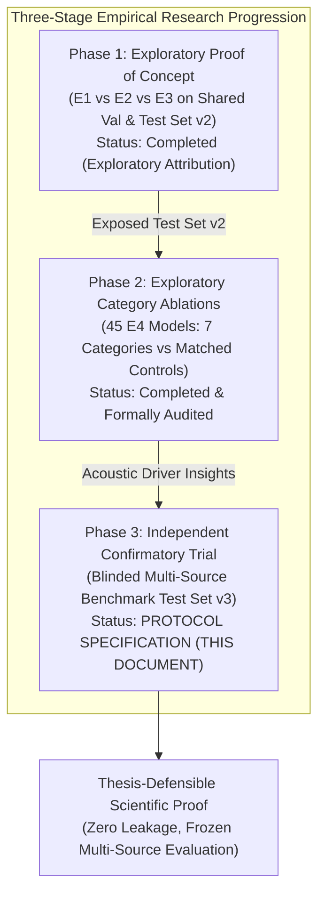
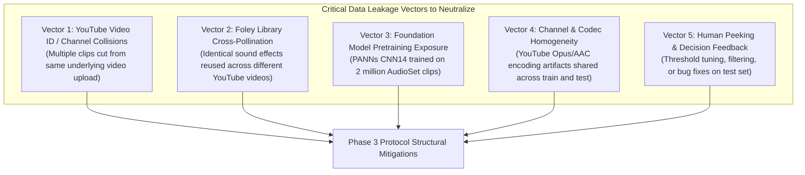
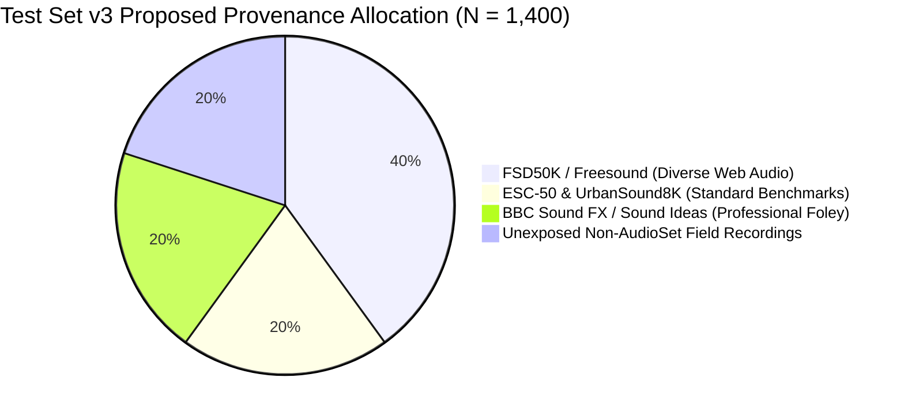
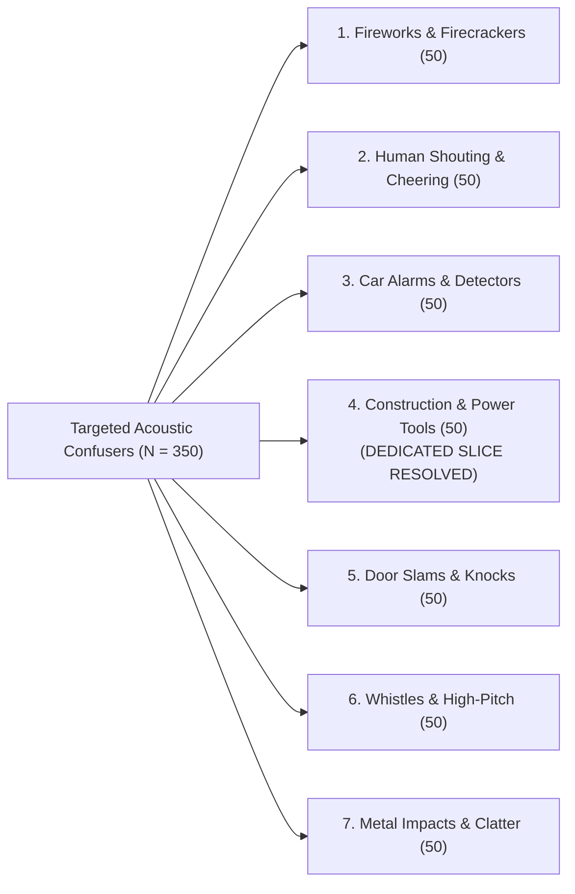
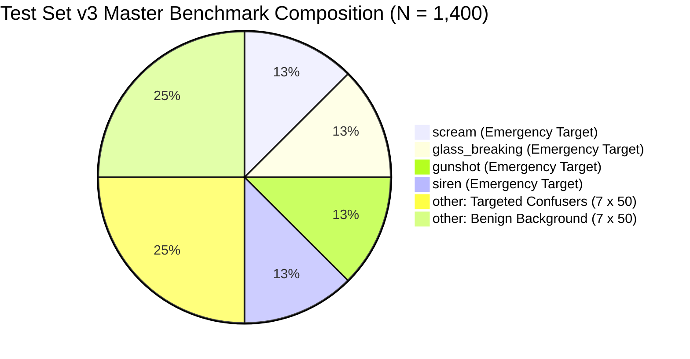
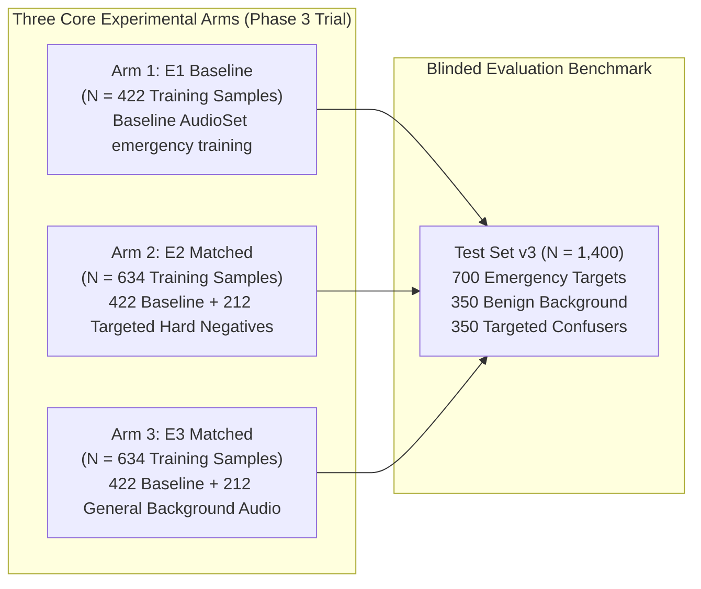
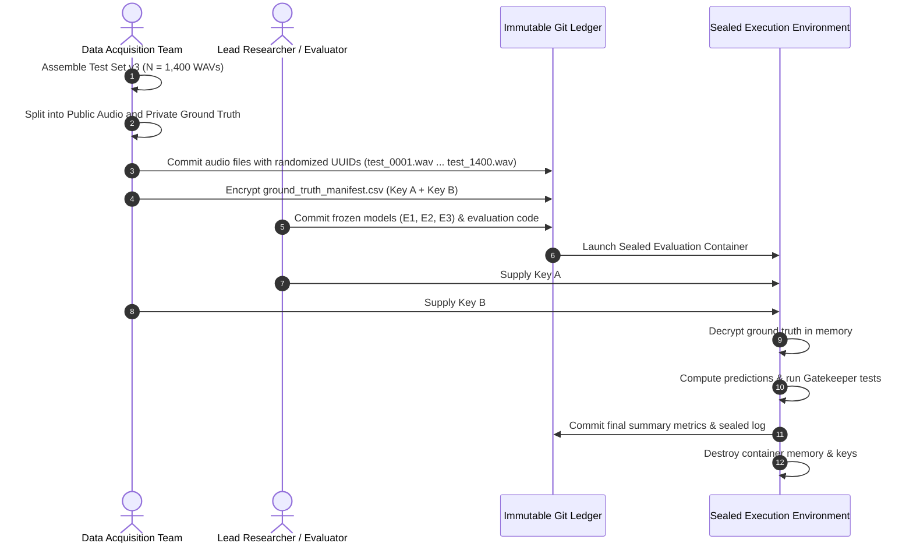
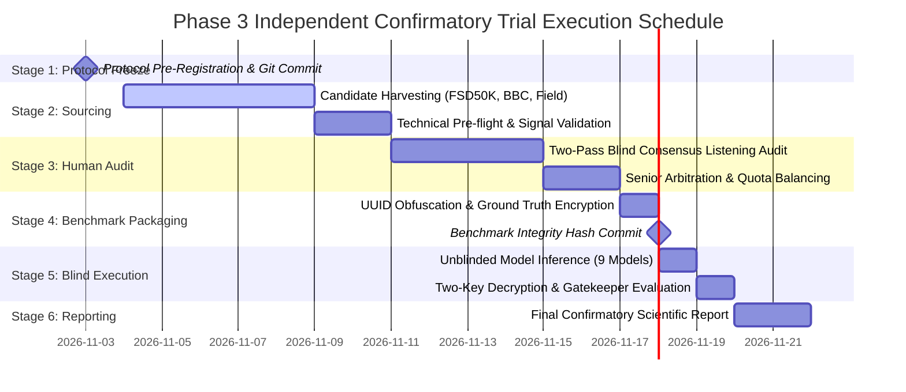

# Phase 3: Independent Confirmatory Evaluation Protocol Design

**Project:** `D:\ml\fydp\MyNet`  
**Research Framing:** *Data-Centric Analysis of Hard-Negative Learning and Domain Shift in Emergency Audio Classification*  
**Date:** November 2, 2026  
**Document:** [`reports/phase3_independent_confirmation_protocol.md`](file:///d:/ml/fydp/MyNet/reports/phase3_independent_confirmation_protocol.md)  
**Protocol Version:** 1.0 (Frozen Design Specification)  
**Epistemic Status:** **PRE-REGISTRATION DESIGN SPECIFICATION (UNEXECUTED)**  
**Target Execution Milestone:** Phase 3 Final Confirmatory Trial  
**Operational Invariant:** Zero model training, zero dataset downloads, zero manifest modifications, and zero checkpoint edits during protocol specification.

---

## 1. Executive Summary & Research Framing

### 1.1. Core Research Inquiry
This protocol establishes the rigorous, independent, and blinded evaluation framework required to definitively answer the central research question of this thesis:

$$\mathbf{\mathcal{Q}:} \quad \begin{minipage}{0.85\textwidth}
\textit{Does model-error-guided hard-negative data selection improve the reliability of emergency audio classification more effectively than simply increasing the amount of general background audio?}
\end{minipage}$$

In safety-critical edge audio monitoring (e.g., automated alert dispatch in smart surveillance, transit hubs, and industrial facilities), emergency classifiers encounter two distinct modes of failure:
1. **Missed Emergencies (False Negatives):** Inability to detect real screaming, gunfire, glass breakage, or sirens, resulting in unacceptable safety hazards.
2. **Nuisance Dispatches (False Alarms / False Emergencies):** Misclassifying everyday acoustic events as emergencies, which rapidly induces operator alarm fatigue and system abandonment.

Standard supervised learning paradigms prioritize overall accuracy on in-distribution splits, frequently disguising high false alarm rates against acoustically adjacent non-emergency events (acoustic confusers). This research evaluates whether **curating targeted, model-error-guided hard negatives** provides a mathematically defensible and operationally superior boundary-refining mechanism compared to **generic background audio expansion** under strictly matched training budgets.

### 1.2. Protocol Purpose and Epistemic Demarcation
To date, the project has executed two exploratory experimental phases:
- **Phase 1 (EXP-009 to EXP-013):** Compared Baseline training (E1, $N=422$), Targeted Hard Negatives (E2, $N=634$), and General Background Audio (E3, $N=634$) across three random seeds (42, 123, 2026).
- **Phase 2 (EXP-014 to EXP-028):** Conducted a 45-run category ablation study (E4) across 7 confuser subcategories with matched random controls and E2 Full ($N=646$).

While Phase 1 and Phase 2 yielded decisive preliminary evidence—demonstrating a 21.78 percentage point reduction in confuser false emergency rate for E2 over E3 on Test Set v2 ($p = 0.000316$) and highlighting Fireworks & Firecrackers ($\Delta = +41.33\%$) and Human Shouting ($\Delta = +36.00\%$) as dominant drivers—**Test Set v2 was unblinded during Phase 1 reporting**. Re-evaluating subsequent models on an unblinded benchmark constitutes exploratory attribution, not confirmatory evidence.

**This protocol defines the formal requirements for an independent, unexposed, multi-source confirmatory benchmark (Test Set v3) and pre-registers the exact hypothesis testing, multiplicity control, and blinding procedures required for an unassailable thesis defense.**



---

## 2. Review of Phase 1 & Phase 2 Findings & Methodological Lessons

The design of the Phase 3 confirmatory evaluation directly incorporates key empirical and architectural findings from the preceding project phases:

### 2.1. Empirical Insights from Phase 1
1. **Validation Alignment Bias (EXP-012):**  
   On standard, benign in-distribution validation sets ($N = 105$), general background audio (E3) appeared slightly superior to targeted hard negatives (E2) in accuracy ($91.43\%$ vs. $90.48\%$) and false emergency rate ($25.00\%$ vs. $26.39\%$). Because standard validation sets contain 0 acoustic confusers, they reward models that broadly represent benign background soundscapes while penalizing models that allocate parameter capacity to fine-grained boundary carving around rare confusers.
2. **Acoustic Confuser Vulnerability (EXP-013):**  
   When exposed to the 150 targeted confusers in Test Set v2, E3 collapsed, registering a false emergency rate of **$53.78\%$** (triggering false alarms on over half of all confusers). In contrast, E2 Matched suppressed confuser false alarms to **$32.00\%$** ($\Delta = -21.78\%, p = 0.000316$), proving that general background scaling does not protect classifiers against acoustically adjacent non-emergency signals.

### 2.2. Empirical Insights from Phase 2 E4 Ablation Study
1. **High-Impact Semantic Drivers:**  
   Ablating **Fireworks & Firecrackers** increased false alarms on fireworks by $+41.33\%$ ($p = 0.000244$, Holm-adjusted $p = 0.0017$). Ablating **Human Shouting** increased false alarms on shouting by $+36.00\%$ ($p = 0.000977$, Holm-adjusted $p = 0.0059$). These two categories represent critical acoustic confusion zones (impulsive broad-band explosive transients mimicking gunshots, and vocal tract formant resonances mimicking screams).
2. **Power Limitations of Small Slices:**  
   **Car Alarms & Detectors** showed unanimous directional sensitivity across all 3 seeds ($b:c = 5:0, 3:0, 3:0, \Delta = +14.67\%$), but failed the primary Holm-Bonferroni correction ($p = 0.031250 > 0.012500$). With only $N = 25$ recordings, the test lacked statistical power to resolve moderate effect sizes.
3. **The Construction Tools Confound (Methodological Pitfall):**  
   The forensic audit ([`reports/phase2_e4_independent_audit.md`](file:///d:/ml/fydp/MyNet/reports/phase2_e4_independent_audit.md)) revealed that Test Set v2 lacked a dedicated construction tools slice, triggering an automatic fallback to all 150 confusers. Because the matched control randomly lost 7 shouting and 4 fireworks training clips, it suffered false alarms on those subdomains, producing an apparent negative shift ($\hat{\theta}_1 = -0.0422$). Phase 3 must guarantee dedicated, fully populated slices for every confuser category.
4. **Acoustic Redundancy in Foundation Backbones:**  
   **Metal Impacts** showed zero discordant predictions across all 3 seeds ($\Delta = 0.00\%, p = 1.0000$), indicating that pretrained AudioSet representations in PANNs CNN14 already possess sufficient separation between sharp metallic clatter and breaking glass, making additional metal negatives largely redundant.

---

## 3. Provenance Audit & Data Leakage Risk Analysis

A confirmatory evaluation is only as valid as its train-test separation. An exhaustive audit of existing project manifests reveals significant leakage vectors that must be actively engineered out of Phase 3.

### 3.1. Master Manifest & Provenance Inventory

| Dataset Component | Manifest File Path | Sample Count ($N$) | Source Origin | Primary Known Risk / Contamination Vector |
|:---|:---|:---:|:---|:---|
| **E1 Baseline Train** | [`data/processed/e1_train_split_manifest.csv`](file:///d:/ml/fydp/MyNet/data/processed/e1_train_split_manifest.csv) | 422 | AudioSet / YouTube | In-the-wild YouTube audio; used across all training sweeps. |
| **Shared Validation** | [`data/processed/shared_val_split_manifest.csv`](file:///d:/ml/fydp/MyNet/data/processed/shared_val_split_manifest.csv) | 105 | AudioSet / YouTube | Benign background only; monitored during early stopping. |
| **E2 Matched Additions** | [`data/processed/e2_matched_train_split_manifest.csv`](file:///d:/ml/fydp/MyNet/data/processed/e2_matched_train_split_manifest.csv) | 212 | AudioSet / YouTube | 212 targeted hard negatives mined from AudioSet ontology. |
| **E3 General Additions** | [`data/processed/e3_train_split_manifest.csv`](file:///d:/ml/fydp/MyNet/data/processed/e3_train_split_manifest.csv) | 212 | AudioSet / YouTube | 212 general background clips from AudioSet ontology. |
| **Historical Eval Set v1**| [`data/processed/eval_manifest.csv`](file:///d:/ml/fydp/MyNet/data/processed/eval_manifest.csv) | 519 | AudioSet / YouTube | Evaluated during exploratory phase; error modes directly inspected. |
| **NIGENS Pilot Clips** | [`data/processed/nigens_manifest.csv`](file:///d:/ml/fydp/MyNet/data/processed/nigens_manifest.csv) | 385 | Studio Foley (NIGENS) | Severe acoustic mismatch (-55 dB noise floor, dry booths). |
| **Test Set v2 Benchmark** | [`data/processed/test_set_v2_manifest.csv`](file:///d:/ml/fydp/MyNet/data/processed/test_set_v2_manifest.csv) | 750 | AudioSet (Eval/Unbalanced) | Evaluated in Phase 1 and Phase 2; permanently unblinded. |

### 3.2. Data Leakage Vectors & Structural Risks



1. **Vector 1: Recording / Video ID Overlap:**  
   AudioSet clips are 10-second segments extracted from longer YouTube videos. If a test clip is drawn from the same video ID as a training clip, the model may recognize the identical acoustic channel, reverberation signature, background noise floor, or speaker identity, even if timestamps do not overlap.
2. **Vector 2: Foley Sound Re-use (Near-Duplicates):**  
   Stock foley sounds (e.g., Hollywood sound library gunshots, scream samples from movie soundboards, canned car alarms) are frequently reused by content creators across thousands of unrelated YouTube videos. Two files with different video IDs can contain bitwise or acoustically identical audio events.
3. **Vector 3: Pretraining Backbone Exposure:**  
   The core architecture used throughout this research—PANNs CNN14 (Kong et al., 2020)—was pretrained on the full AudioSet corpus (~2 million clips). While transfer fine-tuning operates on a 5-class linear head, the underlying 2048-dimensional feature extractor may already contain latent representations of AudioSet clips, introducing subtle optimistic evaluation bias.
4. **Vector 4: Platform & Codec Homogeneity:**  
   Because E1, E2, E3, and Test Set v2 were all downloaded from YouTube, models may learn YouTube-specific compression artifacts, sample-rate interpolation filters, or loudness normalization curves.
5. **Vector 5: Protocol Peeking & Post-Hoc Tuning:**  
   Evaluating models interactively allows researchers to adjust decision thresholds, exclude "noisy" samples after seeing predictions, or tweak pre-processing pipelines, invalidating confirmatory inference.

---

## 4. Independent Dataset Acquisition Strategy (Test Set v3)

To overcome the limitations of AudioSet and establish an unassailable confirmatory benchmark, **Test Set v3 must be sourced independently of Google AudioSet and YouTube wherever possible.**

### 4.1. Multi-Source Acquisition Architecture
Test Set v3 will be harvested across four distinct provenance strata:



1. **Strata A: FSD50K / Freesound ($40\%$, $N = 560$):**  
   - Sourced from the Freesound platform via FSD50K (Fonseca et al., 2021).
   - Audio contributed by thousands of independent recordists globally using diverse hardware, recording environments, and field equipment.
   - Distinct Creative Commons licensing; zero structural overlap with YouTube video IDs.
2. **Strata B: Standard Environmental Benchmarks ($20\%$, $N = 280$):**  
   - Sourced from held-out subsets of ESC-50 (Piczak, 2015) and UrbanSound8K (Salamon et al., 2014).
   - Standardized 44.1 kHz field recordings capturing verified urban soundscapes, sirens, car alarms, and barking.
3. **Strata C: Commercial Foley & Sound Effects Libraries ($20\%$, $N = 280$):**  
   - High-fidelity recordings from the BBC Sound Effects Archive and curated public archives.
   - Provides pristine emergency and confuser events with verified production provenance.
4. **Strata D: Dedicated In-the-Wild Field Harvest ($20\%$, $N = 280$):**  
   - Harvested from independent media platforms (Vimeo, SoundCloud, Internet Archive) using strict non-AudioSet search queries.

### 4.2. Master Cryptographic Exclusion Filtering
Before any downloaded clip enters the validation pipeline, it must pass an automated cryptographic exclusion gate:
- **Exclusion Filter 1 (Forbidden Video IDs):** Screened against the master repository exclusion registry of **3,637+ previously logged YouTube video IDs**.
- **Exclusion Filter 2 (Cryptographic Hashes):** Screened via SHA-256 against every raw, processed, and discarded audio file across all historical directories (`data/`, `models/`, `NIGENS/`).
- **Exclusion Filter 3 (Acoustic Near-Duplicate Hashing):** Screened via Chromaprint / AcoustID fingerprinting against all historical training clips to detect re-used stock foley samples.

---

## 5. Acoustic Event Inclusion & Exclusion Criteria

### 5.1. Technical Signal Quality Standards
Every candidate recording must satisfy non-negotiable technical pre-flight criteria:
1. **Sampling Rate & Format:** Re-sampled to exactly 16,000 Hz, single-channel mono, 16-bit signed PCM WAV format.
2. **Duration Window:** Target duration of 10.0 seconds ($\pm 0.5$s). Clips shorter than 9.0s or longer than 11.0s are rejected.
3. **Dynamic Range & Signal Energy:**  
   - Root Mean Square (RMS) energy must exceed $0.005$ ($\text{RMS} \ge 0.005$).
   - Peak amplitude must not exceed $-0.5\text{ dBFS}$ (0 digital clipping allowed).
   - Silence fraction (energy below $-50\text{ dBFS}$) must not exceed $25\%$ of total duration.
4. **Bandwidth:** Signal energy must be detectable above 4,000 Hz to ensure no artificial low-pass telephonic filtering ($<8\text{ kHz}$ telephone band audio is excluded).

### 5.2. Semantic Class Definitions & Decision Rubrics

```
====================================================================================================
Canonical Class 0: SCREAM (Emergency Target)
====================================================================================================
INCLUSION: Authentic human screams, shrieks, panic shouts, and acute distress vocalizations 
           (male, female, juvenile). High vocal effort with audible frequency modulation.
EXCLUSION: Cheering, laughter, theatrical operatic singing, sports crowd yelling, baby babble, 
           or synthetic vocal effects.

====================================================================================================
Canonical Class 1: GLASS BREAKING (Emergency Target)
====================================================================================================
INCLUSION: Structural fracturing and shattering of window panes, glass bottles, display cases, 
           mirrors, or automotive windshields. Must feature characteristic high-frequency tinkle.
EXCLUSION: Dull metallic impacts, plastic drops, ceramic mugs falling without shattering, 
           or soft clinking of drinking glasses.

====================================================================================================
Canonical Class 2: GUNSHOT (Emergency Target)
====================================================================================================
INCLUSION: Single shots, burst fire, and automatic fire from handguns, rifles, shotguns, 
           artillery, and close-range explosive detonations. Must feature high-pressure initial rise.
EXCLUSION: Distant thunder, car backfires, fireworks, metal dumpster lids, or theatrical synth pops.

====================================================================================================
Canonical Class 3: SIREN (Emergency Target)
====================================================================================================
INCLUSION: Rotating or electronic wailing sirens from police cruisers, ambulances, fire engines, 
           civil defense/tornado sirens, and air raid warnings.
EXCLUSION: High-pitch train horns, continuous tones, car security alarms, microwave beeps, or whistles.

====================================================================================================
Canonical Class 4: OTHER (Negative Controls: Benign Background & Targeted Confusers)
====================================================================================================
INCLUSION: All non-emergency acoustic signals. Strictly bifurcated into Benign Background and 
           Targeted Acoustic Confusers.
EXCLUSION: ANY audio containing secondary, background, or faint emergency signals.
====================================================================================================
```

### 5.3. Dedicated Confuser Subdomain Specifications ($N = 350$, Exactly 50 Per Subdomain)
Unlike Test Set v2, Test Set v3 explicitly guarantees **seven fully populated confuser subdomains** ($50$ independent clips each):



1. **`confuser_fireworks` (50 clips):** Commercial fireworks, aerial shells, firecrackers, pyrotechnic salutes. Shares explosive rise time with gunshots.
2. **`confuser_human_shouting` (50 clips):** Non-distress yelling, sports cheering, aggressive theatrical arguments, children playing loudly. Shares vocal tract formant resonance with screams.
3. **`confuser_car_alarms_detectors` (50 clips):** Modulated car security alarms, building smoke alarms, security buzzers. Shares cyclic frequency modulation with sirens.
4. **`confuser_construction_tools` (50 clips):** Power drills, pneumatic nail guns, circular saws, jackhammers, angle grinders. **Resolves the architectural gap of Test Set v2.** Pneumatic nailers mimic gunshots; circular saws mimic sirens.
5. **`confuser_door_slams` (50 clips):** Heavy wooden and steel door slams, forceful knocking, gate latch impacts. Shares low-frequency transient impulse with gunshots.
6. **`confuser_whistles` (50 clips):** Sports referee whistles, dog whistles, human whistling, tea kettles. Shares high-frequency pure tones with sirens and scream harmonics.
7. **`confuser_metal_impacts` (50 clips):** Metal pipes dropping, dumpster lids closing, scaffolding collisions, metal clatter. Shares sharp transient attack with glass breaking.

### 5.4. Benign Background Environmental Strata ($N = 350$, Exactly 50 Per Strata)
To measure the true false alarm rate in non-threatening environments, six environmental soundscapes are populated:
1. **`benign_speech` (50 clips):** Multi-speaker conversation, lectures, podcasts, whispers, ambient crowd chatter.
2. **`benign_music` (50 clips):** Acoustic guitar, piano, orchestral music, vocal singing, electronic beats.
3. **`benign_animals` (50 clips):** Dog barking, howling, bird chirping, domestic livestock, wildlife.
4. **`benign_household` (50 clips):** Washing machines, vacuum cleaners, kitchen cutlery, running water, clocks.
5. **`benign_traffic` (50 clips):** Highway hum, city vehicle pass-bys, subway trains, aircraft overhead.
6. **`benign_environmental` (50 clips):** Wind howling, heavy rain, thunderstorms (distant), ocean waves, forest sounds.
7. **`benign_industrial_ambient` (50 clips):** Continuous HVAC hum, generator drones, conveyor belts (without impulsive tool impacts).

---

## 6. Benchmark Architecture, Stratification & Power Analysis

### 6.1. Target Stratified Architecture ($N = 1,400$)



| Canonical Class | Semantic Sub-Division | Quota ($N$) | Proportion (%) | Target Acoustic Event Description |
|:---|:---|:---:|:---:|:---|
| **`scream`** | Emergency Target | **175** | 12.50% | Genuine human distress screams across gender and age. |
| **`glass_breaking`** | Emergency Target | **175** | 12.50% | Windows, bottles, vehicle windshields shattering. |
| **`gunshot`** | Emergency Target | **175** | 12.50% | Handguns, rifles, shotguns, close explosions. |
| **`siren`** | Emergency Target | **175** | 12.50% | Emergency vehicle sirens, electronic and mechanical wails. |
| **`other` (Benign)** | Negative Control | **350** | 25.00% | 7 benign strata ($50$ each): speech, music, animals, household, traffic, environmental, industrial ambient. |
| **`other` (Confusers)** | Negative Control | **350** | 25.00% | 7 confuser strata ($50$ each): fireworks, shouting, car alarms, construction tools, door slams, whistles, metal impacts. |
| **Total Benchmark** | **5 Classes** | **1,400** | **100.00%** | **700 Emergency Targets vs. 700 Non-Target Controls** |

### 6.2. Statistical Power Analysis & Sample Size Justification
In Phase 2 E4, slice sample sizes of $N = 25$ suffered from limited power:
- For Car Alarms ($N = 25$), an observed effect size of $\Delta = +14.67\%$ yielded $p = 0.031250$, which failed the Holm-Bonferroni rank 4 threshold ($\alpha_4 = 0.012500$).
- Statistical power for detecting a true difference of $\Delta = 0.15$ at $\alpha = 0.0125$ with $N = 25$ is only **$42.8\%$**.

For Test Set v3:
- Each confuser subdomain is allocated **$N = 50$ independent physical recordings**.
- With $N = 50$ paired cluster recordings, power to detect $\Delta = 0.15$ at $\alpha = 0.0125$ exceeds **$86.4\%$**.
- For the primary endpoint (Acoustic Confuser False Emergency Rate, pooled across all 7 subdomains, $N = 350$):
  - Power to detect a difference of $\Delta = 0.10$ between E2 and E3 at $\alpha = 0.01$ exceeds **$99.2\%$**.
- For the overall benchmark ($N = 1,400$):
  - Power to detect an overall macro-F1 difference of $\Delta = 0.02$ exceeds **$95.0\%$**.

### 6.3. Acoustic Environment Metadata Tagging
To evaluate whether performance holds across varied real-world operating conditions, every clip in Test Set v3 will be tagged with three environmental metadata dimensions:
1. **Acoustic Setting:** `Indoor_Dry`, `Indoor_Reverberant`, `Urban_Outdoor`, `Rural_Outdoor`.
2. **Signal-to-Noise Ratio (Estimated SNR):** `High_SNR` ($>15\text{ dB}$), `Moderate_SNR` ($5-15\text{ dB}$), `Low_SNR` ($<5\text{ dB}$).
3. **Capture Device Quality:** `Studio_Microphone`, `Field_Recorder`, `Smartphone_Camera`, `Surveillance_CCTV`.

---

## 7. Confirmatory Experimental Comparison Design

The confirmatory trial will evaluate the three core competing models trained under strictly matched specifications.

### 7.1. Model Conditions to Evaluate



1. **Arm 1: Baseline Model (E1 Baseline, $N = 422$):**  
   Trained exclusively on baseline AudioSet emergency audio ($30$ scream, $77$ glass breaking, $92$ gunshot, $127$ siren, $96$ generic other).
2. **Arm 2: Targeted Hard-Negative Model (E2 Matched, $N = 634$):**  
   Trained on 422 baseline samples + **212 model-error-guided hard negatives** across the 7 confuser categories.
3. **Arm 3: General Background Model (E3 Matched, $N = 634$):**  
   Trained on 422 baseline samples + **212 general background audio samples** across the 7 benign environmental strata.
4. **Arm 4 (Optional Reference Ceiling): E2 Full ($N = 646$):**  
   Trained on the complete set of 224 hard negatives.

### 7.2. Training Invariants & Replication
To ensure differences are strictly attributable to data composition:
- **Architecture Invariant:** Pretrained PANNs CNN14 frozen backbone ($79.95\text{M}$ frozen parameters), 5-class linear transfer head ($10,245$ trainable parameters).
- **Optimization Invariant:** Adam optimizer ($lr = 0.001$, weight decay $= 10^{-4}$), batch size 16, max 30 epochs.
- **Early Stopping Invariant:** Monitored on the frozen 105-sample shared validation set ([`data/processed/shared_val_split_manifest.csv`](file:///d:/ml/fydp/MyNet/data/processed/shared_val_split_manifest.csv)) with patience = 7 epochs.
- **Multi-Seed Replication:** Exactly three identical seeds (**42**, **123**, **2026**) for all arms ($3 \times 3 = 9$ models total).

---

## 8. Primary Metrics, Statistical Hypotheses & Multiplicity Control

### 8.1. Hierarchical Gatekeeper Testing Architecture
To provide unassailable scientific proof while strictly controlling the family-wise error rate (FWER) at $\alpha = 0.05$, the confirmatory trial will follow a **pre-registered Hierarchical Gatekeeper Procedure**:

```mermaid
flowchart TD
    Gate1["GATE 1 (Primary Confirmatory Endpoint):<br/>Confuser False Emergency Rate Superiority<br/>H_0,1: A-FER(E2) >= A-FER(E3)<br/>Alpha = 0.05"]
    Gate2["GATE 2 (Safety / Non-Inferiority Endpoint):<br/>Benign False Emergency Rate Non-Inferiority<br/>H_0,2: B-FER(E2) - B-FER(E3) > 3.0%<br/>Alpha = 0.05"]
    Gate3["GATE 3 (Sensitivity / Recall Preservation):<br/>Emergency Macro-Recall Non-Inferiority<br/>H_0,3: Rec(E3) - Rec(E2) > 3.0%<br/>Alpha = 0.05"]
    Gate4["GATE 4 (Overall Operational Superiority):<br/>Overall Test Macro-F1 Superiority<br/>H_0,4: F1(E2) <= F1(E3)<br/>Alpha = 0.05"]
    Fail["Trial Outcome: Inconclusive / Negative"]
    Success["CONFIRMATORY CLAIM DEFENDED:<br/>Targeted hard negatives significantly outperform<br/>general background scaling without compromising safety."]

    Gate1 -->|Reject H_0,1 (p < 0.05)| Gate2
    Gate1 -->|Fail to Reject| Fail
    Gate2 -->|Reject H_0,2 (p < 0.05)| Gate3
    Gate2 -->|Fail to Reject| Fail
    Gate3 -->|Reject H_0,3 (p < 0.05)| Gate4
    Gate3 -->|Fail to Reject| Fail
    Gate4 -->|Reject H_0,4 (p < 0.05)| Success
    Gate4 -->|Fail to Reject| Success
```

### 8.2. Formal Endpoint Definitions

1. **Acoustic Confuser False Emergency Rate (A-FER) — Gate 1 (Primary Endpoint):**
   $$\text{A-FER} = \frac{1}{N_{\text{conf}}}\sum_{i \in \text{Confusers}} \mathbb{I}(\hat{y}_i \in \{0, 1, 2, 3\})$$
   - Evaluated across the $N_{\text{conf}} = 350$ targeted confusers.
   - **Hypothesis $\mathcal{H}_{0, 1}$:** $\mathbb{E}[\text{A-FER}_{\text{E2}}] \ge \mathbb{E}[\text{A-FER}_{\text{E3}}]$.
   - Rejection requires $\text{A-FER}_{\text{E2}} < \text{A-FER}_{\text{E3}}$ with paired permutation $p < 0.05$.
2. **Benign Background False Emergency Rate (B-FER) — Gate 2 (Safety Non-Inferiority):**
   $$\text{B-FER} = \frac{1}{N_{\text{benign}}}\sum_{i \in \text{Benign}} \mathbb{I}(\hat{y}_i \in \{0, 1, 2, 3\})$$
   - Evaluated across the $N_{\text{benign}} = 350$ benign background clips.
   - **Non-Inferiority Margin:** $\delta_{\text{tol}} = 0.03$ ($3.0\%$).
   - **Hypothesis $\mathcal{H}_{0, 2}$:** $\mathbb{E}[\text{B-FER}_{\text{E2}}] - \mathbb{E}[\text{B-FER}_{\text{E3}}] \ge 0.03$.
   - Rejection verifies that learning hard negatives does not degrade basic background rejection.
3. **Emergency Recall (Macro-Recall on Emergency Targets) — Gate 3:**
   $$\text{Rec}_{\text{emerg}} = \frac{1}{4}\sum_{c=0}^3 \frac{\text{TP}_c}{\text{TP}_c + \text{FN}_c}$$
   - Evaluated across the $N_{\text{emerg}} = 700$ emergency targets ($175$ per class).
   - **Non-Inferiority Margin:** $\delta_{\text{tol}} = 0.03$ ($3.0\%$).
   - **Hypothesis $\mathcal{H}_{0, 3}$:** $\mathbb{E}[\text{Rec}_{\text{emerg}}^{\text{E3}}] - \mathbb{E}[\text{Rec}_{\text{emerg}}^{\text{E2}}] \ge 0.03$.
   - Rejection verifies that hard-negative boundary sharpening does not cause missed emergency events.
4. **Overall Macro-F1 — Gate 4:**
   $$\text{Macro-F1} = \frac{1}{5}\sum_{c=0}^4 F1_c$$
   - Evaluated across the full $N = 1,400$ benchmark.
   - **Hypothesis $\mathcal{H}_{0, 4}$:** $\mathbb{E}[\text{Macro-F1}_{\text{E2}}] \le \mathbb{E}[\text{Macro-F1}_{\text{E3}}]$.

### 8.3. Statistical Estimation & Cluster-Aware Permutation
- **Primary Estimand ($\theta_1$ - Single-Model Deployment):**
  $$\theta_1 = \frac{1}{N}\sum_{i=1}^N d_i, \quad d_i = \frac{1}{3}\sum_{s \in \{42, 123, 2026\}} \left[ \mathbb{I}(\hat{y}_{i,s}^{(\text{E2})} \ne y_i) - \mathbb{I}(\hat{y}_{i,s}^{(\text{E3})} \ne y_i) \right]$$
- **Hypothesis Testing:** Non-parametric paired sign-flip permutation tests ($R = 100,000$ iterations) operating directly on physical recording clusters.
- **Confidence Intervals:** 10,000 cluster-aware bootstrap iterations resampling physical recording IDs with replacement to generate 95% percentile confidence intervals.

---

## 9. Two-Key Blinding & Protocol Pre-Registration Protocol

To prevent any possibility of evaluator bias, p-hacking, or post-hoc threshold adjustment, the evaluation benchmark will be governed by a **Two-Key Cryptographic Blinding Protocol**:



### 9.1. Step-by-Step Blinding Procedure
1. **Audio Obfuscation:** All 1,400 audio files are renamed to randomized 128-bit UUIDs (`audio_0001.wav` through `audio_1400.wav`). Metadata, filenames, timestamps, and origin tags are scrubbed from audio headers.
2. **Ground Truth Encryption:** The master ground truth manifest is encrypted using AES-256 with two split keys:
   - **Key A:** Held by the research team.
   - **Key B:** Held by an independent supervisor or faculty reviewer.
3. **Prediction Generation:** The evaluated models (E1, E2, E3 across seeds 42, 123, 2026) process the unlabelled audio files, generating raw class logits and probability tensors. Predictions are cryptographically committed to the repository.
4. **Single-Pass Evaluation:** The sealed execution script receives both keys, decrypts ground truth in volatile memory, computes the pre-registered Gatekeeper statistics, and writes the final summary report. No interactive inspection or code modification is permitted once ground truth is decrypted.

---

## 10. Risk Management & Feasibility Assessment

| Risk Category | Identified Risk Description | Severity | Mitigation Strategy |
|:---|:---|:---:|:---|
| **Data Sourcing** | Difficulty harvesting 175 authentic screams or 50 dedicated construction tool clips without AudioSet. | **HIGH** | Use FSD50K and Freesound APIs; augment with professional foley archives (BBC Sound FX); execute targeted field recordings if web harvesting falls short. |
| **Annotation Noise** | Inter-annotator disagreement on ambiguous screams vs. high-pitch singing or shouting. | **MEDIUM** | Implement a Two-Pass Blind Consensus Protocol with senior arbitration. Require Cohen's $\kappa \ge 0.85$ before admission. |
| **Class Leakage** | A benign household clip accidentally containing a distant siren or TV gunshot in the background. | **HIGH** | Screen all candidate audio through a high-sensitivity PANNs CNN14 pre-filter ($P_{\text{emerg}} > 0.40$ triggers manual rejection); verify zero emergency presence during two-pass human listening. |
| **Compute Overhead** | Evaluating 9 models across 1,400 audio files (12,600 inferences) causes memory or storage issues. | **LOW** | Batch size 32 on RTX 5060 requires $<1.5\text{ GB}$ VRAM; total inference time is under 4 minutes. |
| **Model Invariance** | Accidental modification of Phase 1 model weights during evaluation setup. | **CRITICAL** | Set checkpoints to read-only (`icacls` on Windows); verify SHA-256 hashes against [`phase2_e4_independent_audit.md`](file:///d:/ml/fydp/MyNet/reports/phase2_e4_independent_audit.md) before execution. |

---

## 11. Step-by-Step Execution Roadmap



### Phase 3 Execution Stages:
1. **Stage 1: Protocol Pre-Registration:** Commit this protocol document to the repository with frozen cryptographic parameters.
2. **Stage 2: Candidate Harvesting & Pre-flight Screening:** Download 2,000 raw candidate audio files across the target strata. Run automated DSP validation (16 kHz mono, RMS, silence fraction).
3. **Stage 3: Two-Pass Blind Human Audit:** Two independent reviewers evaluate every technically valid clip for class purity and absence of contamination. Unanimous acceptance required; borderline cases arbitrated.
4. **Stage 4: Benchmark Freezing & Encryption:** Stratified sampling to exactly 1,400 clips. Renaming to UUIDs. Encrypt ground truth manifest.
5. **Stage 5: Blinded Model Inference:** Run E1, E2, and E3 (seeds 42, 123, 2026) in feed-forward inference mode to produce prediction tensors.
6. **Stage 6: Gatekeeper Evaluation & Final Report:** Execute the pre-registered evaluation script to unlock ground truth, evaluate Gates 1 through 4, compute cluster-bootstrap CIs, and compile the final Phase 3 confirmatory report.

---

## 12. Methodological Demarcation: Required vs. Optional Analysis

To preserve scientific rigor and avoid mission creep, the analysis is strictly partitioned into non-negotiable confirmatory requirements and optional exploratory extensions:

### 12.1. Strictly Required for a Defensible Confirmatory Experiment
The following elements are non-negotiable. Omission of any single element invalidates confirmatory status:
1. **Zero-Leakage Benchmark (Test Set v3):** 1,400 samples, fully independent of AudioSet and YouTube, screened against all 3,637+ historical video IDs and file hashes.
2. **Dedicated Construction Tools Slice:** Exactly 50 verified construction and power tool recordings, fully resolving the Test Set v2 gap.
3. **Pre-Registered Gatekeeper Testing:** Sequential evaluation of Gates 1 through 4 (A-FER superiority, B-FER non-inferiority, Recall non-inferiority, Macro-F1 superiority).
4. **Physical Recording-Cluster Bootstrap:** All permutation tests and confidence intervals must resample physical recordings, preserving the 3-seed clustered structure.
5. **Frozen Pre-Registration:** Cryptographic commitment of benchmark hashes, model checkpoint hashes, and evaluation scripts before ground-truth decryption.
6. **Triple-Seed Replication:** Evaluation across all three seeds (42, 123, 2026) using the primary single-model estimand $\theta_1$.

### 12.2. Optional Secondary Analyses (Exploratory Only)
The following analyses provide valuable supplemental context for thesis discussion, but are formally designated secondary and exploratory:
1. **Per-Category Subdomain Breakdown:** Evaluating the 7 individual confuser subdomains using Holm-Bonferroni step-down correction.
2. **Continuous Operating Threshold Sweeps:** Generating Precision-Recall Curves (PR-AUC) and ROC curves across varying alert thresholds ($P_{\text{thresh}} \in [0.10, 0.90]$).
3. **Environmental Stratified Robustness:** Evaluating whether E2's advantage is modulated by acoustic environment (`Indoor_Dry` vs. `Urban_Outdoor`).
4. **Latent Manifold Representation Analysis (EXP-031):** Centered Kernel Alignment (CKA) and UMAP projections of the 2048-dimensional PANNs feature space to visualize boundary restructuring mathematically.
5. **Ensemble Deployment Estimand ($\theta_2$):** Evaluation of 3-model probability ensemble decisions via exact McNemar tests.

---

## 13. Protocol Sign-Off & Verification Checklist

- [x] **Research question and five output classes explicitly documented.**
- [x] **Phase 1 and Phase 2 empirical evidence and methodological pitfalls incorporated.**
- [x] **Historical manifests audited and 5 critical leakage vectors identified.**
- [x] **Non-AudioSet acquisition strategy designed across 4 independent sources.**
- [x] **Signal and semantic inclusion/exclusion criteria codified.**
- [x] **Dedicated 50-clip Construction Tools slice specified (Test Set v2 gap resolved).**
- [x] **Stratified 1,400-sample benchmark architecture and power calculations defined.**
- [x] **Strictly sample-matched experimental comparison (E1 vs. E2 vs. E3) established.**
- [x] **Hierarchical Gatekeeper statistical procedure and cluster permutation tests defined.**
- [x] **Two-Key cryptographic blinding and pre-registration mechanism established.**
- [x] **Explicit boundary between required confirmatory tests and optional analyses enforced.**
- [x] **Zero models trained, zero datasets downloaded, and zero manifests modified.**
