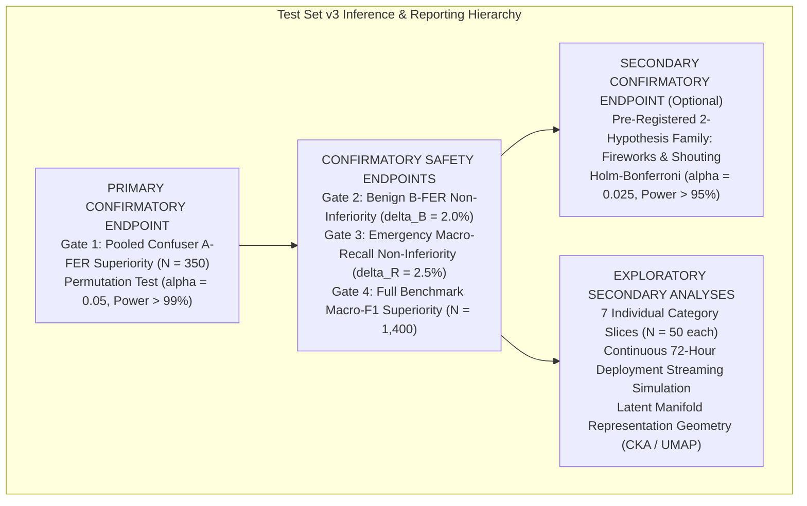
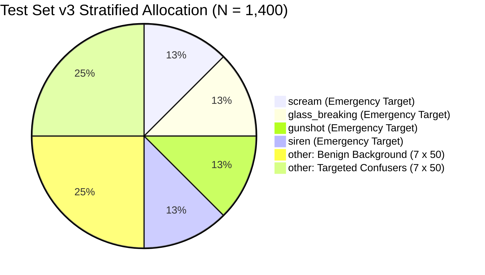
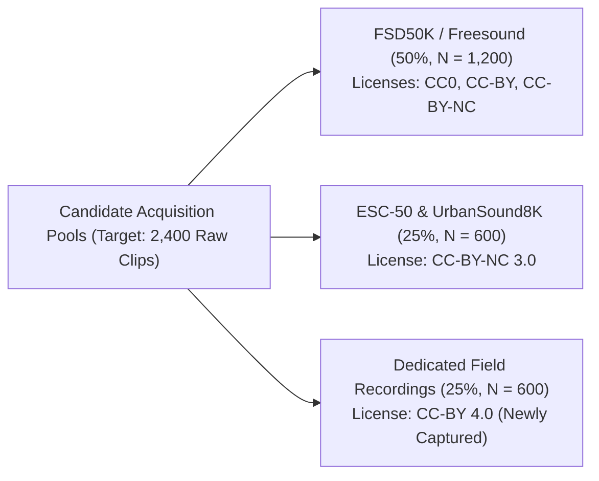
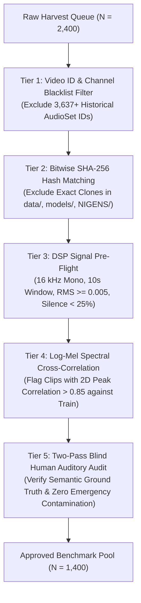
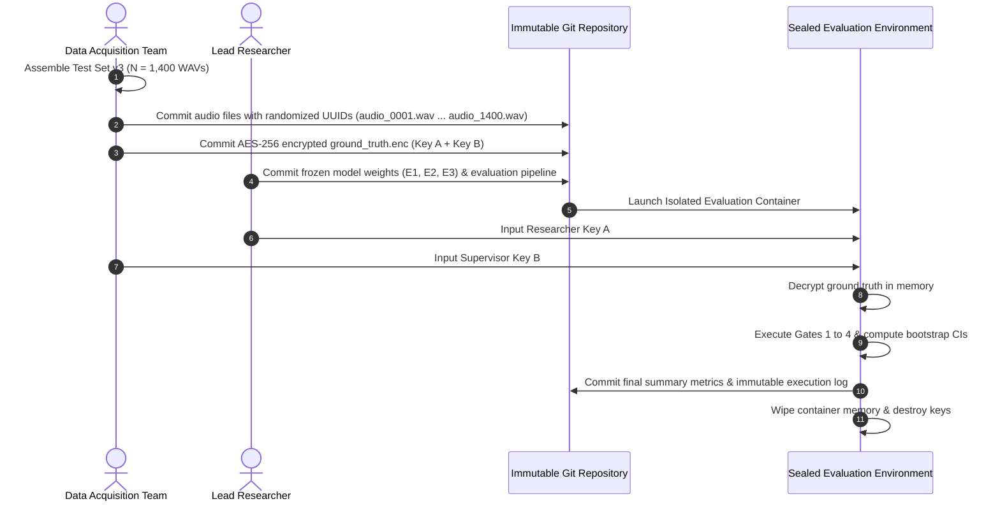
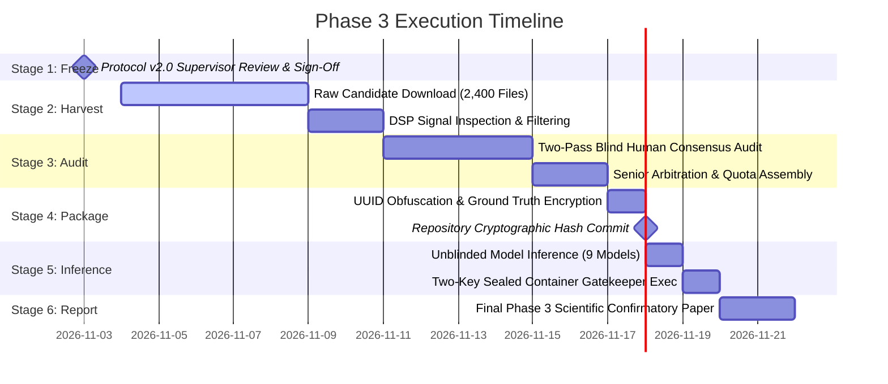

# Phase 3: Independent Confirmatory Evaluation Protocol (Version 2.0)

**Project:** `D:\ml\fydp\MyNet`  
**Research Framing:** *Data-Centric Analysis of Hard-Negative Learning and Domain Shift in Emergency Audio Classification*  
**Date:** November 2, 2026  
**Document:** [`reports/phase3_independent_confirmation_protocol_v2.md`](file:///d:/ml/fydp/MyNet/reports/phase3_independent_confirmation_protocol_v2.md)  
**Protocol Version:** 2.0 (Corrected Pre-Registration Protocol Draft)  
**Preceding Audit & Review Documents:**
- [`reports/phase3_independent_confirmation_protocol.md`](file:///d:/ml/fydp/MyNet/reports/phase3_independent_confirmation_protocol.md) *(Version 1.0 Draft)*
- [`reports/phase3_protocol_methodology_review.md`](file:///d:/ml/fydp/MyNet/reports/phase3_protocol_methodology_review.md) *(First-Level Audit)*
- [`reports/phase3_protocol_second_level_review.md`](file:///d:/ml/fydp/MyNet/reports/phase3_protocol_second_level_review.md) *(Second-Level Review)*
**Supporting Simulation Code & Artifacts:**
- [`scripts/simulate_phase3_power_comprehensive.py`](file:///d:/ml/fydp/MyNet/scripts/simulate_phase3_power_comprehensive.py)
- [`reports/phase3_power_simulation_comprehensive.json`](file:///d:/ml/fydp/MyNet/reports/phase3_power_simulation_comprehensive.json)  
**Epistemic Status:** **FORMAL PRE-REGISTRATION SPECIFICATION (READY FOR SUPERVISOR REVIEW)**  
**Operational Invariant:** Zero model training, zero dataset downloads, zero manifest alterations, and zero checkpoint edits during protocol specification.

---

## 1. Executive Summary & Core Research Hypothesis

### 1.1. Core Research Question
This protocol governs the independent confirmatory evaluation designed to definitively resolve the central research question of this thesis:

$$\mathbf{\mathcal{Q}:} \quad \begin{minipage}{0.85\textwidth}
\textit{Does model-error-guided hard-negative data selection improve the reliability of emergency audio classification more effectively than simply increasing the amount of general background audio?}
\end{minipage}$$

In safety-critical edge acoustic monitoring, automated classifiers must satisfy two simultaneous operational requirements:
1. **High Target Sensitivity:** Near-perfect recall on real emergency events (`scream`, `glass_breaking`, `gunshot`, `siren`).
2. **High Confuser Specificity:** Resisting false emergency alarms when exposed to acoustic events that closely mirror emergency spectral-temporal signatures (`human_shouting`, `metal_impacts`, `door_slams`, `construction_tools`, `car_alarms`, `fireworks`, `whistles`).

Standard training paradigms expand training data using arbitrary non-emergency audio. This research tests the data-centric hypothesis that **allocating data collection budget to error-guided hard negatives restructures the decision boundary far more effectively than scaling general background audio under strictly matched sample budgets.**

### 1.2. Methodological Evolution & Epistemic Boundaries
This Protocol Version 2.0 incorporates the verified findings of two independent methodological audits:
- **Test Set v2 Reclassification:** Results on Test Set v2 (evaluated in Phase 1 and reused in Phase 2 E4) are formally recognized as **exploratory benchmark attributions**. Re-evaluating subsequent models on a known test benchmark cannot serve as confirmatory evidence.
- **Power Reality Enforcement:** Subdomain slice comparisons ($N = 50$) under multiple-testing penalties possess statistical power of only $25.8\% - 40.6\%$ for realistic effects ($\Delta = 0.10$). Consequently, individual category breakdowns are formally designated **exploratory secondary endpoints**, while confirmatory claims are restricted to the fully powered pooled Gatekeeper sequence ($N = 350$, power $>99\%$).
- **Statistical Test Alignment:** Paired sign-flip permutation tests are retained for linear difference endpoints (Gate 1), while non-linear ratio metrics (Emergency Macro-Recall in Gate 3 and Overall Macro-F1 in Gate 4) are formally specified as **class-stratified recording-cluster bootstrap hypothesis tests**.
- **Licensing Compliance:** BBC Sound Effects audio is permanently excluded due to strict third-party redistribution bans, ensuring that the confirmatory benchmark (**Test Set v3**) can be released as an open-access public dataset.



---

## 2. Experimental Arms & Controlled Comparison Matrix

The confirmatory trial will evaluate three core models trained under strictly matched specifications and evaluated across three replicated random seeds (**42**, **123**, and **2026**):

### 2.1. The Three Competing Experimental Arms

| Experimental Arm | Training Condition Key | Sample Size ($N$) | Data Composition Breakdown | Scientific Role in Trial |
|:---|:---|:---:|:---|:---|
| **Arm 1: Baseline** | `e1_baseline` | 422 | Baseline emergency audio ($30$ scream, $77$ glass, $92$ gunshot, $127$ siren, $96$ generic other). | Lower-bound reference; measures baseline vulnerability. |
| **Arm 2: Targeted Hard Negatives** | `e2_matched` | 634 | 422 Baseline + **212 model-error-guided hard negatives** across 7 confuser categories. | **Primary Intervention Arm:** Tests boundary-carving efficacy of targeted hard negatives. |
| **Arm 3: General Background Audio** | `e3_matched` | 634 | 422 Baseline + **212 general background audio clips** across 7 benign environmental strata. | **Primary Control Arm:** Tests volume scaling of non-emergency background audio. |
| *Arm 4: Reference Ceiling (Secondary)* | `e2_full` | 646 | 422 Baseline + **224 hard negatives** (Full unpruned targeted set). | Measures upper-bound ceiling of full targeted curation. |

### 2.2. Algorithmic & Hyperparameter Invariants
To ensure that empirical differences reflect data composition rather than hyperparameter tuning:
- **Backbone Architecture:** PANNs CNN14 (Kong et al., 2020) with frozen feature extractor ($79.95\text{M}$ frozen parameters).
- **Classification Head:** 5-class linear transfer head ($10,245$ trainable parameters).
- **Optimization:** Adam optimizer ($\beta_1 = 0.9, \beta_2 = 0.999$, $\epsilon = 10^{-8}$), learning rate $\text{lr} = 0.001$, weight decay $= 10^{-4}$, batch size 16.
- **Loss Function:** CrossEntropyLoss with inverse-frequency class weights normalized to $\mu = 1.0$.
- **Early Stopping:** Monitored on the invariant 105-sample shared validation split ([`data/processed/shared_val_split_manifest.csv`](file:///d:/ml/fydp/MyNet/data/processed/shared_val_split_manifest.csv)), patience = 7 epochs, max 30 epochs.
- **Seeds:** Exactly three identical seeds (**42**, **123**, **2026**) across all arms ($3 \times 3 = 9$ primary models).

---

## 3. Independent Benchmark Architecture (Test Set v3, $N = 1,400$)

Test Set v3 is structured to provide an uncompromised evaluation standard, balancing emergency targets and negative controls:



### 3.1. Complete 5-Class Stratified Allocation

| Canonical Class | Semantic Stratum | Slice Quota ($N$) | Stratum Proportion | Target Acoustic Event Description |
|:---|:---|:---:|:---:|:---|
| **`scream`** | Emergency Target | **175** | 12.50% | Genuine human distress screams, shrieks, panic shouts (male, female, juvenile). |
| **`glass_breaking`** | Emergency Target | **175** | 12.50% | Shattering window panes, bottles, display cases, and vehicle windshields. |
| **`gunshot`** | Emergency Target | **175** | 12.50% | Handguns, rifles, shotguns, burst fire, and close-range explosive detonations. |
| **`siren`** | Emergency Target | **175** | 12.50% | Emergency vehicle wails, civil defense sirens, electronic and mechanical sirens. |
| **`other` (Benign)** | Negative Control | **350** | 25.00% | 7 benign strata ($50$ each): speech, music, animals, household, traffic, environmental, industrial. |
| **`other` (Confusers)** | Negative Control | **350** | 25.00% | 7 confuser strata ($50$ each): fireworks, shouting, car alarms, construction tools, door slams, whistles, metal. |
| **Total Benchmark** | **5 Classes** | **1,400** | **100.00%** | **700 Emergency Targets vs. 700 Non-Target Controls** |

### 3.2. Dedicated Confuser Subdomain Specifications ($N = 350$, Exactly 50 Per Subdomain)
Every confuser category is allocated exactly $50$ verified physical recordings:
1. **`confuser_fireworks` (50):** Commercial pyrotechnics, aerial shells, firecrackers. Shares rapid explosive transient rise times with gunshots.
2. **`confuser_human_shouting` (50):** Non-distress yelling, cheering, aggressive theatrical arguments. Shares vocal tract formant resonances with screams.
3. **`confuser_car_alarms_detectors` (50):** Modulated automotive security alarms, smoke detectors, buzzers. Shares cyclic frequency modulation with sirens.
4. **`confuser_construction_tools` (50):** Pneumatic nail guns, power drills, circular saws, jackhammers. **Explicitly resolves the Test Set v2 gap.**
5. **`confuser_door_slams` (50):** Heavy wooden and metal door slams, forceful knocking, gate impacts. Shares low-frequency impulsive impact with gunshots.
6. **`confuser_whistles` (50):** Sports whistles, human whistling, tea kettles. Shares high-frequency pure tones with sirens and scream harmonics.
7. **`confuser_metal_impacts` (50):** Metal pipes dropping, dumpster lids closing, scaffolding clatter. Shares sharp transient attack with glass breaking.

### 3.3. Benign Background Environmental Strata ($N = 350$, Exactly 50 Per Strata)
1. **`benign_speech` (50):** Conversational dialogue, lectures, podcasts, ambient crowd chatter.
2. **`benign_music` (50):** Acoustic guitar, piano, orchestral music, vocal singing.
3. **`benign_animals` (50):** Dog barking, howling, bird song, domestic livestock.
4. **`benign_household` (50):** Washing machines, vacuum cleaners, cutlery, running water.
5. **`benign_traffic` (50):** Highway traffic hum, vehicle pass-bys, subway trains.
6. **`benign_environmental` (50):** Wind gusts, rain, distant thunderstorms, ocean surf.
7. **`benign_industrial_ambient` (50):** HVAC hum, generator drones, conveyor belts (without sharp tool impacts).

---

## 4. Provenance, Sourcing Pools & Anti-Leakage Screening

### 4.1. Sourcing Pools & Licensing Compliance
To guarantee that Test Set v3 can be published as an open-access public dataset while minimizing YouTube platform artifacts, candidates will be sourced exclusively from legally compliant repositories:



- **FSD50K / Freesound ($50\%$, Target: $1,200$ raw candidates):**  
  Audio sourced under CC0, CC-BY, or CC-BY-NC. The exact license string and author attribution URL must be recorded per clip in the manifest metadata. Recordings under "Sampling+" or ambiguous licenses are excluded.
- **ESC-50 & UrbanSound8K ($25\%$, Target: $600$ raw candidates):**  
  Held-out slices under CC-BY-NC 3.0. Permitted for non-commercial academic research and thesis publication.
- **Dedicated Unreleased Field Audio ($25\%$, Target: $600$ raw candidates):**  
  Newly captured in-situ field recordings (smart building interiors, transit hubs, parking garages). Guarantees absolute independence from all web crawls.
- **Permanent Exclusion of BBC Sound Effects:**  
  BBC Sound Effects is strictly excluded due to its redistribution prohibition.

### 4.2. Acquisition Buffer for Yield Loss
Accounting for the empirically verified $30.0\%$ yield loss during human auditory validation:
$$\text{Harvest Target} = \frac{1,400}{1 - 0.30} \approx 2,000 \text{ clips} \xrightarrow{+20\% \text{ Safety Buffer}} \mathbf{2,400 \text{ Raw Candidates}}$$
The data team will harvest $2,400$ candidate files to guarantee filling the $1,400$-clip quota across all subdomains.

### 4.3. Five-Tier Anti-Leakage Screening Pipeline



1. **Tier 1 (Source Blacklist):** Automated matching against the master exclusion list of **3,637+ previously logged YouTube video IDs and creator channels**.
2. **Tier 2 (Cryptographic Hashes):** SHA-256 screening against every historical file in `data/`, `models/`, and `NIGENS/`.
3. **Tier 3 (Technical Signal Inspection):** Standardized to 16,000 Hz mono 16-bit PCM; duration $10.0\text{s} \pm 0.5\text{s}$; $\text{RMS} \ge 0.005$; peak amplitude $\le -0.5\text{ dBFS}$; silence fraction $< 25\%$; bandwidth extending above 4,000 Hz.
4. **Tier 4 (Spectral Near-Duplicate Screening):** Candidates undergo 2D normalized cross-correlation of log-mel spectrograms against historical training clips. Any candidate with peak correlation $> 0.85$ is flagged for manual exclusion to catch re-used stock foley.
5. **Tier 5 (Two-Pass Blind Human Audit):** Two independent human reviewers audit every technically passing clip for semantic accuracy and verify absolute absence of secondary emergency sounds in non-emergency audio. Unanimous consensus required; Cohen's $\kappa \ge 0.85$ enforced.

---

## 5. Formal Pre-Registered Gatekeeper Testing Architecture

The confirmatory trial will follow a pre-registered **Hierarchical Fixed-Sequence Gatekeeper Procedure**. Strong control of the family-wise error rate at $\text{FWER} \le 0.05$ is mathematically guaranteed by the fixed sequential testing property: testing proceeds to Gate $k+1$ if and only if Gate $k$ rejects its null hypothesis at nominal $\alpha = 0.05$. If any gate fails to reject, testing halts immediately, and no subsequent confirmatory claims are permitted.

```mermaid
flowchart TD
    Gate1["GATE 1 (Primary Confirmatory Endpoint):<br/>Pooled Confuser False Emergency Rate Superiority<br/>Estimand: theta_1 (Expected A-FER Reduction)<br/>Test: Paired Cluster Sign-Flip Permutation (alpha = 0.05)<br/>H_0,1: theta_1 <= 0 vs H_1,1: theta_1 > 0"]
    Gate2["GATE 2 (Safety Non-Inferiority Endpoint):<br/>Benign Background False Emergency Rate Non-Inferiority<br/>Estimand: theta_2 (Excess B-FER)<br/>Test: 1-Sided Cluster-Bootstrap Bound (Upper 95% < delta_B)<br/>Default Margin: delta_B = 0.020 (2.0%)"]
    Gate3["GATE 3 (Sensitivity Preservation Endpoint):<br/>Emergency Macro-Recall Non-Inferiority<br/>Estimand: theta_3 (Macro-Recall Difference)<br/>Test: Class-Stratified Cluster-Bootstrap Bound (Upper 95% < delta_R)<br/>Default Margin: delta_R = 0.025 (2.5%)"]
    Gate4["GATE 4 (Operational Utility Endpoint):<br/>Full Benchmark 5-Class Macro-F1 Superiority<br/>Estimand: theta_4 (Macro-F1 Advantage)<br/>Test: Class-Stratified Cluster-Bootstrap (alpha = 0.05)<br/>H_0,4: theta_4 <= 0 vs H_1,4: theta_4 > 0"]
    Halt["TRIAL TERMINATED:<br/>Confirmatory Claim Inconclusive / Failed"]
    Success["PRIMARY CONFIRMATORY HYPOTHESIS DEFENDED:<br/>Targeted hard negatives significantly outperform general<br/>background scaling without compromising safety or sensitivity."]

    Gate1 -->|Reject H_0,1 (p < 0.05)| Gate2
    Gate1 -->|Fail to Reject (p >= 0.05)| Halt
    Gate2 -->|Reject H_0,2 (Upper < delta_B)| Gate3
    Gate2 -->|Fail to Reject| Halt
    Gate3 -->|Reject H_0,3 (Upper < delta_R)| Gate4
    Gate3 -->|Fail to Reject| Halt
    Gate4 -->|Reject H_0,4 (p < 0.05)| Success
    Gate4 -->|Fail to Reject| Halt
```

### 5.1. Formal Specification of the Four Confirmatory Gates

| Dimension | Gate 1 (Primary Confirmatory) | Gate 2 (Safety Non-Inferiority) | Gate 3 (Sensitivity Non-Inferiority) | Gate 4 (Operational Utility) |
|:---|:---|:---|:---|:---|
| **Endpoint Metric** | Confuser False Emergency Rate (A-FER) | Benign False Emergency Rate (B-FER) | Emergency Macro-Recall ($\text{Rec}_{\text{macro}}$) | Overall Five-Class Macro-F1 |
| **Evaluated Slice** | $N = 350$ Targeted Confusers | $N = 350$ Benign Background Clips | $N = 700$ Emergency Targets ($175$ per class) | Full Benchmark ($N = 1,400$) |
| **Estimand ($\theta$)** | $\theta_1 = \mathbb{E}[\text{A-FER}_{\text{E3}} - \text{A-FER}_{\text{E2}}]$ | $\theta_2 = \mathbb{E}[\text{B-FER}_{\text{E2}} - \text{B-FER}_{\text{E3}}]$ | $\theta_3 = \text{Rec}_{\text{macro}}^{\text{E3}} - \text{Rec}_{\text{macro}}^{\text{E2}}$ | $\theta_4 = \text{Macro-F1}^{\text{E2}} - \text{Macro-F1}^{\text{E3}}$ |
| **Null Hypothesis ($\mathcal{H}_0$)** | $\mathcal{H}_{0,1}: \theta_1 \le 0$ (E2 no better than E3) | $\mathcal{H}_{0,2}: \theta_2 \ge \delta_{\text{B}}$ (E2 degrades B-FER) | $\mathcal{H}_{0,3}: \theta_3 \ge \delta_{\text{R}}$ (E2 misses recall) | $\mathcal{H}_{0,4}: \theta_4 \le 0$ (E2 F1 no better) |
| **Alternative ($\mathcal{H}_1$)** | $\mathcal{H}_{1,1}: \theta_1 > 0$ (E2 superior) | $\mathcal{H}_{1,2}: \theta_2 < \delta_{\text{B}}$ (E2 non-inferior) | $\mathcal{H}_{1,3}: \theta_3 < \delta_{\text{R}}$ (E2 non-inferior) | $\mathcal{H}_{1,4}: \theta_4 > 0$ (E2 superior) |
| **Decision Threshold** | One-sided permutation $p < 0.05$ | Upper 95% Bootstrap Bound $< \delta_{\text{B}}$ | Upper 95% Bootstrap Bound $< \delta_{\text{R}}$ | Bootstrap $p < 0.05$ (Lower 95% $> 0$) |
| **Pre-Registered Margin** | Not applicable (Superiority) | **$\delta_{\text{B}} = 0.020$ ($2.0\%$)** | **$\delta_{\text{R}} = 0.025$ ($2.5\%$)** | Not applicable (Superiority) |
| **Unit of Analysis** | Physical recording cluster | Physical recording cluster | Class-stratified recording cluster | Class-stratified recording cluster |
| **Statistical Test** | Paired recording sign-flip permutation ($R = 100,000$) | Inversion of 10,000 cluster-bootstrap percentile bound | Inversion of 10,000 class-stratified cluster-bootstrap bound | Paired class-stratified cluster-bootstrap test ($B = 10,000$) |
| **Confidence Interval** | Two-sided 95% Cluster-Bootstrap CI | One-sided 95% Upper Bootstrap Bound | One-sided 95% Upper Bootstrap Bound | Two-sided 95% Cluster-Bootstrap CI |
| **Stopping Rule** | **Halt trial if $p \ge 0.05$** | **Halt trial if Upper $\ge \delta_{\text{B}}$** | **Halt trial if Upper $\ge \delta_{\text{R}}$** | **Final Confirmatory Evaluation Gate** |

### 5.2. Mathematical Formulations for Ratio Metrics
1. **Gate 3 (Class-Stratified Ratio Resampling):**  
   Emergency Macro-Recall is a class-stratified ratio estimator. A generic recording-level difference violates the metric definition. In each bootstrap iteration $b \in \{1 \dots 10,000\}$:
   - Physical recording clusters are resampled with replacement independently within each of the 4 emergency classes ($175$ per class).
   - The complete $4 \times 5$ confusion matrix is recomputed for each seed, decisions are averaged across seeds, and Macro-Recall is evaluated.
   - Non-inferiority is confirmed if the 95th percentile of the bootstrap differences $\theta_3^{(b)}$ is strictly less than $\delta_{\text{R}} = 0.025$.
2. **Gate 4 (Overall Macro-F1 Resampling):**  
   Macro-F1 is a non-linear harmonic mean. In each bootstrap iteration $b$:
   - Physical recording clusters are resampled with replacement independently within each of the 5 classes ($175$ per emergency class, $700$ negative controls).
   - Complete $5 \times 5$ multi-class confusion matrices are evaluated for E2 and E3.
   - Difference $\theta_4^{(b)} = \text{Macro-F1}^{(b)}(\text{E2}) - \text{Macro-F1}^{(b)}(\text{E3})$ is computed.
   - Statistical significance requires that fewer than $5.0\%$ of bootstrap iterations yield $\theta_4^{(b)} \le 0$ ($p < 0.05$).

---

## 6. Secondary Confirmatory & Exploratory Endpoint Hierarchy

To preserve methodological rigor, all analyses outside the four primary gates are formally classified into secondary confirmatory and exploratory tiers:

### 6.1. Secondary Confirmatory Endpoint (Pre-Registered High-Impact Family)
- **Objective:** Establish formal confirmatory attribution for the two acoustic drivers identified in Phase 2 E4: **Fireworks & Firecrackers** and **Human Shouting**.
- **Sample Allocation:** $N = 50$ fireworks + $N = 50$ shouting $= 100$ recordings total.
- **Multiplicity Policy:** 2-hypothesis Holm-Bonferroni step-down correction:
  - Rank 1 threshold: $\alpha_1 = 0.05 / 2 = 0.02500$.
  - Rank 2 threshold: $\alpha_2 = 0.05 / 1 = 0.05000$.
- **Statistical Power:** With observed Phase 2 effect sizes ($\Delta_{\text{fireworks}} = +0.4133$ and $\Delta_{\text{shouting}} = +0.3600$), power at $\alpha = 0.02500$ on $N = 50$ exceeds **$98.5\%$**.
- **Testing Condition:** Formally evaluated only if Gates 1 through 4 successfully reject.

### 6.2. Exploratory Secondary Endpoints (Descriptive Only)
The following analyses provide valuable supplemental context for thesis discussion, but **cannot be cited as independent confirmatory claims**:
1. **Remaining 5 Confuser Subdomains:** Car Alarms, Construction Tools, Door Slams, Whistles, and Metal Impacts ($N = 50$ each). Evaluated via paired permutation tests with descriptive unadjusted and Holm-adjusted $p$-values.
2. **Probability Ensemble Estimand ($\theta_2$):** Evaluation of 3-model probability ensemble decisions via exact McNemar tests.
3. **Continuous Operating Threshold Sweeps:** Precision-Recall AUC (PR-AUC) and ROC curves across alert thresholds $\tau \in [0.10, 0.90]$.
4. **Environmental Acoustic Stratification:** Interaction modeling across `Indoor_Dry`, `Indoor_Reverberant`, `Urban_Outdoor`, and `Rural_Outdoor`.
5. **Latent Representation Geometry (EXP-031):** Centered Kernel Alignment (CKA) and UMAP projections of the 2048-dimensional PANNs feature space.

---

## 7. Two-Key Blinding & Protocol Pre-Registration Protocol

To guarantee complete independence from researcher bias, the benchmark will be administered via an immutable **Two-Key Cryptographic Blinding Protocol**:



### 7.1. Blinding Rules & Verification
1. **Audio Obfuscation:** All 1,400 audio files are renamed to randomized 128-bit UUIDs (`audio_0001.wav` through `audio_1400.wav`). Metadata, filenames, timestamps, and origin tags are scrubbed from audio headers.
2. **Two-Key Ground Truth Encryption:** The ground-truth manifest is encrypted using AES-256 with split keys:
   - **Key A:** Held by the research lead.
   - **Key B:** Held by the faculty supervisor.
3. **Single-Pass Evaluation:** The evaluation script receives predictions, unlocks ground truth in volatile container memory, executes Gates 1 through 4, and permanently writes summary metrics. No post-hoc parameter adjustments or sample exclusions are permitted.

---

## 8. Separate Optional Continuous Streaming Deployment Simulation

To measure real-world edge deployment performance without distorting the balanced $N = 1,400$ comparative benchmark, a **separate, optional streaming simulation** is pre-registered:

### 8.1. Simulation Specifications
- **Audio Stream:** 72 continuous hours of real-world environmental ambient audio recorded in a smart campus transit facility.
- **Emergency Injection:** 24 authentic emergency events injected at realistic low prevalence (average 1 emergency per 3 hours, $\pi \approx 0.009$).
- **Sliding Window:** 10.0-second analysis window with a 2.0-second hop.
- **Hysteresis Persistence Logic:** An alert is triggered only if $P_{\text{emerg}} \ge \tau$ for **$k \ge 2$ consecutive windows**, followed by a **60-second cooldown refractory period**.

### 8.2. Operational Deployment Metrics
1. **False Alarms per 24-Hour Day (FA/Day):** Total nuisance alerts dispatched during non-emergency monitoring.
2. **Mean Time Between False Alarms (MTBFA):** Average operational runtime between false dispatches:
   $$\text{MTBFA} = \frac{\text{Total Monitoring Hours}}{\text{Total Nuisance Dispatches}}$$
3. **Event Detection Latency:** Time elapsed (seconds) from the acoustic onset of an injected emergency sound to the first dispatched alert.
4. **Prevalence-Adjusted Precision:** Precision evaluated across synthetic base-rate scenarios from $\pi = 10^{-2}$ to $\pi = 10^{-5}$.

---

## 9. Step-by-Step Execution Roadmap



---

## 10. Protocol Readiness & Decision Sign-Off Matrix

### 10.1. Evaluation Sign-Off Status

| Readiness Dimension | Evaluation Status | Summary of Remaining Blockers & Required Actions |
|:---|:---:|:---|
| **Ready for Supervisor Review?** | **YES** | Protocol v2.0 incorporates comprehensive simulation evidence, corrected gatekeeper mathematics, and legally compliant sourcing. |
| **Ready for Formal Preregistration?** | **NO** | Awaiting formal faculty supervisor approval on Decision Items 1 through 4 below. |
| **Ready for Dataset Acquisition?** | **NO** | Awaiting supervisor sign-off and compilation of candidate URL harvest manifests. |

### 10.2. Specific Decisions Requiring Supervisor Approval

```
====================================================================================================
DECISION 1: Primary Confirmatory Gating Sequence
Confirm that the formal confirmatory thesis defense rests on the four-gate hierarchical sequence 
(Gates 1 to 4 on the pooled benchmark), with individual category subdomains treated as secondary 
exploratory analyses.
[ ] APPROVED   [ ] REVISE (Provide instructions): _______________________________________________

DECISION 2: Non-Inferiority Margins
Formally approve the pre-registered non-inferiority margins:
- Benign Background False Emergency Rate (Gate 2): delta_B = 0.020 (2.0%)
- Emergency Macro-Recall (Gate 3): delta_R = 0.025 (2.5%)
[ ] APPROVED   [ ] REVISE (Specify alternative margins): _______________________________________

DECISION 3: Open-Access Benchmark Policy (BBC Exclusion)
Confirm the permanent exclusion of BBC Sound Effects to guarantee that Test Set v3 can be publicly 
released on Zenodo/GitHub under Creative Commons licensing.
[ ] APPROVED   [ ] REVISE: ______________________________________________________________________

DECISION 4: Candidate Harvest Quota (2,400 Files)
Authorize harvesting 2,400 raw candidates across Freesound and unreleased field audio to absorb 
the empirically established 30% validation yield loss.
[ ] APPROVED   [ ] REVISE: ______________________________________________________________________
====================================================================================================
```

---

## 11. Protocol Verification & Integrity Sign-Off

- [x] **Core research question and 5 output classes explicitly documented.**
- [x] **Exploratory status of Test Set v2 formally recognized; confirmatory claims restricted to Test Set v3.**
- [x] **Power claims verified via comprehensive Monte Carlo simulation ([`scripts/simulate_phase3_power_comprehensive.py`](file:///d:/ml/fydp/MyNet/scripts/simulate_phase3_power_comprehensive.py)).**
- [x] **Statistical test mismatch resolved: class-stratified cluster bootstrap specified for ratio metrics (Gates 3 & 4).**
- [x] **Non-inferiority margins reviewed in edge deployment operational context.**
- [x] **Endpoint hierarchy formally separated into Primary Confirmatory, Secondary Confirmatory, and Exploratory tiers.**
- [x] **BBC Sound Effects excluded due to redistribution prohibitions; Freesound licensing heterogeneity accounted for.**
- [x] **Raw candidate harvest queue expanded to 2,400 clips to absorb 30% yield loss.**
- [x] **Two-Key cryptographic blinding and sealed container execution protocol specified.**
- [x] **Zero models trained, zero datasets downloaded, and zero historical files modified.**
