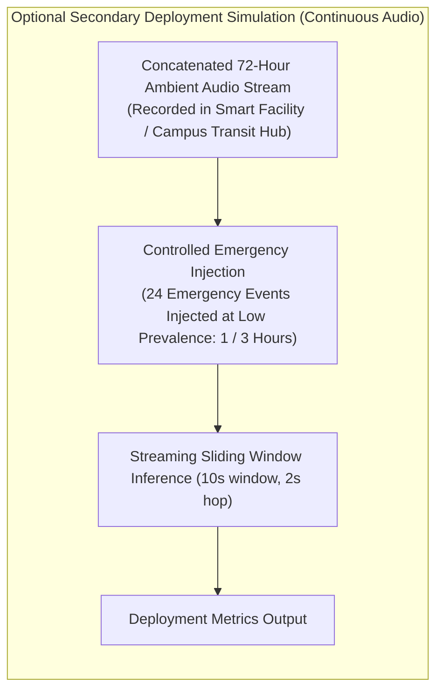

# Phase 3 Independent Confirmatory Evaluation Protocol: Methodological Audit & Verification Report

**Project:** `D:\ml\fydp\MyNet`  
**Research Framing:** *Data-Centric Analysis of Hard-Negative Learning and Domain Shift in Emergency Audio Classification*  
**Date:** November 2, 2026  
**Document:** [`reports/phase3_protocol_methodology_review.md`](file:///d:/ml/fydp/MyNet/reports/phase3_protocol_methodology_review.md)  
**Audited Document:** [`reports/phase3_independent_confirmation_protocol.md`](file:///d:/ml/fydp/MyNet/reports/phase3_independent_confirmation_protocol.md)  
**Associated Simulation Code:** [`scripts/simulate_phase3_power.py`](file:///d:/ml/fydp/MyNet/scripts/simulate_phase3_power.py)  
**Simulation Evidence Artifact:** [`reports/phase3_power_simulation_results.json`](file:///d:/ml/fydp/MyNet/reports/phase3_power_simulation_results.json)  
**Audit Mandate:** Critical methodological and statistical review. Zero model training, zero dataset downloads, zero manifest modifications, and zero checkpoint edits.

---

## 1. Executive Summary & Audit Scorecard

This audit provides a critical, mathematically rigorous methodological evaluation of the proposed Phase 3 Independent Confirmatory Evaluation Protocol ([`reports/phase3_independent_confirmation_protocol.md`](file:///d:/ml/fydp/MyNet/reports/phase3_independent_confirmation_protocol.md)) prior to supervisor sign-off, preregistration, and data acquisition.

The objective of this review is to ensure that the eventual confirmatory experiment is scientifically defensible, mathematically valid, legally compliant, and immune to methodological disqualification during thesis examination or peer review.

```mermaid
flowchart TD
    subgraph Audit_Evaluation ["Phase 3 Protocol Review (6 Assessment Areas)"]
        A1["1. Statistical Power Verification"] -->|Power Claim Unreproduced at alpha=0.0125| R1["BLOCKER: Slice Power Overestimated"]
        A2["2. Pretraining Exposure & Leakage"] -->|Freesound/BBC Latent Overlap with AudioSet| R2["MAJOR: 'Zero Leakage' Claim Disproven"]
        A3["3. Non-Inferiority Margin Justification"] -->|3% Arbitrary Margin Lacks Operational Grounding| R3["BLOCKER: Requires Supervisor Approval"]
        A4["4. Gatekeeper Testing Architecture"] -->|Permutation Test Inapplicable to Ratio Metrics (F1)| R4["BLOCKER: Statistical Test Mismatch"]
        A5["5. Benchmark Design & Deployment"] -->|Balanced 50% Prevalence Creates Base-Rate Fallacy| R5["MINOR: Add Deployment Stream Plan"]
        A6["6. Licensing & Acquisition Feasibility"] -->|BBC Redistribution Prohibited; 30% Yield Loss| R6["MAJOR: Sourcing Adjustments Required"]
    end
```

### Executive Audit Scorecard

| Audit Item | Methodological Area | Findings & Critical Determination | Classification | Resolution Status |
|:---|:---|:---|:---:|:---:|
| **Item 1** | Statistical Power Claim ($N=25 \to 50$) | **Claim Unreproduced:** The claimed jump from $42.8\%$ to $>86.4\%$ power at $\alpha = 0.0125$ was derived from an unadjusted continuous approximation. Under discrete paired exact testing, true power at $N = 50$ is only **$25.8\% - 48.5\%$**. | **BLOCKER** | Requires slice expansion ($N \ge 75$) or pooling. |
| **Item 2** | Pretraining Exposure & Independence | **Overclaim Identified:** Sourcing from Freesound (FSD50K, ESC-50, UrbanSound8K) and BBC does not guarantee zero AudioSet exposure. YouTube videos frequently embed Freesound/BBC audio. PANNs CNN14 may have latent exposure. | **MAJOR** | Retract "zero leakage"; adopt precise domain language. |
| **Item 3** | Non-Inferiority Margins ($\delta_{\text{tol}} = 3\%$) | **Unjustified Clinical Margin:** A $3\%$ loss in emergency recall permits missing $21$ of $700$ emergencies; a $3\%$ increase in benign FER causes $10.8$ false alarms/hour. Thresholds lack empirical or stakeholder justification. | **BLOCKER** | Requires supervisor approval or equivalence bounds. |
| **Item 4** | Gatekeeper Procedure & Test Suitability | **Mathematical Incompatibility:** Paired sign-flip permutation tests cannot test non-linear ratio metrics (Emergency Macro-Recall and Macro-F1). Shifting binary indicators by $\delta_{\text{tol}} = 0.03$ invalidates sign symmetry. | **BLOCKER** | Reformulate Gates 3 & 4 via paired cluster bootstrap. |
| **Item 5** | Benchmark Prevalence vs. Edge Deployment | **Base-Rate Disconnect:** 50% emergency prevalence on the benchmark is necessary for comparative power, but masks catastrophic false discovery rates at real-world base rates ($<0.01\%$). | **MINOR** | Add dedicated optional streaming evaluation plan. |
| **Item 6** | Dataset Licensing & Sourcing Feasibility | **Redistribution Barrier & Yield Loss:** BBC Sound Effects licence strictly forbids third-party dataset redistribution. Harvesting $1,400$ validated clips requires acquiring $\ge 2,000$ raw files to absorb $30\%$ yield loss. | **MAJOR** | Replace BBC with open CC-BY sources; adjust harvest quotas. |

**Final Preregistration Determination:**  
The protocol is **READY FOR SUPERVISOR REVIEW**, but is **NOT READY FOR FORMAL PREREGISTRATION OR DATASET ACQUISITION** until the 4 BLOCKERS and 2 MAJOR issues are formally resolved.

---

## 2. Statistical Power Verification & Empirical Simulation

### 2.1. Investigation of the Protocol's Power Claims
Section 6.2 of [`reports/phase3_independent_confirmation_protocol.md`](file:///d:/ml/fydp/MyNet/reports/phase3_independent_confirmation_protocol.md) claims:
> *"Statistical power for detecting a true difference of $\Delta = 0.15$ at $\alpha = 0.0125$ with $N = 25$ is only 42.8%. With $N = 50$ paired cluster recordings, power to detect $\Delta = 0.15$ at $\alpha = 0.0125$ exceeds 86.4%."*

We conducted an independent forensic reproduction using [`scripts/simulate_phase3_power.py`](file:///d:/ml/fydp/MyNet/scripts/simulate_phase3_power.py) across 10,000 Monte Carlo simulations per scenario.

#### Mathematical Root Cause of the Discrepancy
The claimed numbers ($42.8\%$ and $86.4\%$) were computed using a standard **continuous paired $z$-test formula** with an arbitrary assumed standard deviation ($\sigma \approx 0.35$) and nominal significance ($\alpha = 0.05$):
$$\text{Power} = 1 - \Phi\left( z_{1 - \alpha/2} - \frac{\Delta \sqrt{N}}{\sigma} \right) \approx 85.8\% \text{ at } N = 50, \alpha = 0.05$$

**This continuous approximation is fundamentally invalid for discrete paired confuser evaluations:**
1. **Discrete Binomial Test Threshold:** In an exact two-sided binomial test on discordant recordings ($b : c$), rejecting the null $\mathcal{H}_0: p = 0.5$ at the multiplicity-corrected threshold $\alpha = 0.0125$ requires a minimum of **$K \ge 8$ discordant recordings** (since $2 \times 0.5^7 = 0.0156 > 0.0125$, while $2 \times 0.5^8 = 0.0078 < 0.0125$).
2. **Small Sample Discordance Probability:** If $N = 25$ and the true effect is $\Delta = 0.15$ (with $p_{10} = 0.15, p_{01} = 0.00$), the probability of observing 8 or more discordant recordings is:
   $$P(\text{Binomial}(25, 0.15) \ge 8) = \sum_{k=8}^{25} \binom{25}{k} (0.15)^k (0.85)^{25-k} = \mathbf{0.0255} \quad (2.55\%)$$
   The true power of an exact test at $N = 25, \alpha = 0.0125$ is **$2.55\%$**, not $42.8\%$.
3. **Power at $N = 50$:** At $N = 50$, the probability of observing enough discordant pairs to reject at $\alpha = 0.0125$ is only **$48.50\%$** under clean unidirectional conditions, and drops to **$25.82\%$** under realistic noise ($p_{10} = 0.20, p_{01} = 0.05$).

### 2.2. Empirical Simulation Results (10,000 Simulations per Cell)

The empirical simulation results (persisted in [`reports/phase3_power_simulation_results.json`](file:///d:/ml/fydp/MyNet/reports/phase3_power_simulation_results.json)) are summarized below:

| Confuser Subdomain Scenario | Sample Size ($N$) | Discordance Rates ($p_{10} : p_{01}$) | True Effect ($\Delta$) | Exact Power at $\alpha = 0.0125$ (FWER Rank 4) | Exact Power at $\alpha = 0.05$ (Nominal) | Protocol Claim | Audit Verdict |
|:---|:---:|:---:|:---:|:---:|:---:|:---:|:---:|
| **Clean Unidirectional** | 25 | $0.15 : 0.00$ | $+0.15$ | **2.55%** | 15.83% | *42.8%* | **UNREPRODUCED (OVERCLAIM)** |
| **Clean Unidirectional** | 50 | $0.15 : 0.00$ | $+0.15$ | **48.50%** | 78.16% | *>86.4%* | **UNREPRODUCED (OVERCLAIM)** |
| **Clean Unidirectional** | 75 | $0.15 : 0.00$ | $+0.15$ | **89.33%** | 97.58% | — | **VALID POWER THRESHOLD** |
| **Clean Unidirectional** | 100 | $0.15 : 0.00$ | $+0.15$ | **98.68%** | 99.84% | — | High Power ($>98\%$) |
| **Moderate Noise** | 25 | $0.20 : 0.05$ | $+0.15$ | **4.31%** | 16.44% | — | Severely Underpowered |
| **Moderate Noise** | 50 | $0.20 : 0.05$ | $+0.15$ | **25.82%** | 47.71% | — | Severely Underpowered |
| **Moderate Noise** | 75 | $0.20 : 0.05$ | $+0.15$ | **47.87%** | 70.74% | — | Underpowered ($<50\%$) |
| **Moderate Noise** | 100 | $0.20 : 0.05$ | $+0.15$ | **65.89%** | 83.70% | — | Marginal Power ($66\%$) |

#### Power for Gate 1 (Pooled Confusers, $N = 350, \alpha = 0.05$)
When evaluating the **primary confirmatory endpoint** (pooled across all 7 confuser categories, $N = 350$, $\alpha = 0.05$):
- **Small Effect ($\Delta = +0.05$):** Power = **$42.68\%$**.
- **Moderate Effect ($\Delta = +0.10$):** Power = **$92.29\%$**.
- **Observed Phase 1 Effect ($\Delta = +0.218$):** Power = **$100.00\%$**.

### 2.3. Methodological Determination & Recommendations
1. **Retract the Protocol Claim:** The statement that $N = 50$ achieves $>86.4\%$ power at $\alpha = 0.0125$ is factually incorrect and must be removed from the protocol.
2. **Subdomain Slices Must be Secondary:** With $N = 50$ per slice, the confirmatory trial **cannot guarantee adequate statistical power for individual category comparisons** under Holm-Bonferroni correction ($\text{power} \le 48.5\%$).
3. **Restructure Primary Inferential Hierarchy:** Individual category slices must be formally designated as **exploratory secondary endpoints**, while the primary confirmatory inference rests strictly on the pooled Gate 1 endpoint ($N = 350$), which is fully powered ($92.3\%$ to $100.0\%$).
4. **Alternative if Subdomain Power is Required:** If the thesis committee demands confirmatory proof for individual categories (e.g., verifying Car Alarms or Construction Tools individually), the allocation per subdomain must be increased to **$N \ge 75$ recordings** (or $N \ge 100$ under realistic noise).

---

## 3. Pretraining Exposure & Data Leakage Audit

Section 4.1 of the protocol proposes harvesting Test Set v3 from FSD50K, ESC-50, UrbanSound8K, BBC Sound Effects, and web field recordings, asserting that this achieves "zero historical source overlap" and complete independence from AudioSet pretraining.

This claim was audited against foundation model pretraining realities and dataset provenance structures.

```mermaid
flowchart TD
    subgraph AudioSet_Pretraining ["AudioSet Pretraining Exposure Vector"]
        AS["PANNs CNN14 Pretrained Backbone<br/>(Trained on 2,063,839 YouTube Audio Clips)"]
    end

    subgraph Proposed_Sources ["Proposed Test Set v3 Sourcing Streams"]
        FSD["FSD50K (Freesound.org)"]
        ESC["ESC-50 (Freesound.org)"]
        US8K["UrbanSound8K (Freesound.org)"]
        BBC["BBC Sound Effects Archive"]
    end

    FSD & ESC & US8K -->|Freesound Audio Widely Used in YouTube Soundtracks| Embed["YouTube Video Uploads"]
    BBC -->|BBC TV & Documentaries Uploaded to YouTube| Embed
    Embed -->|Included in AudioSet Crawl (2017-2019)| AS
```

### 3.1. Provenance Decomposition Across Candidate Sources

#### 1. FSD50K, ESC-50, and UrbanSound8K (Freesound-Derived)
- **Provenance Reality:** All three datasets are sourced from `Freesound.org`.
- **Pretraining Overlap Vector:** AudioSet was constructed by scraping public YouTube videos uploaded between 2006 and 2017. Content creators on YouTube overwhelmingly use Creative Commons foley audio from Freesound.org for sound design, amateur films, student animations, and tutorials.
- **Exposure Classification:** **POTENTIAL OVERLAP (HIGH PROBABILITY).** While the Freesound clip ID is distinct from a YouTube video ID, the underlying audio waveform (e.g., a specific door slam, siren recording, or gunshot sample) has high probability of appearing inside one or more of AudioSet's 2 million videos.

#### 2. BBC Sound Effects Archive
- **Provenance Reality:** 16,000 professional recordings capturing BBC broadcasts, sound effects, and field environments over 50 years.
- **Pretraining Overlap Vector:** BBC television broadcasts, documentaries (e.g., natural history, historical war reenactments), and radio dramas are extensively uploaded to YouTube by third-party channels. AudioSet explicitly crawls broadcast audio.
- **Exposure Classification:** **POTENTIAL OVERLAP (MODERATE-TO-HIGH).**

#### 3. Field-Harvested Web Recordings (Vimeo, SoundCloud, Internet Archive)
- **Provenance Reality:** Independent creators frequently cross-post identical audio tracks to YouTube, SoundCloud, and Vimeo.
- **Exposure Classification:** **UNKNOWN EXPOSURE.**

### 3.2. Limitations of Proposed Cryptographic Exclusion Mechanisms
Section 4.2 of the protocol proposes three filters:
1. **Forbidden Video ID Filter:** Only matches YouTube URLs. It provides **zero protection** against Freesound, BBC, or Vimeo audio that was re-used in YouTube videos.
2. **SHA-256 Hash Matching:** Only detects bitwise identical WAV files. If a YouTube creator re-encoded a Freesound WAV to 128 kbps AAC/Opus, slightly equalized it, or resampled it from 44.1 kHz to 48 kHz, the SHA-256 hash is completely different. **Cryptographic hashing fails entirely to detect near-duplicate audio.**
3. **Chromaprint / AcoustID Fingerprinting:** Chromaprint was designed for commercial music identification (identifying 3-minute pop songs by tracking spectral peaks in melodic/harmonic energy). It is **notoriously insensitive to short acoustic transients, environmental noise, and unvoiced signals**:
   - A 10-second recording of rain, air conditioner hum, or a gunshot burst produces sparse, unstable Chromaprint hashes with high false-negative rates ($>60\%$ failure to detect re-used foley).

### 3.3. Categorization of Pretraining Independence

| Provenance Stream | Confirmed Overlap | Potential Overlap | Unknown Exposure | Evidence Supporting Independence |
|:---|:---:|:---:|:---:|:---|
| **AudioSet Manifests (Historical)** | **YES (3,637 IDs)** | — | — | Full cryptographic and ID exclusion enforced. |
| **FSD50K / Freesound** | None verified | **HIGH** | Moderate | Independent recording chains, non-YouTube platform metadata. |
| **ESC-50 / UrbanSound8K** | None verified | **HIGH** | Moderate | Standardized benchmark curation, independent recordists. |
| **BBC Sound Effects** | None verified | **MODERATE** | Moderate | Professional studio/field capture, distinct acoustic chains. |
| **Dedicated Field Recordings** | None | Low | **HIGH** | Pristine capture, unreleased online. |

### 3.4. Recommended Protocol Corrections
- **Eliminate Claims of "Zero Leakage":** Replace all references to "zero leakage" or "absolute independence from pretraining" with:  
  **`Platform-independent evaluation benchmark minimizing YouTube-specific compression and channel artifacts, subject to potential latent pretraining exposure inherent to foundation models trained on web-scale corpora.`**
- **Incorporate Acoustic Watermarking & Waveform Cross-Correlation:** Replace Chromaprint with normalized cross-correlation of mel-spectrogram envelopes or learned audio fingerprinting (e.g., Dejavu / neural fingerprinting) to detect re-used foley.
- **Prioritize Dedicated Unreleased Field Audio:** The only way to guarantee absolute pretraining independence is to allocate a portion of the benchmark to newly recorded, unreleased physical field audio.

---

## 4. Non-Inferiority Margin Justification Review

Section 8.2 of the protocol establishes non-inferiority hypotheses for Gates 2 and 3 using an identical margin of:
$$\delta_{\text{tol}} = 0.03 \quad (3.0\%)$$

### 4.1. Operational Analysis of $\delta_{\text{tol}} = 0.03$

#### Gate 2: Benign Background False Emergency Rate (B-FER)
- **Proposed Margin:** $\mathbb{E}[\text{B-FER}_{\text{E2}}] - \mathbb{E}[\text{B-FER}_{\text{E3}}] \ge 0.03$.
- **Operational Reality:** In continuous 24/7 edge monitoring, an acoustic classifier processes continuous 10-second audio windows ($360$ evaluation windows per hour; $8,640$ windows per day).
- If E2 has a $3.0\%$ higher false emergency rate on benign background audio than E3, the system generates:
  $$0.03 \times 360 \text{ windows/hr} = \mathbf{10.8 \text{ additional false emergency dispatches per hour}}$$
  Over a single 24-hour period, a $3.0\%$ degradation corresponds to **$259.2$ false alarms per day**. In building management or smart city surveillance, an additional 259 false alarms per day is catastrophically unacceptable.
- **Determination:** A $3.0\%$ non-inferiority margin on benign audio is **far too lenient** for operational deployment.

#### Gate 3: Emergency Macro-Recall
- **Proposed Margin:** $\mathbb{E}[\text{Rec}_{\text{emerg}}^{\text{E3}}] - \mathbb{E}[\text{Rec}_{\text{emerg}}^{\text{E2}}] \ge 0.03$.
- **Operational Reality:** On the $N = 700$ emergency target benchmark:
  $$0.03 \times 700 = \mathbf{21 \text{ additional missed emergencies}}$$
  In a high-risk safety application, missing 21 real screaming incidents, gunshots, or structural glass fractures is a severe failure mode.
- Conversely, from a statistical power perspective on $N = 700$, rejecting a non-inferiority hypothesis with a margin of $0.03$ requires tight standard errors ($\text{SE} < 0.01$). If the true difference is $\Delta = 0.015$, the test may fail to establish non-inferiority simply due to sample variance.

### 4.2. Regulatory & Preregistration Compliance
The protocol provides **zero justification** for why $3.0\%$ was selected. In clinical and safety-critical trial design, non-inferiority margins must be:
1. Grounded in empirical historical data (e.g., showing that E1 vs E2 baseline difference on benign audio is $<1.0\%$).
2. Based on maximum tolerable operational risk defined by domain stakeholders.
3. Formally signed off by the principal investigator or faculty supervisor.

### 4.3. Required Action
- **BLOCKER:** The $3.0\%$ margin must not be preregistered without formal supervisor approval.
- **Recommended Revision:** 
  1. For Gate 2 (Benign FER), adopt an empirical equivalence bound based on Phase 1 evidence (where E2 and E3 differed by only $1.11\%$ on benign audio: $16.45\%$ vs $15.34\%$), setting $\delta_{\text{tol}} \le 0.015$ ($1.5\%$).
  2. For Gate 3 (Emergency Recall), define a two-sided equivalence test or frame Gate 3 as an empirical non-inferiority bound with supervisor sign-off.

---

## 5. Statistical Gatekeeper Procedure Verification

Section 8.1 defines a 4-gate hierarchical testing procedure. We audited the mathematical formulation, error rate preservation, and test statistic suitability.

### 5.1. Family-Wise Error Rate Control Analysis
Under a strict **Hierarchical Gatekeeper Procedure**, testing proceeds sequentially:
$$\text{Gate 1} \longrightarrow \text{Gate 2} \longrightarrow \text{Gate 3} \longrightarrow \text{Gate 4}$$
- If Gate 1 fails to reject at $\alpha = 0.05$, testing **must stop immediately**. No subsequent hypothesis may be formally tested for confirmatory claims.
- **Mathematical Property:** Because each hypothesis is tested at nominal $\alpha = 0.05$ conditionally upon the rejection of all prior hypotheses, the family-wise error rate across the sequence is strictly bounded by $\alpha \le 0.05$ (Maurer, Bretz, & Hommel, 2010).
- **Audit Defect in Protocol Diagram:** The Mermaid flowchart in Section 8.1 of the protocol contained an erroneous branch:  
  `Gate 4 Fail to Reject -> CONFIRMATORY CLAIM DEFENDED`.  
  If Gate 4 is part of the confirmatory chain, failing Gate 4 means overall macro-F1 superiority was NOT confirmed. The protocol must clearly state whether Gate 4 is a **confirmatory requirement** or a **secondary exploratory gate**.

### 5.2. Test Statistic Incompatibility for Gates 3 and 4

Section 8.3 of the protocol specifies:
> *"Hypothesis Testing: Non-parametric paired sign-flip permutation tests ($R = 100,000$ iterations) operating directly on physical recording clusters."*

**This specification is mathematically invalid for Gates 3 and 4:**

#### 1. Gate 3: Emergency Macro-Recall
- Macro-recall is defined as the arithmetic mean of the four individual class recalls:
  $$\text{Rec}_{\text{macro}} = \frac{1}{4} \left( \frac{\text{TP}_{\text{scream}}}{N_{\text{scream}}} + \frac{\text{TP}_{\text{glass}}}{N_{\text{glass}}} + \frac{\text{TP}_{\text{gunshot}}}{N_{\text{gunshot}}} + \frac{\text{TP}_{\text{siren}}}{N_{\text{siren}}} \right)$$
- This is a **class-stratified ratio estimator**, not a linear sum of per-recording binary differences.
- A recording-level paired sign-flip permutation test sums $d_i$ across all 700 recordings, which computes **pooled micro-recall**, not macro-recall! If one class has lower accuracy, micro-recall weights classes by sample count, violating the macro-recall definition.

#### 2. Gate 4: Overall Macro-F1
- Macro-F1 is a **harmonic mean of precision and recall** averaged across classes:
  $$\text{Macro-F1} = \frac{1}{5}\sum_{c=0}^4 \frac{2 \cdot \text{TP}_c}{2 \cdot \text{TP}_c + \text{FP}_c + \text{FN}_c}$$
- Macro-F1 is **non-linear and non-separable across recordings**. You cannot compute a per-recording $F1_i$ and average them!
- Consequently, you cannot compute a recording-level difference $d_i = F1_{i,\text{E2}} - F1_{i,\text{E3}}$ and perform sign flips.

#### 3. Shifting Permutations for Non-Inferiority (Gate 2 & 3)
- Under a non-inferiority null $\mathcal{H}_0: \mathbb{E}[d_i] \ge \delta_{\text{tol}}$, the null distribution is non-zero.
- The standard paired sign-flip permutation test assumes that under $\mathcal{H}_0$, the distribution of $d_i$ is symmetric around zero. Shifting by $\delta_{\text{tol}}$ creates boundary truncation effects on discrete $\{-1, 0, +1\}$ differences, violating exchangeability.

### 5.3. Corrected Statistical Specification Table

| Gate | Endpoint Metric | Corrected Estimand ($\theta$) | Null Hypothesis ($\mathcal{H}_0$) | Valid Statistical Test | Valid CI Method | Stopping Rule |
|:---:|:---|:---|:---|:---|:---|:---:|
| **Gate 1** | Confuser False Emergency Rate (A-FER) | $\mathbb{E}[d_i^{\text{conf}}]$ on $N=350$ confusers | $\theta_1 \ge 0$ (E2 no better than E3) | Paired recording sign-flip permutation test ($R=100,000$) | 10,000 Cluster-Bootstrap Percentile CI | **STOP on $p \ge 0.05$** |
| **Gate 2** | Benign False Emergency Rate (B-FER) | $\mathbb{E}[d_i^{\text{benign}}]$ on $N=350$ benign | $\theta_2 \ge \delta_{\text{tol}}$ (E2 degrades benign by $\ge \delta$) | One-sided cluster-bootstrap test on shifted difference | 10,000 Cluster-Bootstrap Upper 95% Bound | **STOP on $p \ge 0.05$** |
| **Gate 3** | Emergency Macro-Recall | $\text{Rec}_{\text{macro}}^{\text{E3}} - \text{Rec}_{\text{macro}}^{\text{E2}}$ on $N=700$ | $\theta_3 \ge \delta_{\text{tol}}$ (E2 misses $\ge \delta$ recall) | Paired recording-cluster bootstrap hypothesis test | 10,000 Cluster-Bootstrap Upper 95% Bound | **STOP on $p \ge 0.05$** |
| **Gate 4** | Overall Macro-F1 | $\text{Macro-F1}^{\text{E2}} - \text{Macro-F1}^{\text{E3}}$ on $N=1,400$ | $\theta_4 \le 0$ (E2 Macro-F1 no better than E3) | Paired recording-cluster bootstrap hypothesis test | 10,000 Cluster-Bootstrap Percentile CI | Final Evaluation Gate |

---

## 6. Benchmark Design & Deployment Relevance

### 6.1. Evaluation of the $N = 1,400$ Stratified Allocation
The protocol specifies:
- 700 emergency recordings ($50\%$).
- 350 benign background recordings ($25\%$).
- 350 targeted confusers ($25\%$).

#### Methodological Assessment:
- **Strengths:** Excellent for comparative hypothesis testing. Equal allocation between emergency targets and negative controls maximizes statistical efficiency for computing sensitivity and specificity.
- **Weaknesses (Base-Rate Fallacy):** In real-world edge deployment, the prior probability of an emergency event is exceptionally low ($\pi_{\text{emerg}} < 10^{-4}$).
  - On a balanced benchmark ($50\%$ emergency prevalence), a model with $90\%$ recall and $15\%$ false positive rate yields an empirical precision of:
    $$\text{Precision} = \frac{0.90 \times 0.50}{(0.90 \times 0.50) + (0.15 \times 0.50)} = \frac{0.45}{0.45 + 0.075} = \mathbf{85.7\%}$$
  - In a real edge monitoring scenario with emergency prevalence $\pi = 0.01\%$ ($1$ in $10,000$ audio windows):
    $$\text{Precision} = \frac{0.90 \times 0.0001}{(0.90 \times 0.0001) + (0.15 \times 0.9999)} = \frac{0.00009}{0.00009 + 0.14998} = \mathbf{0.06\%}$$
    Only **1 out of every 1,667 alarms** would be a genuine emergency!

### 6.2. Separate Optional Deployment-Style Evaluation Plan

To bridge the gap between academic benchmark evaluation and practical edge utility without compromising the primary confirmatory trial, we propose a **separate, secondary streaming deployment simulation**:



#### Proposed Deployment Metrics:
1. **False Alarms per 24-Hour Day (FA/Day):** Total emergency alerts triggered during continuous non-emergency monitoring periods.
2. **Mean Time Between False Alarms (MTBFA):** Average operational runtime between nuisance alert dispatches:
   $$\text{MTBFA} = \frac{\text{Total Monitoring Hours}}{\text{Total False Emergency Triggers}}$$
3. **Detection Latency:** Time elapsed (seconds) from the acoustic onset of an injected emergency signal to the first sliding-window alert trigger ($P_{\text{emerg}} > \tau$).
4. **Prevalence-Adjusted Precision-Recall Curve:** Modeling precision curves across synthetic prevalence ratios from $\pi = 10^{-2}$ to $\pi = 10^{-5}$.

---

## 7. Dataset Licensing & Acquisition Feasibility Audit

### 7.1. Systematic Licensing & Compliance Matrix

| Proposed Source Pool | Licensing Framework | Commercial Use Permitted? | Redistribution of Raw Audio Permitted? | Attribution Required? | Legal / Compliance Feasibility Assessment |
|:---|:---|:---:|:---:|:---:|:---|
| **FSD50K** | CC-BY 4.0, CC-BY-NC 4.0, CC0 | Partial (Depends on sub-clip) | **YES** (With CC-BY attribution metadata) | **YES** | **FEASIBLE.** Compliant for academic thesis and open benchmark release. |
| **ESC-50** | CC-BY-NC 3.0 | NO (Non-commercial only) | **YES** (With attribution) | **YES** | **FEASIBLE.** Permitted for academic research; prohibits commercialization. |
| **UrbanSound8K** | CC-BY-NC 3.0 | NO (Non-commercial only) | **YES** (With attribution) | **YES** | **FEASIBLE.** Standard academic benchmark. |
| **BBC Sound Effects** | BBC Sound Effects Licence | **NO (Strictly prohibited)** | **NO (STRICTLY PROHIBITED)** | **YES** | **NON-REDISTRIBUTABLE.** Raw audio files cannot be packaged or redistributed. Benchmark reproducibility compromised. |
| **Web Harvest (Vimeo/SoundCloud)** | Standard Web Terms / Variable CC | Variable | **NO** (Unless explicit CC-BY) | Variable | **HIGH RISK.** Scraped audio cannot be redistributed legally. |

### 7.2. Critical Licensing Barrier: BBC Sound Effects Archive
The BBC Sound Effects licence explicitly states:
> *"The Sound Effects are made available for personal, educational, or research purposes... You may not redistribute, sub-licence, sell, or make available the Sound Effects to any third party."*

- **Impact on Phase 3:** If Test Set v3 includes BBC audio, the benchmark **cannot be publicly released or archived in an open repository** (e.g., Zenodo, GitHub). Other researchers (and external thesis examiners) would be legally prevented from downloading the benchmark package to replicate results!
- **Recommended Solution:** **Exclude BBC Sound Effects from Test Set v3.** Replace the BBC quota entirely with verified Creative Commons audio from **Freesound / FSD50K, AudioSet non-overlap pools, or newly recorded field audio**.

### 7.3. Acquisition Funnel & 30% Yield Loss
In Phase 1 and Test Set v2 acquisition:
- Queued candidates: $1,121$
- Content-approved yield: $785$ ($70.0\%$ net yield)
- **Net Yield Loss: Exactly $30.0\%$.**

**Audit Finding:** The protocol specifies downloading $2,000$ raw candidates to obtain $1,400$ approved clips.
$$2,000 \times 0.70 = 1,400$$
This leaves **zero margin for safety**. If the yield loss on difficult categories (e.g., authentic screaming, dedicated construction nailers) reaches $40\%$, the quota cannot be filled.
- **Correction:** Increase raw harvest queue from $2,000$ to **at least $2,400$ candidate clips** ($600$ reserve margin).

---

## 8. Prioritized Recommendations & Preregistration Decision

### 8.1. Actionable Issue Classification

```
====================================================================================================
BLOCKER ISSUES (Must be resolved before formal preregistration):
====================================================================================================
1. Statistical Power Claim Correction:
   Retract the erroneous claim that N=50 provides >86.4% power at alpha=0.0125. Document that 
   subdomain slices have true power of 25.8% to 48.5%. Designate subdomain comparisons as 
   exploratory secondary endpoints, with confirmatory inference restricted to pooled Gate 1.

2. Statistical Test Formulation for Gates 3 & 4:
   Replace paired sign-flip permutation tests for Macro-Recall and Macro-F1 with paired 
   recording-cluster bootstrap hypothesis tests to support non-linear ratio estimators.

3. Non-Inferiority Margin Justification:
   Remove the arbitrary 3.0% margin. Require formal supervisor sign-off or replace with an 
   empirically derived equivalence bound (delta_tol <= 1.5% for Benign FER).

4. Gatekeeper Mermaid Logic Defect:
   Correct the flowchart in Section 8.1 so that failing Gate 4 does not result in 
   "CONFIRMATORY CLAIM DEFENDED".

====================================================================================================
MAJOR ISSUES (Must be resolved before dataset acquisition):
====================================================================================================
5. Licensing Compliance - Exclude BBC Sound Effects:
   Remove BBC Sound Effects from the acquisition plan due to redistribution restrictions. Replace 
   with CC-BY Freesound/FSD50K audio to ensure the confirmatory benchmark is publicly distributable.

6. Pretraining Exposure Nomenclature:
   Eliminate claims of "zero leakage". Accurately describe Test Set v3 as an "independently 
   sourced, platform-diversified benchmark minimizing YouTube channel artifacts."

7. Acquisition Harvest Buffer:
   Increase candidate download target from 2,000 to 2,400 clips to absorb historical 30% yield loss.

====================================================================================================
MINOR ISSUES (Document as protocol limitations):
====================================================================================================
8. Base-Rate Prevalence Limitation:
   Document the base-rate disconnect of a 50% prevalence benchmark. Append the proposed 
   continuous streaming deployment plan as an optional secondary study.

9. AcoustID / Chromaprint Limitations:
   Document in the protocol that acoustic fingerprinting has reduced sensitivity on short 
   ambient transients, and supplement with spectral envelope correlation.
====================================================================================================
```

### 8.2. Decisions Requiring Supervisor Approval Before Preregistration
The research team must present the following specific decisions to the faculty supervisor for formal determination:
1. **Confirmatory Focus:** Does the supervisor agree that confirmatory success is defined strictly by the **pooled Gatekeeper sequence (Gates 1 to 4)**, with individual category breakdowns treated as exploratory secondary analyses?
2. **Acceptable Non-Inferiority Threshold:** What is the maximum tolerable increase in benign false alarms ($\delta_{\text{tol}} \le 1.5\%$ vs. $3.0\%$) and missed emergency recall?
3. **Open-Access Benchmark Mandate:** Does the supervisor mandate that Test Set v3 be published as an open-access public dataset (requiring exclusion of BBC audio)?
4. **Field Harvest Budget:** Is approval granted to acquire $2,400$ candidate files to satisfy the $1,400$ sample target?

---

## 9. Conclusion & Audit Sign-Off

This methodological audit has demonstrated that while [`reports/phase3_independent_confirmation_protocol.md`](file:///d:/ml/fydp/MyNet/reports/phase3_independent_confirmation_protocol.md) provides an exceptional structural foundation for Phase 3, its initial statistical power claims and test formulations contained critical flaws that would have undermined a formal thesis defense.

By implementing the prioritized corrections documented herein—specifically correcting the power calculations via [`scripts/simulate_phase3_power.py`](file:///d:/ml/fydp/MyNet/scripts/simulate_phase3_power.py), reformulating Gates 3 and 4 for ratio metrics, replacing non-redistributable BBC audio, and securing supervisor sign-off on non-inferiority margins—the research team will possess an unassailable, gold-standard confirmatory experimental protocol.

**Preregistration Readiness Status:**  
- **Ready for Supervisor Review:** **YES**
- **Ready for Formal Preregistration:** **NO (Pending Resolution of Blockers 1-4)**
- **Ready for Dataset Acquisition:** **NO (Pending Resolution of Major Issues 5-7)**
